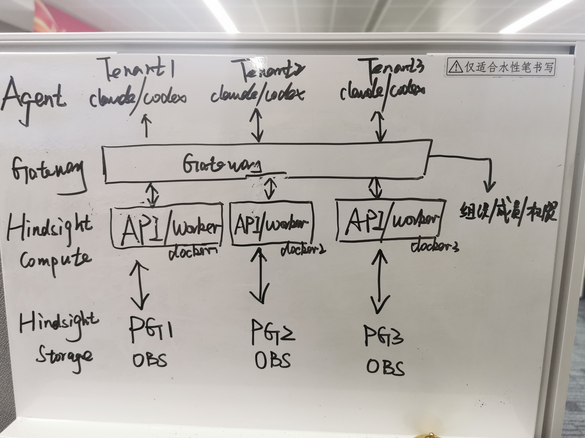
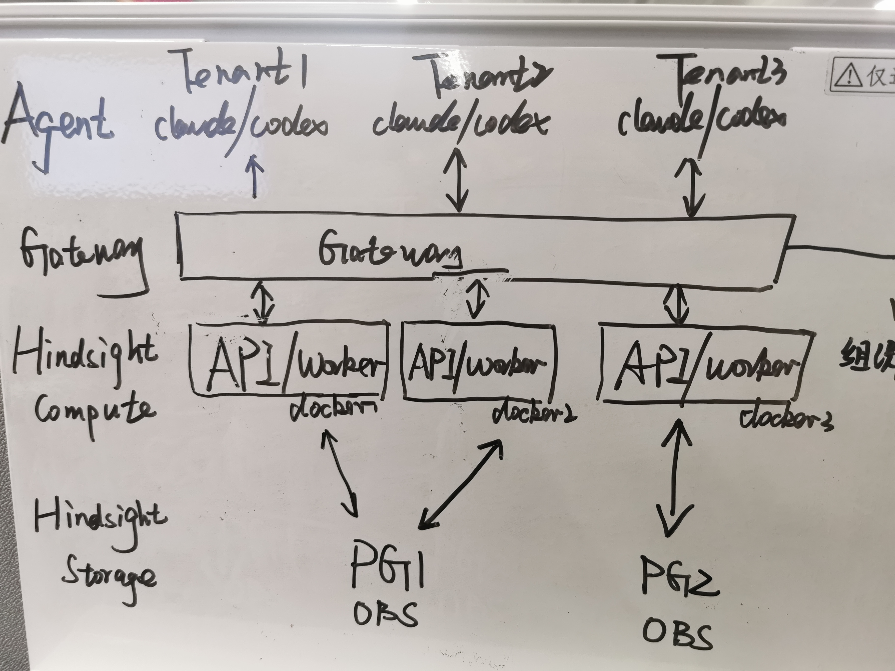
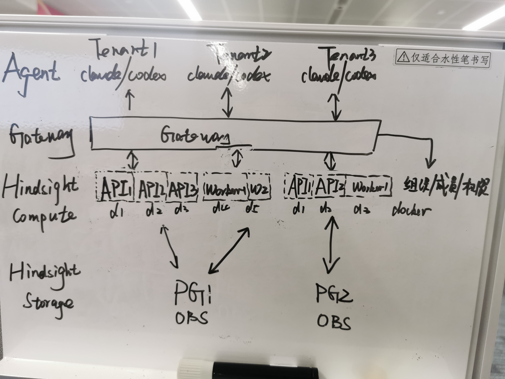
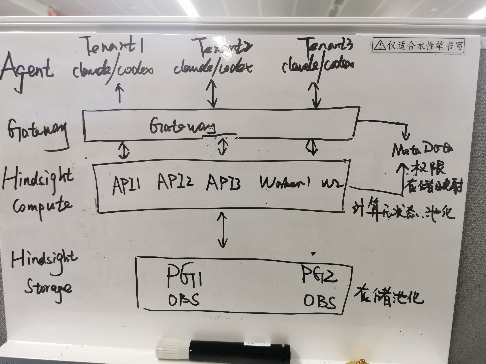

# Hindsight Architecture

日期：2026-10-07
评审基线：Hindsight `0.10.2`，源码 `f7dd3f4fd7420f7beec60c32c965e5e5cf7be066`
目标：基于 Hindsight、华为云 RDS PostgreSQL 和 OBS，实现华为云 ContextDB（Agent Memory & Knowledge Base）。

## 0. 文档复核结果与问题答复

### 0.1 本次如何修改文档

本次是在 `Hindsight Architecture.md` 中直接完成复核和修订，没有把评审结论写入 README。原来的四张方案图保留在第3章；文字说明已根据 Hindsight 0.10.2 源码、本地测试和商业 Cloud 实测结果修正。

具体内容位置如下：

| 用户问题 | 复核结论 | 详细位置 |
|---|---|---|
| 应拆成哪两个方案 | 短期采用共享 Data Cell；长期采用多个固定 Data Cell | 第1、4、5、7章 |
| 方案2能否长期演进 | 可作为独享版或早期验证模板；不适合作为共享版长期架构 | 第3.2节 |
| 除Gateway外，Hindsight是否都已具备 | 否。核心记忆数据面具备；Control Plane、运维面、Model Gateway、Workspace到PostgreSQL实例的分配与迁移等仍需建设 | 第3.2节能力表 |
| 方案3比方案2的优势 | 共享API/Worker资源、独立扩缩Worker、减少容器/连接池/模型缓存浪费 | 第3.3节 |
| 实现方案3要修改什么 | 开发华为Tenant/Validator Extension、Gateway、Control Plane和部署运维；不需要修改核心数据模型 | 第3.3节 |
| 方案4的优势 | 全局资源利用率高，可持续增加PG故障域 | 第3.4节 |
| 实现原方案4要修改什么 | 需要改造TenantContext、连接池、事务、Worker、Maintenance、迁移和文件存储，侵入很大 | 第3.4节 |
| 是否有比原方案4更优的实现 | 有。由Gateway选择固定Cell，Hindsight进程不动态切换PG | 第3.4、5章 |
| 商业共享版可能是什么形态 | 高可信推断为共享控制面和资源池化数据面；物理PG/schema/K8s粒度未公开 | 第5.2、5.5节 |
| 商业独享版可能是什么形态 | 推断为相同数据面镜像、一个客户独占资源单元；官方只确认Dedicated Infrastructure属于Enterprise | 第5.3、5.5节 |
| 方案3/4是否不利于跟随开源 | 修正后的方案3和多Cell方案基本不修改Hindsight核心代码；原方案4要求一个进程动态连接多个PostgreSQL实例，侵入很高 | 第6章 |

### 0.2 对原文的关键纠正

1. Hindsight API是耐久状态无关的，客户数据和异步任务状态在PG中；本地缓存和模型缓存不构成租户绑定。
2. 默认只有一个 `hindsight-api` 进程，其中包含内置Worker；独立Worker是官方支持的可选部署形态。
3. 多租户扩展点选择的是同一PostgreSQL实例中的schema，不支持根据每次请求动态选择PostgreSQL连接地址。
4. API不把任务直接发送给某个Worker。API写入PG任务队列，多个Worker自行竞争领取。
5. Maintenance是MemoryEngine内部循环，不是第三种原生部署进程。
6. OBS只能在兼容性验证通过后作为S3-compatible backend使用，不能根据配置名称直接认定已经兼容。
7. 商业Cloud的产品边界可以实测，内部容器、PG、对象存储和Kubernetes拓扑不能从公网证据确定。

## 1. 结论

四个原始方案中：

| 方案 | 判断 | 适用位置 |
|---|---|---|
| 方案1：每租户一套计算和 PG | 能工作，成本高 | 独享版、强隔离客户、故障兜底 |
| 方案2：每租户一个 Hindsight 容器，共享 PG | 能较快上线，但不是共享版长期形态 | 过渡方案、小规模内测 |
| 方案3：API/Worker 可扩展、PG 可共享 | 方向正确，但应改成“多个租户共享一个 Data Cell 的 API/Worker Pool” | **短期推荐方案** |
| 方案4：任意 API/Worker 动态访问任意 PG | 扩展能力强，但原图需要大范围修改 Hindsight | 不建议按原图实现 |

建议最终只保留两套架构：

1. **短期：单 Cell 或少量 Cell。** 每个 Cell 内共享 API Pool、Worker Pool、一个 RDS PG 和一套 OBS 配置；多个 Workspace 通过 PG schema 隔离。它基本使用 Hindsight 原生机制。
2. **长期：多 Data Cell。** 每个 Cell 仍是短期方案的完整复制，Gateway根据MetaPG中的Workspace到Cell分配关系，把Workspace路由到固定Cell。增加Cell即增加PostgreSQL容量，不让单个Hindsight进程动态连接任意PostgreSQL实例。

独享版不是第三套软件架构，而是长期架构中的一种资源分配方式：一个客户独占一个Cell，使用相同镜像、扩展和发布流程。

## 2. 原文中需要纠正的认识

### 2.1 Hindsight API 不是保存租户耐久状态的有状态节点

Hindsight 官方服务文档明确把 API 定义为 stateless，耐久状态保存在 PostgreSQL。源码中的 Bank、Memory、Document、Operation、Knowledge Page、Mental Model 和 Worker 任务状态均落在 PG。

API 进程确实存在本地缓存、连接池和可选的本地 Embedding/Rerank 模型缓存，但这些内容可以重建，不决定某个租户必须固定访问某个 API Pod。因此：

- 同一 Cell 中的任意健康 API Pod 都可以处理该 Cell 内任意租户的请求；
- API Pod 可以使用 Deployment 横向扩展；
- Worker 的任务认领状态在 PG，但 Worker ID 必须稳定。官方 Helm 使用 StatefulSet 部署独立 Worker；
- 本地模型缓存影响启动速度和资源占用，不构成客户数据状态。生产可把模型烘焙进镜像或使用外部推理服务。

### 2.2 默认部署不是“API进程 + Worker进程”两个进程

默认运行一个 `hindsight-api` 进程，API 内部启动 Worker loop。只有显式设置 `HINDSIGHT_API_WORKER_ENABLED=false` 并启动 `hindsight-worker`，才是两个独立进程/容器。

官方建议：开发和小型生产使用内置 Worker；高吞吐或长任务使用独立 Worker。商业 Cloud 实测 `/version` 返回 `worker=false`，说明其公网 API 没有运行内置 Worker，但不能据此得知 Worker 数量和编排拓扑。

### 2.3 Hindsight 已原生支持同一 PG 内多租户

`TenantExtension.authenticate()` 把请求身份转换为 `TenantContext(schema_name=...)`；所有核心表通过当前 schema 完整限定。`list_tenants()` 给 Worker 和 Maintenance 提供需要扫描的租户 schema。

当前仓库还提供两个外部扩展示例：

- `StaticKeysTenantExtension`：Key 到用户/schema 的静态映射；
- `SupabaseTenantExtension`：JWT 到用户/schema 的动态映射。

这证明“多个租户共享 Hindsight API/Worker 和同一个 PG、每租户一个 schema”是上游明确支持的形态。静态环境变量只适合演示，华为云需要实现自己的 `HuaweiTenantExtension`，从 Gateway 的可信身份和租户注册表得到 schema。

### 2.4 Hindsight 不原生支持每请求动态选择 PG

`TenantContext` 只返回 `schema_name`，不返回 `database_url`。`HINDSIGHT_API_DATABASE_URL`、文件存储类型和 bucket/endpoint 都是进程启动时的服务级配置。

因此原方案4中“任意 API/Worker 接受任意客户请求，然后动态选择 PG1/PG2”的能力不存在。要直接实现，需要改造连接池、事务、迁移、Worker 租户发现、Maintenance、配置缓存、文件存储和所有后台恢复路径，侵入很大。

### 2.5 OBS 不能在设计阶段直接写成“已经替换 S3”

Hindsight 的 `s3` backend 支持自定义 S3-compatible endpoint，也支持独立 `FileStorage` Extension。华为云应先验证 OBS 的签名、region、流式上传、批量删除、multipart 回收和 presigned URL 行为；通过后使用内置 S3 backend，否则实现 OBS FileStorage Extension。

当前源码的对象 key 为：

```text
tenants/{schema}/banks/{bank_id}/...
```

所以多个 schema 可以安全共享一个 bucket/prefix 空间。方案1若不同 PG 都使用默认 `public` schema，却共享同一个 OBS bucket，相同 Bank ID 会产生对象 key 冲突；必须使用不同 schema、不同 bucket，或额外租户前缀。

Hindsight Cloud 已开启文件上传和附件能力，但其物理后端没有公开，不能确认使用 AWS S3。

### 2.6 Maintenance 不是原生第三种独立部署实例

Hindsight 官方可独立运行的后端角色是 API 和 Worker；Web Control Plane 是管理界面。源码中的 `MaintenanceLoop` 由 `MemoryEngine` 启动，用于 operation/audit/trace 清理、Consolidation reconciliation、Mental Model定时刷新等维护工作，它不是一个名为 `hindsight-maintenance` 的独立进程入口。

首期不应自行增加 Maintenance Deployment。API/Worker按照上游行为运行维护循环，并依靠 PG锁和幂等机制协调。只有压测证明维护扫描明显干扰在线请求，而且上游提供或接受独立角色的通用改造时，再考虑拆分。

## 3. 四种原始方案评审

### 3.1 方案1：每租户独立计算、PG和OBS



方案能够工作，几乎不需要 Hindsight 内核改造。每个租户可以使用默认联合 Runtime，也可以按需拆分 API/Worker。

需要修正两点：

- “一台 ECS 放多个租户容器”属于主机共享，不等于云服务真正的弹性共享；每个租户仍有容器、连接池、模型缓存、监控和升级对象；
- 如果多个租户共享 OBS bucket，必须保证对象 key 中的 schema 唯一，不能让所有独立 PG 都使用 `public` schema。

它适合独享版或强隔离客户，不适合作为大量小客户的标准档。

### 3.2 方案2：每租户一个 Hindsight Runtime，共享 PG



实现方法是每个租户 Runtime 使用同一个 PostgreSQL 连接地址（包含主机、端口、数据库名和认证信息），但设置不同的 `HINDSIGHT_API_DATABASE_SCHEMA`。各 Runtime 只看到自己的 schema，OBS key 也带 schema 前缀。

#### 是否满足长期演进

**它可以长期保留为独享/隔离部署模板，不适合作为共享版的长期主架构。**

主要问题不是单个 Hindsight 节点保存了客户数据，而是每租户 Runtime 带来的运营成本：

- 每增加租户就增加 Deployment、连接池、模型缓存、监控、升级和故障对象；
- 单租户扩容需要把该租户从一个 Runtime 变为一组 Runtime，部署模型会逐渐变成方案3；
- 大量小租户会浪费 CPU、内存和 PG 连接；
- API 和内置 Worker 绑定扩缩，在线请求和后台任务互相影响；
- 租户配置分散在容器环境变量中，不适合控制面动态治理。

因此方案2适合在最早期验证和作为独享版模板，但共享版应直接采用修正后的方案3。

#### 除了 Gateway，Hindsight 是否已经具备其他能力

Hindsight 已经具备的是**记忆数据面**，不是完整云服务：

| 能力 | Hindsight 0.10.2 | 华为云仍需补充 |
|---|---|---|
| Retain / Recall / Reflect | 已具备 | API 产品合同、配额和SLO |
| Memory、Entity、关系、Observation | 已具备 | 产品级生命周期和效果度量 |
| Mental Model、Knowledge Page | 已具备 | 知识候选、人工审核、团队发布流程 |
| 文档、附件、导入导出 | 已具备 | OBS 兼容验证、租户容量和恢复流程 |
| PG schema 多租户 | 已具备扩展点 | Huawei TenantExtension、租户注册表 |
| API/Worker 分离和多 Worker claim | 已具备 | K8s部署、容量策略、稳定Worker ID |
| Bank 级读写校验、限流/计量 hook | 已具备 OperationValidator 扩展点 | IAM/ACL/Quota/Metering 的实际实现 |
| 健康检查、Prometheus metrics | 已具备基础能力 | 云监控、告警、审计和SLO运营 |
| 组织、成员、角色、Key生命周期 | 开源版没有 | Control Plane/Gateway |
| 用量、账单、账号安全、通知 | 开源版没有 | Control Plane |
| Workspace到多个PostgreSQL实例的分配和迁移 | 没有 | Control Plane/Gateway/Data Cell管理 |
| 租户公平调度和模型预算 | 不完整 | Gateway、Model Gateway、Validator |
| 备份恢复、升级编排和容灾 | 只有基础工具 | 云服务运维面 |

所以答案是：**并非除了 Gateway 之外都已经具备。** Hindsight 已具备核心记忆数据面，但华为云还需完成 **Cloud Control Plane、运维面和 Model Gateway**。此外，商业 Cloud 实测还比本地开源版多 scoped child Key、privacy receipt、security event 等接口，`/version` 也显示 Cloud 开启了 audit log；官方资料把完整 Memory Defense、SSO/RBAC 等列为 Enterprise 能力。这些能力不能当作开源内核现成能力。首期可按产品范围分别放入 Control Plane、独立 Extension，或明确延期，不需要把它们写进核心记忆算法。

### 3.3 方案3：API/Worker 集群、PG 可共享



方案3的 API/Worker 分离方向正确，但图中仍像是“每租户一组 API/Worker”。更优的共享版应该是：**多个租户共享一个 Data Cell 的 API Pool 和 Worker Pool**。

#### 相比方案2的优势

- API 副本处理 Cell 内所有租户，请求由 Service/LB 均衡，不再每租户维护容器；
- Worker 独立扩缩，Retain、文件解析、Consolidation和知识页刷新不会占用 API 资源；
- 小租户共享空闲 CPU、内存、模型连接和 PG 连接池，按量收费更可行；
- API、Worker 和扩展按 Cell 统一升级，版本数量受控；
- 大租户可以增加 Cell 内副本，或直接迁移到独享 Cell；
- Hindsight 原生 PG operation queue 和多 Worker claim 已解决任务分配，Gateway不需要调用 Worker。

#### 要做到方案3，需要哪些改动

不需要修改 Hindsight 核心数据模型，主要开发外围模块和扩展：

1. **HuaweiTenantExtension**
   - 校验 Gateway 签发的短期内部身份；
   - 将 Workspace/Tenant 映射为 PG schema；
   - `list_tenants()` 只返回本 Cell 分配的租户；
   - `get_tenant_config()` 提供允许的租户级配置。
2. **HuaweiOperationValidatorExtension**
   - Bank 读写权限、能力开关、配额预检查；
   - 记录 tenant/key/bank 维度计量和审计；
   - 模型或额度暂时不可用时对后台任务执行 defer。
3. **Control Plane 与 MetaPG**
   - Workspace、成员、Key、ACL、规格和租户注册；
   - `workspace -> cell -> schema` 分配关系；
   - schema provisioning、版本和生命周期状态。
4. **Gateway**
   - IAM/API Key 鉴权、租户和 Bank 授权；
   - 限流、幂等、Cell 路由、统一错误码；
   - 删除客户伪造的内部身份 Header。
5. **部署与运维**
   - API Deployment；
   - Worker StatefulSet和稳定 worker ID；
   - 固定的 RDS PostgreSQL 连接配置、OBS配置和模型配置；
   - 真实 PG/OBS、并发 Worker、强杀恢复和升级回归。

#### API/Worker 如何获得租户信息

环境变量保存的是 **Cell 级配置**，例如 PostgreSQL连接地址、OBS服务地址和Extension服务地址，不保存完整租户列表。

```text
在线请求：Gateway可信身份 -> TenantExtension.authenticate()
          -> tenant/schema -> 当前请求的schema上下文

后台任务：Worker -> TenantExtension.list_tenants()
          -> 本Cell的schema列表 -> 在各schema中claim PG任务
```

租户注册表应存于 MetaPG，并在 Extension 中做有界缓存。Worker没有原始客户端请求，因此不能依赖请求 Header发现租户。

#### 请求与任务究竟如何分发

```text
同步 Recall：Client -> Gateway -> Cell Service -> 任意健康 API Pod -> PG/模型

异步 Retain：Client -> Gateway -> Cell Service -> 任意健康 API Pod
                                      |
                                      `-> PG async_operations（pending）
                                                   |
                                  任意空闲 Worker --+-- claim one row
                                                   `-- FOR UPDATE SKIP LOCKED
```

Gateway只与 API Service交互，不选择 Worker，也不把 Retain请求直接发送给 Worker。多个 API Pod完全对等；多个 Worker也完全对等。Worker通过 PG队列领取任务，源码使用 `FOR UPDATE SKIP LOCKED` 避免同一任务被重复领取，并通过每类任务的 slot和 Bank轮转控制并发与基本公平性。

#### 单个 PG 会不会成为当前核心问题

对首期不是第一矛盾。模型调用时延、后台任务积压、成本和产品易用性通常更早暴露。先使用：

- RDS PG 规格和存储扩容；
- `HINDSIGHT_API_READ_DATABASE_URL` 把 Recall 查询送到只读副本；
- PgBouncer/连接配额；
- 小 Bank 延迟建向量索引，避免大量 Bank 的索引规划和锁表开销；
- 租户和 Bank 数量、PG CPU/IO/连接数、Worker backlog 的容量水位。

达到水位后增加 Data Cell。首期不为尚未出现的单租户跨 PG需求修改 Hindsight 内核。

### 3.4 方案4：全局无状态计算、动态多 PG



以下把用户问题“要做到方案3需要哪些改动”按上下文理解为“要做到方案4需要哪些改动”。

#### 优势

- 全局计算池利用率最高；
- 理论上任意请求可路由到任意 PG；
- PG 容量和故障域可以持续横向增加；
- 大租户可以使用多个计算节点，Workspace与Cell的分配调整更灵活。

#### 按原图实现需要的改动

原生 Hindsight 的 PostgreSQL连接地址、对象存储配置和MemoryEngine都是进程级配置。要让一个进程根据每次请求动态切换PostgreSQL实例或OBS存储位置，需要：

- 把 `TenantContext` 从schema扩展为PostgreSQL实例和对象存储位置；
- 实现多个PostgreSQL连接池的注册、生命周期、数量上限和淘汰；
- 所有事务和查询路径携带 storage context；
- ConfigResolver和Bank cache加入 Cell/PG 维度；
- Worker 按 PG和schema发现、认领、恢复任务；
- Maintenance遍历所有 PG，并解决重复调度和leader问题；
- Migration、Admin CLI、备份恢复覆盖所有 PG；
- 文件存储按请求选择 bucket/endpoint和凭据；
- 处理迁移期间的双写、读切换、幂等、fence和回滚；
- 验证全部 Retain、Recall、Reflect、Knowledge Page、删除和GC路径。

这是高侵入改造，会长期增加跟随上游的成本，不建议五人团队实现。

#### 更优替代：Gateway 选 Cell，Hindsight 只在 Cell 内无状态

```text
Client
  |
Gateway -- 查询MetaPG中的Workspace到Cell分配关系
  |
  +--> Data Cell A: API×N + Worker×M + PG-A + OBS配置A
  +--> Data Cell B: API×N + Worker×M + PG-B + OBS配置B
  `--> Dedicated Cell: API×N + Worker×M + PG-C + OBS配置C
```

Gateway只选择Cell的稳定服务地址，不选择Pod。Cell内任意API Pod对等；Worker从本Cell的PostgreSQL任务表领取任务。每个Hindsight进程仍只使用固定的PostgreSQL连接地址和对象存储配置。

这种方案得到方案4最重要的收益——PG 横向扩展、故障域隔离和大客户独享——又避免动态选库的内核改造。它应作为长期方案。

## 4. 短期推荐方案：共享 Data Cell

### 4.1 部署形态

```text
Agent / SDK / MCP / Console
              |
Huawei API Gateway + ContextDB Control Plane
              |
        Cell Service / LB
              |
       Hindsight API × 2
          |             \
          |              `-> Model Gateway / MaaS
          v
   RDS PG（数据表 + async_operations）
          ^
          |
 Hindsight Worker × 2 ------> Model Gateway / MaaS
          |
          `------------------> OBS（schema + bank前缀）

   每Workspace一个PG schema
```

- 开发环境继续使用一个 `hindsight-api` 联合进程；
- 对外生产预览使用独立 API和Worker，复用官方 Helm 形态；
- `API × 2`、`Worker × 2` 表示四个独立 Pod/容器的建议起步副本数，不是同一容器中的四个进程，也不要求四台独立 ECS；
- 第一阶段只建一个生产 Cell；容量水位或故障域要求出现后增加 Cell；
- Workspace 的全部 Bank 放在同一个 Cell；
- 大客户暂时使用高规格或独享 Cell，不做单 Bank 跨 PG。

### 4.2 短期开发边界

Hindsight core 目标为零必需补丁。华为专属代码放在：

- `contextdb-control-plane`；
- `contextdb-gateway`；
- `huawei-hindsight-extension`；
- Helm values/部署模板和运维工具；
- API兼容、租户隔离、真实 PG/OBS 和 Agent E2E测试。

## 5. 长期推荐方案：一套多 Cell 架构，同时提供共享型和独享型

### 5.1 长期方案究竟是什么

长期方案不是让一个 Hindsight进程动态连接所有PostgreSQL实例，而是建设多个彼此独立的 **Data Cell**。每个Cell都是一个完整的数据处理和存储单元，至少包含：

- 一个只在本Cell内负载均衡的Hindsight API集群；
- 一个只处理本Cell任务的Hindsight Worker集群；
- 一个RDS PostgreSQL主实例或高可用集群，可选只读副本；
- 一套OBS bucket、目录前缀和访问凭据；
- 一套模型调用配置、资源配额、监控和告警。

一个Cell中的API和Worker固定使用该Cell的PostgreSQL连接地址与OBS配置。它们不能处理其他Cell中的数据。

```text
                              MetaPG
             Workspace -> Cell映射、Cell状态、规格、Secret引用
                                 |
Agent -> API Gateway ------------+-------------------------------+
        鉴权、授权、限流、查找目标Cell                        |
             |                                                   |
             +--> 共享Cell A                                    |
             |    API集群 + Worker集群 + PG-A + OBS-A           |
             |    客户1/Workspace-1 -> schema-1                 |
             |    客户2/Workspace-2 -> schema-2                 |
             |                                                   |
             +--> 共享Cell B                                    |
             |    API集群 + Worker集群 + PG-B + OBS-B           |
             |    客户3/Workspace-3 -> schema-3                 |
             |                                                   |
             `--> 客户4独享Cell C                                |
                  API集群 + Worker集群 + PG-C + OBS-C            |
                  只允许客户4的Workspace进入                     |
```

Gateway先用API Key或IAM身份确定Workspace，再查询或缓存 `workspace_id -> cell_id` 映射，把请求发给目标Cell的稳定服务地址。Cell内部的负载均衡再选择任意健康API Pod。Gateway不选择Worker；API将异步任务写入本Cell的PostgreSQL，Worker自行领取。

长期扩容顺序是：先增加Cell内API或Worker副本，再升级本Cell的PostgreSQL规格或增加只读副本；当PostgreSQL容量、IO、连接数、租户数量或故障域成为瓶颈时，创建新Cell。新Workspace直接放入新Cell，已有Workspace通过迁移流程切换Cell。

### 5.2 共享型如何实现

共享型是 **多个客户的Workspace共同使用一个Cell**：

| 项目 | 共享型设计 |
|---|---|
| API/Worker | 多个客户共享同一组API和Worker Pod |
| PostgreSQL | 多个Workspace共享一个PG实例；每个Workspace使用独立schema |
| OBS | 可共享bucket；对象路径必须包含唯一schema和Bank ID |
| 模型 | 共享Model Gateway连接，通过Workspace配额、并发和Token限制隔离 |
| 网络 | 统一公网或云内服务入口，由Gateway鉴权和路由 |
| 故障影响范围 | 一个Cell故障会影响该Cell内多个客户，因此必须限制每Cell客户数和容量 |
| 成本 | 小客户共享空闲计算、数据库连接和模型资源，单位成本最低 |

创建共享型Workspace的流程：

1. Control Plane从健康且未达到容量水位的共享Cell中选择一个Cell；
2. 在该Cell的PostgreSQL中创建唯一schema并执行Hindsight数据库迁移；
3. 在MetaPG写入 `workspace_id、cell_id、schema_name、产品规格、状态`；
4. TenantExtension能够通过Workspace查到schema，Worker的 `list_tenants()` 能发现该schema；
5. 创建完成后开放API Key，Gateway开始把请求路由到该Cell。

共享Cell达到CPU、IO、连接数、存储、租户数或Worker积压阈值后，不再接收新Workspace，Control Plane创建共享Cell B。首期不自动搬迁已有Workspace；需要均衡时使用维护窗口执行整Workspace导出、恢复、校验和路由切换。

### 5.3 独享型如何实现

独享型是 **一个客户独占一个或多个Cell**。首期采用一个客户独占一个Cell，客户的多个Workspace可以在该Cell内继续使用不同schema隔离。

| 项目 | 独享型设计 |
|---|---|
| API/Worker | 客户独占API和Worker Pod及其CPU、内存配额 |
| PostgreSQL | 客户独占RDS PostgreSQL实例或高可用集群 |
| OBS | 客户独占bucket或独立访问凭据和目录前缀 |
| 模型 | 独立模型配额；可选择华为云托管模型或客户授权的模型 |
| 网络 | 可提供VPC私网入口、指定安全组和企业网络接入 |
| 密钥 | 独立KMS密钥和数据库/OBS凭据；MetaPG只保存Secret引用，不保存明文凭据 |
| 运维 | 独立升级窗口、备份策略、容量和SLA |

创建独享型实例的流程：

1. Control Plane创建专属Cell记录，状态为`provisioning`；
2. 创建专属RDS PostgreSQL、OBS存储空间、数据库和OBS凭据；
3. 部署与共享型相同版本的Hindsight API、Worker和Huawei Extension镜像；
4. 为该Cell写入固定的PostgreSQL连接配置、OBS配置和模型配置；
5. 建立专属服务地址或私网入口，完成健康、隔离、备份恢复测试；
6. MetaPG写入客户与Cell的独占关系，状态变为`ready`后才允许Gateway路由流量。

独享型不需要修改Hindsight核心代码，也不应维护另一套代码分支。它与共享型使用相同镜像、API和升级流程，区别是一个Cell允许进入的客户数量、底层资源归属、网络入口和SLA。

### 5.4 共享型与独享型如何统一和转换

| 能力 | 共享型 | 独享型 | 是否共用实现 |
|---|---|---|---|
| Hindsight API/Worker代码 | 相同 | 相同 | 是 |
| Huawei Extension | 相同 | 相同 | 是 |
| Gateway和Control Plane | 共享 | 可共享；特殊合同再独立部署 | 默认是 |
| Workspace到Cell路由 | 多客户映射到同一Cell | 一个客户映射到专属Cell | 是 |
| PG/OBS | Cell内共享 | 客户独占 | 配置不同 |
| 升级与监控工具 | 相同 | 相同，可使用独立窗口 | 是 |

共享型升级为独享型时，以Workspace为迁移单位：冻结写入、导出、恢复到独享Cell、校验数量与抽样召回、更新MetaPG映射、切换Gateway路由，再保留源数据一段回滚窗口。首期使用维护窗口完成，不做在线双写。

如果单个超大客户的一个Cell仍然成为瓶颈，下一步优先给该客户增加第二个独享Cell，并按Workspace分配到不同Cell。把同一个Workspace或Bank拆到多个PostgreSQL实例会改变数据和一致性模型，不属于首期或本长期方案的默认能力。

### 5.5 对Hindsight商业Cloud部署形态的推断和证据边界

高可信推断是：Hindsight Cloud标准档采用共享控制面和资源池化数据面，多个小客户共享至少一部分API、Worker、数据库或对象存储资源，而不是每个免费或小客户独占全套基础设施。理由是标准Cloud统一入口、按量计费、自动扩缩，而Dedicated Infrastructure被单列为Enterprise能力。

合理推断其独享版仍使用相同Hindsight API/Worker数据面，只改变资源归属、网络和客户到部署单元的映射。以上是产品形态推断，不是Vectorize已经披露的物理架构；公开资料无法证明其实际Cell、PG、schema、容器、对象存储和Kubernetes粒度。

外部证据包括：

- Cloud 与开源版同为 0.10.2，共有 74 条核心 API路径；
- Cloud 增加组织、团队、Key、用量、账单、安全和隐私控制；
- Cloud 公网 API 为 `worker=false`，表明 API没有运行内置Worker；
- 官方定价把 Dedicated Infrastructure单列为 Enterprise，而标准 Cloud按量收费且无席位费；
- Hindsight Extension 文档明确把多租户、鉴权、限流、配额、审计和计量作为外部扩展用途；
- 官方说明外部 Extension 的变化不要求 Hindsight 发版。

这些证据更符合“开源数据面 + 私有控制面/扩展 + 多部署规格”，没有证据支持商业版维护了一个动态多 PG的大型 Hindsight fork。

## 6. 侵入程度与长期维护

| 能力 | 实现方式 | Hindsight core侵入 |
|---|---|---:|
| 组织、成员、Key、账单、通知 | 外部Control Plane/Gateway | 无 |
| 同一 PG schema多租户 | HuaweiTenantExtension | 无 |
| Bank ACL、限流、计量和审计 | OperationValidatorExtension | 无或很低 |
| OBS | 内置S3-compatible backend或FileStorage Extension | 无 |
| API/Worker分离 | 官方入口和Helm | 无 |
| PostgreSQL横向扩展 | Gateway按Workspace选择Cell + 多Data Cell | 无 |
| 独享版 | 一个客户独占Cell | 无 |
| Cell离线迁移 | 导出/恢复 + Control Plane编排 | 低 |
| 在线迁移/fencing | 外围状态机，可能需要通用hook | 中 |
| 一个进程动态访问多个 PG | 重写连接、Worker、Maintenance和迁移路径 | **很高** |
| 单 Bank跨多个 PG | 数据模型和全部读写路径分片 | **极高** |

与 MySQL Plugin 的经验一致，华为特有能力应通过 Extension、Gateway和Control Plane接入。若确实缺少 hook，应提交小而通用的上游扩展点，而不是在私有分支改写 MemoryEngine。

## 7. 最终决策

1. **停止把方案2作为共享版长期目标。** 它保留为独享模板和早期验证方案。
2. **短期实施修正后的方案3。** 一个 Cell 内多租户共享 API/Worker，PG按Workspace schema隔离。
3. **长期实施多 Cell，而不是原方案4。** Gateway通过MetaPG选择Cell；每个Hindsight进程固定使用所属Cell的PostgreSQL连接地址和OBS配置。
4. **共享版与独享版使用同一数据面。** 差异由Workspace到Cell的分配关系、资源规格、网络和SLA决定。
5. **不让一个Hindsight进程动态连接多个PostgreSQL实例，也不让单个Bank跨PostgreSQL实例存储。** 只有真实容量数据证明必要时，才单独立项。

相关实测和证据见：[Hindsight Cloud 与开源版实测及部署建议](hindsight-cloud-open-source-comparison.md)。

## 8. 主要依据

- Hindsight Services：<https://hindsight.vectorize.io/developer/services>
- Hindsight Operations：<https://hindsight.vectorize.io/developer/api/operations>
- Hindsight Extensions：<https://hindsight.vectorize.io/developer/extensions>
- Hindsight Configuration：<https://hindsight.vectorize.io/developer/configuration>
- Hindsight Installation / Helm：<https://hindsight.vectorize.io/developer/installation>
- Hindsight Pricing / Cloud / Enterprise：<https://vectorize.io/pricing>
- 本地源码：`hindsight-api-slim/hindsight_api/extensions/tenant.py`
- 本地源码：`hindsight-api-slim/hindsight_api/extensions/operation_validator.py`
- 本地源码：`hindsight-api-slim/hindsight_api/engine/storage/__init__.py`
- 本地源码：`helm/hindsight/values.yaml`

## 9. 本轮本地验证

在源码基线 `f7dd3f4fd7420f7beec60c32c965e5e5cf7be066` 上执行：

```bash
uv pip install --python ../.venv/bin/python -e '.[embedded-db]'
../.venv/bin/python -m pytest -q -n 0 \
  tests/test_worker_claim_connection_reuse.py \
  tests/test_file_retain.py
```

结果为 **25 passed，17 skipped，0 failed/error**。3 项 Worker claim/多 schema连接复用测试通过；文件 Retain的参数合同、转换器和存储相关无模型用例通过。17 项因测试环境未安装 local-ml栈而由 fixture明确跳过，本轮没有调用外部模型，也没有把 skip计为通过。

商业 Cloud 与本地版的 API、feature flag和 UI路由对比证据保存在 [cloud-vs-local-summary.json](evidence/cloud-vs-local-2026-10-07/cloud-vs-local-summary.json)，其中不含账号、API Key、Bank ID或业务内容。
