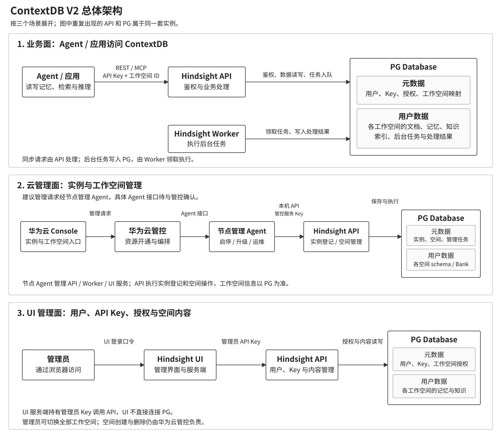

# ContextDB V2 总体架构

更新日期：2026-10-15。按业务访问、云管控、UI 管理三个场景展示。三者共用同一套 Hindsight API、Worker 和 PG 数据库。

## 业务面：Agent / 应用

Agent / 应用携带 API Key 和工作空间 ID，通过 REST / MCP 访问 Hindsight API。API 检查用户、Key 和空间权限后读写数据；后台任务保存在 PG，由 Worker 领取执行。

## 云管理面：实例与工作空间

华为云 Console 提供管理入口，华为云管控负责实例资源开通。节点上已有管理 Agent，负责 Hindsight API/Worker/UI 的启停、升级及高可用运维。

建议管理请求走“管控 → 节点管理 Agent → 本机 Hindsight API”，登记实例、创建 / 删除 / 查询工作空间。具体 Agent接口和转发能力待与管控确认；当前 V2 提供的是 Hindsight REST 接口。工作空间信息保存在服务 PG，云管控不另存一份空间目录。

当前 Console 尚未完成，验证时使用管控 API 执行这些操作，管理职责不变。详细流程与接口见 [管控联调文档](../../contextdb-v2-control-plane-integration.md)。节点管理 Agent与业务侧的 Agent/应用是两个组件。

## UI 管理面：用户、Key 与空间内容

管理员使用独立口令登录 Hindsight UI。UI 服务端携带管理员 API Key 调用 Hindsight API，管理用户、Key、空间授权，并查看或修改各工作空间的内容。UI 不直接连接 PG；空间创建与删除仍走云管控。

## PG 中的数据归属

| 数据 | 内容 |
| --- | --- |
| 元数据 | 实例、工作空间、用户、API Key 摘要、授权、管理任务与审计 |
| 用户数据 | 各空间的文档、记忆、知识、索引及后台任务 |

每个工作空间对应独立 schema 中的唯一 Bank，`workspace_id = bank_id`。不同空间隔离，同空间获授权用户共享内容。API 和 Worker 共用一个 PG 数据库。

接口、表结构和权限细节见 [V2 设计](../../member-apikey-bank-service-design-v2.md)。
