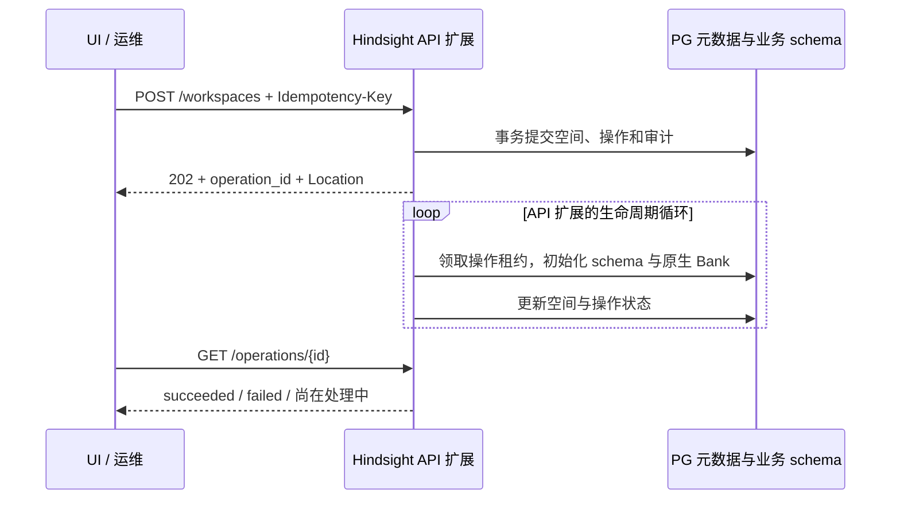

# ContextDB 首发设计：工作空间、用户与 API Key

> **状态：内部方案评审中。** 当前实现供专家检视，功能测试通过不代表简洁性、性能或最小侵入设计已定稿。当前待决定事项集中在[本文TODO](#本轮实现收敛与-todo)；[历史复审与验证](contextdb-optimization-status.md#simplicity-review)仅用于追溯，不是检视前置阅读。

更新（2026-10-18首发基线）：新空间对外统一使用可读 bank_id，对内保留 UUID；工作空间名称仅允许字母、数字、下划线，最长54字符，统一小写。新 schema 为 ctxdb_ws_<bank_id>；彻底删除后允许同名重建，并隔离旧授权和旧执行者。本轮功能回归与原生v1.0.0部署证据见优化状态；目标ECS/RDS、镜像安全与生产性能仍须单独验收。

本文按总体设计、实例管理、UI 管理、应用访问、核心实现和本期边界组织。接口、数据结构、安全依据及异常恢复规则完整保留在本文，便于连续阅读和实现核对。 当前文档与代码的统一核对结果见[优化清单第0.6节](contextdb-optimization-status.md#document-consistency)；历史手册中的配置和接口不作为本版本部署依据。

[管控部署指南](contextdb-service-integration-guide.md) · [Agent部署合同](contextdb-deployment-contract.md) · [运维手册](contextdb-operations-runbook.md) · [原生v1.0.0对接](../native-v1.0.0/contextdb-service-integration-guide.md) · [API curl 验证手册](contextdb-optimized-curl-guide.md) · [OpenAPI](https://github.com/ZhuQingping/hindsight/blob/00770662e52a5368432d65563eb07517a7329060/hindsight-extensions/contextdb-service/docs/contextdb-control-plane.openapi.yaml)

| 章节 | 主要内容 |
| --- | --- |
| [1. 总体设计](#overview) | 三个入口、对象关系、组件职责、实现版本 |
| [2. 华为云实例管理](#instance) | 数据库准备、离线初始化、凭据、密码、启动与升级 |
| [3. 管理员通过 UI 管理服务](#ui) | 操作流程、用户与 Key 管理、授权格式和状态变化 |
| [4. 客户应用访问记忆服务](#business) | 原生 REST/MCP、权限检查、按名称查询与按身份操作 |
| [5. 核心实现与设计理由](#implementation) | 认证安全、异步生命周期、PG 字段与约束、完整管理 API |
| [6. 本期边界与 Q&A](#boundaries) | 安全及产品边界、关键问题与异常恢复规则 |

<a id="overview"></a>

## 1. 总体设计

以下架构图和对象关系图沿用当前版本。

### 1.1 三个入口

一个独享实例使用一个 PG 数据库。用户与工作空间同属实例；用户可以持有多个 API Key，每个 Key 独立配置空间范围和权限。工作空间与 Hindsight Bank 一对一，每空间使用独立 schema。


[可编辑 drawio 源文件](diagrams/contextdb-first-release-architecture.drawio) · [PNG 预览](diagrams/contextdb-first-release-architecture.png)

实线表示请求或数据访问，虚线表示部署运维。节点管理 Agent 负责配置、启停、升级及离线初始化；业务 Agent 和 Hindsight UI 的请求直接由 Hindsight API 处理。

三个入口各自负责：

| 场景 | 调用关系 | 职责 |
| --- | --- | --- |
| 业务访问 | 应用 → Hindsight API / MCP | 携带业务 Key、可读 bank_id，调用 Retain、Recall、Reflect 等原生接口 |
| 实例运维 | Console → 华为云管控 → 节点管理 Agent | 准备 PG、配置凭据和模型、离线初始化、部署与启停；已有 Agent 负责升级/高可用调度 |
| 资源管理 | 管理员 → Hindsight UI → Hindsight API | 管理工作空间、用户、API Key；UI 后端持有 Admin Key |

工作空间管理已放在 UI，华为云 Console 不再维护空间目录。运维也可直接使用 Admin Key 调管理 REST API。本期没有新增实例注册 HTTP 接口，也没有实现一套新的 Agent 升级或高可用协议。

### 1.2 工作空间、用户与 Key


[可编辑 drawio 源文件](diagrams/contextdb-first-release-workspace-model.drawio) · [PNG 预览](diagrams/contextdb-first-release-workspace-model.png)

用户与工作空间同属实例，彼此没有从属关系。用户 A 可以持有多个 Key；Key A2 可同时访问研发和客服空间，并分别设置只读、读写。不同用户的 Key 可以访问同一个空间，空间内的内容共享。

图中的实例归属是逻辑关系，不需要在每张表重复保存 instance_id。新建空间名称同时作为可读 bank_id，按 NFKC、去首尾空白及小写规范化，须符合 `[a-z][a-z0-9_]{0,53}`；例如 MySQL 规范化为 mysql。服务端生成 schema `ctxdb_ws_mysql`。内部 workspace_id 为随机32位 UUID，用于授权关联及执行身份，不用于业务寻址。名称和 bank_id 在对象存续期间不可修改；完整删除后可以同名重建，内部 UUID 必须变化。连字符会使原生未加引号的 schema DDL 无法执行，首版禁止连字符以避免扩大内核修改。

可读 bank_id、可读 schema 与内部 UUID 各有职责；保留内部身份的具体原因见[第5.3.4节](#workspace-identity)。

用户用于记录 Key 归属、名称和启停状态，没有角色选择或用户级空间授权。后台 users 表同时保存唯一受保护的系统管理员，role 为 admin；普通成员固定为 member。**权限配置在 Key 上**，不再叠加“用户权限与 Key 权限取交集”。用户不是 PG 登录角色，工作空间也不是 UI 登录账号。

### 1.3 组件分工

| 组件 | 职责 |
| --- | --- |
| 节点管理 Agent | 下发配置、离线初始化、管理服务进程，对接已有运维调度 |
| Hindsight API | 扩展层完成认证、授权、空间管理；原生内核执行记忆接口 |
| Hindsight Worker | 执行原生记忆异步任务，按空间 schema 访问数据 |
| Hindsight UI | 管理员操作入口；服务端持有 Admin Key |
| PostgreSQL | 保存管理元数据和各空间业务数据；API 与 Worker 共用 |

<a id="contextdb-extensions"></a>

#### 1.3.1 为什么使用四个 ContextDB 扩展

四个类都属于同一个 `hindsight_ext_contextdb` Python 包，分别接入 Hindsight 已有的 Tenant、Operation Validator、HTTP、MCP 扩展入口。扩展框架来自 Hindsight，下面的具体实现由 ContextDB 提供；它们随服务进程加载，无须单独部署，与 PG 的 vector、pg_trgm 等数据库插件无关。

新增工作空间、用户、Key 管理后，除了提供管理接口，还必须让原生 REST、MCP 和后台任务遵守同一套空间与权限规则。因此需要覆盖不同入口：

| 扩展实现 | 对应配置变量 | 职责 |
| --- | --- | --- |
| ContextDBTenantExtension | HINDSIGHT_API_TENANT_EXTENSION | 认证 Key，按目标工作空间选择 PG schema；提供空间发现和后台任务的空间身份接入 |
| ContextDBOperationValidator | HINDSIGHT_API_OPERATION_VALIDATOR_EXTENSION | 在原生引擎操作处检查读写权限、管理员权限及内部任务归属；阻止绕过管理接口创建或删除 Bank |
| ContextDBHttpExtension | HINDSIGHT_API_HTTP_EXTENSION | 提供工作空间、用户、Key 的管理 REST 接口；启动空间生命周期执行器，并接入在途请求与删除屏障 |
| ContextDBMCPExtension | HINDSIGHT_API_MCP_EXTENSION | 从原生 MCP 工具调用中确定实际 Bank，校验当前消息的 Key，接入空间权限、在途保护和业务任务响应脱敏 |

**职责不同，认证规则共用。** 管理员与业务 Key 都由 `Repository.authenticate` 查询 PG、校验 HMAC；角色与空间权限也来自同一份元数据。各入口调用它完成必要检查，不各自维护一套密钥或权限表。

例如，某 Key 对 `mysql` 只有只读权限：Tenant 扩展负责将已认证请求路由到 `ctxdb_ws_mysql`；Validator 负责允许 Recall、拒绝 Retain。通过 MCP 调用时，目标空间还可能位于工具参数中，MCP 扩展需要先确定本次调用的 Bank，不能只依赖 REST URL。HTTP 扩展则让管理员能够创建空间、签发这个 Key，并在删除空间时协调仍在执行的请求。

MCP 扩展复用原生工具，不新增工作空间、用户或 Key 的管理 MCP 工具。启用 MCP 的当前部署需要四个扩展配套；关闭 MCP 时，MCP 接入没有调用用途，但 REST 的前三项职责仍然存在。独立 Worker 主要通过 Tenant 和 Validator 接入身份及操作保护，工作空间管理执行器仍在 API 侧。

**设计选择：保留这些接入入口，集中复用公共逻辑。** 减少扩展类数量本身不会减少必须完成的检查；强行统一加载入口会扩大 Hindsight 内核改动。本版优先在外围实现管理和隔离，继续复用原生记忆算法。扩展与本分支的保护钩子须同版交付，不能单独复制到任意上游版本。

### 1.4 实现版本与变更说明

更新：2026-10-18。当前交付分支为`contextdb/v1.0.0`，直接基于原生v1.0.0（39c65ffe2f140d0c84cee58566cad8900c5b9908）；优化对照提交为be6f12c4；不覆盖已停止的旧体验实例。本文描述该分支的目标实现；公开管理 API 仍为 `/ext/contextdb/v1`，首发管理元数据结构为 **1**。结构序号、API v1、资源 version 是三个概念。

本次统一管理员与业务 Key 认证，落实成员名唯一、删除空间的物理清理、按名称查询详情、自动状态刷新和部署脚本。[优化前完整设计](https://github.com/ZhuQingping/hindsight/blob/07028c3561bd6601dd72af137ea5d96658210ae9/hindsight-extensions/contextdb-service/docs/archive/2026-10-16-before-release-hardening/design-research.md)保留作对照。本轮统一 GET/DELETE、授权输入及原生 REST/MCP 使用可读 bank_id；授权存储与任务仍绑定内部 UUID。首发从当前完整结构的版本1开始；不提供开发期旧结构的自动升级，新空间使用可读标识。历史设计保留在Git历史，不能用历史测试代替本轮验收。

[API curl 验证手册](contextdb-optimized-curl-guide.md) · [部署与升级](contextdb-service-integration-guide.md) · [OpenAPI](https://github.com/ZhuQingping/hindsight/blob/00770662e52a5368432d65563eb07517a7329060/hindsight-extensions/contextdb-service/docs/contextdb-control-plane.openapi.yaml) · [优化前设计](https://github.com/ZhuQingping/hindsight/blob/07028c3561bd6601dd72af137ea5d96658210ae9/hindsight-extensions/contextdb-service/docs/contextdb-first-release-design.md)

<a id="instance"></a>

## 2. 华为云实例管理

实例部署由华为云管控通过已有节点管理 Agent 完成；空间、用户和业务 Key 的管理在服务启动后通过 UI 或管理 REST 完成。

### 2.1 实例如何开通

数据库连接不强制 SSL：部署示例不附加 sslmode，PGADMIN_URL 与 HINDSIGHT_API_DATABASE_URL 均按调用方提供的 URL 连接。未开启 SSL 的 PG 可接入；需要证书校验时部署方再显式配置 sslmode 和 CA，不由服务自动升级或降级策略。MaaS HTTPS 和 UI/API 对外入口的 TLS 配置独立。

管控具体输入、PG权限和命令以[人工部署指南](contextdb-service-integration-guide.md)为入口；自动化严格按[Agent配置合同](contextdb-deployment-contract.md)及 JSON Schema 校验。PG数据库必须先存在；管控接收用户UI密码并提供秘密文件。节点渲染配置后初始化管理表和原生public共享表，再启动API/Worker、检查ready及实例身份，最后启动UI。模型、插件和端口不依赖人工临时export。

管控调用已有节点管理 Agent 完成部署。本期不新增“创建实例”的 Hindsight HTTP 接口，工作空间目录也不在 Console 维护。

| 步骤 | 执行内容 | 完成结果 |
| --- | --- | --- |
| 1. 准备数据库 | 准备专用 UTF8 PG、服务账号、vector / pg_trgm / btree_gin；首版 RDS 固定 native + english | 数据库可连接，所选扩展可用 |
| 2. 准备配置与秘密 | 配置实例归属、数据库和模型；生成并私密保存 Admin Key、pepper、UI 密码 | 重启时可复用同一份配置 |
| 3. 离线初始化 | 执行 service.sh init：管理表迁移/管理员导入，再显式迁移原生public共享表 | API 尚未启动，也能准备管理员身份 |
| 4. 启动服务 | 启动 API、Worker，检查 readiness，再启动 UI | 管理与业务接口可用 |
| 5. 交付 | 提供 UI 地址和密码；管理员进入 UI 创建空间、用户与业务 Key | 应用可以接入 |

具体命令见[原生v1.0.0对接](../native-v1.0.0/contextdb-service-integration-guide.md)。已有 `service.sh` 用于部署和启动，由节点 Agent、systemd 或容器监督器管理前台进程。

### 2.2 三种凭据及保存位置

| 凭据 | 生成与保存 | 能力 |
| --- | --- | --- |
| 运维 Admin Key | 离线生成并私密保存；初始化时将 HMAC 摘要写入 PG，UI 服务端保存明文 | 管理全部空间、用户、Key；访问全部 active 空间的原生 REST/MCP 数据接口 |
| UI 登录密码 | 客户侧可选择随机生成或自定义，通过 HINDSIGHT_CP_ACCESS_KEY 配置并持久保存 | 仅用于管理员登录 UI，不是 API Key |
| 业务 API Key | 管理员通过 UI 或管理 API 创建；数据库只存 HMAC-SHA256 摘要 | 按 Key 的范围和权限访问原生 REST/MCP；不能调用管理 API，也不能登录 UI |

UI 继续使用原生 `HINDSIGHT_CP_DATAPLANE_API_KEY`，值为运维 Admin Key。浏览器只持有登录会话，不接收这个后台 Key。运维 Key 不作为普通用户/Key 显示在“用户管理”中。

业务 Key 格式为 `ctx_live_<32位Key ID>_<随机秘密>`。明文只在创建成功时返回一次；普通列表只返回 `display_key`，例如 `ctx_live_***5f82bf`，以及授权和时间等元信息。尾缀取自真实凭据末6字符；历史 Key 无法恢复尾缀时返回 null，不伪造脱敏值。

`CONTEXTDB_KEY_PEPPER` 是服务端 HMAC 秘密，不写入元数据表。保留现有 Key 时必须沿用 pepper。管理员与业务 Key 均依赖相同 pepper。轮换管理员 Key 使用受控离线命令更新 PG 摘要，并同步 UI 私密配置、重启 UI；本期没有在线恢复、双 Key 轮换或成员自助签 Key。摘要存储与 pepper 的安全依据、运维影响见第 5.1 节。

<a id="ui-password"></a>

### 2.3 UI 登录密码配置

`HINDSIGHT_CP_ACCESS_KEY` 是 UI 服务端读取的环境变量。客户侧可以使用部署时随机生成的密码，也可以自行设置密码；两种方式使用相同的 Hindsight UI 登录入口。当前是实例级管理密码，不为业务成员提供个人 UI 账号，也没有页面内改密功能。

| 配置方式 | 建议 |
| --- | --- |
| 随机密码 | 使用密码管理器或密码学安全随机源生成24～32位字符串，例如从大小写字母、数字、`_`、`-` 中随机选择；生成后持久保存，普通重启复用原值 |
| 自定义密码 | 建议16～32字符，可混合大小写字母、数字及 `- _ . @` 等符号；需要记忆时，可使用5～6个随机、互不相关的单词，以 `-` 分隔，不必限制在32字符以内 |

自定义密码优先保证长度、不可预测和不复用，不强制同时包含大写、小写、数字和特殊字符。避免姓名、生日、公司或产品名加年份、连续数字、名句等易猜组合。[NIST 密码指南](https://pages.nist.gov/800-63-4/sp800-63b/passwords/)同样强调长度，不建议强制字符类型组合。

当前实现的硬性约束与使用建议分开说明：

- 原生UI要求非空；本版托管部署合同额外要求至少12字符，不设置字符类型组合规则。上述16～32字符是使用建议。直接运行UI的基础校验与管控部署入口的约束不可混淆。
- 密码不能等于 `HINDSIGHT_CP_DATAPLANE_API_KEY`，也不能以 `ctx_live_`、`ctx_ctrl_`、`ctx_admin_` 开头。
- 登录精确匹配，区分大小写，不自动去除首尾空格或做 Unicode 归一化。可使用中文等可输入字符；为方便跨终端配置和输入，推荐使用可打印 ASCII 字符。
- 环境变量不能包含 NUL。避免换行、控制字符和首尾空格；单双引号、反引号、`$`、反斜杠等会增加 Shell 引用或转义要求，建议避开。它们并非应用的字符黑名单。

随机生成示例（执行一次生成32字符密码；部署工具需将结果安全持久保存，不在每次启动时重新生成）：

```bash
export HINDSIGHT_CP_ACCESS_KEY="$(python3 -c 'import secrets; print(secrets.token_urlsafe(24))')"
```

选择自定义方式时，由客户将自己的密码写入私密 UI 配置，例如 Shell 环境文件中的 `export HINDSIGHT_CP_ACCESS_KEY='<客户自定义密码>'`，其中占位符必须替换为实际密码，并按所用配置格式正确引用。配置文件限制为部署账号可读，不把实际密码写入设计文档、版本库或普通日志。

修改密码时，托管部署更新 ui-secrets.json 的 password 并重启 UI；直接原生启动才通过环境变量配置。仅编辑文件不会使运行中的进程自动生效。无需重新构建 UI、重启 API/PG 或修改后台 Admin Key。所有提供该实例 UI 的进程应使用同一新值；生效后旧密码及旧密码签发的登录会话失效，管理员重新登录。托管启动会用持久秘密覆盖 shell 中同名环境变量，不能只改 ui.env 或临时 export 后声称改密完成。

<a id="deployment"></a>

### 2.4 部署、启停、升级与兼容

离线顺序：准备专用 UTF8 PG 与扩展 → 私密目录保存配置和生成凭据 → 离线 migrate 导入管理员摘要 → 启动 API/Worker → readiness 通过后启动 UI。使用代码仓 `hindsight-extensions/contextdb-service/scripts/service.sh`，由已有节点 Agent/systemd/容器监督器管理前台进程；不引入新常驻管理服务。

必要配置收敛为 HINDSIGHT_API_DATABASE_URL、CONTEXTDB_INSTANCE_ID、CONTEXTDB_CLOUD_TENANT_ID、私密持久化的 pepper、四个扩展及模型配置。实例初始化、管理员离线轮换和API/Worker统一使用HINDSIGHT_API_DATABASE_URL及同一个专用服务账号，不提供另一套引导连接地址。运行期创建工作空间仍需DDL权限；PG数据库和插件由管控/数据库管理员预先准备。后台 Admin Key 与业务 Key 统一由PG中的HMAC摘要校验。

部署目录保存 `api.env`/`ui.env`、`admin-key.json`、`api-secrets.json`、`ui-secrets.json`，秘密文件0600、目录0700。API/Worker 加载 PG、模型、实例及扩展配置，另从秘密文件加载 pepper，不加载 Admin Key 明文或 UI 密码；UI 只得到登录密码/后台 Admin Key/API URL，不接收 PG 或模型密钥。重复初始化保留原值；已初始化但秘密文件缺失时拒绝补生，要求恢复备份。托管启动设置标准`PYTHON_DOTENV_DISABLED=1`，利用python-dotenv已有能力阻止意外.env覆盖；扩展依赖要求python-dotenv>=1.2.1，无须改原生config.py。

首发管理元数据结构版本固定为1。migrate仅初始化新库，或核对已经采用当前结构的数据库；开发期试验结构不作为已发布版本，不自动升级或直接改号。已有试验库先保留数据和配置备份，再使用新的专用数据库验证；不能仅修改metadata_version冒充结构匹配。未来正式发布结构变更时，再从版本1增加有序迁移。正常重启不执行结构迁移或重新生成凭据。

预检检查真实导入路径、扩展接口、Python3.11～3.14、Node22.12+/24及平台 esbuild、目标 PG 扩展和语言后端。外部 PG 不必安装 pg0；测试/内嵌路径使用 `hindsight-api-slim[embedded-db]`，发行包名 pg0-embedded，导入名 pg0。UI 使用系统字体，构建不下载 Google Fonts。Node22/24 的生产构建已在本机验证；源码路径检查不能替代部署方对镜像摘要和供应链的记录。

UI 启动只对暂时网络、5xx、429 有界重试，错误凭据、成员身份、畸形响应立即失败。每次新准入重新校验；同次操作复用受信Principal，Key/成员/授权变更阻止下一次准入，不中断已受理操作。管理代理保留会话和同源保护，上游管理接口验证当前管理员Key；原生UI数据路径仍单独检查管理员身份。HTTPS、入口限流和网络隔离由部署入口提供，不能把本机功能测试称为生产入口验收。

#### 2.4.1 部署语言检查参数

`CONTEXTDB_VALIDATION_LANGUAGE` 是 ContextDB 启动脚本的辅助参数，由部署意图中的 `language` 渲染生成，用于指定预检需要覆盖的语言能力。它不控制模型语言、分词算法或检索时的语言选择；实际全文后端仍由 `HINDSIGHT_API_TEXT_SEARCH_EXTENSION` 及相应分词配置决定。

| 值 | 预检要求 |
| --- | --- |
| english | 可以使用 native 英文全文后端；通过不代表已验证中文能力 |
| chinese / multilingual | 不接受 native 英文后端替代中文验收；检查配置的 PGroonga 或 pg_search 中文分词能力 |

当前 `service.sh init/api/worker` 将该变量传给 `preflight --language`，未设置时按 english 检查；手工执行 `service.sh preflight` 须显式传入 `--language`。预检只是部署门槛，仍须使用实际中英文材料验证检索效果。

该变量不是 Hindsight 原生参数，也不需要客户额外填写：管控只提交部署意图的 `language`。后续可让脚本直接读取该字段，去掉重复的环境变量映射；这是待简化方向，本次文档补充未改变当前实现。

<a id="api-worker-deployment"></a>

### 2.5 API 与 Worker 如何部署

2026-10-19 决策：**首版一个容器合并部署 API、Worker 和 UI**。外部 RDS PG 保存全部持久业务数据；LLM、Embedding、Rerank 均调用华为云 MaaS，节点不运行模型推理。

```text
Console → 管控 → 节点 Agent → 一个 Hindsight 容器
                              ├─ Python：API :8888 + 内置 Worker
                              └─ Node.js：UI :9999 → 127.0.0.1:8888
应用 ────────────────────────→ API → 外部 RDS PG / MaaS
浏览器 ──────────────────────→ UI
```

一个容器、两个应用主进程；Worker 是 API 进程内的后台执行器，不另起 Worker 进程。init/监督器负责信号转发和退出清理，不计作业务进程。API 和 UI 均可从其他机器访问，默认端口 8888/9999，部署时可配置；容器内部 UI 通过 loopback 访问 API。

选择依据是首版减少部署对象、配置和排障分支，复用原生内置 Worker。原生联调直接使用官方镜像的 start-all.sh；自研镜像的 service.sh all 监督既有 api/ui 入口，保留原来的预检、秘密加载和 UI 等待就绪逻辑，不修改记忆算法。任一应用主进程退出，自研监督器停止另一进程并退出，由容器运行时重启整个服务；正常停止给全部子进程组发送 SIGTERM，并设置退出超时。健康检查覆盖 API 和 UI；unhealthy 本身不触发 Docker 自动重启，持续不健康由节点 Agent 按已有恢复策略处理。

| 项目 | 首版配置与边界 |
| --- | --- |
| topology | 固定 merged，不要求管控在多种拓扑间选择 |
| HINDSIGHT_API_WORKER_ENABLED | true，API 内置 Worker |
| HINDSIGHT_API_WORKERS | 1；不是后台任务并发数 |
| HINDSIGHT_API_WORKER_ID | 固定且实例内唯一，重启不变，不能使用随机容器 hostname |
| 独立 Worker 容器/8889 | 本期不启动、不发布 |
| 初始化 | 自研版在启动前运行一次性初始化命令，结束后退出；不算长期运行容器 |
| CPU/内存 | API、Worker、UI 共享一个容器限额，不提供组件级限额或独立重启 |
| 秘密边界 | 同容器、同 UID，不声称强隔离；自研启动器仍按进程加载必要环境，但挂载文件可由同 UID 读取 |

API 与 Worker 仍通过 PG 原生任务系统协作；同步 Recall、Reflect 在 API 执行。ContextDB 工作空间创建/删除由 API 的扩展生命周期执行器处理，不另起任务服务。单容器不会改变授权、在途保护或物理删除规则。

[组件资源与磁盘预算](contextdb-resource-sizing.md)给出 CPU/内存开销、磁盘分类、初始规格、采样方法和验收边界。Compose示例上限为2 vCPU/4 GiB，可按节点调整，不是官方推荐规格；ECS与容器的生产规格均待目标负载压测，不固定要求4 vCPU/8 GiB节点或扣留一半资源。后续明确出现后台挤占、需独立扩容或恢复的场景后，再评审 API/Worker/UI 分容器；历史分离模式测试保留为机制证据，不作为本期交付选项。

### 首版后台写入边界

旧空间任务被标记 cancelled 不表示实际执行者已退出；原生 Worker 的可选 async_execution_scope 将持久准入持有到实际执行及最终状态写入完成。未知失败保留屏障，不按 TTL 清除。新空间不能继承旧 UUID、准入或 selected 授权。

原生 LLM Trace 和原生业务 Audit 使用独立后台 INSERT，原生 Webhook 队列缺少不可复用的空间身份，本期不扩大内核改造来接入它们：`HINDSIGHT_API_LLM_TRACE_ENABLED=false` 必填（原生缺省true，所以缺省也拒绝），`HINDSIGHT_API_AUDIT_LOG_ENABLED=false`；不支持非空 `HINDSIGHT_API_WEBHOOK_URL`。Admin/内部默认模板不能开启 audit_log_enabled，旧 Bank 开启原生审计或 enabled Webhook 时先停用，启动/迁移会拒绝。`ctxdb_meta.audit_events` 管理事务审计继续保留。UI原生调用正文/原生审计不产生新记录，运维使用JSON日志、任务、PG统计和按需OTEL，详见[运维手册](contextdb-operations-runbook.md)。

<a id="fulltext-selection"></a>

### 2.6 中英文全文检索与许可证（补充调研，待选型）

**2026-10-19 RDS 首版决策：去掉 PGroonga/Groonga 部署依赖，固定 native + english。** 意图模板和部署指南同步采用该组合，不引入替代全文插件。中文内容可写入并通过 MaaS bge-m3 向量召回，中文分词/关键词全文未完成适配，列为 TODO。language=english 仅表示当前全文验收范围，不限制中文输入；不会放宽 native + chinese/multilingual 的预检。既有 PGroonga 试验库不执行卸载或直接切换；新基线使用新建专用库。

下文保留未来中文方案的调研比较，不是当前 RDS 安装清单。**撤回“PGroonga 已确定为云上默认插件”的预设。** 选型先满足目标 RDS 可安装和许可证要求，再比较 Hindsight 适配成本、检索效果及运维能力。一套部署选择一个全文后端；向量检索继续使用 `vector`，不因全文方案改变。

#### 2.6.1 PGroonga 与 Groonga 的关系

PGroonga 是 PG 扩展，依赖的 Groonga 是搜索引擎库，不是必须另起一个 Groonga 网络服务，也不是再执行一次 `CREATE EXTENSION groonga`。库及其运行依赖需要部署在 **PG 节点**；装进 Hindsight 的 ECS 容器不能让外部 RDS 自动获得插件。[源码安装要求](https://pgroonga.github.io/install/source.html)。

| 组件 | 官方许可证 | 本项目关注点 |
| --- | --- | --- |
| PGroonga | PostgreSQL License | 不能只审核这一层而遗漏底层库 |
| Groonga | 官方当前说明为 LGPL-2.1-or-later | LGPL 与 GPL、AGPL 的条件不同，不能统称“GPL 禁止商用”；锁定实际交付版本及其许可声明 |
| ParadeDB / pg_search 社区源码 | AGPL-3.0 | 云上使用、修改、组合及镜像交付的具体义务需核对；商业授权可作为另一条路线，不能当作规避 LGPL 的宽松许可证替代品 |
| pg_textsearch | PostgreSQL License | 与 timescaledb 不是同一个插件，不能套用后者的授权或 RDS 支持情况 |
| zhparser / SCWS | 分别为 PostgreSQL 风格宽松许可 / BSD | 字典、可选依赖和最终二进制仍按实际发行物核查 |

依据：[PGroonga 许可](https://github.com/pgroonga/pgroonga/blob/main/COPYING)、[Groonga 官方许可说明](https://groonga.org/docs/reference/api/index.html)、[pg_search 许可](https://github.com/paradedb/paradedb/blob/main/LICENSE)、[pg_textsearch 许可](https://github.com/timescale/pg_textsearch/blob/main/LICENSE)、[zhparser 许可](https://github.com/amutu/zhparser/blob/master/COPYRIGHT)、[SCWS 许可](https://github.com/hightman/scws/blob/master/COPYING)。

许可评估需区分仅在服务端运行与向客户交付镜像/二进制、是否修改库、静态或动态链接；不能由“动态链接”直接推出完全无义务，也不能由“LGPL”直接推出全部业务代码必须开源。交付清单应记录组件版本、源码来源、许可证/NOTICE、补丁及相应源码提供方式；最终结论针对实际交付形态确认。

#### 2.6.2 可行方案与当前代码差距

| 方案 | 英文 | 中文及混合语言 | 当前 Hindsight 接入与工作量 |
| --- | --- | --- | --- |
| PG 原生 tsvector + GIN | 可用 english 配置，含词干与停用词处理 | 默认英文配置不足；需中文 parser 和 text search configuration | 纯英文改动最少；中文候选为原生 + zhparser，须补齐预检及配置一致性，工作量中等 |
| PGroonga + Groonga | 同一索引处理英文，但不等价于 English stemming/BM25 | 当前 TokenBigram + NormalizerNFKC150；中文主要按字符二元片段，不依赖中文词典 | 已有索引及查询适配，接入改动少；新增底层库及备份恢复、WAL/主备验收工作 |
| pg_search + Jieba 等 tokenizer | 支持英文 tokenizer，混合语言效果随所选 tokenizer 而异 | 已有 Jieba、chinese_compatible、Lindera 等配置入口，需核实发行版本是否包含 | 已有适配，接入改动少；AGPL/商业授权及 RDS 插件交付是独立前提 |
| pg_textsearch + english / 中文配置 | 当前代码已支持 BM25 英文后端 | 插件可用自定义 PG text_config；配合 zhparser 是候选，并非安装后自动中文 | 当前 Hindsight 索引使用 english；要参数化 DDL/查询、重建策略及预检，工作量中等，不能宣称已有中文开箱即用 |
| vchord_bm25 + pg_tokenizer | Hindsight 已有对应后端 | 效果取决于所配 tokenizer/model；现有路径使用 llmlingua2，不能据名称保证中文效果 | 依赖、模型文件及发行物更多，保留比较入口，首版暂不新增默认组合 |

`pg_trgm` 是三元片段相似度/模糊匹配能力，`btree_gin` 提供普通标量类型的 GIN 操作符类；二者不是中文分词器，也不能单独替代上述完整全文方案。`vector` 负责向量相似度，同样不替代关键词检索。[PG 全文机制](https://www.postgresql.org/docs/current/textsearch.html)、[ParadeDB tokenizer 说明](https://www.paradedb.com/blog/v2api)。

**原生 + zhparser 的实际差距：** 当前 `HINDSIGHT_API_TEXT_SEARCH_EXTENSION_NATIVE_LANGUAGE` 允许自定义配置名，memory_units 写入和查询已有对应参数；但 mental_models 的生成表达式和关键词查询仍固定 english，现有 ContextDB 中文预检也只接受 PGroonga/pg_search。故不能只安装 zhparser、改一个变量，就宣称所有中文检索完成适配。需统一索引、写入、查询、schema search_path 与升级重建，覆盖普通记忆和 mental_models 两条路径。

**RDS 可用性：** 本次查看的华为云[官方插件清单](https://support.huaweicloud.com/intl/zh-cn/usermanual-rds-pg/rds_09_0045.html)列有 zhparser，未查到 PGroonga、pg_search、pg_textsearch。公开清单未列出不等于所有内部版本均不支持，也不构成已可用的证据；必须由 RDS 同事确认区域、PG 大/小版本和实际插件列表，包含必需的 vector。不能在安装脚本里自动退回英文后端并将其标为中文验收通过。

#### 2.6.3 选型顺序与验收

1. **纯英文基线：** 原生 tsvector + GIN + english，先保证最小依赖下完整运行；不把它包装为中英文交付。
2. **现有 RDS 中文候选：** 优先验证原生 + zhparser，因为官方有该组件；若平台将来提供 pg_textsearch，再比较 pg_textsearch + zhparser 的 BM25 收益与额外适配成本。
3. **可新增插件的 PG 平台：** 并行评估 PGroonga；通过 LGPL 依赖核查、RDS 接入及恢复测试后，才决定是否作为固定中英文方案。pg_search 在可接受授权成立后参与同条件比较。
4. 当前首版固定 native 英文全文；中文分词关键词全文待适配，不声称已发布中英文全文组合。不向客户暴露复杂选型开关。保留原生后端配置能力供运维使用；更换全文后端必须执行受控索引重建/迁移，不能视为无状态参数切换。

对照使用相同 PG 版本、数据、embedding、reranker 和查询集，分别记录“只测关键词”和“完整混合召回”的结果：中文术语/新词、中英混写、英文词形、标识符/错误码、短查询、误匹配和空间隔离；统计 Recall@K、排序质量、p95、索引体积及写入成本。另验证备份恢复、异常退出后索引一致性和目标 PG 主备机制。本轮已执行独立PG18.4的12条材料/7查询 SQL 对照及 pg_dump/restore一致性检查，也验证真实MaaS中英完整调用链；这些小样本不替代生产并发、中文质量基准或云 RDS 实测。结果和局限见[补充验证记录](contextdb-service-research-validation.md)。

<a id="ui"></a>

## 3. 管理员通过 UI 管理服务

管理员只需输入 UI 密码。UI 后端使用 Admin Key 调用管理 API 和原生数据接口，管理员可以查看全部可用空间。

### 3.1 从创建空间到交付 Key

| 顺序 | 页面操作 | 服务端行为 |
| --- | --- | --- |
| 1 | 创建工作空间，填写名称和可选描述 | 登记创建操作，初始化独立 schema 和唯一 Bank |
| 2 | 等待空间可用 | UI 自动刷新；空间 active 后可进入和授权 |
| 3 | 在“用户管理”创建用户，只填写名称 | 建立实例级用户，不选择空间或管理员角色 |
| 4 | 展开用户，创建 Key | 填写 Key 名称、选择空间范围和权限 |
| 5 | 复制 Key 给应用 | 明文仅本次展示一次；以后只显示脱敏值 |
| 6 | 切换工作空间查看内容 | UI 使用后台 Admin Key 读取对应 Bank |

普通用户没有个人 UI 账号。受保护的系统管理员不出现在普通用户和 Key 列表中，也不能通过这些页面修改或吊销。

### 3.2 UI 展示、秘密处理与操作恢复

工作空间目录提供创建、删除、查询及失败状态。内容切换器只列 active 空间，管理目录保留创建中、删除中和失败状态。创建填写名称、可选描述；删除需确认，随后跟踪操作状态。

“用户管理”是实例级页面。创建用户只填名称，成员行展开查看 Key，更多菜单提供编辑、停用、删除。创建 Key 填名称，选择“指定工作空间”或“全部工作空间（包含未来新创建工作空间）”；指定模式按空间设置权限，默认读写。编辑保留原有只读设置，支持改名。吊销后从列表移除。

Key 明文只在本次创建结果中展示和复制，不写入 localStorage/sessionStorage。工作空间操作仅持久保存非敏感的原始请求、幂等标识与操作 ID：刷新后只恢复 GET 查询；响应丢失且没有操作 ID 时，由管理员明确继续才重放原请求，不自动 POST。成员和 Key 创建不透明重试；结果未知时先核对列表，不能按模糊名称或“最新一条”自动吊销。

### 3.3 空间授权及请求格式

| 授权方式 | 适用情况 | 权限规则 |
| --- | --- | --- |
| 指定工作空间 | 只访问部分空间，或不同空间需要不同权限 | 每个空间分别选择只读 / 读写 |
| 全部工作空间（包含未来新创建工作空间） | 应用需要覆盖整个实例 | 所有空间使用统一权限，不设置例外 |

例如，同一个 Key 可以对“研发空间”读写、对“客服空间”只读。需要这种差异时选择指定空间。创建默认读写；编辑时保留原有设置，替换授权以本次完整选择为准。

公开请求统一使用 `authorization` 对象。

指定空间允许每个空间设置不同权限：

```json
{
  "name": "订单应用",
  "authorization": {
    "mode": "selected",
    "workspaces": [
      {"bank_id":"mysql", "workspace_id": "aaaaaaaaaaaaaaaaaaaaaaaaaaaaaaaa", "permission": "read_write"},
      {"bank_id":"pg", "workspace_id": "bbbbbbbbbbbbbbbbbbbbbbbbbbbbbbbb", "permission": "read"}
    ]
  }
}
```

全部空间使用统一权限，包含未来新建空间：

```json
{"name":"实例应用","authorization":{"mode":"all","permission":"read_write"}}
```

- selected：1～1000个不同的 active 空间，每项 bank_id 独立选择 read / read_write，不接收统一 permission。可选 workspace_id 是预期对象身份，UI始终发送；旧选择指向同名新对象时返回409 workspace_generation_changed并回滚。直接API省略该字段表示明确授权请求处理时的当前同名对象。读取结果始终包含内部UUID，不能只靠可复用名称持久保存授权。
- all：不提交 workspaces，统一 permission 作用于全部当前及未来空间。需要差异权限时选择 selected；all 不支持例外覆盖。
- 创建 Key 必须提供 authorization 和 mode；permission 省略时默认 read_write。UI 默认读写，保留只读选择。
- 编辑可以只改 name；一旦提交 authorization，就完整替换授权，未列出的旧空间授权被移除，所有 permission 必须明确填写，不使用创建时默认值。
- 旧版平铺 access_mode / workspace_ids / permission 不再是公开输入，不能与新格式混用。数据库内部仍有 access_mode 等列，不代表客户端继续使用旧格式。

| 权限 | 可执行 | 边界 |
| --- | --- | --- |
| read | Recall、Reflect、记忆/文档/知识等已有内容读取 | Reflect 调用模型，使用时间和日志也可能写入；不是 PG 只读事务 |
| read_write | read 能力，加 Retain 和允许的内容增改删 | 不包含空间生命周期、用户/Key 管理、Bank 配置写入、Webhook 管理、归档导出/下载等运维能力 |
| Admin Key | 全空间业务及管理能力 | 仍受空间状态、schema 映射和安全排空约束；原生 Bank 生命周期也必须走空间管理接口 |

### 3.4 停用、吊销、删除与生效时机

| 操作 | 对后续访问的影响 | 是否删除空间数据 |
| --- | --- | --- |
| 停用用户 | 该用户全部 Key 无法认证；恢复后未吊销的 Key 可继续使用 | 否 |
| 删除用户 | 该用户及其 Key 不再可用，后台保留用户历史 | 否 |
| 吊销 Key | 该 Key 永久失效，从普通列表移除，后台保留记录 | 否 |
| 删除工作空间 | 先停止接受新请求，排空已受理工作，再删除业务数据、schema、空间记录和相应授权 | 是 |

用户停用阻断全部 Key 的后续认证；恢复仅恢复未吊销 Key。删除用户保留墓碑，使其全部 Key 无法继续使用，不删除工作空间数据。

吊销 Key 记录 `api_keys.revoked_at`，永久失效，不能恢复。普通 Key 列表在 SQL 中先过滤吊销记录，再计算 total 和分页，因此吊销后该行消失；后台保留历史及审计。

权限变更、停用和吊销对后续 REST 请求/MCP 工具调用重新检查，不承诺强制取消已受理请求。已经接受的原生异步任务继续执行，避免因 Key 失效丢失已接收的数据处理。

<a id="business"></a>

## 4. 客户应用访问记忆服务

客户应用通过业务 Key 使用原生记忆接口；空间目录和 Key 由管理员维护。

### 4.1 请求如何到达目标空间

应用取得业务 Key 和可读 bank_id（例如 mysql），沿用 Hindsight 原生 REST/MCP 接口。管理路径 `/workspaces/mysql` 与业务路径 `/v1/default/banks/mysql/...`、单空间MCP `/mcp/mysql/` 使用同一个标识。内部 workspace_id 不作为调用地址。

```text
应用携带 API Key + bank_id
    → 认证 Key，检查用户及吊销状态
    → 检查 Key 对目标空间的权限、空间是否可用
    → 根据管理元数据定位独立 schema
    → 调用原生 Retain / Recall / Reflect
```

管理层负责认证、授权与路由，记忆算法和原生接口请求、返回结构沿用 Hindsight。多空间 Key 允许切换目标空间，不代表一次 Recall 联合查询多个空间。

### 4.2 不同 Key 能做什么

| 凭据 / 权限 | 可执行 | 主要限制 |
| --- | --- | --- |
| 业务 Key：只读 | Recall、Reflect，以及允许的记忆、文档、知识内容读取 | 不能 Retain 或修改内容；Reflect 仍可能调用模型和写日志 |
| 业务 Key：读写 | 只读能力，加 Retain 和允许的内容增改删 | 不能管理空间、用户、Key，不能登录 UI |
| Admin Key | 全部可用空间的业务访问及管理 API | 仍遵守空间状态与删除安全规则 |

Admin Key 与业务 Key 使用相同的 Bearer 携带方式、相同的认证入口，权限由 PG 中的身份和授权决定。“全部工作空间”的业务 Key 仍然不是管理员。

所有 Key 都不能通过原生 Bank 创建、删除、克隆等入口绕过空间管理，避免破坏空间与 Bank 的一对一映射。具体接口边界见第 6.1 节。

### 4.3 可读寻址与对象身份条件

GET、DELETE 使用 `/workspaces/{bank_id}`，Key选择也使用 bank_id。新建名称同时就是规范化 bank_id；不接受中文、空格或连字符，不额外提供显示名、别名或改名接口。旧结构升级保留历史UUID bank_id及原schema，不自动改动原生数据。

空间列表和详情返回 bank_id、workspace_id、version、etag；详情同时发送ETag头。DELETE 必须发送原对象的 If-Match 与本次 Idempotency-Key：缺条件428，代次/版本不匹配412。条件缺失或旧对象消失不能改为删除当前同名对象；幂等重试仍绑定原操作和UUID。

UI 在显示删除确认前捕获对象身份，重试继续使用原ETag，不重新获取同名对象条件。selected选择包含预期UUID并在服务端事务内校验。删除清理授权会使Key version递增；旧编辑412；空selected拒绝所有空间而不变成all。

<a id="implementation"></a>

## 5. 核心实现与设计理由

以下保留完整认证、生命周期、数据库及接口规则，说明功能如何实现、失败时如何处理。

<a id="security"></a>

### 5.1 API Key 统一认证与安全设计

#### 为什么只保存摘要

API Key 是持有即可使用的访问凭据。数据库只保存用于验证的摘要，避免表或备份泄露时直接暴露可用的完整 Key。调用方持有明文，服务端收到请求后重新计算摘要并比较，不需要从 PG 还原 Key。明文仍需防止在客户端配置、传输、日志及 UI 签发结果中泄露；生产访问通过 HTTPS 保护。

本系统的 Key 由密码学安全随机源生成，秘密部分使用32字节随机值，提供256位随机熵；公开前缀和 key_id 用于识别格式、定位记录，不是秘密，也不能决定权限。该设计针对高强度随机凭据，不应照搬到用户自行选择的短密码。OWASP 对用户密码建议使用 Argon2id 等专用密码哈希，明确不建议只用快速 SHA-256 保存密码。[OWASP 密码存储指南](https://cheatsheetseries.owasp.org/cheatsheets/Password_Storage_Cheat_Sheet.html)

#### HMAC 与 pepper 分别是什么

HMAC-SHA256 是以 SHA-256 和秘密密钥构成的消息认证算法，定义见 [RFC 2104](https://www.rfc-editor.org/rfc/rfc2104.html)。这里使用它计算 API Key 的校验摘要；没有解密操作，无法直接从摘要还原原 Key。校验通过重新计算、恒定时间比较完成；不可逆不等于弱凭据无法被猜测，随机强度仍是基础。

pepper 是安全领域对“与凭据摘要分开保管的共享秘密”的称呼；在本系统中就是 HMAC 使用的密钥，由 CONTEXTDB_KEY_PEPPER 提供。它独立生成，不是 Admin Key，也不是生成各 API Key 的种子。与通常每条不同、可随摘要保存的 salt 相比，pepper 在当前部署内共享且必须保密。[OWASP pepper 说明](https://cheatsheetseries.owasp.org/cheatsheets/Password_Storage_Cheat_Sheet.html#peppering)

当前业务 Key 的处理流程：

```text
签发：随机生成完整 API Key → 交给调用方，明文只展示一次
      HMAC-SHA256(pepper, 完整 API Key) → 摘要写入 PG

认证：请求携带完整 API Key → 解析 key_id，查询 PG
      用服务端 pepper 重新计算 HMAC → 与 PG 摘要做恒定时间比较
      → 再检查用户状态、吊销状态及目标空间权限
```

计算覆盖完整 Key，包括公开 ID 和随机秘密部分。pepper 由服务端配置持有，调用方无需知道，也不在 API 请求中传递。

#### 为什么 pepper 不放 PG，能保护到哪里

分开保存的目标是增加独立于数据库的一层保护：只获得数据库只读副本或备份的人，无法仅凭其中的摘要计算候选 Key 的 HMAC 进行离线核对。若 pepper 与摘要放在同一数据库，一次数据库泄露就可能同时获得两者，失去这层隔离。OWASP 要求 pepper 与密码摘要分开保存；本设计采用同样的秘密隔离原则，应用于随机 API Key 校验。[OWASP 保管要求](https://cheatsheetseries.owasp.org/cheatsheets/Password_Storage_Cheat_Sheet.html#common-requirements-for-peppering-strategies)

| 风险 | 保护范围与限制 |
| --- | --- |
| 只读数据库或备份泄露 | 不直接暴露完整 Key，pepper 仍在独立的受保护配置中 |
| 完整 API Key 泄露 | 攻击者可直接携带该 Key 请求服务，无需知道 pepper；应吊销并重新签发 |
| 服务端配置与数据库同时泄露 | pepper 的隔离保护失效，需按凭据泄露处理 |
| 数据库任意写入或真正 PG SUPERUSER | 可以篡改用户、授权或数据；摘要校验和 pepper 不能代替数据库权限边界 |

pepper 不保证系统绝对安全，仍需正确的权限校验、HTTPS、秘密保管及受控数据库访问。当前配置文件应仅部署账号可读；生产可交给秘密管理系统。备份恢复流程必须分别覆盖数据库和所匹配的 pepper，且都不进入普通日志、设计文档或版本库。

#### 重启、丢失和更换的影响

pepper 在实例首次部署时生成并持久保存，正常重启、扩容和升级复用原值；同一部署的 API/Worker 使用一致配置。它不是每次启动生成的临时随机数。

| 认证方案 | 更换或丢失 pepper 的影响 |
| --- | --- |
| 本次统一认证实现 | 管理员与业务 Key 都使用 PG 中的 HMAC 摘要，原 Key 均受影响，UI 后台调用也会失败 |

数据库与记忆数据不会因 pepper 改变而消失，服务健康检查也可能仍正常，但凭据认证会失败。误改时恢复原值并让相关进程重新加载；正常轮换必须配套迁移，持有原 Key 明文才能计算新摘要，否则需要重新签发受影响凭据。不能从旧 HMAC 摘要直接转换出使用新 pepper 的摘要，也不能只改环境变量后认为轮换完成。

#### 当前决策与待评估项

所有 Key 都经过同一个 Repository.authenticate：解析 Key ID → PG 联查 api_keys/users → 常量时间比较完整凭据的 HMAC-SHA256 → 检查吊销与用户状态 → 按 PG role 和目标空间授权。前缀只用于格式和定位，不授予角色。管理员使用 role=admin；普通 all Key 仍是 member，不能调用管理 API。

这属于 ContextDB 扩展的实现。Hindsight 原生 StaticKeys 的配置 Key 比较和 UI 会话签名并非同一套机制。本次没有改变记忆算法，也没有运行时 SHA 回退。generate-admin-key 仍可输出 sha256，**只校验离线凭据文件的 secret 是否与 checksum 一致；可省略，不作为 PG 认证摘要或部署环境变量**。

保留独立 pepper，当前不采用取消 pepper 的 SHA-only 候选。数据库和秘密配置分别备份并一起恢复；只恢复数据库、丢失 pepper 无法恢复原 Key 认证。系统管理员不出现在普通用户/Key 列表，普通 CRUD 不能改名、停用、删除、追加 Key 或吊销它；运维显式离线轮换是另一个操作。

<a id="lifecycle"></a>

### 5.2 工作空间异步创建、删除与恢复

**设计决策：创建、删除工作空间都保留异步接口。** POST /workspaces、DELETE /workspaces/{bank_id} 在操作持久受理后返回202，通过 GET /operations/{id} 查询最终结果；本版不增加同步/异步切换参数。这里的“异步”指 HTTP 返回后后台继续执行，与 Python 函数是否使用 async def 是不同概念。

#### 为什么工作空间采用异步

| 操作 | 实际步骤 | 采用异步的主要原因 |
| --- | --- | --- |
| 创建工作空间 | 登记空间及操作 → 在独立 schema 执行原生迁移，创建表和索引 → 创建、校验 Bank → 标记 active | 初始化包含多个步骤；进程中断可能留下部分已完成状态，需要可追踪、可恢复的执行记录；复用现有生命周期执行机制 |
| 删除工作空间 | 关闭新请求准入 → 等待在途请求和已受理后台任务排空 → 清理 Bank 与文件 → 删除 schema、空间元数据及对应授权 | 等待现有任务及清理历史数据的耗时不确定；避免把整个生命周期绑定在一次 HTTP 连接上 |

新空间没有历史数据，建表、建索引可能很快，**不能仅凭“表多”断定创建一定慢或必须异步**。每空间独立 schema 提供数据隔离，但不消除原生迁移、多步骤提交和故障恢复问题。当前没有生产耗时数据证明同步创建不可行，选择异步是可靠性与复用现有实现的取舍。

创建并非一次管理表 INSERT：原生迁移、Bank 写入和管理状态更新不由同一个事务整体提交，不能假设 HTTP 请求失败就能回滚全部初始化结果。当前将操作保存到 management_operations，由 API 进程内的 ContextDB 生命周期循环领取并执行；租约及所有权检查约束接续执行，幂等标识关联同次请求与重试，不新增独立调度服务。失败需明确记录，满足条件后再重试，不承诺任何故障都能自动恢复。

删除还需要协调已经接受的业务工作。即使表互不共享，Retain/Recall/Reflect、原生后台任务仍可能访问目标空间；不能因为删除请求到达就直接清理。空闲空间可以很快删除，繁忙空间或大数据空间则需要等待，未知执行者也不能仅靠时间过去就视为结束。

当前删除入口在写入删除状态前获取空间排他锁，本身可能等待在途请求释放。因此，异步不保证202立即返回，前置校验、锁等待、网络及数据库问题仍可能影响受理响应；实现和验收不能承诺固定耗时。

#### 为什么用户与 API Key 管理采用同步

用户创建、改名、启停、删除，以及 Key 签发、授权编辑、吊销，主要是少量管理记录和必要审计的事务写入。它们不运行原生 schema 迁移，也不等待业务任务排空，事务提交后即可返回最终结果。

| 操作 | 成功返回的含义 |
| --- | --- |
| POST 用户 / Key | 201，记录已经创建并提交；Key 明文仅这次签发返回 |
| PATCH 用户 / Key | 200，修改已经提交 |
| DELETE 用户 / Key | 204，软删除或吊销状态已经提交，后续认证受影响；不强制取消已受理业务任务 |
| GET 管理资源 / 操作状态 | 200，返回本次查询到的状态；查询操作进度不会等待整个操作结束 |

#### 为什么本版不再切换为同步创建

同步可以可靠实现，但需要继续处理请求超时、客户端断开后执行是否继续、重复请求与部分初始化的恢复。仅让 HTTP 等待现有后台任务，简化的是调用方，内部持久状态和恢复机制不会因此消失；直接删掉后台机制，则需重新设计中断恢复及验证。对当前已有实现，收益不足以支持再维护一套执行模式。

本版因此保留异步创建、删除，优先简化 UI：提交后自动查询并更新状态，成功进入正常使用，失败显示原因。正常空间不再显示常驻“查询进度”；创建/删除中以单次目录 GET 自动刷新，1～5秒退避，最多2分钟。超时保留状态和手动刷新，失败提供查询原因和明确恢复入口，不自动重放写请求。用户不必手动管理 operation_id，运维和 API 调用方仍可查询。

#### 交互与完成判定



管理操作状态为 pending / running / succeeded / failed；空间状态为 creating / active / deleting / failed，两者不能混淆。latest_operation_id 帮助页面恢复进度，不能代替查询操作结果。

删除先阻止新请求，等待在途请求和原生任务排空，调用原生 Bank 清理并严格检查文件前缀清理；随后在一个事务内删除受控 schema、逐空间授权和空间元数据，并完成操作。schema 必须由服务角色拥有，不能含其他所有者/共享扩展或跨 schema 依赖；无法确认则失败保留。正常完成不留空表和空间墓碑。未知执行者必须先确认停止，不能按 TTL 强行解除屏障。Admin Key 也不绕过这些步骤。

已删除空间的操作快照独立保留；删除重试先匹配历史，再查空间，因此旧结果仍可查询。历史默认168小时，配置范围24～8760小时；每分钟最多清理100条过期终态，不清理未完成操作或仍有空间行的失败操作。浏览器未知写意图仅允许24小时内明确重放，过期后只读核对，不重新发写请求。审计独立保留，不随空间清理。

客户端收到202不能认为空间已创建或删除，必须查询到 succeeded；创建还需空间为 active 才可进入或新增授权。响应丢失、等待超时、浏览器关闭都不能证明服务端操作未执行或已取消。已知 operation_id 时只查询；需要重试时复用原 Idempotency-Key 和原请求，不能因为等不到结果就换标识重复提交。failed 操作在满足条件时可通过明确重试重新执行；GET 不触发重执行。

<a id="metadata"></a>

### 5.3 PG 元数据表、字段、索引与约束

管理表位于 `ctxdb_meta`，原生业务表位于各空间 schema；本次优化不修改 Hindsight 原生业务表结构。当前仍为8张管理表：合并2张为1张，同时新增逐空间授权表。

| 表 | 关键字段与职责 |
| --- | --- |
| deployment_info | 单行 singleton；instance_id、cloud_tenant_id、metadata_version=1、format_id、installed_at；承接管理事务短行锁 |
| workspaces | workspace_id、唯一 bank_id、唯一 schema_name、description、state、version、时间、metadata；成功删除后移除行 |
| users | user_id、name/name_key、role(admin/member)、status、version、时间、metadata；无用户级空间授权 |
| api_keys | key_id、user_id、name、digest、access_mode、permission、revoked_at、version、时间、metadata；无明文 |
| key_workspace_permissions | key_id + workspace_id 联合主键、permission；外键关联 Key 与空间，仅 selected 模式使用 |
| management_operations | operation_id、workspace_id、workspace_version、action、target_id、idempotency_key、request_hash、state、attempts、lease、时间；空间异步操作及幂等历史 |
| request_admissions | admission_id、workspace_id、owner_id、origin、state、created_at；在途请求、任务提交/完整执行及生命周期DDL的删除屏障 |
| audit_events | event_id、request_id、workspace_id/user_id/key_id、control_key_id、action、result、created_at；成功管理变更追溯 |

#### 5.3.1 字段、索引与约束

- `instances` 与 `schema_versions` 合并为 `deployment_info`，不是删除 PG 系统表。
- 各业务表不再重复 instance_id，workspaces/audit_events 不再重复 cloud_tenant_id；去掉固定的 actor_subject 和 Key.created_by。实例、租户只在部署单行保存，不为尚不支持的共享版保留重复字段。
- selected 授权从 api_keys.workspace_ids 数组迁至 key_workspace_permissions，每个空间一条权限；此时 api_keys.permission 为 NULL。all 无逐空间记录，统一权限保存在 api_keys.permission。
- 保留 user_id 等真实归属、workspace_id 等真实关联；不因独享部署而删除必要外键。
- 内部受控ID使用varchar(32)并校验小写十六进制；可读bank_id为varchar(54)，schema_name实际为text，由等于ctxdb_ws_加bank_id的CHECK间接限制到最多63字节，工作空间输入最多54字符；用户/Key名称varchar(64)，外部实例/租户 ID varchar(128)，digest 固定校验32字节。状态及不定长说明保留 text；类型选择用于约束，不宣称同长度 varchar 比 text 更快。
- 空间bank_id使用唯一约束，name仅在响应中派生；Key 正常列表索引排除已吊销行。分页、待领任务、空间准入与审计索引对应实际查询；逐空间授权有联合主键。约束和延迟触发器保证 all 没有逐空间记录、selected 在创建/替换输入中有1～1000项，删除清理后存储允许0项，空 selected 拒绝全部空间。
- schema、表、列已补充 PG COMMENT。实体 metadata JSONB 默认空对象，只预留非安全扩展；新 Key 的真实脱敏尾缀由服务端保存，不作为授权来源。

#### 5.3.2 为什么保留三张运行记录表

| 表 | 谁写入/使用 | 何时结束 | 不能混为一张任务表的原因 |
| --- | --- | --- | --- |
| management_operations | 管理 API 提交，API 扩展生命周期循环领取执行 | 操作终态仍保留，支持查询和幂等 | 代表空间创建/删除，具有租约和重试状态；不是 Hindsight Worker 的记忆任务 |
| request_admissions | REST/MCP 和后台任务入口登记/释放，删除流程检查 | 正常完成删除；异常保留直到确认执行者已停止 | 代表正在占用空间的工作，不负责调度，不能按任务租约过期而删除 |
| audit_events | 管理变更在同一事务写入 | 历史保留 | 代表谁提交了何种成功变更，不表示异步空间操作已完成 |

本期不新增统一调度平台。终态操作采用上述有界保留，异常准入不按 TTL 清除；审计不自动过期。last_used_at 最多每60秒更新一次，是近似使用时间，不作为审计或编辑版本。列表返回该统计但不发 ETag；单个 Key 编辑响应排除统计，版本只保护可编辑内容。普通请求仍实时校验权限，不缓存认证。

#### 5.3.3 唯一性与标识

| 对象 | 规则 |
| --- | --- |
| workspace_id | 随机32位内部 UUID，PG 主键唯一，授权/任务绑定且不复用 |
| 新空间 name / bank_id | 同一个规范化可读标识，实例内唯一；完整删除后可复用，不继承旧对象授权 |
| schema_name | `ctxdb_ws_<bank_id>`，唯一且由服务端生成；新 bank_id 最长54字节，加9字节前缀不超 PG 的63字节 |
| workspace bank_id | NFKC、trim、小写ASCII规范化，数据库唯一；成功物理删除后可复用名称，name响应为同一值 |
| users name_key | 相同规范化规则；active/disabled 共用唯一部分索引，包含管理员保留名；软删除后可复用 |
| key_id | 随机32位 ID 主键；不是 API Key 的秘密长度；Key 另有32字节随机秘密 |

成员重名或并发重复创建/改名返回409；停用不释放名称。删除后同名成员用新 user_id，不继承旧 Key。开发期旧结构拒绝自动导入，不自动合并成员或转移授权。

<a id="workspace-identity"></a>

#### 5.3.4 为什么可读 Bank ID 之外仍保留内部 workspace_id

**设计结论：对外使用可读 bank_id，对内保留不可复用的 workspace_id。主要依据是对象身份的正确性；减少现有代码改动是次要收益。即使从零实现，也建议保留这两种职责。** 本节说明本轮标识、寻址和同名重建保护的设计依据。

**名称相同，不代表同一个对象。** 本产品允许彻底删除空间后同名重建：

| 项目 | 旧空间 | 删除后同名新建的空间 |
| --- | --- | --- |
| 名称 / 对外 bank_id | jiamu | jiamu |
| 实际 schema | ctxdb_ws_jiamu | 旧 schema 完全删除后重新创建 |
| 内部 workspace_id | UUID A | UUID B，与 A 不同 |
| 对象归属 | 旧数据、旧授权、旧操作 | 新数据、明确的新授权、新操作 |

bank_id 负责让人和应用找到当前空间；workspace_id 负责区分这个空间在生命周期中的具体对象。名称的唯一约束只能保证当前没有两个同名空间，不能区分删除前后的 A 与 B。

**一、授权需要关联具体对象。** selected Key 的授权表关联 UUID A。删除 A 时清理对应授权，并递增受影响 Key 的版本；B 不继承 A 的权限。不能把可复用的 jiamu 字符串作为授权关联的全部依据。内部 UUID 让外键和查询持续表达同一个对象，但授权清理和权限校验仍必须正确执行，保存一个字段本身不会自动产生保护。all Key 按既定语义允许访问未来新空间，因此可访问 B。

**二、旧删除请求需要识别原对象。** 当前接口使用 `DELETE /workspaces/jiamu`，同时要求原对象的条件凭据。GET 返回的 ETag 包含对象身份和版本，例如以下示意：

```text
旧空间：bank_id=jiamu，workspace_id=A，version=1，ETag="object-A-v1"
新空间：bank_id=jiamu，workspace_id=B，version=1，ETag="object-B-v1"

旧 DELETE /workspaces/jiamu
If-Match: "object-A-v1"

当前对象是 B，条件不匹配，拒绝执行；不能删除 B。
```

上例的 A/B 是对象身份占位符，不是实际 UUID 格式；实际ETag为带双引号的 `<workspace_id>:<version>`；客户端作为不透明条件原样使用。只有 `version=1` 不够，新对象也可能从1开始。服务端必须在受控事务和执行权保护下校验目标身份，受理后的异步操作保存 UUID A，重试也定位原操作和 A。不能先检查名称、稍后再按名称删除，留出同名对象被替换的窗口。HTTP `If-Match` 支持对 DELETE 等变更操作实施条件校验，参见 [RFC 9110 第13.1.1节](https://www.rfc-editor.org/rfc/rfc9110.html#section-13.1.1)。

**三、后台任务和历史记录需要保留归属。** 创建/删除执行器、准入、管理操作和审计引用原对象身份，避免同名重建后把旧任务或历史误认为属于 B。执行器在关键破坏性步骤前必须检查对象、schema 映射及执行权；旧执行者没有确认结束时，不得释放名称和 schema 供复用。UUID 不能替代租约、排空和这些实际检查。

该分工有成熟系统的参考：Kubernetes 同时保留资源名称和 UID，用 UID 区分历史上的不同对象。参考 [Kubernetes Object Names and IDs](https://kubernetes.io/docs/concepts/overview/working-with-objects/names/)。这是可参考的设计依据，不代表直接复制其完整实现。

**必须保留的是不可复用的对象身份，格式不限定为 UUID。** 全局递增 ID 或不会因同名重建而重置的 generation 也可以承担这一职责。当前选择 UUID，表达直接且已有稳定关联；删除 workspace_id 后再增加一个 generation，并没有消除区分对象代际的机制。授权记录也可以设计为“名称＋generation”，但本版保留单独 UUID 作为关联键更清楚。

UUID 不承担凭据认证职责；安全访问仍依赖 Key 认证、角色/空间授权及对象状态检查。本方案保护原对象关联、生命周期操作及重试；不承诺所有携带可读地址的陈旧业务请求都能被自动识别。

**评审状态：** 本轮重新进行 Hindsight、Web、UI、PG 四类复核，报告保留发现、修复及复测证据；结果见本轮验收，不复用历史接受结论。

<a id="api"></a>

### 5.4 管理 API、公共约束与响应字段

统一前缀 `/ext/contextdb/v1`，全部使用 `Authorization: Bearer <Admin Key>`。不接收 CK、actor 身份头、客户指定的实例/租户/schema。公网入口的 HTTPS 和网络准入由部署环境提供。

| 方法与路径 | 用途 | 必要输入 | 成功响应 |
| --- | --- | --- | --- |
| GET /admin/identity | 检查部署管理员身份 | 无 | 200，部署身份 |
| POST /workspaces | 创建 schema、Bank 与映射 | name；description 可选；Idempotency-Key | 202，管理操作 |
| GET /workspaces | 工作空间目录 | q、limit、offset 可选 | 200，分页空间 |
| GET /workspaces/{bank_id} | 查询空间状态及删除条件 | 可读bank_id | 200，空间 |
| DELETE /workspaces/{bank_id} | 关闭准入、排空并清理数据 | 可读bank_id、原对象If-Match、Idempotency-Key | 202，管理操作 |
| GET /operations/{id} | 查询创建/删除进度 | 路径 ID | 200，管理操作 |
| POST /users | 创建用户 | name | 201，用户 |
| GET /users | 用户列表 | q、limit、offset 可选 | 200，分页用户 |
| PATCH /users/{id} | 改名、停用或恢复 | name/status 至少一项；If-Match | 200，用户 |
| DELETE /users/{id} | 删除用户 | 路径 ID | 204，无正文 |
| POST /users/{id}/keys | 创建业务 Key | name、authorization | 201，Key 元数据及一次性 secret |
| GET /users/{id}/keys | 未吊销 Key 列表 | 路径 ID；q、limit、offset 可选 | 200，分页 Key 元数据 |
| PATCH /users/{id}/keys/{key_id} | 改名或完整替换授权 | name/authorization 至少一项；If-Match | 200，Key 元数据，无 secret |
| DELETE /users/{id}/keys/{key_id} | 永久吊销 | 路径 ID | 204，无正文 |

共14个方法与路径组合，不新增管理 MCP。没有实例创建/注册/查询接口、Admin Key 在线恢复接口、单用户详情、单 Key 详情或工作空间 PATCH。

#### 5.4.1 公共约束与返回字段

- 用户/Key名称先NFKC、trim，再检查1～64字符；工作空间名称另须规范化为小写ASCII标识 `[a-z][a-z0-9_]{0,53}`，最长54字符；description最多512字符。用户、Key和操作路径ID为32位小写十六进制。
- 列表 q 默认空、最多128字符，按名称不区分大小写包含匹配；limit 默认20、范围0～100；offset 默认0、非负。返回 items、total、limit、offset。
- Idempotency-Key 必填，1～128个 ASCII 字母、数字、下划线或连字符。同一操作复用原 Key 和相同请求内容，不同内容返回409；失败操作在满足状态条件时可用原 Key 重试执行。GET 不会重启任务。
- PATCH 使用带双引号的正整数 If-Match，如 `"1"`，最多22位数字；缺失/格式错误400，版本不符412。刷新并确认最新资源后再编辑，不能自动覆盖。
- 空间202响应含 Location，指向操作查询；UI 代理转换成自己的 `/api/contextdb/operations/{id}`。用户与Key编辑快照带数字版本ETag；空间详情带身份与版本ETag，列表亦返回etag字段。
- 管理响应带 X-Request-ID、Cache-Control: no-store；错误含 code、message、request_id，可附安全的 fields 提示，不回显凭据或原始敏感输入。

| 响应对象 | 公开字段 |
| --- | --- |
| 管理员身份 | user_id、role、instance_id、cloud_tenant_id |
| 工作空间 | workspace_id、bank_id、name、description、state、version、etag、created_at、latest_operation_id |
| 管理操作 | operation_id、workspace_id、action、state、error_code |
| 用户 | user_id、name、status、version、created_at |
| Key 编辑快照 | key_id、user_id、name、display_key、authorization、version、created_at；列表另含last_used_at |

Key 的 revoked_at 留在后台，普通响应不再带 status/revoked_at；用户响应不再重复 instance_id。空间响应不暴露 schema_name；内部租约、摘要、actor 和 metadata 不作为客户权限输入。version 是资源并发控制版本，修改后递增。

<a id="boundaries"></a>

## 6. 本期边界与 Q&A

以下边界适用于前述管理和业务流程。

### 6.1 安全边界与产品范围

1. 业务使用原生 REST/MCP 的可读 bank_id，内部UUID负责授权和执行代次。每次请求按 Key、目标空间、空间状态和 schema 校验；不能通过相同 URL 或 MCP 复用会话越权。
2. 原生 Bank 创建、删除、克隆、恢复到新 Bank、别名写入禁止绕过映射，包括 Admin Key；空间生命周期统一走管理 API。
3. 业务不能用 operation include_payload=true 读取内部任务负载；Webhook 投递诊断隐藏负载、结果元信息和错误详情。原生审计读取、整库归档导出/下载等可能含运维凭据的入口限 Admin。已授权业务 LLM trace/config 读取维持现有边界。诊断读取仅兼容历史数据；首版关闭新增原生 Trace/Audit 正文和 Webhook，运行限制见2.5。
4. 运维 Key 是服务凭据，不是 PG 超级用户。一个 PG 数据库内无法防止真正 SUPERUSER 或 OS root 读取和修改数据；客户 SQL 账号应为非超级用户，且不拥有服务 schema。
5. 实例运维、空间任务、原生记忆任务各用现有入口；只保留必要的准入、租约、并发和审计机制。本期不实现共享多租户、组织 IAM、子 Key、个人 UI 登录或跨空间联合查询。

### 6.2 Q&A 与旧结构恢复边界

**可以给 MySQL 读写、PG 只读吗？** 可以。使用 selected，在两个 workspaces 条目分别设置 read_write 和 read。同一个明文 Key 可访问两者，URL 用各自 bank_id。

**全部工作空间能设置个别只读例外吗？** 不能。all 是含未来空间的统一权限；需要差异权限时改为 selected。

**权限给用户还是 Key？** 给 Key；用户只管理归属和统一停用，一个用户可以有多个不同授权的 Key。

**为什么 UI 吊销看起来像删除？** 列表移除该行，后台仍保留 revoked_at 和审计。删除用户则阻断该用户全部 Key，两者都不会删除空间内容。

**管理员能调用原生 REST/MCP 吗？** 能访问全部 active 空间；但原生 Bank 生命周期不能绕过空间管理。全空间业务 Key 也不会因此成为管理员。

**UI 登录是否需要知道后台 Key？** 不需要，只输入 UI 密码。后台 Key 由部署设置，不发给浏览器或普通业务用户。

**客户可以自定义 UI 密码或修改已有密码吗？** 可以。随机密码与自定义密码均配置到 `HINDSIGHT_CP_ACCESS_KEY`。托管部署更改 ui-secrets.json 的 password 后重启 UI，启动器再注入 HINDSIGHT_CP_ACCESS_KEY，旧登录会话失效；无需修改后台 Admin Key，详细限制和建议见第 2.3 节。使用逐文件挂载的Compose时，原子替换秘密后须force-recreate UI重新建立挂载，并同步input/ui-password的源值，避免后续render不一致；不要仅普通restart。

**工作空间映射写在哪里？** ctxdb_meta.workspaces；原生记忆表结构没有因这次管理优化而改变。

**元数据版本为什么是1？** 这是第一个正式发布版本，deployment_info.metadata_version从1开始。以后发布表结构变更时才增加结构版本；管理API v1和资源version各自独立。

**删了哪两张表？** instances、schema_versions 合并为 deployment_info；新增 key_workspace_permissions，总数仍是8张。当前首发从新库创建这8张管理表。历史试验库不自动升级，不能依据数据库名称或手改版本号推断结构。

**为什么管理员也要入库？** 同一个认证函数从 PG 读取角色与摘要，再分配权限。离线生成解决 API 尚未启动的问题，离线迁移完成导入，普通运行无第二套配置摘要认证。

**删除后能同名重建吗？** 能，正常删除成功后名称释放；新UUID不同，可读schema名相同但必须在旧schema彻底清理且旧执行者结束后重建。旧的 selected 授权和旧删除重试仍绑定旧身份；all Key 按定义可访问未来的新空间。操作结果保留窗口内可查，过期后404不代表操作从未发生。

**管理与业务地址为何统一？** 首版对外只使用可读bank_id，降低接入成本；内部UUID仍用于授权、任务和删除条件。不能因地址可读就删除对象代次保护。

**客户直连 PG 的边界：** 客户 SQL 账号不拥有、也不授权读写服务 schema；不支持绕过服务直接修改元数据、并发向服务表建立跨 schema 依赖。删除前和最终 DROP 前的依赖检查用于拒绝已有异常依赖，不构成对数据库所有者任意并发 DDL 的隔离承诺。

[重新编排前的完整设计](https://github.com/ZhuQingping/hindsight/blob/07028c3561bd6601dd72af137ea5d96658210ae9/hindsight-extensions/contextdb-service/docs/archive/before-scenario-restructure-20261016-201640/member-apikey-bank-service-design-first-release.md) · [精简版归档](https://github.com/ZhuQingping/hindsight/blob/07028c3561bd6601dd72af137ea5d96658210ae9/hindsight-extensions/contextdb-service/docs/archive/before-full-detail-restore-20261016-201944/member-apikey-bank-service-design-first-release.md)

## 同名重建的进程缓存处理

原生 Bank profile/config 缓存按(schema,bank_id)保存；删除只失效执行删除的进程，独立Worker可能在原生30秒TTL内持有旧配置。仅保护PG数据和任务不足以解决这个问题。

扩展层在每个进程记住最近见到的工作空间UUID，首次访问或UUID变化时调用原生缓存失效方法；同一代次继续使用原生缓存。HTTP/MCP认证、Worker完整执行准入和内部任务提交入口均覆盖，映射有界，不新增PG表或客户参数。PG统计缓存实际保存在业务schema表中，随DROP清理，无须一并禁用。测试使用1小时缓存TTL，通过真实API/Worker验证新空间的抽取提示词不含旧空间mission。

## 本轮实现收敛与 TODO

认证、SQL批量授权、连接预算、索引、真实身份及原生改动缩减的逐项结果见[优化状态](contextdb-optimization-status.md#simplicity-review)。原生v1.0.0的独立接入材料见[原生部署合同](../native-v1.0.0/contextdb-deployment-contract.md)及[操作指南](../native-v1.0.0/contextdb-service-integration-guide.md)；该模式没有ContextDB权限或元数据，不承诺原库直接切换。

- **TODO：认证与目录性能**：少数原生管理员专属入口仍会额外核对role；后续可复用角色快照，但不能将目标空间授权误当完整授权目录。跨schema Bank列表仍按全部可见空间取得原生排序/搜索信息后分页。需要在存储适配层批量查询或维护可靠写入水位，不能牺牲q、全局最近写入排序或total来减少查询。
- **TODO：契约规则复用**，将条件Header、OpenAPI和UI代理的重复规则继续统一，保留先鉴权、错误脱敏和固定目标转发。
- **TODO：启动交付**，进一步合并language辅助参数，以镜像manifest代替固定镜像中的重复bundle扫描。调整Dockerfile的COPY次序与SOURCE_REVISION作用域，避免后端修改引起不必要的依赖/UI构建层失效；运行时UI指纹已缩小，但Docker构建缓存仍有改善空间。
- **TODO：原生可选能力恢复**：首版继续关闭新增Trace/Audit正文和Webhook。它们的脱离请求写入需要接入完整代次、排空与恢复保护后才能重新启用；不能以核心记忆功能回归通过推断这些能力已经开放。
- **TODO：RDS 中文全文**：当前 native + english 仅作为英文全文基线，中文依赖向量等混合召回。后续单独评审 native + zhparser 的普通记忆/mental_models 索引、写入和查询一致性、预检及迁移重建，不在本次去掉 PGroonga 时顺带引入插件。
- **TODO：生产验收**，目标ECS容器重建、安全扫描、RDS中文全文/备份/PITR、混合负载及管理并发压测与高可用验证。本文记录本机功能证据，不替代这些验收。

本轮保留可读物理schema与内部不可复用UUID。删除安全链路、原生引擎鉴权、异步生命周期及持久未知写入屏障继续保留；剩余取舍应围绕实际复杂度和测试证据讨论。

### v1.0.0 Append冲突与删除保护

上游v1.0.0新增Append冲突延期重试。Worker的延期状态写入继续包含在工作空间代次保护内；直接PG CAS冲突、单一文档（含合并任务）在确认延期写入完成后退出准入，未知结果仍保留屏障。原生按提供方错误文本识别的backpressure、外部store冲突或包装后的不确定错误可以重试，但不能据此证明兄弟写入已结束，继续保留删除保护。

同步单输入PG Append冲突可能经原生接口返回500，但流式/子批次任务已结束，不能因此永久阻塞空间删除。本版复用已有`on_retain_complete`结果钩子，发出`success=false,error=append_conflict`的受信结束通知；不读取客户端错误文本作判断，不改变原生响应协议。新的引擎操作会清除此证明；取消、未知故障不能套用。并发追加测试在两种Worker模式下检查完整文档内容和后续物理删除。

**TODO：多文档并行失败的结束证明。** 一次多文档调用可能有仍在退出的兄弟任务，当前不据“冲突可重试”就推断全局静止，继续保守保留准入。后续需统一原生并行任务的取消/排空，再讨论自动释放；同时可评审把原生同步CAS冲突响应由500规范为409。首版不为此重写记忆流程或增加新的管理恢复接口。
