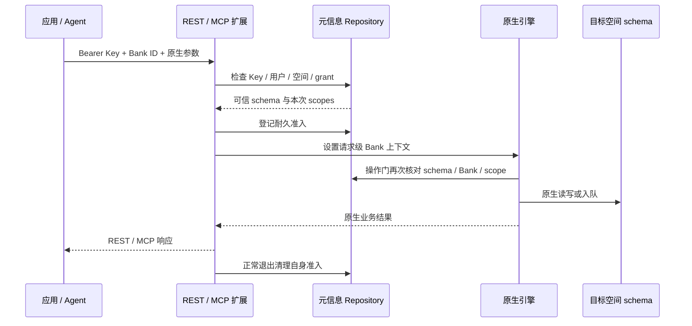
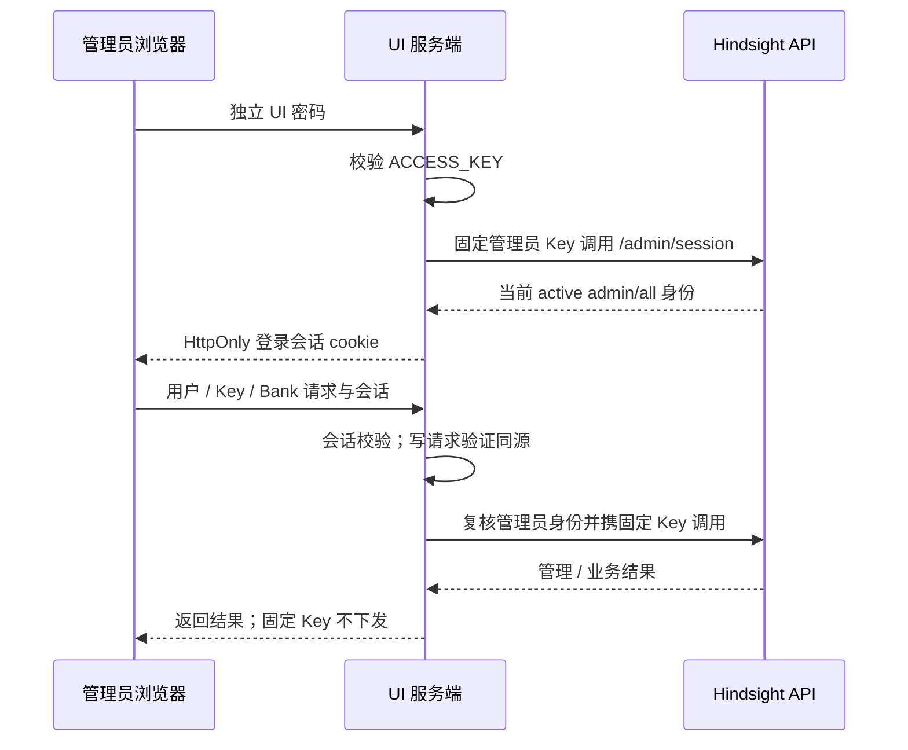

# ContextDB 独享版本 v2：租户用户、工作空间与 API Key 设计

更新日期：2026-10-15。本文独立记录 v2 的“实例级用户、多空间 Key、唯一管理员 UI”设计；原“工作空间内成员、Key 固定单空间”的详细设计保留为 [v1](member-apikey-bank-service-design.md)。方案结合 Hindsight、阿里云、腾讯、火山的资料与架构评审形成，已完成 V2 实现和本地自测。云管控、节点 Agent 和生产部署验收尚未完成。

开发起点：V1 `cdfc199e5f48b1d9cc9a99119b3efb761f656ef6`。V2 已整理为独立分支 `contextdb/service-management-v2`、单一提交 `d5e851b60315b79696e995874e7edc1e9a7bae23`，与 V1 共用上游基线 `a77c1f3412a7b82f36588dffce1a8d7480e99cc7`；已推送个人仓。V2 面向新实例，不迁移旧 ContextDB 元数据或接续旧 Key。验证结果与未完成项见[本地自测与验收记录](implementation/contextdb-v2-self-test-acceptance-2026-10-15.md)，开发过程见[夜间审阅记录](implementation/contextdb-tenant-admin-review-2026-10-15.md)。

本文同时记录产品选择与当前本地实现。接口字段以 [v2 OpenAPI](api/contextdb-control-plane.openapi.yaml) 为准，可执行 DDL 以扩展 `schema.sql` 为准；部署、源码位置和证据见[实现与资料入口](#实现与资料入口)。v1 的架构图和接口合同只用于历史对照。

## 阅读导航

- [设计结论](#设计结论)、[总体架构与请求流程](#总体架构与请求流程)、[管理职责](#管理职责)
- [用户、空间与 Key 授权](#用户空间与-key-授权)、[管理员 UI](#管理员-ui)
- [工作空间与 Bank](#工作空间与-bank)、[PG 表设计](#pg-表设计)、[管理 REST 接口](#管理-rest-接口)
- [原生接口与外围集成](#原生接口与外围集成)、[生命周期与并发实现](#生命周期与并发实现)
- [客户可见 PG 与 root 的边界](#客户可见-pg-与-root-的边界)、[实现与资料入口](#实现与资料入口)、[Q&A](#qa)

## 设计结论

**用户在华为云租户下，与工作空间同级；用户可获一个、多个或全部空间的权限。每个空间仍对应独立 schema 内的唯一 Bank。**

```text
华为云租户 / 独享实例（复用已有云资源身份）
├── 用户目录
│   ├── 实例管理员（本期唯一）→ 多把独立管理员 Key
│   └── 普通用户 × N → 空间访问范围 → API Key × N
└── 工作空间 × N
    └── 独立 PG schema → 唯一 Bank（bank_id = workspace_id）
```

这里的用户可代表人或应用责任记录，不要求普通用户注册登录。空间页面显示的是“获授权的租户用户”，不是另建一份空间用户。移除某空间授权与删除全租户用户是两个动作。

**本期用户目录和 Key 只覆盖当前独享实例。** 不建设跨 ContextDB 实例的云账户用户目录，不允许一个 Key 跨云租户访问；若一个华为云租户购买多个实例，各实例分别管理用户和 Key。

本期不引入 Organization、项目、用户组、邀请系统或独立 MetaPG。资源和元信息共用服务 PG，云管控不持久保存工作空间信息。

相较“Key 固定单空间”，多空间方案的主要工作量在请求路由、跨 schema 列表和 MCP 每次调用鉴权。用户目录与 Key 求交增加一层检查，但能避免以后为多空间身份重做模型；本期通过唯一管理员、无子 Key、无普通用户登录和无旧数据迁移控制范围。数组/JSONB 足够承载当前授权，若以后需要用户组、批量授权或大量空间，再迁移为关联表，不改变对外用户/Key 身份。

## 总体架构与请求流程

总体架构按业务访问、云管控、UI 管理三个场景展开，三者共用同一套 Hindsight API、Worker 和 PG。单独查看见 [总体架构说明](contextdb-v2-architecture.md)。


- **业务面**：Agent / 应用 → Hindsight API；API 处理业务请求，Worker 从 PG 领取后台任务并写入结果。
- **云管理面**：建议华为云 Console → 华为云管控 → 节点管理 Agent → 本机 Hindsight API，负责实例登记和工作空间创建、删除、查询；节点 Agent负责服务启停、升级及高可用运维，具体接口待与管控确认，见 [管控联调文档](contextdb-v2-control-plane-integration.md)。
- **UI 管理面**：管理员 → Hindsight UI → Hindsight API，负责用户、Key、空间授权和空间内容管理；UI 不直接连接 PG。

PG 保存两类数据：元数据包括实例、空间、用户、Key 与授权；用户数据包括各空间的文档、记忆、知识和任务。每个空间独立 schema、唯一 Bank，元数据和用户数据位于同一个 PG 数据库。

### 业务 REST / MCP 调用



拒绝请求不进入业务读写。进入引擎后的取消、未知错误或数据库连接丢失保留恢复屏障；MCP 每次工具调用重新检查当前凭据，不沿用 initialize 时的授权快照。

## 管理职责

| 入口 | 本期职责 | 凭据 |
| --- | --- | --- |
| 华为云 Console → 管控 → 节点管理 Agent → Hindsight API（建议路径） | 登记实例；创建、查询、删除工作空间；初始化凭据恢复 | 管控到 Agent复用已有认证；Agent到 API使用管控服务 Key和可信操作人 |
| 管控 → 节点管理 Agent | 服务部署、启停、升级及高可用运维 | 复用节点 Agent现有管理通道，接口待确认 |
| Hindsight UI → API 节点 | 管理租户用户、空间授权和用户 Key；查看与操作全部空间的 Bank 内容 | UI 登录口令 + 服务端固定管理员业务 Key |
| 应用 / Agent → 原生 REST / MCP | 使用获准 Bank 的记忆、知识、Recall/Retain/Reflect 等能力 | 普通业务 Key |
| Worker | 发现空间、执行已受理任务和后台维护 | 原生内部任务上下文，不借用 UI 登录口令 |

Console 复用已有华为云登录和授权，不建设第二个登录平台。工作空间状态、schema 映射、用户及 Key 均以服务 PG 为准；创建/删除超时后，管控查询操作结果，不假定未执行，也不另存一套空间目录。

**管理员业务 Key 与内部管控 Key 不混用。** 管控 Key 不取得 Recall/Retain 权限；UI 管理员 Key 不取得空间创建/删除的管控权限。管理员 UI 不直接调用原生 Bank 创建、删除、clone、restore 或 alias 创建入口。

## 用户、空间与 Key 授权

### 用户范围

用户角色只有 `admin` 和 `member`：

- **实例管理员**：初始化自动创建，本期唯一；固定 `all` 空间范围，包含未来新增空间。不可降级、停用、删除或改成 selected。
- **普通用户**：可配置 `all` 或 `selected`。all 包括当前和未来空间；selected 是明确的 workspace_id 清单。普通用户不能管理用户或 Key，也不能登录 UI。

用户在多个空间始终是同一 user_id，停用一次即可阻断名下全部 Key 的新请求。恢复用户只恢复仍有效、未撤销、未到期的 Key；已撤销 Key 不复活。同 Bank 内容继续共享，不提供写入者私有记忆隔离。

### Key 范围

一个用户可以有多把独立 Key，本期不实现父子 Key、委派或普通用户自助签发。

- 普通 Key 使用 **selected**，逐空间保存操作权限；默认按用户当前获准空间生成显式清单，不自动获得未来新增空间。
- 管理员 UI 专用 Key 使用 **all**，包含全部四类业务 scope，并自动覆盖未来空间。管理员也可持有 selected Key 用于特定业务。
- 用户空间范围是上限，Key 只能收窄；修改用户范围后，不需要逐把重新签发 Key。

```text
有效权限 = 用户有效
         ∧ Key 有效
         ∧ 工作空间允许当前业务访问
         ∧ 用户允许目标空间
         ∧ Key 允许该空间及本次操作
```

**all 必须显式设置，不用空数组表示“全部”。** 普通用户获 all 范围，也不意味着其旧 selected Key 自动扩权。

| 用户空间范围 | Key 授权 | 结果 |
| --- | --- | --- |
| A、B | A 读写；B 只读 | A 读写成功，B 写入拒绝，C 全部拒绝 |
| A、B | 另一把 Key 仅 A 只读 | 不继承同用户其他 Key 的写权限 |
| 从 A、B 改为仅 A | Key 仍有旧 B 授权 | 下一请求访问 B 拒绝，secret 不变 |
| 用户停用 | 名下任意有效 Key | 新请求均拒绝，其他用户正常 |
| 管理员 all | 管理员 UI all Key | 新增 D 后自动可见 D |

四类业务 scope 沿用：

| scope | 能力与边界 |
| --- | --- |
| `memory.read` | 记忆、文档及相关任务读取，Recall 的记忆来源 |
| `memory.write` | Retain、记忆/文档修改与删除、相关派生内容写入；必须同时有 memory.read |
| `knowledge.read` | 知识页、知识树、知识检索和导出，以及 Recall 的知识来源 |
| `reflect` | Reflect；必须同时有 memory.read |

业务 write 不包含空间生命周期、用户或 Key 管理。清空整个 Bank 的内容仅允许 admin/all Key；清空后仍保留 Bank，不能将其当作删除工作空间。关联文件、任务、知识页等也必须验证真实 Bank 归属；不能只检查 URL 的一个 ID。原生已受理任务继续按既定 schema 执行，撤销凭据不承诺取消在途任务或回滚数据。

### Key 生命周期

创建时生成随机 secret，服务端只存带 pepper 的摘要；secret 仅创建响应展示一次。列表和详情只返回元数据，日志、审计不含 secret。

管理员可创建、查看、撤销 Key，并修改 selected Key 的逐空间权限；修改授权不换 secret，使用版本和 If-Match 防止并发覆盖。all 管理员 Key 的权限固定，不支持修改。删除 Key 表示不可逆撤销，不抹除历史归属。

实例初始化返回唯一管理员和首把 all 管理员 Key。初始 Key 不到期；允许多把管理员 Key 进行手动轮换，禁止撤销最后一把有效 all 管理员 Key。初始化响应丢失时不重显 secret，由可信管控调用管理员 Key 恢复入口签新 Key，并同步更新 UI 服务端配置。

## 管理员 UI

本期只允许一个实例管理员进入，复用原生共享口令机制：

| 配置 | 含义 |
| --- | --- |
| `HINDSIGHT_CP_CONTEXTDB_ENABLED=true` | 显式启用 ContextDB 管理员模式 |
| `HINDSIGHT_CP_ACCESS_KEY` | 独立 UI 登录口令，只提供给管理员 |
| `HINDSIGHT_CP_DATAPLANE_API_KEY` | UI 服务端固定的、有效的实例管理员 all Key |

ContextDB 模式下缺少任一凭据必须拒绝访问；UI 后端校验固定 Key 确为有效 admin/all。口令和业务 Key 不相同，不接受成员 Key 替代登录口令；浏览器不能指定上游地址或替换服务端 Key。

UI 登录口令不是用户角色认证。只有获该口令的人能登录；共享口令的审计只能归于实例管理员/服务端 Key，不能区分多位真实操作人。以后增加多管理员登录再接已有 IAM/SSO，不在本期建设。

页面提供：

- 租户用户目录，以及按当前 Bank/空间筛选的“已授权用户”视图。
- 创建普通用户，配置 all/selected 空间范围，修改名称、启停和删除。
- 用户 Key 的列表、一次性创建展示、授权修改与撤销。
- 全部 Bank 的原生记忆、文档、知识和任务视图；切换空间不更换 Key。

用户/Key 管理代理必须同时检查 UI 会话和后端管理员身份，写请求做同源校验。关闭原生 Bank 创建、删除、clone、restore、alias 创建与名称修改入口，后端也拒绝对应绕行请求。工作空间生命周期仍只由 Console 管理。



## 工作空间与 Bank

- `bank_id = workspace_id`，由服务生成不可变的随机 32 位 hex ID，实例内全局唯一，删除后不复用。
- `bank_name = workspace_name`，创建时固定。服务端按 **NFKC → trim → casefold** 生成 name_key，由 PG 唯一约束保证实例内名称唯一。
- schema 使用服务生成的安全名称，登记在元信息中；不从用户名、显示名或客户端 schema 参数拼接。
- 本期 Console 支持创建、查询、删除，不开放空间/Bank 改名。成功删除后可以重用名称，但获得全新的 Bank ID/schema。
- 创建/删除返回可查询操作，状态包含 creating、active、deleting、deleted、failed；重复请求依据幂等号核对，不重复创建。
- 删除先拒绝新请求和新入队，等待已受理请求/原生任务排空后清理 Bank 数据；保留 schema/表结构与元信息 tombstone，不自动 DROP schema。不能仅等待固定时间就认为安全；未知旧执行者必须阻断破坏性清理。

同实例不同空间的数据、表和索引分离，CPU、内存、I/O、连接、WAL、故障与恢复边界共享，不宣传独立计算资源隔离。

## PG 表设计

### 布局与全部元信息表

`ctxdb_meta` 保存管理元信息；`ctxdb_ws_<32位hex>` 保存该空间的原生 Bank、记忆、知识、索引与异步任务。下表对应当前 **8 张**元信息表，不复制另一套 SQL。ID 通常为 `text`，时间为 `timestamptz`，资源版本为 `bigint`。

| 表 | 主要字段 | 数据库约束与服务规则 |
| --- | --- | --- |
| schema_versions | version（integer 主键）、installed_at | 当前版本 2；缺失、v1 或未知版本拒绝启动，不自动升级 |
| instances | instance_id（主键）、cloud_tenant_id、name、created_by、created_at | instance/tenant 联合唯一；只能登记部署配置中的本实例及云租户 |
| workspaces | workspace_id（主键）、instance_id、cloud_tenant_id、schema_name、name、name_key、description、state、version、created_at | instance/tenant 复合外键；schema 全局唯一且满足安全名称模式；未 deleted 的同实例 name_key 唯一；Bank ID = workspace ID |
| users | user_id（主键）、instance_id、name、role、status、workspace_access、workspace_ids（text[]）、version、created_at | role 为 admin/member；status 为 active/disabled/deleted；all 时数组必须为空；admin 固定 active/all；每实例最多一个 admin，由 bootstrap 建立 |
| api_keys | key_id（32hex 主键）、instance_id、user_id、name、digest（bytea）、access_mode、grants（jsonb）、expires_at、revoked_at、version、created_by、created_at、last_used_at | instance/user 复合外键；digest 为 32 字节；grants 为数组；all 时 grants=[] 且无到期时间；仅管理员可签发 all，由 Repository 复核 |
| management_operations | operation_id（主键）、workspace_id、instance_id、workspace_version、actor_subject、action、target_id、idempotency_key、request_hash、state、attempts、lease_token、lease_until、error_code、created_at、updated_at | instance/workspace 复合外键；实例/actor/动作/目标/幂等值联合唯一；版本代次与租约限制旧执行者，token 不返回客户端 |
| request_admissions | admission_id（主键）、instance_id、workspace_id、owner_id、origin、state、created_at | instance/workspace 复合外键；origin 为 http/queue；state 为 active/interrupted；执行前提交；无 TTL，均阻止破坏性清理 |
| audit_events | event_id（identity bigint 主键）、request_id、instance_id、cloud_tenant_id、workspace_id、user_id、key_id、control_key_id、actor_subject、action、result、created_at | 管理成功变更审计，与变更同事务提交；不存 secret/digest/请求正文/记忆正文；不是完整数据调用审计 |

`audit_events.control_key_id` 沿用历史列名：Console 调用记录管控 Key ID；UI 管理调用记录实际管理员业务 Key ID，actor 为管理员 user_id，不冒充共享口令后的个人身份。

用户空间范围和 Key 的逐空间 scope 分别保存在数组与 JSONB，不新增两张授权关联表。每条 grant 必须绑定自己的 workspace_id 与 scopes，不能将空间清单和动作清单交叉组合。目标存在性、用户范围上限、scope 白名单/依赖及 admin/all 资格由 Repository 校验；直接 SQL 写入不能替代服务规则。

### 索引与状态

| 索引 | 用途 |
| --- | --- |
| workspaces_name_unique / workspaces_instance_page | 同实例有效名称唯一、空间分页 |
| one_admin_per_instance / users_instance_page | 唯一管理员、租户用户分页 |
| keys_user_page | 同用户 Key 分页，包含撤销/到期元数据 |
| operations_pending | 待处理任务与到期租约发现 |
| admissions_workspace | 删除前检查未完成/未知请求 |
| audit_workspace_time | 按实例、空间、时间检索管理变更 |

空间状态为 creating/active/frozen/deleting/deleted/failed；本期没有面向 Console 的冻结/解冻接口，frozen 仍用于已有内部状态与排空保护。管理任务状态为 pending/running/succeeded/failed。Key 的 active/expired/revoked 是由到期与撤销字段计算的状态，不代表用户或空间一定有效。

### 事务与权限更新

1. Bootstrap 单独安装元信息；API/Worker 运行时校验版本。原生空间 schema 仍由 Hindsight migration 初始化，不重写记忆表/Alembic。
2. 用户/Key 修改先锁本实例行，再复核当前管理员 Key 和资源版本。最后一把 all Key 的检查与撤销同事务串行，不能并发全部撤销。
3. 用户范围修改不重写每把 Key；下一次请求重新求交。停用/删除用户也不删除共享 Bank 内容；恢复只适用于 disabled 用户，软删除用户没有恢复接口。
4. selected Key 只允许在有效状态下修改 grants；修改 secret、到期、名称及 all Key 权限不属于当前 PATCH。授权修改保持原 secret，version 递增。
5. 生命周期登记、操作幂等和管理审计同事务；空间 DDL/Bank 初始化在后续异步步骤执行，不宣传元信息与所有 DDL 为单一原子事务。
6. 不长期缓存授权；已受理任务与新请求分别处理，详见生命周期章节。

新 schema 版本只面向新库；发现旧版元信息明确拒绝自动迁移。v1 的 workspace_members 和 key_requests 不属于 v2 表集，不能混用两版 DDL。

## 管理 REST 接口

前缀 `/ext/contextdb/v1`。接口划分按调用资格，不因 API Key 名叫 admin 就允许内部管控操作。

| 调用资格 | 操作 |
| --- | --- |
| 可信管控服务 | POST /instances；GET /instances/{id}；POST /instances/{id}/admin-keys |
| 可信管控服务 | POST/GET /workspaces；GET/DELETE /workspaces/{id}；GET /operations/{id} |
| 有效 admin/all 业务 Key | GET /admin/session；POST/GET /users；GET/PATCH/DELETE /users/{id} |
| 有效 admin/all 业务 Key | POST/GET /users/{id}/keys；PATCH/DELETE /users/{id}/keys/{key_id} |

User 返回 user_id、name、role、status、workspace_access、workspace_ids、version；Key 返回 key_id、user_id、name、access_mode、grants、到期/撤销、version。列表统一 items/total/limit/offset，可按 workspace_id 筛选用户。

创建/删除空间使用 Idempotency-Key；202 响应直接返回 operation_id、workspace_id、action、state 等操作信息，空间详情另行 GET 查询。用户和 Key 权限更新使用 ETag/If-Match。缺凭据 401，无管理权限 403，版本冲突 412，名称/状态冲突 409。不存在或越界目标不泄露其他客户资源；错误不回显秘密。

管控服务凭据只由平台持有，来源及可信 actor 检查继续复用，不接受客户自报 subject 获得管理身份。UI 由固定管理员 Key形成自己的管理身份，不冒充管控 actor。

### 完整操作清单

以下 18 个操作相对于 `/ext/contextdb/v1`。**文档/元数据版本是 v2，扩展 API 路径仍为 v1**，本轮没有将 URL 改成 `/v2`。请求输入拒绝未定义字段。

| 凭据 | 方法与路径 | 主要输入 / 前置条件 | 成功响应 |
| --- | --- | --- | --- |
| 管控 | POST /instances | instance_id、name；cloud_tenant_id 可省略，否则必须匹配部署 | 201 BootstrapResult |
| 管控 | GET /instances/{instance_id} | 本部署实例 ID | 200 Instance |
| 管控 | POST /instances/{instance_id}/admin-keys | name 可选；可信恢复/轮换 | 201 KeyIssued，secret 仅本次展示 |
| 管控 | POST /workspaces | name、description 可选；Idempotency-Key | 202 ManagementOperationResponse |
| 管控 | GET /workspaces | limit/offset | 200 Page[Workspace] |
| 管控 | GET /workspaces/{workspace_id} | 当前实例已登记且未 deleted | 200 Workspace + ETag |
| 管控 | DELETE /workspaces/{workspace_id} | Idempotency-Key | 202 ManagementOperationResponse |
| 管控 | GET /operations/{operation_id} | 当前实例管理任务 | 200 ManagementOperationResponse |
| admin/all | GET /admin/session | 当前 Key 和用户有效 | 200 AdminSession |
| admin/all | POST /users | name、workspace_access、workspace_ids；创建 member | 201 User + ETag |
| admin/all | GET /users | limit/offset、workspace_id 可选 | 200 Page[User] |
| admin/all | GET /users/{user_id} | 当前实例未删除用户 | 200 User + ETag |
| admin/all | PATCH /users/{user_id} | If-Match；name/status/workspace_access/workspace_ids 中至少一项；不接受 role | 200 User + ETag |
| admin/all | DELETE /users/{user_id} | 普通用户；全实例软删除，重复删除幂等 | 204，无正文 |
| admin/all | POST /users/{user_id}/keys | name、access_mode、grants、expires_at；目标用户 active | 201 KeyIssued + ETag |
| admin/all | GET /users/{user_id}/keys | limit/offset | 200 Page[KeyMetadata] |
| admin/all | PATCH /users/{user_id}/keys/{key_id} | If-Match；仅 grants；有效 selected Key | 200 KeyMetadata + ETag |
| admin/all | DELETE /users/{user_id}/keys/{key_id} | 不可撤销最后有效 all Key；重复撤销幂等 | 204，无正文 |

所有 Console 调用要求 `X-ContextDB-Control-Key`、`X-ContextDB-Actor-Subject` 和真实私有来源；admin/all 接口要求 `Authorization: Bearer <ADMIN_KEY>`。认证先于请求体解析，来源头不能代替真实连接来源。

集合默认 limit=20，允许 0..100，offset 非负；返回 items/total/limit/offset。空间/用户列表不返回 deleted 项，Key 列表包含已撤销/过期元数据；workspace_id 用户筛选表示用户的空间上限关系，不代表每把 Key 都能访问该空间。

### 请求与响应模型

| 模型 | 关键字段与含义 |
| --- | --- |
| BootstrapResult | instance、admin_user、admin_key；首次包含 KeyIssued，重复登记 admin_key=null，不重显旧 secret |
| Workspace | workspace_id、instance_id、cloud_tenant_id、schema_name、name、description、state、version、created_at；bank_id 由 workspace_id 确定 |
| User | user_id、instance_id、name、role、status、workspace_access、workspace_ids、version、created_at |
| KeyMetadata | key_id、user_id、name、access_mode、grants、expires_at、revoked_at、version、created_at、last_used_at、计算得到的 status；无 secret/digest |
| KeyIssued | KeyMetadata + secret；secret 已是完整 ctx_live_ 凭据，不再拼接 key_id |
| ManagementOperationResponse | operation_id、workspace_id、action、state、attempts、error_code；没有内部 lease_token/actor/request_hash |
| AdminSession | user_id、role=admin、instance_id、cloud_tenant_id；成功即证明当前 active admin/all |
| 管理错误 | code、message、request_id；不回显凭据、DSN、请求正文或数据库诊断 |

UserCreate 默认 selected/空 workspace_ids，允许暂时无空间；all 模式必须为空数组。workspace_ids 与 grants 各最多 1000 项且 ID 不重复；每 grant 的 scopes 是四类白名单中的非空集合，write/reflect 必须含 read。用户空间和 grant 目标只能登记已就绪的 active/frozen 空间，实际客户业务仍要求 active。

**当前签发默认值必须明确：省略 grants 时，selected Key 快照用户当前空间，给每项全部四类 scope；显式 grants=[] 表示零权限。** 客户端/UI 如需最小权限应显式传 grants。member 不可创建 all Key；selected Key 可无到期时间，指定到期则须含时区、晚于当前时间且不超过 365 天；all Key 无到期时间。

下面示意给同一用户在 A 空间读写、B 空间只读。占位 ID 必须替换为管控返回的真实 workspace_id：

```json
{
  "name": "app-key",
  "access_mode": "selected",
  "grants": [
    {"workspace_id": "aaaaaaaaaaaaaaaaaaaaaaaaaaaaaaaa", "scopes": ["memory.read", "memory.write"]},
    {"workspace_id": "bbbbbbbbbbbbbbbbbbbbbbbbbbbbbbbb", "scopes": ["memory.read"]}
  ]
}
```

用户/Key PATCH 的 If-Match 必须为带引号的版本，例如 `"1"`，不是裸数字。成功资源响应返回新 ETag；版本不匹配 412。管理响应有 X-Request-ID 与 Cache-Control: no-store，204 无正文。

空间 POST/DELETE 的幂等值长度 1..128；同 actor/动作/目标重用相同值须对应相同正文，否则 409。管理任务成功后才表示生命周期完成，不能将 202 当成已可用/已删除。Key 签发没有 v1 的 key_requests 重放机制，重复 POST 可能生成多把 Key；丢失 secret 后签新 Key 并撤销已知旧 Key，不查询或重放旧 secret。

## 原生接口与外围集成

**尽量不新增内核改动：业务算法、原生记忆表和接口路径保持。** 静态租户扩展只复用 TenantExtension 接口、schema 迁移和 Worker 发现模式，不修改其“Key→唯一 schema”实现，也不宣传它原本就支持动态多空间。

| 外围模块 | 职责 |
| --- | --- |
| Repository | 用户、空间上限、Key 逐空间权限、状态、元信息事务 |
| HTTP 扩展/纯 ASGI 中间件 | 从真实 Bank URL建立请求级目标；跨 schema Bank 列表；拒绝不支持的生命周期入口 |
| TenantExtension | 验证当前 Key/用户，按实际目标 Bank 查询可信 schema，并校验空间范围 |
| OperationValidator | 每次操作复查目标 Bank、schema 和 scope；未知或不支持的组合拒绝 |
| MCPExtension middleware | 每次工具调用按 bank_id 选择空间、重新鉴权；list_banks 使用同一聚合规则 |
| UI 服务端代理 | 固定 adminKey、会话/同源保护、用户/Key 页面和跨空间 Bank 选择 |

同一个 Key 可以请求不同 Bank URL，Bank ID 决定目标空间，服务端查登记映射，不直接相信客户给出的 schema。列表先确定可见空间，再全局搜索、排序、分页；不能只设置 allowed_bank_ids 就假定原生 list_banks 会跨 schema。

MCP 旧会话下一工具调用必须执行当前权限，不能只认证 initialize；无 Bank 的初始化、list_tools、list_banks 与固定 /mcp/{bank} 都要覆盖。禁止静态 MCP_AUTH_TOKEN 绕过动态认证。

继续保留基线中的必要消息身份、scope来源和入队/排空 hook，不能为了减少行数取消安全机制。任何新增内核改动都需在实现报告列清文件、理由和无法由外围完成的依据；“减少侵入”不等于取消鉴权或生命周期保护。

### 原生数据接口与 MCP 细节

| 能力 | 原生入口 / 调用方式 | 当前扩展策略 |
| --- | --- | --- |
| Retain | POST /v1/default/banks/{bank_id}/memories | memory.write + memory.read；同步/异步及原生响应沿用 |
| Recall | POST /v1/default/banks/{bank_id}/memories/recall | memory.read；知识来源另需 knowledge.read |
| Reflect | POST /v1/default/banks/{bank_id}/reflect | reflect + memory.read；沿用原生 text/based_on/usage 等结果 |
| 原生异步任务 | Bank 下 /operations/{operation_id} | 读取需 memory.read；任务归属仍限定实际 Bank |
| 知识读取与内容编辑 | 原生知识树、页面、搜索、导出、文档/文件入口 | 知识读取 knowledge.read；普通内容写入 memory.write；不另写知识/文件引擎 |
| REST Bank 列表 | GET /v1/default/banks?q&limit&offset | 轻量 catalog 跨 schema 合并后全局排序、分页，仅结果页补统计/config；返回原生 banks/total/limit/offset |
| MCP 多 Bank | /mcp/ + 工具 bank_id；支持 X-Bank-Id 默认目标 | 每个工具按当前消息凭据路由；不能借旧 session 或任意 schema 越权 |
| MCP 单 Bank | /mcp/{bank_id}/ | 工具参数不能切换到别的 Bank |
| Bank 生命周期 | 原生建/删/改名、clone、Bank import/restore、alias 写 | 业务 Key（含管理员）拒绝，空间生命周期走 Console |
| 整 Bank 内容清空 | DELETE .../memories、MCP clear_memories | 仅 admin/all；保留 Bank 与工作空间映射 |

REST 列表默认 limit=100，最大 1000，支持 limit=0 返回总数；catalog 发现仍需遍历可见 schema，不宣称 O(page) 的整体成本。MCP list_banks 沿用 JSON 文本与当前 FastMCP 的 structured result 包装，不新增用户/Key 管理工具。

配置/mission、部分任务控制等管理动作只允许 admin/all。未知或不支持的 operation 默认拒绝，不因 memory.write 就获得任意引擎能力。原生成功响应结构沿用；权限错误、可见 Bank/工具及生命周期限制属于有意改变的行为。

## 生命周期与并发实现

### 初始化与开通空间

1. 在新数据库安装 metadata v2，注入固定 instance/tenant、pepper 与管控 Key 摘要，再启动 API/Worker。
2. Console 登记已有实例，首次创建唯一 admin 和永久 all Key；平台保存该一次性 secret 并配置 UI。重复登记不重放 secret；丢失时使用可信恢复入口签新 Key。
3. 创建空间在短事务内检查实例、幂等值与规范化名称，生成 workspace/schema/operation，登记 creating/pending 与成功管理审计，返回 202。
4. API 内 Lifecycle 领取操作租约，在可信 schema 中执行原生 migration，复核租约后以限定 create_workspace 上下文创建唯一 Bank。
5. 核验 Bank 存在后完成操作，将空间置 active。默认模板产生的初始任务沿用受限初始化准入，不能由旧租约重新入队。

### 删除与排空

Console 的删除请求关闭空间新业务入口，进入 deleting 并登记管理任务。已受理的 HTTP/MCP 请求、pending/processing 原生任务及其必要后续任务先排空；API Lifecycle 在可信 delete_workspace 上下文清理 Bank 数据，成功后标记 deleted，保留 schema/表与 tombstone。

排空同时看原生队列和已提交的 request_admissions；不能只查 processing=0 或等固定秒数。进入引擎后失联/异常留下的 interrupted 屏障不会自动过期，需要运维确认旧 API/Worker/PG 会话已被隔离后处理。没有面向客户的自动清屏障 API。

创建/删除失败由 operation 状态、workspace_version 和租约核对后重试。DDL 不持有长元信息事务；迁移取消须等底层执行真正退出，不把协程 cancelled 当成后台 DDL 已停止。本期要求 MIGRATION_ISOLATION=false，尚未验证生产多副本迁移 fencing。

### 请求、MCP 与 Worker 的保护

- 业务请求先登记耐久准入，再持有必要空间/数据库事务保护；metadata 使用独立连接预算，避免删除等待占满业务池。
- 未通过工具/参数/操作门、尚未进入引擎的拒绝清理准入；真实执行后的未知错误/取消保留屏障。
- MCP 每个 HTTP 消息建立不持有 Bank/PG 锁的传输生命周期，真实工具再建立目标空间准入；断连时取消并等待脱离 HTTP 任务的处理器退出。
- Worker 从已登记 schema 发现原生队列；frozen/deleting 仍可发现以完成已受理工作。内部上下文检查实际 schema/Bank，只有 lifecycle purpose + 当前租约能建/删 Bank。
- 撤权后新请求拒绝，已受理任务继续处理；不承诺取消旧任务或回滚数据。MCP 401 可能结束客户端会话，恢复凭据后需要重连。

## 客户可见 PG 与 root 的边界

**真正的 PG SUPERUSER、可接管服务 owner 的云高权限账号或主机 OS root，无法由同库 schema ACL/RLS 阻止篡改服务数据。** 本方案不承诺这种隔离。

PG 对客户可见的可行前提：平台保留受保护 schema/table 的 owner 和服务凭据；客户拿受限账号，无 SUPERUSER、BYPASSRLS、CREATEROLE、owner 成员资格、SET ROLE 提权路径、受保护 schema 的 DDL/DML 或危险内置角色。PUBLIC 和未来对象的默认权限也要收回，同时保留 public 中共享扩展的正常调用。

受限客户账号可以使用自己的 schema，但不能直接读服务元信息或改 Bank 表。系统目录仍可能显示 schema/表的存在，不能宣传完全隐藏。真实华为 RDS 高权限账号能否满足上述条件需要平台验证；若客户必须拥有真正 root，则需接受可篡改边界，或另行选择客户无超级权限的服务数据库边界。

部署例子与权限测试只证明临时标准 PG 的角色效果，不代表华为 RDS 生产策略已验证。[PG 角色属性](https://www.postgresql.org/docs/18/role-attributes.html)、[RLS 边界](https://www.postgresql.org/docs/18/ddl-rowsecurity.html)。

## 实现与资料入口

### 文档和源码各负责什么

| 入口 | 包含内容 |
| --- | --- |
| 本文 | v2 产品模型、架构、鉴权、表字段/约束、接口清单、生命周期及实现选择 |
| [v2 OpenAPI](api/contextdb-control-plane.openapi.yaml) | 实际路由生成的精确请求/响应 schema、security、状态码、必需请求头；当前合同测试对照此文件 |
| [本地自测与验收记录](implementation/contextdb-v2-self-test-acceptance-2026-10-15.md) | 已执行检查、证据范围和待完成的验收项 |
| [夜间审阅记录](implementation/contextdb-tenant-admin-review-2026-10-15.md) | 开发阶段独立审阅、已修缺陷与历史测试记录 |
| [v1 详细设计](member-apikey-bank-service-design.md) / [v1 OpenAPI](api/contextdb-control-plane-v1.openapi.yaml) | 2026-10-13 历史模型、架构图、9 张表、16 个管控操作；不是 v2 合同 |
| 扩展 schema.sql / models.py / http.py | 可执行 DDL、模型校验和真实路由，修改代码时同步上述合同 |
| 扩展 README.md / deployment/pg-role-boundary.sql | 部署配置说明、客户受限 PG 角色示例 |

V2 正式代码已归档为独立单提交并推送至 [代码分支](https://github.com/ZhuQingping/hindsight/tree/contextdb/service-management-v2)。本地归档工作区：

```text
/Users/zhuqingping/Work/Database/Context/.local/worktrees/contextdb-service-management-v2
```

下面路径相对该代码工作区，不是 Research 仓库内的源码：

| 路径 | 实现职责 |
| --- | --- |
| hindsight-extensions/contextdb-service/hindsight_ext_contextdb/schema.sql | 本文列出的 8 张表、索引和 metadata 版本 |
| 同目录 models.py / security.py | user/grant 输入校验、32hex ID、随机 Key、完整凭据 HMAC、管控 SHA-256 摘要校验 |
| 同目录 repository.py | 授权求交、用户/Key 变更、实例锁、幂等/审计及生命周期元信息 |
| 同目录 http.py / admission.py | 两种管理认证、纯 ASGI 准入与不支持入口拒绝、传输取消/耐久屏障 |
| 同目录 tenant.py / validator.py | 可信 schema 解析、每操作 scope、内部任务与目的限制、Worker 发现 |
| 同目录 routing.py / mcp.py | 请求级目标、跨 schema 全局列表、MCP 每消息/每工具路由 |
| 同目录 lifecycle.py / __main__.py / config.py | 管理任务执行器、bootstrap/凭据生成 CLI、部署条件校验 |
| hindsight-control-plane/src/lib/contextdb.ts / contextdb-api.ts | UI 凭据/后台管理员检查、同源校验、浏览器管理请求合同 |
| hindsight-control-plane/src/app/api/contextdb/[...path]/route.ts | 固定上游/Key 的管理代理、路径/字段白名单、secret 一次展示响应 |
| hindsight-control-plane/src/components/contextdb-users-view.tsx | 用户、空间授权、Key 管理界面 |
| hindsight-extensions/contextdb-service/tests / hindsight-system-tests/tests/test_100–110 | 元信息/权限/角色边界测试与真实 API/SDK/MCP/Worker 故事 |

业务 Key 为 `ctx_live_<32hex key_id>_<随机secret>`；摘要覆盖整串凭据，pepper 只在服务配置中。修改 pepper 会使已有业务 Key 失效，本期无版本化 pepper 轮换。管控 Key 为独立 `ctx_ctrl_` 凭据，只以 key_id/摘要配置，不存入 api_keys。名称或前缀本身不是授权依据。

### 部署配置与升级边界

| 配置 | 当前作用 |
| --- | --- |
| CONTEXTDB_INSTANCE_ID / CONTEXTDB_CLOUD_TENANT_ID | 本部署已有资源身份，API/Worker/bootstrap 必须一致 |
| CONTEXTDB_KEY_PEPPER | 至少 32 字符、稳定的服务秘密；不下发浏览器 |
| CONTEXTDB_CONTROL_KEYS | 管控 key_id + SHA-256 摘要；当前允许 1–2 把用于轮换，配置改变需重载相关副本 |
| CONTEXTDB_CONTROL_NETWORKS | 可信私有来源 CIDR；默认 loopback，不是公网客户授权 |
| CONTEXTDB_BOOTSTRAP_DATABASE_URL / HINDSIGHT_API_DATABASE_URL | bootstrap 与运行期使用同一新 PG；保护服务 owner 凭据 |
| HINDSIGHT_API_TENANT_EXTENSION | hindsight_ext_contextdb.tenant:ContextDBTenantExtension |
| HINDSIGHT_API_OPERATION_VALIDATOR_EXTENSION | hindsight_ext_contextdb.validator:ContextDBOperationValidator |
| HINDSIGHT_API_HTTP_EXTENSION | hindsight_ext_contextdb.http:ContextDBHttpExtension |
| HINDSIGHT_API_MCP_EXTENSION | hindsight_ext_contextdb.mcp:ContextDBMCPExtension；启用 MCP 时必须使用 |
| HINDSIGHT_API_MIGRATION_ISOLATION | 当前必须 false；禁止残留异步迁移子进程绕过关闭边界 |
| HINDSIGHT_API_MCP_AUTH_TOKEN | 不得配置，避免静态 token 优先级绕过动态认证 |
| HINDSIGHT_CP_CONTEXTDB_ENABLED / ACCESS_KEY / DATAPLANE_API_KEY | 显式开启管理员 UI；后两个变量全名分别为 HINDSIGHT_CP_ACCESS_KEY、HINDSIGHT_CP_DATAPLANE_API_KEY |

管控入口禁用 proxy-header 来源改写，并拒绝 Forwarded/X-Forwarded-For；实际私网、HTTPS 与代理剥离策略须部署验收。UI 写请求验证 Origin/Host 与可用 fetch metadata，所有 API 路径（含静态后缀资源 ID）都经过会话保护；上游地址与固定 Key 不来自浏览器。

本轮没有新增原生内核文件修改，但依赖 cdf 基线已有 9 个文件的 hook（+211/-20 行）：HTTP 生命周期/扩展接口、每消息 MCP 身份恢复、操作来源、入队和 Worker 上下文。原 static tenant 类、记忆算法和记忆表未改；它仍是单 Key→单 schema 语义。该扩展不能直接安装到缺少这些 hook 的任意上游版本，私有 schema/catalog 适配须随上游升级回归。

原 `contextdb-v1-local-validation-guide.md` 保留用于 v1 验证，其成员/Key 初始化流程不能直接用于 v2。当前配套 [v2 验证与演示手册](implementation/contextdb-v2-local-validation-guide.md)、[部署配置清单](implementation/contextdb-v2-deployment-environment.md)及[部署与使用手册](implementation/contextdb-v2-deployment-usage-guide.md)。生产新库开通/回滚、容量与恢复仍需云部署联调，不把本地验证当作生产部署验收。

## Issue 与厂商调研取舍

| 来源 | 本期采纳 | 明确差异或后置 |
| --- | --- | --- |
| [Issue 1](https://github.com/ZhuQingping/ContextDB-Research/issues/1) | 管理员代管、多 Key、逐 Bank 权限、原 Key 改授权、统一停用、管理审计 | 最新诉求增加用户空间上限层；旧模型兼容不做，其他安全机制保留 |
| [Issue 2](https://github.com/ZhuQingping/ContextDB-Research/issues/2) | 固定服务端 Key与独立 UI、管理员限定入口 | 用户/Key 管理由 Console 移到 UI；Console保留空间生命周期；普通用户 UI不做 |
| Hindsight Cloud | 组织内多个 Bank 的 Key 收窄 | 本期不新增 Organization/SSO/子 Key；不等同跨组织 Key |
| 阿里 ContextDB | 治理和数据调用分离、Key一次展示、成员范围 | 阿里 Key固定空间；我们明确支持多空间，不复制其私人记忆/知识ACL |
| 腾讯 Memory Hub | 统一用户、同一用户关联多个团队的身份思路 | 不复制其成员网页登录、资产Owner和私有资产模型 |
| 火山 VikingMem | 一 Key授权多个记忆库、原Key改授权、控制/数据凭据分离 | 不把未公开的逐库动作/用户求交实现当作厂商事实；Mem0是另一产品 |

依据：[Hindsight API Key](https://docs.hindsight.vectorize.io/cloud/api-keys/)、[阿里权限管理](https://help.aliyun.com/zh/rds/apsaradb-rds-for-mysql/permission-management)、[腾讯团队与成员](https://cloud.tencent.com.cn/document/product/1813/134590)、[火山 Viking 鉴权](https://docs.volcengine.com/docs/vector_database_vikingdb/SignatureAuthenticationandInvokingExample?lang=zh)。厂商资料仅用于产品取舍，不代表我们已完成运行验证。

## 验收与待确认边界

必须实际验证：一 Key A读写/B只读/C拒绝；同用户不同Key独立；移除用户空间授权、缩Key权限、停用后旧MCP下一请求生效；管理员全部空间及新增空间可见；成员Key不能登录/管理UI；任意schema/关联ID不绕行；名称并发唯一；删除与请求/入队安全；共享内容与后台任务schema正确；客户受限角色拒绝与SUPERUSER反例。

产品与部署验收仍需确认：

1. 唯一实例管理员、用户空间上限与Key逐空间求交是否符合产品预期。
2. 普通Key默认显式清单、不自动包含未来空间；管理员all包含未来空间。
3. Console独占空间生命周期、UI代管用户和Key；共享口令不具备个人身份审计。
4. Bank名称本期不可改，实例内规范化唯一；ID不可变。
5. 客户PG是受限可见账号，还是必须提供可篡改服务对象的真正root。
6. 正式 V2 提交、测试证据、侵入清单及剩余部署限制是否可以接受。

## Q&A

### 是否支持使用管理员 Key 访问 Hindsight 原生 REST / MCP？

**支持。实例初始化生成的管理员 all API Key 可以直接调用原生 REST 和 MCP**，使用 `Authorization: Bearer <管理员 API Key>`。

- 可以访问全部工作空间的 Bank，包括未来新增空间，执行 Recall、Retain、Reflect 和内容管理。
- 同一把 Key 也可配置为 UI 服务端的 `HINDSIGHT_CP_DATAPLANE_API_KEY`。
- 创建、删除工作空间及修改 Bank 名称不属于管理员业务 Key 的能力；空间生命周期由 Console 管控，本期不支持改名。

这里的管理员 API Key 不是 `HINDSIGHT_CP_ACCESS_KEY`（UI 登录口令），也不是内部管控服务 Key。若管理员另签 selected Key，其业务访问仍限于该 Key 的空间和操作授权，不具备 all Key 的全空间及用户/Key 管理能力。

### UI 登录是否只需要密码，访问 API 的 Key 由后台配置？

**是。管理员登录只输入 UI 密码，不需要输入业务 API Key。** `HINDSIGHT_CP_ACCESS_KEY` 用于登录；后台配置的 `HINDSIGHT_CP_DATAPLANE_API_KEY` 由 UI 服务端持有，调用 API 时附带，浏览器不能替换这把固定 Key，也不接收其 secret。

UI 的 Key 管理页面可以在创建新 Key 时一次性展示新 secret，这是凭据签发功能，与 UI 登录及后台固定 Key 的使用分开。

### 工作空间与 Bank 的映射是否只记录在新增 metadata 中？

**是。** `ctxdb_meta.workspaces` 保存工作空间 ID、schema 名称及生命周期状态，约定 `workspace_id = bank_id`。每个工作空间的 schema 内仍使用原生 `banks` 表保存真实 Bank 记录，记忆、文档等继续使用原生表。

本轮没有修改原生表结构；用户、Key 和授权记录保存在新增 metadata 中。创建和删除工作空间由内部生命周期流程同步维护 metadata 与实际 Bank，管控不另存一份工作空间目录。

### 新部署方案是否保持原生 REST / MCP 的请求和返回格式？

**已验证的主要业务接口保持原生请求方式和成功响应结构。** REST 路径、请求参数，以及 MCP 工具名称、参数和结果格式继续沿用原生协议；客户端提供有效 Key 和平台生成的 Bank ID，无需传入 PG schema 或额外的工作空间路由字段。

有意调整的行为包括：Bank 列表跨 schema 聚合后仅返回获授权空间；权限不足、用户停用或 Key 撤销时拒绝请求；MCP 可见工具受权限限制；Bank 生命周期入口不向业务 Key 开放。

关键行为已通过 49 个 REST/MCP/Worker 黑盒故事验证，详见[夜间审阅记录](implementation/contextdb-tenant-admin-review-2026-10-15.md)。这不代表全部原生接口、所有客户端版本或真实云部署已经验收。

### 客户能否用 API Key 创建、删除 Bank？为什么必须禁止？

**不能，管理员 all 业务 Key 也不能。** 绕过工作空间生命周期直接创建或删除 Bank，可能产生未登记的 Bank，或让 metadata 指向已删除的 Bank，破坏“一空间一 Bank”、schema 路由及授权的一致性。

| 入口 | 当前新方案的行为 |
| --- | --- |
| 原生 REST + 普通或管理员 API Key | 创建、删除 Bank 请求拒绝；向未登记 Bank 执行 Retain 也不能自动创建 Bank |
| 原生 MCP | `create_bank`、`delete_bank` 不开放，直接调用也拒绝 |
| Hindsight UI | 隐藏相关入口，服务端同时拦截 |
| Console → 私有管控 API | 使用专用管控服务凭据、可信操作人和来源限制，创建/删除工作空间；内部流程同步操作 Bank 与 metadata |

clone、Bank 导入/恢复、alias 写入等绕行入口也受限制。普通文档导入、Retain 等内容写入仍按业务 scope 执行。

**清空内容与删除 Bank 不同：** admin/all Key 可以清空 Bank 内容，但 Bank 及工作空间映射保留；普通用户不能清空整个 Bank。上述限制已在独立分支实现并通过黑盒验证，已用于本机体验实例，尚未完成云端部署验收。

### 权限是给用户还是给 API Key？

**两层共同决定：用户定义工作空间上限，Key 定义该范围内的逐空间操作权限。实际权限是两者的交集。** 用户允许 A/B、Key 只允许 A 只读时，使用该 Key 只能读取 A；另一把 Key 的权限不会合并过来。停用用户阻断名下所有 Key 的新请求，撤销一把 Key 只影响该 Key；移除用户的 B 授权会令所有 Key 下一次访问 B 时拒绝，即使历史 grant 仍记录 B。

### 管理员能否获取、修改或删除 Initial administrator Key？

首次初始化响应向可信管控返回 `Initial administrator` 的 secret 一次，由平台安全保存并交付给管理员；普通用户不能获取。之后列表只返回名称、ID 和授权等元信息，不能取回原明文，遗失时通过可信管控另签管理员 all Key。

这把 Key 可访问全部当前及未来工作空间的原生 REST/MCP，并管理用户和 API Key；不能绕过 Console 创建、删除 Bank。all 权限和 secret 不能直接修改。管理员可以撤销它，但必须先有另一把有效的管理员 all Key；最后一把撤销返回 `409 last_admin_key`。

当前 UI 服务端使用它作为 `HINDSIGHT_CP_DATAPLANE_API_KEY` 调用 API，**UI 不直接连接 PG**；API 使用 `HINDSIGHT_API_DATABASE_URL` 连接数据库。轮换时先替换 UI 配置并重启 UI，再撤销旧 Key，否则 UI 的 API 调用会失败。UI 登录口令仍是独立的 `HINDSIGHT_CP_ACCESS_KEY`。
