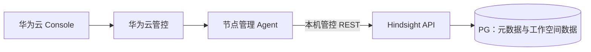

# ContextDB V2 管控联调：实例与工作空间

更新日期：2026-10-15。接口基线：`contextdb/service-management-v2` / `d5e851b60`。

本文用于与管控确认调用流程，只涉及实例、工作空间和节点服务管理。用户、授权和日常 API Key 管理由 Hindsight UI 完成。创建实例时的管理员凭据交付属于初始化流程。

## 1 调用路径建议

**建议管控统一调用现有节点管理 Agent，由 Agent 管理服务进程，并调用本机 Hindsight API 完成实例登记和工作空间操作。**



节点管理 Agent 与业务侧的 Agent/应用是两个概念。业务请求仍直接访问 Hindsight REST/MCP，不经过节点管理 Agent。

| 方案 | 接入方式 | 需要承担的工作 |
| --- | --- | --- |
| 管控 → 节点 Agent → 本机 API（建议） | 复用现有 Agent 管理通道 | Agent 增加或复用受控的 API 调用能力，保留 Hindsight 响应和任务 ID |
| 管控 → Hindsight API | 启停、升级走 Agent；空间操作直连 API | 管控同时维护两套调用入口，处理服务地址、访问认证和故障切换后的路由 |

当前 V2 已实现下文的 Hindsight REST 接口，直接调用可以联调。节点 Agent 的实际协议、接口和转发能力尚未提供，**经 Agent 的链路是待确认方案，不是当前代码已经实现的能力**。确认前可先直连 API 验证接口，之后再验证 Agent 端到端链路。

## 2 职责划分

| 组件 | 职责 |
| --- | --- |
| 华为云 Console | 实例、工作空间的操作入口和状态展示 |
| 华为云管控 | 云用户认证授权，资源开通与回收，部署任务编排，选择目标节点，展示最终结果 |
| 节点管理 Agent | 安装、配置、启停 API/Worker/UI，服务状态检查，接入已有高可用和升级流程；调用本机 API |
| Hindsight API | 登记实例，创建/查询/删除工作空间，保存元信息并执行空间初始化和清理 |
| Hindsight Worker | 执行记忆处理等后台业务任务；不负责云实例开通或空间管理任务 |
| PG | 保存实例/空间元信息、管理任务和各空间业务数据，是工作空间信息的来源 |

管控保留实例资源、访问地址及任务跟踪信息，不另建工作空间目录。空间列表、详情及状态从 Hindsight 查询。空间创建/删除的后台执行器在 API 进程内，不能只启动 Worker 而停掉 API 等待其完成。

## 3 节点 Agent 需要对接的能力

以下是能力要求，实际方法名和 URL 由 Agent 团队按现有接口填写。

| 能力 | 管控提供 | Agent 返回 |
| --- | --- | --- |
| 部署/初始化实例 | 实例与云租户 ID、发布版本、PG 连接、模型与服务配置、凭据配置引用 | 部署任务 ID；完成后返回服务地址、发布版本和状态 |
| 查询服务状态 | 实例 ID、目标节点 | API/Worker/UI 的状态及本机 API 健康检查结果 |
| 调用 Hindsight 管控接口 | 实例 ID、操作人、方法、受控路径、参数、幂等值 | Hindsight HTTP 状态、响应体和请求 ID |
| 停止/重启/升级/故障恢复 | 实例 ID、目标版本或操作参数 | 复用现有运维任务 ID、进度、结果和失败原因 |

登记和空间请求发往当前承载 API 的节点 Agent；纯 Worker 节点不作为这些请求的目标。Agent 根据实例配置访问固定本机地址，不接受调用方指定任意上游 URL。调用范围仅限本文的实例、空间、操作查询接口及健康检查。

Agent 接收管控请求时复用现有管理通道认证；调用 Hindsight 时使用管控服务 Key。操作人由管控从真实登录身份生成，重试保持一致。Agent 不透传外部 `Forwarded` / `X-Forwarded-For`；Hindsight 当前管控接口会拒绝这些来源头。Agent 不与 API 共享网络命名空间时，需按真实连接来源配置允许的 CIDR。

**Agent 转发成功或运维任务完成，不等于工作空间已创建/删除。** 空间操作以 Hindsight 的 `operation_id` 最终状态为准；管控任务 ID、Agent 任务 ID 与这个 ID 分别记录。

## 4 实例创建与管理

### 4.1 创建顺序

| 步骤 | 交互 | 完成条件 |
| --- | --- | --- |
| 1 | Console → 管控：创建实例 | 管控完成权限、规格和配额检查，确定 instance_id / cloud_tenant_id |
| 2 | 管控开通计算、网络和 PG，向节点 Agent 下发部署任务 | 资源、数据库和配置可用；使用新的 UTF8 数据库 |
| 3 | 部署流程生成并持久保存管控 Key、pepper、UI 口令，Agent加载配置 | Hindsight 配置实例/租户 ID、PG URL、pepper、管控 Key 摘要；明文管控 Key供内部调用 |
| 4 | Agent 执行 `python -m hindsight_ext_contextdb migrate` | metadata 版本为 2；仅一个部署执行者初始化元数据 |
| 5 | Agent 启动 API/Worker，查询本机 `/health/ready` | API 可以响应内部初始化请求；尚不向客户宣告实例可用 |
| 6 | 管控经 Agent 调用 `POST /ext/contextdb/v1/instances` | 首次返回 201、管理员身份和管理员 all Key |
| 7 | Agent 安全保存管理员 Key，写入 UI 配置并启动 UI | UI 使用独立口令和该管理员 Key，启动与访问检查通过 |
| 8 | Agent 上报结果，管控开放客户入口并标记实例可用 | API、UI、配置身份和数据库均核对通过 |

管控 Key、pepper、UI 口令可以在服务启动前离线生成；管理员业务 Key 由第 6 步生成。UI 必须在取得有效管理员 Key 后启动。凭据使用现有受保护配置保存与交付，不进入普通任务日志；负责生成、持久保存和交付的一方需在联调前确认。

**`POST /instances` 是“登记已经部署的实例”，不是“申请云资源或启动进程”。** 每套部署绑定配置中的一个实例 ID，不能在同一 API 上登记另一个实例。`/health/ready` 成功也不代表实例登记和 UI 初始化已经完成。该接口不自动创建工作空间。

### 4.2 Hindsight 实例接口

前缀为 `/ext/contextdb/v1`，V2 不使用 `/ext/contextdb/v2`。

| 接口 | 作用 | 成功结果 |
| --- | --- | --- |
| `POST /instances` | 登记实例、首次生成管理员 | 201；返回 instance、admin_user、admin_key |
| `GET /instances/{instance_id}` | 查询登记信息 | 200；实例 ID、云租户、名称、创建信息 |
| `POST /instances/{instance_id}/admin-keys` | 初始化凭据丢失时恢复管理员访问 | 201；签发一把新的管理员 all Key，不取回旧 secret |
| `GET /health/ready`（无上述前缀） | 检查 API readiness | 200；不代替实例登记或 UI 状态检查 |

登记请求示例，ID 必须与部署配置一致：

```json
{
  "instance_id": "ctxdb-cloud-001",
  "cloud_tenant_id": "tenant-001",
  "name": "ContextDB 实例"
}
```

首次响应的关键字段如下，完整结构以 OpenAPI 为准：

```json
{
  "instance": {"instance_id": "ctxdb-cloud-001", "cloud_tenant_id": "tenant-001", "name": "ContextDB 实例"},
  "admin_user": {"user_id": "<管理员ID>", "role": "admin"},
  "admin_key": {"key_id": "<Key ID>", "access_mode": "all", "secret": "<首次返回的完整管理员Key>"}
}
```

相同 ID、租户和名称重复登记仍返回 201，但 `admin_key=null`。Agent 收到首个响应后应先持久保存 Key，再上报初始化成功；不能用重复登记取回明文。若 API 已提交而首响应丢失，查询实例确认后使用恢复接口，取得新 Key 并配置 UI。恢复请求 body 可为 `{"name":"Administrator recovery"}`；它不是幂等签发接口，超时不能盲目反复提交。

已有实例名不同返回 409，登记其他部署身份返回 403。GET 返回的是登记信息，不包含进程、节点角色或升级进度，这些状态由 Agent/管控提供。

### 4.3 停止、重启、升级、高可用与销毁

| 操作 | 流程与边界 |
| --- | --- |
| 停止/重启 | 管控进入维护状态，Agent按现有流程排空并启停服务；复用原 PG、实例 ID、pepper 和凭据，恢复后核对服务健康及实例登记 |
| 升级 | 管控确定版本和窗口，Agent执行发布、单一迁移执行者及恢复检查；期间暂停空间创建/删除，避免与迁移交叉执行 |
| 高可用恢复 | 由现有管控/Agent机制确定可用节点和角色；新节点使用同一实例配置和 PG，恢复后查询已有空间与操作结果 |
| 销毁实例 | 管控关闭访问及自动恢复，确认备份/数据保留策略，Agent停止全部服务，再按云资源流程回收计算和独享 PG |

当前 Hindsight 没有停止实例、升级、主备切换或 `DELETE /instances` 接口。不能用空间删除代替实例销毁。多节点迁移和故障后的旧执行者隔离尚未完成生产验收；未知旧执行者未确认退出前，不强行重试 DDL 或清理删除屏障。

## 5 工作空间接口与交互

### 5.1 公共请求约定

Agent 调用本机 Hindsight 时携带：

```http
X-ContextDB-Control-Key: <管控服务Key>
X-ContextDB-Actor-Subject: <管控确认的操作人>
```

创建、删除还需 `Idempotency-Key`（1–128 字符），JSON 请求使用 `Content-Type: application/json`。业务管理员 Key 不能替代管控服务 Key。管控选择对应实例的 Agent，空间请求体不用再添加 instance_id；API 从本部署配置确定实例。

| 接口（相对上述前缀） | 输入 | 成功结果 |
| --- | --- | --- |
| `POST /workspaces` | name、可选 description；幂等值 | 202，返回管理操作 |
| `GET /workspaces?limit=20&offset=0` | 分页；limit 0–100，offset 非负 | 200，items/total/limit/offset |
| `GET /workspaces/{workspace_id}` | 空间 ID | 200，空间详情；已 deleted 返回 404 |
| `DELETE /workspaces/{workspace_id}` | 空间 ID、幂等值 | 202，返回删除操作 |
| `GET /operations/{operation_id}` | Hindsight 管理操作 ID | 200，返回操作状态；空间删除后仍可查询 |

本期不提供空间改名、修改描述或冻结的 PATCH 接口。名称在实例内规范化后唯一；ID 由服务生成，`workspace_id = bank_id`，客户端不用传 PG schema。

### 5.2 创建工作空间

1. Console 发起创建；管控校验权限和目标实例状态，生成稳定幂等值。
2. 管控调用该实例节点 Agent；Agent向本机 API 发送以下请求。
3. API 登记 creating 空间和管理操作，返回 202；管控保存 workspace_id、operation_id，显示创建中。
4. API后台执行器初始化空间 schema、原生表和唯一 Bank。
5. 管控经 Agent轮询操作；succeeded 后查询空间详情，确认 active，再显示可用。

```http
POST /ext/contextdb/v1/workspaces
Idempotency-Key: create-workspace-<管控请求ID>

{"name":"MySQL","description":"MySQL 业务记忆"}
```

受理响应示例：

```json
{
  "operation_id": "<操作ID>",
  "workspace_id": "<空间ID>",
  "action": "create_workspace",
  "state": "pending",
  "attempts": 0,
  "error_code": null
}
```

操作可能已进入 running，以实际返回为准。空间详情包括 workspace_id、instance_id、cloud_tenant_id、schema_name、name、description、state、version、created_at。管控对客户提供空间 ID；schema_name 用于内部核验。

### 5.3 列表与详情

Console → 管控 → Agent → Hindsight，按请求分页查询并展示返回数据。列表包含 creating、active、deleting、failed 等未 deleted 空间；不能只把列表中存在当成可用。管控可以缓存展示结果，但不维护另一份权威空间目录。

### 5.4 删除工作空间

1. 管控校验权限，生成删除幂等值，经 Agent发送 DELETE。
2. API 将空间置 deleting，拒绝新业务请求，返回删除 operation_id；Console 显示删除中。
3. API后台执行器等待已受理请求和记忆任务排空，再清理 Bank 数据。
4. 管控经 Agent轮询至 succeeded；空间标记 deleted，列表不再返回它，详情查询返回 404。

```http
DELETE /ext/contextdb/v1/workspaces/<空间ID>
Idempotency-Key: delete-workspace-<管控请求ID>
```

删除保留空间墓碑、schema 和表；不能以 schema 消失作为完成标准，也不能由 Agent直接 DROP SCHEMA 代替接口。成功删除后名称可以重用，但新空间生成新的 ID，旧授权不会继承。

## 6 状态、超时与重试

| 情况 | 管控/Agent应如何处理 |
| --- | --- |
| HTTP 202 | 仅受理；继续查询 Hindsight operation，不能直接显示成功 |
| operation pending / running | 继续等待；建议每 2–5 秒查询，超出展示等待时间后转后台跟踪，任务不因页面超时取消 |
| operation succeeded / failed | 成功后核对空间详情；失败展示 error_code，结合节点日志定位 |
| waiting_for_tasks / waiting_for_admissions | 删除尚在排空，即使 error_code 非空也不表示 failed；以 state 为准 |
| 提交超时，未拿到 operation_id | 原操作人、原幂等值和原正文重试创建/删除，取得原 operation_id；不要换新幂等值 |
| 已确认操作 failed | 排除原因后重用原请求；当前实现可重启同一失败操作，但后续空间状态变化会拒绝旧任务重启 |
| 400 / 401 / 403 / 404 / 409 / 503 | 分别检查参数、凭据、来源/身份、资源、名称/状态/幂等冲突、服务/PG可用性；不把所有错误改成“Agent执行失败” |

同一个幂等值换正文返回 409；相同名称换新幂等值也会冲突。完成后的删除用原幂等值重试仍返回原操作；查询操作可核对结果。同一创建任务失败重试与未知旧执行者恢复是不同情况，后者需先完成隔离确认。

Agent保留 Hindsight 的 HTTP 状态码、响应体和可用请求 ID。节点 Agent不可达、API未启动、API已受理但后台失败应分别报告，避免管控误判是否已经执行。

## 7 联调前需要确认

| 问题 | 本文建议 / 需管控补充 |
| --- | --- |
| 最终调用路径 | 采用“管控 → 节点 Agent → 本机 API”；确认 Agent是否已有转发能力及实际接口 |
| 节点选址与运维状态 | 复用现有高可用/升级机制；明确管控调用哪个 Agent、维护期间如何阻止空间变更 |
| Agent调用合同 | 确认协议、路径/动作白名单、超时、原始响应传递以及三类任务 ID的关联方式 |
| 凭据生成与交付 | 确认管控 Key/pepper/UI口令由谁生成和保管，管理员 Key由谁保存并交付；恢复节点必须复用 |
| 创建实例是否带默认空间 | 当前登记接口不自动建空间；如需默认空间，在开通流程单独调用创建接口 |
| 销毁实例数据策略 | 明确保留/删除 PG、备份及自动恢复停止顺序；不是 Hindsight实例删除接口 |

## 8 联调用例

| 用例 | 应确认的结果 |
| --- | --- |
| 新实例完整开通 | API readiness → 实例登记 → 凭据保存 → UI启动 → 客户入口可用，顺序正确 |
| 同实例重复登记 / 首响应丢失 | 不重复创建管理员，不重显 secret；按恢复流程取得新 Key并配置 UI |
| 创建 MySQL、PG | 取得不同 ID/schema，操作成功后各有唯一 Bank，空间 active |
| 创建重试与冲突 | 原请求重试返回同一操作；换正文或重复名称返回 409 |
| 列表、详情与分页 | 与 PG登记状态一致，deleted 不出现在列表 |
| 有在途任务时删除 | 返回 202并等待排空，不提前显示成功；其他空间仍可用 |
| 删除重试 | 完成后原幂等值仍返回原操作；详情 404，墓碑与空 schema/表保留 |
| Agent/API异常与恢复 | 错误层次可区分；恢复后查询已有实例、空间、操作，不重新生成 pepper或假定请求未执行 |

本文不增加 Hindsight接口，也不代表 Agent适配、高可用和升级已经实现或验收。完整 HTTP 合同以 [V2 随版 OpenAPI](https://github.com/ZhuQingping/hindsight/blob/d5e851b60315b79696e995874e7edc1e9a7bae23/hindsight-extensions/contextdb-service/docs/contextdb-control-plane.openapi.yaml)为准；内部实现见 [V2 设计](member-apikey-bank-service-design-v2.md)。
