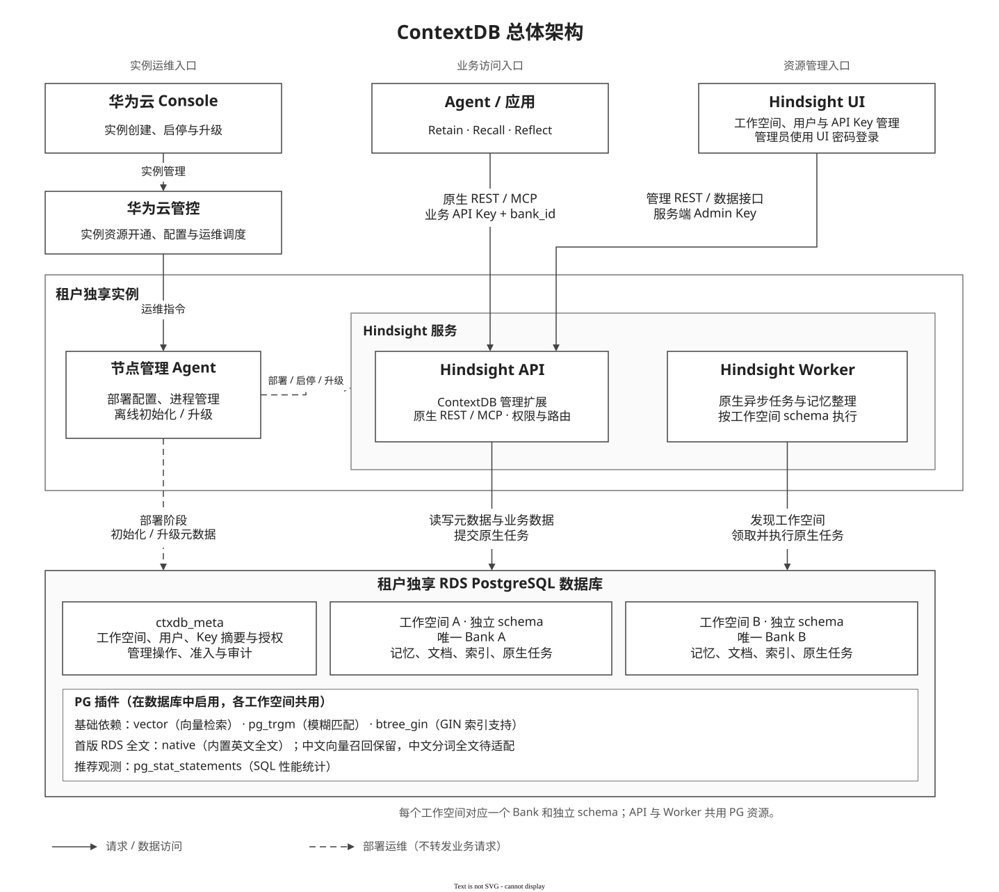
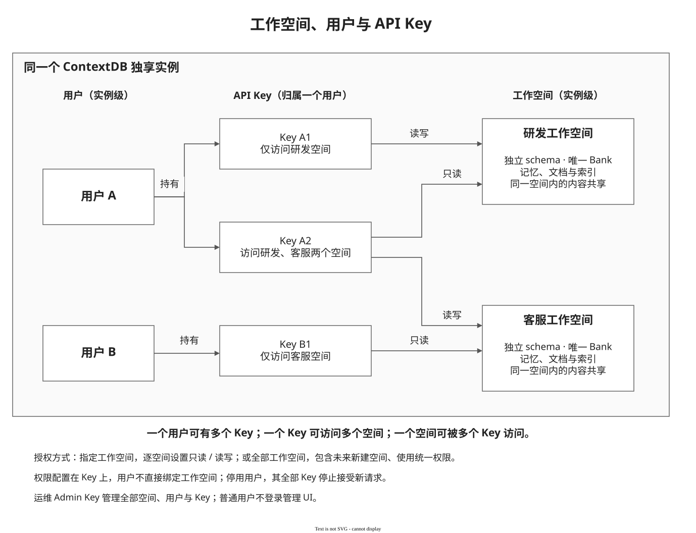

# ContextDB 首发设计：工作空间、用户与 API Key

> **状态（2026-10-20）：设计已同步当前实现，四批优化、测试接线及UI简化随本次 amend 整理，尚未推送。** 交付分支为 `contextdb/v1.0.0`；验收源码树为 `ce1c7def06cf26d9450fcef34acbad4e47268e6f`，替代原特性提交 `ddf5c3600` 的提交说明固定本资料仓版本。最新实现已完成本地回归及自检；此前 Hindsight/PG 独立检视只覆盖当时快照，本轮UI调整未重新组织独立检视。结果与未验证项见[验证摘要](../testing/contextdb-validation-summary.md)，本机回归不替代目标ECS/RDS或生产验收。

> **首版决策（2026-10-19）：工作空间创建、删除同步返回201/204；同名schema、bank_id复用接受原生Bank并发边界。** 删除前由管理员停止访问、等待已有工作结束；没有全局执行排空、代次或持久故障屏障。当前管理API为13项，管理表为6张。

> **原生改动收敛：** 官方v1.0.0基线为 `39c65ffe2f140d0c84cee58566cad8900c5b9908`。此前七个原生Python运行文件的自研差异已撤销，原生运行目录当前与基线一致。外围扩展、UI、CI和测试仍有改动；仍须使用扩展自己的ASGI入口，不能据此直接用原生CLI启动。旧 `9d51cac` 为上一轮远程评审快照，不是本轮交付提交。

更新（2026-10-19，基于原生 v1.0.0 的首发方案）：新空间对外统一使用可读 bank_id，对内保留 UUID；工作空间名称仅允许字母、数字、下划线，最长54字符，统一小写。新 schema 为 ctxdb_ws_<bank_id>；正常删除后允许同名重建，旧selected授权不继承；并发删除与业务访问不在支持范围，见第5.2节。本轮功能回归与原生v1.0.0部署证据见[验证摘要](../testing/contextdb-validation-summary.md)；目标ECS/RDS、镜像安全与生产性能仍须单独验收。

本文按总体设计、实例管理、UI 管理、应用访问、核心实现和本期边界组织。接口、数据结构、安全依据及异常恢复规则完整保留在本文，便于连续阅读和实现核对。 当前版本与检视入口见[代码检视指南](code-review-guide.md)；历史手册中的配置和接口不作为本版本部署依据。

[管控部署指南](../deployment/contextdb-service-integration-guide.md) · [Agent部署合同](../deployment/contextdb-deployment-contract.md) · [运维手册](../operations/contextdb-operations-runbook.md) · [原生v1.0.0对接](../deployment/native-v1.0.0/contextdb-service-integration-guide.md) · [API curl 验证手册](../api/contextdb-management-api-curl-guide.md) · [OpenAPI旧评审快照](https://github.com/ZhuQingping/hindsight/blob/9d51cacde496baa628408e4b474f0f949220a90f/hindsight-extensions/contextdb-service/schemas/contextdb-control-plane.openapi.yaml)

| 章节 | 主要内容 |
| --- | --- |
| [1. 总体设计](#overview) | 三个入口、对象关系、组件职责、实现版本 |
| [2. 华为云实例管理](#instance) | 数据库准备、离线初始化、凭据、密码、启动与升级 |
| [3. 管理员通过 UI 管理服务](#ui) | 操作流程、用户与 Key 管理、授权格式和状态变化 |
| [4. 客户应用访问记忆服务](#business) | 原生 REST/MCP、权限检查、按名称查询与按身份操作 |
| [5. 核心实现与设计理由](#implementation) | 认证安全、同步管理决策、当前生命周期实现、PG 字段与约束、完整管理 API |
| [6. 规格约束与 Q&A](#boundaries) | 支持范围、删除使用前提、超时/取消边界、安全约束及常见问题 |

<a id="overview"></a>

本轮机器契约位于同版代码仓 `hindsight-extensions/contextdb-service/schemas/contextdb-control-plane.openapi.yaml`，须按本轮源码生成/校验。本文固定远程OpenAPI链接是旧评审快照，不能据此核验当前工作区；应以同版源码生成的契约为准。

## 1. 总体设计

以下为逻辑架构与对象关系；API、Worker、UI 的框不代表独立容器。首版部署形态见第2.5节：单容器、API 内置 Worker、独立 UI 进程。

### 1.1 三个入口

一个独享实例使用一个 PG 数据库。用户与工作空间同属实例；用户可以持有多个 API Key，每个 Key 独立配置空间范围和权限。工作空间与 Hindsight Bank 一对一，每空间使用独立 schema。



[可编辑 drawio 源文件](../diagrams/source/contextdb-first-release-architecture.drawio)

实线表示请求或数据访问，虚线表示部署运维。节点管理 Agent 负责配置、启停、升级及离线初始化；业务 Agent 和 Hindsight UI 的请求直接由 Hindsight API 处理。

三个入口各自负责：

| 场景 | 调用关系 | 职责 |
| --- | --- | --- |
| 业务访问 | 应用 → Hindsight API / MCP | 携带业务 Key、可读 bank_id，调用 Retain、Recall、Reflect 等原生接口 |
| 实例运维 | Console → 华为云管控 → 节点管理 Agent | 准备 PG、配置凭据和模型、离线初始化、部署与启停；已有 Agent 负责升级/高可用调度 |
| 资源管理 | 管理员 → Hindsight UI → Hindsight API | 管理工作空间、用户、API Key；UI 后端持有 Admin Key |

工作空间管理已放在 UI，华为云 Console 不再维护空间目录。运维也可直接使用 Admin Key 调管理 REST API。本期没有新增实例注册 HTTP 接口，也没有实现一套新的 Agent 升级或高可用协议。

### 1.2 工作空间、用户与 Key



[可编辑 drawio 源文件](../diagrams/source/contextdb-first-release-workspace-model.drawio)

用户与工作空间同属实例，彼此没有从属关系。用户 A 可以持有多个 Key；Key A2 可同时访问研发和客服空间，并分别设置只读、读写。不同用户的 Key 可以访问同一个空间，空间内的内容共享。

图中的实例归属是逻辑关系，不需要在每张表重复保存 instance_id。新建空间名称同时作为可读 bank_id，按 NFKC、去首尾空白及小写规范化，须符合 `[a-z][a-z0-9_]{0,53}`；例如 MySQL 规范化为 mysql。服务端生成 schema `ctxdb_ws_mysql`。内部 workspace_id 为随机32位 UUID，用于授权关联及管理对象身份，不用于业务寻址，也不要求跟踪全部旧执行者。名称和 bank_id 在对象存续期间不可修改；完整删除后可以同名重建，内部 UUID 必须变化。连字符会使原生未加引号的 schema DDL 无法执行，首版禁止连字符以避免扩大内核修改。

可读 bank_id、可读 schema 与内部 UUID 各有职责；保留内部身份的具体原因见[第5.3.4节](#workspace-identity)。

用户用于记录 Key 归属、名称和启停状态，没有角色选择或用户级空间授权。后台 users 表同时保存唯一受保护的系统管理员，role 为 admin；普通成员固定为 member。**权限配置在 Key 上**，不再叠加“用户权限与 Key 权限取交集”。用户不是 PG 登录角色，工作空间也不是 UI 登录账号。

### 1.3 组件分工

| 组件 | 职责 |
| --- | --- |
| 节点管理 Agent | 下发配置、离线初始化、管理服务进程，对接已有运维调度 |
| Hindsight API | 扩展层完成认证、授权、空间管理；原生内核执行记忆接口 |
| Hindsight Worker | 执行原生记忆异步任务，按空间 schema 访问数据 |
| Hindsight UI | 管理员操作入口；服务端持有 Admin Key |
| PostgreSQL | 保存管理元数据和各空间业务数据；API 与 Worker 共用 |

<a id="contextdb-extensions"></a>

#### 1.3.1 为什么使用四个 ContextDB 扩展

四个类都属于同一个 `hindsight_ext_contextdb` Python 包，分别接入 Hindsight 已有的 Tenant、Operation Validator、HTTP、MCP 扩展入口。扩展框架来自 Hindsight，下面的具体实现由 ContextDB 提供；它们随服务进程加载，无须单独部署，与 PG 的 vector、pg_trgm 等数据库插件无关。

新增工作空间、用户、Key 管理后，除了提供管理接口，还必须让原生 REST、MCP 和后台任务遵守同一套空间与权限规则。因此需要覆盖不同入口：

| 扩展实现 | 对应配置变量 | 职责 |
| --- | --- | --- |
| ContextDBTenantExtension | HINDSIGHT_API_TENANT_EXTENSION | 认证 Key，按目标工作空间选择 PG schema；提供空间发现和后台任务的空间身份接入 |
| ContextDBOperationValidator | HINDSIGHT_API_OPERATION_VALIDATOR_EXTENSION | 在原生引擎操作处检查读写权限、管理员权限及内部任务归属；阻止绕过管理接口创建或删除 Bank |
| ContextDBHttpExtension | HINDSIGHT_API_HTTP_EXTENSION | 提供工作空间、用户、Key 的管理 REST 接口；在请求内同步初始化或清理空间，校验部署和元数据 |
| ContextDBMCPExtension | HINDSIGHT_API_MCP_EXTENSION | 从原生 MCP 工具调用中确定实际 Bank，校验当前消息的 Key，适配空间目录、读写权限和业务任务响应脱敏 |

公共逻辑集中在扩展内部：`authorization.py` 保存本次调用的认证结果及受信管理上下文；`transport.py` 处理REST入口的身份、路由及诊断边界；`lifecycle.py` 只组织同步创建和删除，没有自研调度或执行屏障。

**职责不同，认证规则共用。** 管理员与业务 Key 都由 `Repository.authenticate` 查询 PG、校验 HMAC；角色与空间权限也来自同一份元数据。各入口调用它完成必要检查，不各自维护一套密钥或权限表。

例如，某 Key 对 `mysql` 只有只读权限：Tenant 扩展负责将已认证请求路由到 `ctxdb_ws_mysql`；Validator 负责允许 Recall、拒绝 Retain。通过 MCP 调用时，目标空间还可能位于工具参数中，MCP 扩展需要先确定本次调用的 Bank，不能只依赖 REST URL。HTTP 扩展则让管理员能够创建空间、签发这个 Key，并按管理员已停止访问、等待已有工作的前提删除空间。

MCP 扩展复用原生工具，不新增工作空间、用户或 Key 的管理 MCP 工具。启用 MCP 的当前部署需要四个扩展配套；关闭 MCP 时，MCP 接入没有调用用途，但 REST 的前三项职责仍然存在。原生Worker通过Tenant和Validator进行正常身份及schema检查；工作空间管理在API请求内执行，不交给Worker。首版交付为API内置Worker。

**设计选择：保留这些接入入口，集中复用公共逻辑。** 减少扩展类数量本身不会减少必须完成的检查；强行统一加载入口会扩大 Hindsight 内核改动。本版优先在外围实现管理和隔离，继续复用原生记忆算法。扩展、API、UI和启动脚本仍须同版交付；本轮没有新增或保留原生执行保护钩子。

### 1.4 实现版本与变更说明

更新：2026-10-20。当前交付分支为 `contextdb/v1.0.0`，直接基于原生 v1.0.0（39c65ffe2f140d0c84cee58566cad8900c5b9908）；代码与资料版本见[代码检视指南](code-review-guide.md)。本文描述本轮本地实现，待验收项明确列在TODO；公开管理 API 仍为 `/ext/contextdb/v1`，首发管理元数据结构为 **1**。结构序号、API v1、资源 version 是三个概念。

本次统一管理员与业务 Key 认证，落实成员名唯一、删除空间的物理清理、按名称查询详情、同步管理和部署脚本。[优化前完整设计](https://github.com/ZhuQingping/hindsight/blob/07028c3561bd6601dd72af137ea5d96658210ae9/hindsight-extensions/contextdb-service/docs/archive/2026-10-16-before-release-hardening/design-research.md)保留作对照。本轮统一 GET/DELETE、授权输入及原生 REST/MCP 使用可读 bank_id；授权存储及管理条件绑定内部UUID；原生记忆任务继续沿用原生上下文和schema机制，不增加全程执行代次。首发从当前完整结构的版本1开始；不提供开发期旧结构的自动升级，新空间使用可读标识。历史设计保留在Git历史，不能用历史测试代替本轮验收。

[API curl 验证手册](../api/contextdb-management-api-curl-guide.md) · [部署与升级](../deployment/contextdb-service-integration-guide.md) · [OpenAPI旧评审快照](https://github.com/ZhuQingping/hindsight/blob/9d51cacde496baa628408e4b474f0f949220a90f/hindsight-extensions/contextdb-service/schemas/contextdb-control-plane.openapi.yaml) · [优化前设计](https://github.com/ZhuQingping/hindsight/blob/07028c3561bd6601dd72af137ea5d96658210ae9/hindsight-extensions/contextdb-service/docs/contextdb-first-release-design.md)

<a id="instance"></a>

## 2. 华为云实例管理

实例部署由华为云管控通过已有节点管理 Agent 完成；空间、用户和业务 Key 的管理在服务启动后通过 UI 或管理 REST 完成。

### 2.1 实例如何开通

数据库连接不强制 SSL：部署示例不附加 sslmode，PGADMIN_URL 与 HINDSIGHT_API_DATABASE_URL 均按调用方提供的 URL 连接。未开启 SSL 的 PG 可接入；需要证书校验时部署方再显式配置 sslmode 和 CA，不由服务自动升级或降级策略。MaaS HTTPS 和 UI/API 对外入口的 TLS 配置独立。

管控具体输入、PG权限和命令以[人工部署指南](../deployment/contextdb-service-integration-guide.md)为入口；自动化严格按[Agent配置合同](../deployment/contextdb-deployment-contract.md)及 JSON Schema 校验。PG数据库必须先存在；管控接收用户UI密码并提供秘密文件。节点渲染配置后初始化管理表和原生public共享表，再启动API/Worker、检查ready及实例身份，最后启动UI。模型、插件和端口不依赖人工临时export。

管控调用已有节点管理 Agent 完成部署。本期不新增“创建实例”的 Hindsight HTTP 接口，工作空间目录也不在 Console 维护。

| 步骤 | 执行内容 | 完成结果 |
| --- | --- | --- |
| 1. 准备数据库 | 准备专用 UTF8 PG、服务账号、vector / pg_trgm / btree_gin；首版 RDS 固定 native + english | 数据库可连接，所选扩展可用 |
| 2. 准备配置与秘密 | 配置实例归属、数据库和模型；生成并私密保存 Admin Key、pepper、UI 密码 | 重启时可复用同一份配置 |
| 3. 离线初始化 | 执行 service.sh init：管理表迁移/管理员导入，再显式迁移原生public共享表 | API 尚未启动，也能准备管理员身份 |
| 4. 启动服务 | 启动 API、Worker，检查 readiness，再启动 UI | 管理与业务接口可用 |
| 5. 交付 | 提供 UI 地址和密码；管理员进入 UI 创建空间、用户与业务 Key | 应用可以接入 |

自研实例的具体命令见[管控部署指南](../deployment/contextdb-service-integration-guide.md)。原生联调指南不包含 ContextDB 初始化与管理接口，不能混用。已有 `service.sh` 用于部署和启动，由节点 Agent、systemd 或容器监督器管理前台进程。

### 2.2 三种凭据及保存位置

| 凭据 | 生成与保存 | 能力 |
| --- | --- | --- |
| 运维 Admin Key | 离线生成并私密保存；初始化时将 HMAC 摘要写入 PG，UI 服务端保存明文 | 管理全部空间、用户、Key；访问全部 active 空间的原生 REST/MCP 数据接口 |
| UI 登录密码 | 客户侧可选择随机生成或自定义，通过 HINDSIGHT_CP_ACCESS_KEY 配置并持久保存 | 仅用于管理员登录 UI，不是 API Key |
| 业务 API Key | 管理员通过 UI 或管理 API 创建；数据库只存 HMAC-SHA256 摘要 | 按 Key 的范围和权限访问原生 REST/MCP；不能调用管理 API，也不能登录 UI |

UI 继续使用原生 `HINDSIGHT_CP_DATAPLANE_API_KEY`，值为运维 Admin Key。浏览器只持有登录会话，不接收这个后台 Key。运维 Key 不作为普通用户/Key 显示在“用户管理”中。

业务 Key 格式为 `ctx_live_<32位Key ID>_<随机秘密>`。明文只在创建成功时返回一次；普通列表只返回 `display_key`，例如 `ctx_live_***5f82bf`，以及授权和时间等元信息。尾缀取自真实凭据末6字符；历史 Key 无法恢复尾缀时返回 null，不伪造脱敏值。

`CONTEXTDB_KEY_PEPPER` 是服务端 HMAC 秘密，不写入元数据表。保留现有 Key 时必须沿用 pepper。管理员与业务 Key 均依赖相同 pepper。轮换管理员 Key 使用受控离线命令更新 PG 摘要，并同步 UI 私密配置、重启 UI；本期没有在线恢复、双 Key 轮换或成员自助签 Key。摘要存储与 pepper 的安全依据、运维影响见第 5.1 节。

<a id="ui-password"></a>

### 2.3 UI 登录密码配置

`HINDSIGHT_CP_ACCESS_KEY` 是 UI 服务端读取的环境变量。客户侧可以使用部署时随机生成的密码，也可以自行设置密码；两种方式使用相同的 Hindsight UI 登录入口。当前是实例级管理密码，不为业务成员提供个人 UI 账号，也没有页面内改密功能。

| 配置方式 | 建议 |
| --- | --- |
| 随机密码 | 使用密码管理器或密码学安全随机源生成24～32位字符串，例如从大小写字母、数字、`_`、`-` 中随机选择；生成后持久保存，普通重启复用原值 |
| 自定义密码 | 建议16～32字符，可混合大小写字母、数字及 `- _ . @` 等符号；需要记忆时，可使用5～6个随机、互不相关的单词，以 `-` 分隔，不必限制在32字符以内 |

自定义密码优先保证长度、不可预测和不复用，不强制同时包含大写、小写、数字和特殊字符。避免姓名、生日、公司或产品名加年份、连续数字、名句等易猜组合。[NIST 密码指南](https://pages.nist.gov/800-63-4/sp800-63b/passwords/)同样强调长度，不建议强制字符类型组合。

当前实现的硬性约束与使用建议分开说明：

- 原生UI要求非空；本版托管部署合同额外要求至少12字符，不设置字符类型组合规则。上述16～32字符是使用建议。直接运行UI的基础校验与管控部署入口的约束不可混淆。
- 密码不能等于 `HINDSIGHT_CP_DATAPLANE_API_KEY`，也不能以 `ctx_live_`、`ctx_ctrl_`、`ctx_admin_` 开头。
- 登录精确匹配，区分大小写，不自动去除首尾空格或做 Unicode 归一化。可使用中文等可输入字符；为方便跨终端配置和输入，推荐使用可打印 ASCII 字符。
- 环境变量不能包含 NUL。避免换行、控制字符和首尾空格；单双引号、反引号、`$`、反斜杠等会增加 Shell 引用或转义要求，建议避开。它们并非应用的字符黑名单。

随机生成示例（执行一次生成32字符密码；部署工具需将结果安全持久保存，不在每次启动时重新生成）：

```bash
export HINDSIGHT_CP_ACCESS_KEY="$(python3 -c 'import secrets; print(secrets.token_urlsafe(24))')"
```

选择自定义方式时，由客户将自己的密码写入私密 UI 配置，例如 Shell 环境文件中的 `export HINDSIGHT_CP_ACCESS_KEY='<客户自定义密码>'`，其中占位符必须替换为实际密码，并按所用配置格式正确引用。配置文件限制为部署账号可读，不把实际密码写入设计文档、版本库或普通日志。

修改密码时，托管部署更新 ui-secrets.json 的 password 并重启 UI；直接原生启动才通过环境变量配置。仅编辑文件不会使运行中的进程自动生效。无需重新构建 UI、重启 API/PG 或修改后台 Admin Key。所有提供该实例 UI 的进程应使用同一新值；生效后旧密码及旧密码签发的登录会话失效，管理员重新登录。托管启动会用持久秘密覆盖 shell 中同名环境变量，不能只改 ui.env 或临时 export 后声称改密完成。

<a id="deployment"></a>

### 2.4 部署、启停与未来升级

离线顺序：准备专用 UTF8 PG 与扩展 → 私密目录保存配置和生成凭据 → 离线 migrate 导入管理员摘要 → 启动 API/Worker → readiness 通过后启动 UI。使用代码仓 `hindsight-extensions/contextdb-service/scripts/service.sh`，由已有节点 Agent/systemd/容器监督器管理前台进程；不引入新常驻管理服务。

必要配置收敛为 HINDSIGHT_API_DATABASE_URL、CONTEXTDB_INSTANCE_ID、CONTEXTDB_CLOUD_TENANT_ID、私密持久化的 pepper、四个扩展及模型配置。实例初始化、管理员离线轮换和API/Worker统一使用HINDSIGHT_API_DATABASE_URL及同一个专用服务账号，不提供另一套引导连接地址。运行期创建工作空间仍需DDL权限；PG数据库和插件由管控/数据库管理员预先准备。后台 Admin Key 与业务 Key 统一由PG中的HMAC摘要校验。

部署目录保存 `api.env`/`ui.env`、`admin-key.json`、`api-secrets.json`、`ui-secrets.json`，秘密文件0600、目录0700。API/Worker 加载 PG、模型、实例及扩展配置，另从秘密文件加载 pepper，不加载 Admin Key 明文或 UI 密码；UI 只得到登录密码/后台 Admin Key/API URL，不接收 PG 或模型密钥。重复初始化保留原值；已初始化但秘密文件缺失时拒绝补生，要求恢复备份。托管启动设置标准`PYTHON_DOTENV_DISABLED=1`，利用python-dotenv已有能力阻止意外.env覆盖；扩展依赖要求python-dotenv>=1.2.1，无须改原生config.py。

首发管理元数据结构版本固定为1。migrate仅初始化新库，或核对已经采用当前结构的数据库；开发期试验结构不作为已发布版本，不自动升级或直接改号。本期不存在旧实例升级到当前版本的场景，不提供旧开发结构迁移；不支持结构或归属不一致的数据库明确拒绝接管，不能手改metadata_version冒充匹配。未来正式发布结构变更时，再从版本1增加有序迁移。正常重启不执行结构迁移或重新生成凭据。

预检检查真实导入路径、扩展接口、Python3.11～3.14、Node22.12+/24及平台 esbuild、目标 PG 扩展和语言后端。外部 PG 不必安装 pg0；测试/内嵌路径使用 `hindsight-api-slim[embedded-db]`，发行包名 pg0-embedded，导入名 pg0。UI 使用系统字体，构建不下载 Google Fonts。Node22/24 的生产构建已在本机验证；源码路径检查不能替代部署方对镜像摘要和供应链的记录。

UI 启动只对暂时网络、5xx、429 有界重试，错误凭据、成员身份、畸形响应立即失败。每个新请求或每条MCP消息重新校验；同次调用复用受信Principal，Key/成员/授权变更阻止后续请求，不中断已受理操作。管理代理保留会话和同源保护，上游管理接口验证当前管理员Key；原生UI数据路径仍单独检查管理员身份。HTTPS、入口限流和网络隔离由部署入口提供，不能把本机功能测试称为生产入口验收。

#### 2.4.1 部署语言检查参数

**R04已实施：删除 `CONTEXTDB_VALIDATION_LANGUAGE`。** 托管部署预检固定使用english，不再渲染或读取这一派生变量。部署输入中的 `topology`、`language`、`text_search` 分别只接受首版固定值merged、english、native；它们不是客户可自由选择的组合。

原生全文后端、语言/分词配置和研究预检CLI的显式 `--language` 保留。固定english只定义首版全文验收范围，不限制中文输入或中文向量召回。没有为了替代该变量而在运行时重新读取部署输入文件、增加秘密挂载或新增参数；中文分词全文仍需独立适配与验收。

<a id="api-worker-deployment"></a>

### 2.5 API 与 Worker 如何部署

2026-10-19 决策：**首版一个容器合并部署 API、Worker 和 UI**。外部 RDS PG 保存全部持久业务数据；LLM、Embedding、Rerank 均调用华为云 MaaS，节点不运行模型推理。

```text
Console → 管控 → 节点 Agent → 一个 Hindsight 容器
                              ├─ Python：API :8888 + 内置 Worker
                              └─ Node.js：UI :9999 → 127.0.0.1:8888
应用 ────────────────────────→ API → 外部 RDS PG / MaaS
浏览器 ──────────────────────→ UI
```

一个容器、两个应用主进程；Worker 是 API 进程内的后台执行器，不另起 Worker 进程。init/监督器负责信号转发和退出清理，不计作业务进程。API 和 UI 均可从其他机器访问，默认端口 8888/9999，部署时可配置；容器内部 UI 通过 loopback 访问 API。

选择依据是首版减少部署对象、配置和排障分支，复用原生内置 Worker。原生联调直接使用官方镜像的 start-all.sh；自研镜像的 service.sh all 监督既有 api/ui 入口，保留原来的预检、秘密加载和 UI 等待就绪逻辑，不修改记忆算法。任一应用主进程退出，自研监督器停止另一进程并退出，由容器运行时重启整个服务；正常停止给全部子进程组发送 SIGTERM，并设置退出超时。健康检查覆盖 API 和 UI；unhealthy 本身不触发 Docker 自动重启，持续不健康由节点 Agent 按已有恢复策略处理。

| 项目 | 首版配置与边界 |
| --- | --- |
| topology | 固定 merged，不要求管控在多种拓扑间选择 |
| HINDSIGHT_API_WORKER_ENABLED | true，API 内置 Worker |
| HINDSIGHT_API_WORKERS | 1；不是后台任务并发数 |
| HINDSIGHT_API_WORKER_ID | 固定且实例内唯一，重启不变，不能使用随机容器 hostname |
| 独立 Worker 容器/8889 | 本期不启动、不发布 |
| 初始化 | 自研版在启动前运行一次性初始化命令，结束后退出；不算长期运行容器 |
| CPU/内存 | API、Worker、UI 共享一个容器限额，不提供组件级限额或独立重启 |
| 秘密边界 | 同容器、同 UID，不声称强隔离；自研启动器仍按进程加载必要环境，但挂载文件可由同 UID 读取 |

API 与 Worker 仍通过 PG 原生任务系统协作；同步 Recall、Reflect 在 API 执行。ContextDB工作空间创建/删除由API在管理请求内同步调用，不另起管理任务服务、调度循环或在途屏障。单容器不会改变认证授权和第5.2节的使用约束。

[组件资源与磁盘预算](../deployment/contextdb-resource-sizing.md)给出 CPU/内存开销、磁盘分类、初始规格、采样方法和验收边界。Compose示例上限为2 vCPU/4 GiB，可按节点调整，不是官方推荐规格；ECS与容器的生产规格均待目标负载压测，不固定要求4 vCPU/8 GiB节点或扣留一半资源。后续明确出现后台挤占、需独立扩容或恢复的场景后，再评审 API/Worker/UI 分容器；历史分离模式测试保留为机制证据，不作为本期交付选项。

### 首版后台写入边界

此前为增强执行结束保证新增的async_execution_scope及持久准入已删除；本版复用原生任务取消和检查点语义。删除前先停止业务并等待已有工作结束；同名新空间使用新UUID，旧selected授权不继承。

原生LLM Trace、业务Audit正文和Webhook在独立schema下的正常路由与存储归属尚未完成首版验收，本期维持关闭，后续独立评估，不再要求恢复完整代次屏障：`HINDSIGHT_API_LLM_TRACE_ENABLED=false` 必填（原生缺省true，所以缺省也拒绝），`HINDSIGHT_API_AUDIT_LOG_ENABLED=false`；不支持非空 `HINDSIGHT_API_WEBHOOK_URL`。Admin/内部默认模板不能开启 audit_log_enabled，旧 Bank 开启原生审计或 enabled Webhook 时先停用，启动/迁移会拒绝。`ctxdb_meta.audit_events` 管理事务审计继续保留。UI原生调用正文/原生审计不产生新记录，运维使用JSON日志、任务、PG统计和按需OTEL，详见[运维手册](../operations/contextdb-operations-runbook.md)。

<a id="fulltext-selection"></a>

### 2.6 中英文全文检索与许可证（补充调研，待选型）

**2026-10-19 RDS 首版决策：去掉 PGroonga/Groonga 部署依赖，固定 native + english。** 意图模板和部署指南同步采用该组合，不引入替代全文插件。中文内容可写入并通过 MaaS bge-m3 向量召回，中文分词/关键词全文未完成适配，列为 TODO。language=english 仅表示当前全文验收范围，不限制中文输入；不会放宽 native + chinese/multilingual 的预检。既有 PGroonga 试验库不执行卸载或直接切换；新基线使用新建专用库。

下文保留未来中文方案的调研比较，不是当前 RDS 安装清单。**撤回“PGroonga 已确定为云上默认插件”的预设。** 选型先满足目标 RDS 可安装和许可证要求，再比较 Hindsight 适配成本、检索效果及运维能力。一套部署选择一个全文后端；向量检索继续使用 `vector`，不因全文方案改变。

#### 2.6.1 PGroonga 与 Groonga 的关系

PGroonga 是 PG 扩展，依赖的 Groonga 是搜索引擎库，不是必须另起一个 Groonga 网络服务，也不是再执行一次 `CREATE EXTENSION groonga`。库及其运行依赖需要部署在 **PG 节点**；装进 Hindsight 的 ECS 容器不能让外部 RDS 自动获得插件。[源码安装要求](https://pgroonga.github.io/install/source.html)。

| 组件 | 官方许可证 | 本项目关注点 |
| --- | --- | --- |
| PGroonga | PostgreSQL License | 不能只审核这一层而遗漏底层库 |
| Groonga | 官方当前说明为 LGPL-2.1-or-later | LGPL 与 GPL、AGPL 的条件不同，不能统称“GPL 禁止商用”；锁定实际交付版本及其许可声明 |
| ParadeDB / pg_search 社区源码 | AGPL-3.0 | 云上使用、修改、组合及镜像交付的具体义务需核对；商业授权可作为另一条路线，不能当作规避 LGPL 的宽松许可证替代品 |
| pg_textsearch | PostgreSQL License | 与 timescaledb 不是同一个插件，不能套用后者的授权或 RDS 支持情况 |
| zhparser / SCWS | 分别为 PostgreSQL 风格宽松许可 / BSD | 字典、可选依赖和最终二进制仍按实际发行物核查 |

依据：[PGroonga 许可](https://github.com/pgroonga/pgroonga/blob/main/COPYING)、[Groonga 官方许可说明](https://groonga.org/docs/reference/api/index.html)、[pg_search 许可](https://github.com/paradedb/paradedb/blob/main/LICENSE)、[pg_textsearch 许可](https://github.com/timescale/pg_textsearch/blob/main/LICENSE)、[zhparser 许可](https://github.com/amutu/zhparser/blob/master/COPYRIGHT)、[SCWS 许可](https://github.com/hightman/scws/blob/master/COPYING)。

许可评估需区分仅在服务端运行与向客户交付镜像/二进制、是否修改库、静态或动态链接；不能由“动态链接”直接推出完全无义务，也不能由“LGPL”直接推出全部业务代码必须开源。交付清单应记录组件版本、源码来源、许可证/NOTICE、补丁及相应源码提供方式；最终结论针对实际交付形态确认。

#### 2.6.2 可行方案与当前代码差距

| 方案 | 英文 | 中文及混合语言 | 当前 Hindsight 接入与工作量 |
| --- | --- | --- | --- |
| PG 原生 tsvector + GIN | 可用 english 配置，含词干与停用词处理 | 默认英文配置不足；需中文 parser 和 text search configuration | 纯英文改动最少；中文候选为原生 + zhparser，须补齐预检及配置一致性，工作量中等 |
| PGroonga + Groonga | 同一索引处理英文，但不等价于 English stemming/BM25 | 当前 TokenBigram + NormalizerNFKC150；中文主要按字符二元片段，不依赖中文词典 | 已有索引及查询适配，接入改动少；新增底层库及备份恢复、WAL/主备验收工作 |
| pg_search + Jieba 等 tokenizer | 支持英文 tokenizer，混合语言效果随所选 tokenizer 而异 | 已有 Jieba、chinese_compatible、Lindera 等配置入口，需核实发行版本是否包含 | 已有适配，接入改动少；AGPL/商业授权及 RDS 插件交付是独立前提 |
| pg_textsearch + english / 中文配置 | 当前代码已支持 BM25 英文后端 | 插件可用自定义 PG text_config；配合 zhparser 是候选，并非安装后自动中文 | 当前 Hindsight 索引使用 english；要参数化 DDL/查询、重建策略及预检，工作量中等，不能宣称已有中文开箱即用 |
| vchord_bm25 + pg_tokenizer | Hindsight 已有对应后端 | 效果取决于所配 tokenizer/model；现有路径使用 llmlingua2，不能据名称保证中文效果 | 依赖、模型文件及发行物更多，保留比较入口，首版暂不新增默认组合 |

`pg_trgm` 是三元片段相似度/模糊匹配能力，`btree_gin` 提供普通标量类型的 GIN 操作符类；二者不是中文分词器，也不能单独替代上述完整全文方案。`vector` 负责向量相似度，同样不替代关键词检索。[PG 全文机制](https://www.postgresql.org/docs/current/textsearch.html)、[ParadeDB tokenizer 说明](https://www.paradedb.com/blog/v2api)。

**原生 + zhparser 的实际差距：** 当前 `HINDSIGHT_API_TEXT_SEARCH_EXTENSION_NATIVE_LANGUAGE` 允许自定义配置名，memory_units 写入和查询已有对应参数；但 mental_models 的生成表达式和关键词查询仍固定 english，现有 ContextDB 中文预检也只接受 PGroonga/pg_search。故不能只安装 zhparser、改一个变量，就宣称所有中文检索完成适配。需统一索引、写入、查询、schema search_path 与升级重建，覆盖普通记忆和 mental_models 两条路径。

**RDS 可用性：** 本次查看的华为云[官方插件清单](https://support.huaweicloud.com/intl/zh-cn/usermanual-rds-pg/rds_09_0045.html)列有 zhparser，未查到 PGroonga、pg_search、pg_textsearch。公开清单未列出不等于所有内部版本均不支持，也不构成已可用的证据；必须由 RDS 同事确认区域、PG 大/小版本和实际插件列表，包含必需的 vector。不能在安装脚本里自动退回英文后端并将其标为中文验收通过。

#### 2.6.3 选型顺序与验收

1. **纯英文基线：** 原生 tsvector + GIN + english，先保证最小依赖下完整运行；不把它包装为中英文交付。
2. **现有 RDS 中文候选：** 优先验证原生 + zhparser，因为官方有该组件；若平台将来提供 pg_textsearch，再比较 pg_textsearch + zhparser 的 BM25 收益与额外适配成本。
3. **可新增插件的 PG 平台：** 并行评估 PGroonga；通过 LGPL 依赖核查、RDS 接入及恢复测试后，才决定是否作为固定中英文方案。pg_search 在可接受授权成立后参与同条件比较。
4. 当前首版固定 native 英文全文；中文分词关键词全文待适配，不声称已发布中英文全文组合。不向客户暴露复杂选型开关。保留原生后端配置能力供运维使用；更换全文后端必须执行受控索引重建/迁移，不能视为无状态参数切换。

对照使用相同 PG 版本、数据、embedding、reranker 和查询集，分别记录“只测关键词”和“完整混合召回”的结果：中文术语/新词、中英混写、英文词形、标识符/错误码、短查询、误匹配和空间隔离；统计 Recall@K、排序质量、p95、索引体积及写入成本。另验证备份恢复、异常退出后索引一致性和目标 PG 主备机制。本轮已执行独立PG18.4的12条材料/7查询 SQL 对照及 pg_dump/restore一致性检查，也验证真实MaaS中英完整调用链；这些小样本不替代生产并发、中文质量基准或云 RDS 实测。结果和局限见[补充验证记录](../archive/2026-10-19-before-reorganization/design/contextdb-service-research-validation.md)。

<a id="ui"></a>

## 3. 管理员通过 UI 管理服务

管理员只需输入 UI 密码。UI 后端使用 Admin Key 调用管理 API 和原生数据接口，管理员可以查看全部可用空间。

### 3.1 从创建空间到交付 Key

两个创建入口使用同一个表单，填写名称和可选描述；创建完成后直接返回工作空间。流程见[第5.2节](#workspace-sync-decision)。

| 顺序 | 页面操作 | 服务端行为 |
| --- | --- | --- |
| 1 | 创建工作空间，填写名称和可选描述 | 在请求内初始化独立schema和唯一Bank，完成返回201 |
| 2 | 等待空间可用 | 等待当前创建请求完成；active后刷新目录并可进入、授权 |
| 3 | 在“用户管理”创建用户，只填写名称 | 建立实例级用户，不选择空间或管理员角色 |
| 4 | 展开用户，创建 Key | 填写 Key 名称、选择空间范围和权限 |
| 5 | 复制 Key 给应用 | 明文仅本次展示一次；以后只显示脱敏值 |
| 6 | 切换工作空间查看内容 | UI 使用后台 Admin Key 读取对应 Bank |

普通用户没有个人 UI 账号。受保护的系统管理员不出现在普通用户和 Key 列表中，也不能通过这些页面修改或吊销。

### 3.2 UI 展示、秘密处理与操作恢复

本轮已移除管理操作轮询和浏览器操作恢复。下拉选择器与Dashboard复用同一个创建对话框，均支持名称、可选描述和一致校验；未提交时不显示“服务端正在处理”。

工作空间目录提供创建、删除、查询及失败状态。内容切换器只列 active 空间，管理目录保留创建中、删除中和失败状态。创建填写名称、可选描述；删除需确认并等待当前请求返回204。列表使用完整可用宽度、明确列间距和长文本换行；状态及操作保留独立区域，窄窗口可横向滚动查看，不增加额外查询。

“用户管理”是实例级页面。创建用户只填名称，成员行展开查看 Key，更多菜单提供编辑、停用、删除。创建 Key 填名称，选择“指定工作空间”或“全部工作空间（包含未来新创建工作空间）”；指定模式按空间设置权限，默认读写。编辑保留原有只读设置，支持改名。吊销后从列表移除。

Key 明文只在本次创建结果中展示和复制，不写入 localStorage/sessionStorage。工作空间操作不持久保存操作ID、幂等标识或待重放请求；提交中禁止重复点击。超时或断连显示结果未知，只查询普通资源并核对UUID/状态，不自动POST或DELETE。成员和 Key 创建不透明重试；结果未知时先核对列表，不能按模糊名称或“最新一条”自动吊销。

本轮进一步简化页面职责：

- 创建用户成功后显示名称和返回ID，刷新当前搜索；不自动遍历所有页定位并展开。用户主动展开目标行管理Key。
- Key编辑使用已有响应中的授权快照，分页目录仅提供可选空间，不为每个已有授权额外GET。保存时携带原workspace_id及Key版本；后端在同一管理事务中检查UUID、版本和权限，过期返回400/409/412。只改名称不重发授权。目录已观察到同名不同UUID时提示旧项不可用，不自动换绑。
- 用户/Key写入结果未知或冲突时保留原目标信息，管理员刷新、搜索普通列表后明确处理；取消全量ID扫描。刷新不证明原请求已停止，也不重放写入；签发明文丢失仍不能补取。
- ContextDB工作空间删除只在工作空间管理目录执行；原生Bank详情提供管理链接，不再维护第二套删除快照和恢复交互。原生模式Bank删除照常保留，服务端生命周期旁路限制不变。
- UI服务器保留会话、同源、固定目标、路径/方法和敏感字段保护，业务请求字段与权限由Python模型统一校验，避免两份业务字段白名单。组件集中`components/contextdb/`，无新API、生产参数或状态管理框架。

### 3.3 空间授权及请求格式

| 授权方式 | 适用情况 | 权限规则 |
| --- | --- | --- |
| 指定工作空间 | 只访问部分空间，或不同空间需要不同权限 | 每个空间分别选择只读 / 读写 |
| 全部工作空间（包含未来新创建工作空间） | 应用需要覆盖整个实例 | 所有空间使用统一权限，不设置例外 |

例如，同一个 Key 可以对“研发空间”读写、对“客服空间”只读。需要这种差异时选择指定空间。创建默认读写；编辑时保留原有设置，替换授权以本次完整选择为准。

公开请求统一使用 `authorization` 对象。

指定空间允许每个空间设置不同权限：

```json
{
  "name": "订单应用",
  "authorization": {
    "mode": "selected",
    "workspaces": [
      {"bank_id":"mysql", "workspace_id": "aaaaaaaaaaaaaaaaaaaaaaaaaaaaaaaa", "permission": "read_write"},
      {"bank_id":"pg", "workspace_id": "bbbbbbbbbbbbbbbbbbbbbbbbbbbbbbbb", "permission": "read"}
    ]
  }
}
```

全部空间使用统一权限，包含未来新建空间：

```json
{"name":"实例应用","authorization":{"mode":"all","permission":"read_write"}}
```

- selected：1～1000个不同的 active 空间，每项 bank_id 独立选择 read / read_write，不接收统一 permission。可选 workspace_id 是预期对象身份，UI始终发送；旧选择指向同名新对象时返回409 workspace_generation_changed并回滚。直接API省略该字段表示明确授权请求处理时的当前同名对象。读取结果始终包含内部UUID，不能只靠可复用名称持久保存授权。
- all：不提交 workspaces，统一 permission 作用于全部当前及未来空间。需要差异权限时选择 selected；all 不支持例外覆盖。
- 创建 Key 必须提供 authorization 和 mode；permission 省略时默认 read_write。UI 默认读写，保留只读选择。
- 编辑可以只改 name；一旦提交 authorization，就完整替换授权，未列出的旧空间授权被移除，所有 permission 必须明确填写，不使用创建时默认值。
- 旧版平铺 access_mode / workspace_ids / permission 不再是公开输入，不能与新格式混用。数据库内部仍有 access_mode 等列，不代表客户端继续使用旧格式。

| 权限 | 可执行 | 边界 |
| --- | --- | --- |
| read | Recall、Reflect、记忆/文档/知识等已有内容读取 | Reflect 调用模型，使用时间和日志也可能写入；不是 PG 只读事务 |
| read_write | read 能力，加 Retain 和允许的内容增改删 | 不包含空间生命周期、用户/Key 管理、Bank 配置写入、Webhook 管理、归档导出/下载等运维能力 |
| Admin Key | 全空间业务及管理能力 | 仍受空间状态、schema映射及删除使用约束；原生 Bank 生命周期也必须走空间管理接口 |

### 3.4 停用、吊销、删除与生效时机

| 操作 | 对后续访问的影响 | 是否删除空间数据 |
| --- | --- | --- |
| 停用用户 | 该用户全部 Key 无法认证；恢复后未吊销的 Key 可继续使用 | 否 |
| 删除用户 | 该用户及其 Key 不再可用，后台保留用户历史 | 否 |
| 吊销 Key | 该 Key 永久失效，从普通列表移除，后台保留记录 | 否 |
| 删除工作空间 | 管理员先停止访问并等待已有工作结束；服务清理业务数据、schema、空间记录和授权，不提供全局自动排空 | 是 |

用户停用阻断全部 Key 的后续认证；恢复仅恢复未吊销 Key。删除用户保留墓碑，使其全部 Key 无法继续使用，不删除工作空间数据。

吊销 Key 记录 `api_keys.revoked_at`，永久失效，不能恢复。普通 Key 列表在 SQL 中先过滤吊销记录，再计算 total 和分页，因此吊销后该行消失；后台保留历史及审计。

权限变更、停用和吊销对后续 REST 请求/MCP 工具调用重新检查，不承诺强制取消已受理请求。已经接受的原生异步任务继续执行，避免因 Key 失效丢失已接收的数据处理。

<a id="business"></a>

## 4. 客户应用访问记忆服务

客户应用通过业务 Key 使用原生记忆接口；空间目录和 Key 由管理员维护。

### 4.1 请求如何到达目标空间

应用取得业务 Key 和可读 bank_id（例如 mysql），沿用 Hindsight 原生 REST/MCP 接口。管理路径 `/workspaces/mysql` 与业务路径 `/v1/default/banks/mysql/...`、单空间MCP `/mcp/mysql/` 使用同一个标识。内部 workspace_id 不作为调用地址。

```text
应用携带 API Key + bank_id
    → 认证 Key，检查用户及吊销状态
    → 检查 Key 对目标空间的权限、空间是否可用
    → 根据管理元数据定位独立 schema
    → 调用原生 Retain / Recall / Reflect
```

管理层负责认证、授权与路由，记忆算法和原生接口请求、返回结构沿用 Hindsight。多空间 Key 允许切换目标空间，不代表一次 Recall 联合查询多个空间。

### 4.2 不同 Key 能做什么

| 凭据 / 权限 | 可执行 | 主要限制 |
| --- | --- | --- |
| 业务 Key：只读 | Recall、Reflect，以及允许的记忆、文档、知识内容读取 | 不能 Retain 或修改内容；Reflect 仍可能调用模型和写日志 |
| 业务 Key：读写 | 只读能力，加 Retain 和允许的内容增改删 | 不能管理空间、用户、Key，不能登录 UI |
| Admin Key | 全部可用空间的业务访问及管理 API | 仍遵守空间状态与删除安全规则 |

Admin Key 与业务 Key 使用相同的 Bearer 携带方式、相同的认证入口，权限由 PG 中的身份和授权决定。“全部工作空间”的业务 Key 仍然不是管理员。

所有 Key 都不能通过原生 Bank 创建、删除、克隆等入口绕过空间管理，避免破坏空间与 Bank 的一对一映射。具体接口边界见第 6.1 节。

### 4.3 可读寻址与对象身份条件

管理与业务统一使用可读bank_id，删除条件仍绑定原对象身份。没有管理任务历史和强制幂等键；未知结果按[第5.2.5节](#workspace-sync-failures)查询核对。

GET、DELETE 使用 `/workspaces/{bank_id}`，Key选择也使用 bank_id。新建名称同时就是规范化 bank_id；不接受中文、空格或连字符，不额外提供显示名、别名或改名接口。首发使用新建专用库；不自动接管开发期 UUID bank_id/schema 结构。本期不设计旧开发实例到当前版本的迁移流程。

空间列表和详情返回 bank_id、workspace_id、version、etag；详情同时发送ETag头。DELETE必须发送原对象的If-Match：缺条件428、身份或版本不匹配412。响应丢失不能盲目更新条件去删除当前同名对象；先核对原UUID和状态。

UI 在显示删除确认前捕获对象身份，重试继续使用原ETag，不重新获取同名对象条件。selected选择包含预期UUID并在服务端事务内校验。删除清理授权会使Key version递增；旧编辑412；空selected拒绝所有空间而不变成all。

<a id="implementation"></a>

## 5. 核心实现与设计理由

以下保留完整认证、生命周期、数据库及接口规则，说明功能如何实现、失败时如何处理。

<a id="security"></a>

### 5.1 API Key 统一认证与安全设计

#### 为什么只保存摘要

API Key 是持有即可使用的访问凭据。数据库只保存用于验证的摘要，避免表或备份泄露时直接暴露可用的完整 Key。调用方持有明文，服务端收到请求后重新计算摘要并比较，不需要从 PG 还原 Key。明文仍需防止在客户端配置、传输、日志及 UI 签发结果中泄露；生产访问通过 HTTPS 保护。

本系统的 Key 由密码学安全随机源生成，秘密部分使用32字节随机值，提供256位随机熵；公开前缀和 key_id 用于识别格式、定位记录，不是秘密，也不能决定权限。该设计针对高强度随机凭据，不应照搬到用户自行选择的短密码。OWASP 对用户密码建议使用 Argon2id 等专用密码哈希，明确不建议只用快速 SHA-256 保存密码。[OWASP 密码存储指南](https://cheatsheetseries.owasp.org/cheatsheets/Password_Storage_Cheat_Sheet.html)

#### HMAC 与 pepper 分别是什么

HMAC-SHA256 是以 SHA-256 和秘密密钥构成的消息认证算法，定义见 [RFC 2104](https://www.rfc-editor.org/rfc/rfc2104.html)。这里使用它计算 API Key 的校验摘要；没有解密操作，无法直接从摘要还原原 Key。校验通过重新计算、恒定时间比较完成；不可逆不等于弱凭据无法被猜测，随机强度仍是基础。

pepper 是安全领域对“与凭据摘要分开保管的共享秘密”的称呼；在本系统中就是 HMAC 使用的密钥，由 CONTEXTDB_KEY_PEPPER 提供。它独立生成，不是 Admin Key，也不是生成各 API Key 的种子。与通常每条不同、可随摘要保存的 salt 相比，pepper 在当前部署内共享且必须保密。[OWASP pepper 说明](https://cheatsheetseries.owasp.org/cheatsheets/Password_Storage_Cheat_Sheet.html#peppering)

当前业务 Key 的处理流程：

```text
签发：随机生成完整 API Key → 交给调用方，明文只展示一次
      HMAC-SHA256(pepper, 完整 API Key) → 摘要写入 PG

认证：请求携带完整 API Key → 解析 key_id，查询 PG
      用服务端 pepper 重新计算 HMAC → 与 PG 摘要做恒定时间比较
      → 再检查用户状态、吊销状态及目标空间权限
```

计算覆盖完整 Key，包括公开 ID 和随机秘密部分。pepper 由服务端配置持有，调用方无需知道，也不在 API 请求中传递。

#### 为什么 pepper 不放 PG，能保护到哪里

分开保存的目标是增加独立于数据库的一层保护：只获得数据库只读副本或备份的人，无法仅凭其中的摘要计算候选 Key 的 HMAC 进行离线核对。若 pepper 与摘要放在同一数据库，一次数据库泄露就可能同时获得两者，失去这层隔离。OWASP 要求 pepper 与密码摘要分开保存；本设计采用同样的秘密隔离原则，应用于随机 API Key 校验。[OWASP 保管要求](https://cheatsheetseries.owasp.org/cheatsheets/Password_Storage_Cheat_Sheet.html#common-requirements-for-peppering-strategies)

| 风险 | 保护范围与限制 |
| --- | --- |
| 只读数据库或备份泄露 | 不直接暴露完整 Key，pepper 仍在独立的受保护配置中 |
| 完整 API Key 泄露 | 攻击者可直接携带该 Key 请求服务，无需知道 pepper；应吊销并重新签发 |
| 服务端配置与数据库同时泄露 | pepper 的隔离保护失效，需按凭据泄露处理 |
| 数据库任意写入或真正 PG SUPERUSER | 可以篡改用户、授权或数据；摘要校验和 pepper 不能代替数据库权限边界 |

pepper 不保证系统绝对安全，仍需正确的权限校验、HTTPS、秘密保管及受控数据库访问。当前配置文件应仅部署账号可读；生产可交给秘密管理系统。备份恢复流程必须分别覆盖数据库和所匹配的 pepper，且都不进入普通日志、设计文档或版本库。

#### 重启、丢失和更换的影响

pepper 在实例首次部署时生成并持久保存，正常重启、扩容和升级复用原值；同一部署的 API/Worker 使用一致配置。它不是每次启动生成的临时随机数。

| 认证方案 | 更换或丢失 pepper 的影响 |
| --- | --- |
| 本次统一认证实现 | 管理员与业务 Key 都使用 PG 中的 HMAC 摘要，原 Key 均受影响，UI 后台调用也会失败 |

数据库与记忆数据不会因 pepper 改变而消失，服务健康检查也可能仍正常，但凭据认证会失败。误改时恢复原值并让相关进程重新加载；正常轮换必须配套迁移，持有原 Key 明文才能计算新摘要，否则需要重新签发受影响凭据。不能从旧 HMAC 摘要直接转换出使用新 pepper 的摘要，也不能只改环境变量后认为轮换完成。

#### 当前决策与待评估项

所有 Key 都经过同一个 Repository.authenticate：解析 Key ID → PG 联查 api_keys/users → 常量时间比较完整凭据的 HMAC-SHA256 → 检查吊销与用户状态 → 按 PG role 和目标空间授权。前缀只用于格式和定位，不授予角色。管理员使用 role=admin；普通 all Key 仍是 member，不能调用管理 API。

这属于 ContextDB 扩展的实现。Hindsight 原生 StaticKeys 的配置 Key 比较和 UI 会话签名并非同一套机制。本次没有改变记忆算法，也没有运行时 SHA 回退。generate-admin-key 仍可输出 sha256，**只校验离线凭据文件的 secret 是否与 checksum 一致；可省略，不作为 PG 认证摘要或部署环境变量**。

保留独立 pepper，当前不采用取消 pepper 的 SHA-only 候选。数据库和秘密配置分别备份并一起恢复；只恢复数据库、丢失 pepper 无法恢复原 Key 认证。系统管理员不出现在普通用户/Key 列表，普通 CRUD 不能改名、停用、删除、追加 Key 或吊销它；运维显式离线轮换是另一个操作。

<a id="lifecycle"></a>

### 5.2 工作空间管理

<a id="workspace-sync-decision"></a>

**首版决策（2026-10-19，已在本地实施）：工作空间创建、删除改为同步；删除后允许复用相同 schema、bank_id，行为边界与原生 Bank 保持一致。** 不额外实现“并发删除、重建期间，所有旧请求和 Worker 都绝不影响新空间”的增强保证。删除前停止业务访问、等待在途请求及后台任务结束，是使用前提，不通过自研排空平台强制实现。

本决策替代此前“必须证明全部执行者退出，才能允许删除/同名重建”“忙时409加完整执行屏障”“补齐原生所有并发缺口”的设计要求。原生存在同样的并发现象，本期聚焦工作空间、用户和 Key 管理，不为解决这一原生边界扩大内核修改。

**实施状态：同步流程、13项管理API、六表结构及增强保护删除已在本地实施。** `Lifecycle.create/delete` 直接调用原生迁移和Bank方法；没有后台管理调度。同步管理在此前提交中已完成本地回归及 Hindsight/PG 独立终审；最新工作区另经回归和自检，结果见验证摘要。最新优化尚未推送，远程旧快照不包含这些变化。原生依据、约束和失败处理如下。

#### 5.2.1 原生 Bank 语义与验证结论

基线为官方 Release v1.0.0：`39c65ffe2f140d0c84cee58566cad8900c5b9908`。

| 原生接口 | 实现方式 | 成功结果 |
| --- | --- | --- |
| `PUT /v1/default/banks/{bank_id}` | 等待 `MemoryEngine.update_bank()`；不存在时创建，存在时更新 | 200，Bank profile |
| `DELETE /v1/default/banks/{bank_id}` | 等待 `MemoryEngine.delete_bank()`；清理业务数据和 Bank | 200，删除结果 |

两个接口均不返回管理 operation_id。Python 的 `async def` / `await` 用于异步 I/O，不表示 HTTP 返回后再由管理任务执行。默认模板可能触发原生记忆任务，不改变 Bank 创建接口的同步语义。

<a id="native-bank-deletion"></a>

原生删除在事务内锁定 Bank 行、清理业务数据并删除 Bank；任务表通过外键级联删除。Worker 在分派入口及执行检查点按旧 operation_id 检查：记录消失时跳过或停止后续处理，最终状态更新不会复活旧记录。**这些机制直接复用，不另写一套任务取消和重试实现。**

但原生采用协作停止：删除返回不代表所有在途协程已退出；检查点通过后，当前批次仍可能写入。Bank 的 internal_id 也不是所有请求都校验的执行代次。原生不删除整个 schema，不管理 ContextDB 的授权关系。

依据：[原生创建/更新路由](https://github.com/vectorize-io/hindsight/blob/39c65ffe2f140d0c84cee58566cad8900c5b9908/hindsight-api-slim/hindsight_api/api/http.py#L8592)、[删除路由](https://github.com/vectorize-io/hindsight/blob/39c65ffe2f140d0c84cee58566cad8900c5b9908/hindsight-api-slim/hindsight_api/api/http.py#L8684)、[级联外键](https://github.com/vectorize-io/hindsight/blob/39c65ffe2f140d0c84cee58566cad8900c5b9908/hindsight-api-slim/hindsight_api/alembic/versions/e5f6g7h8i9j0_cascade_delete_ops_on_bank_delete.py)、[任务检查及引擎实现](https://github.com/vectorize-io/hindsight/blob/39c65ffe2f140d0c84cee58566cad8900c5b9908/hindsight-api-slim/hindsight_api/engine/memory_engine.py#L5115)。

2026-10-19 已做隔离验证：使用从该提交导出的原生代码、独立临时 PG、本地模型 stub；以模型响应停顿控制时序，没有修改原生运行文件。测试机制和业务时序分开统计：

| 已执行验证 | 结果及适用范围 |
| --- | --- |
| 16项原生取消测试、3项定向机制测试、6项MCP结果观测测试 | 25 passed；原生取消测试文件未改，测试环境使用本地模型替身；不是原生全量回归 |
| 同步/异步 Retain，在模型调用中删除 Bank，分别不重建或立即同名重建 | 4个场景中旧文档和记忆均在恢复后写入；未重建时甚至留下无 Bank 行的业务记录；重建时写入同名新 Bank。旧异步任务记录没有复活 |
| 同步/异步 Retain，删除 Bank、DROP schema、迁移重建相同 schema 和 Bank 后恢复模型响应 | 2个场景均出现旧数据写入新 schema；不能仅靠独立 schema 消除名称复用问题 |
| 跨进程配置缓存，TTL设为3600秒后同名重建 | 新请求仍可能使用另一进程缓存的旧 mission；放大TTL用于确定性验证，不代表原生默认TTL |
| Consolidation 模型调用中删除、同名重建 | 此场景恢复后未写入新记忆，说明不同任务的原生存活检查不同，不能推断所有任务都存在相同缺口 |

上述8个时序场景没有未匹配的模型调用，相关测试进程已停止。结论是存在明确的原生并发边界，不是已经验证新的 ContextDB 实现；不据此承诺生产性能、其他存储后端或全部任务路径。

#### 5.2.2 取舍与使用约束

| 项目 | 首版决定 | 原因 |
| --- | --- | --- |
| 管理接口执行方式 | 同步调用原生方法；不自建管理任务调度 | 原生已有同步能力，本期没有跨重启自动接续管理请求的需求 |
| 删除期间业务访问 | 不支持；删除前由管理员停止访问并等待已受理请求和任务结束 | 接受原生边界，避免为增强并发保证引入多层保护 |
| 相同名称复用 | 正常删除完成后允许；bank_id、schema_name相同，workspace_id不同 | 保留可读地址，内部身份继续隔离授权和管理对象 |
| 在途检测与排空 | 不建设全局在途登记、任务排空、执行代次屏障或未知故障恢复框架 | 不把强于原生的保证作为首版目标 |
| 忙时409 | 不再要求实现可靠的 `workspace_busy` 检测；409仍用于名称占用、管理状态冲突等 | 任务数为0不证明执行结束；不把提示性查询包装成安全保证 |
| 多进程缓存 | 复用原生缓存失效及TTL，不承诺跨进程瞬时一致 | 不为同名重建缓存一致性新增 Worker 全程钩子；独立优化另行评估 |
| 文件及索引清理 | 复用原生实现及其失败语义；PG schema按归属清理 | 不另建严格文件排空及恢复体系，也不把同步描述成整体事务 |

**操作约束应同时写入 UI 删除说明和部署/使用手册：** 删除前停止向目标空间发送新请求，等待已受理的同步请求、异步任务和相关维护工作结束，再删除；删除成功后才能创建同名空间。取消任务或任务列表为空，不能单独证明执行者已经退出。不满足前提时可能出现旧请求继续写入、缺表错误或旧配置被继续使用；服务不额外提供原生没有的并发删除重建保证。

这是一项首版支持边界，不是问题已修复，也不放弃正常认证授权。未来若明确要求业务不中断删除或并发同名重建，再以独立需求评估代价，不在本版保留一整套“以备将来使用”的框架。

<a id="execution-completion-decision"></a>

##### 5.2.2.1 执行结束判断

**实施结果：已随同步管理撤销增强执行结束判断。** 请求超时、任务取消不代表后台执行者已经停止，这一原生事实继续存在。但首版不再提供增强的并发删除保证，因此不需要额外精确判断每个请求、Worker及其最终状态写入是否全部结束，也不再以此为理由修改引擎和Worker。撤销仅为该目标新增的全程执行跟踪、最终状态写入屏障、quiescent传播及故障结束通知；原生的超时、取消、检查点、重试和最终状态处理保持不变。

同步创建/删除请求超时后的资源查询、身份核对和部分失败清理仍然需要，这是普通管理错误处理，不重新引入执行者登记或自动恢复平台。删除使用前提与不提供的保证统一见[第6.1节规格约束](#feature-specification)。

<a id="mcp-fault-notification-decision"></a>

##### 5.2.2.2 MCP故障通知

**实施结果：已移除仅服务于删除屏障的MCP故障通知，原生MCP运行代码恢复官方v1.0.0。** 下文保留改动来源及清理范围，便于检视。 不以解析工具错误结果建立替代通知，也不因此删除整个ContextDB MCP扩展。

**改动由来：** 部分原生工具捕获内部异常后返回错误JSON，HTTP/MCP协议层仍可能正常完成。原生已经记录异常；自研failure_reporter没有改变这种返回方式，而是额外把错误通知ContextDB，将当前调用标记failed，保留request_admissions中的interrupted记录，阻止旧增强删除流程误放行。因此它不是日志、认证、重试或MCP功能的必要条件。

| 调用路径 | 旧通知的影响范围（已撤销） |
| --- | --- |
| 新增工作空间、用户、Key管理REST | 不经过MCP回调；但工作空间删除会间接受到已有删除屏障阻塞 |
| 原生Retain/Recall/Reflect等REST | 不经过本回调；同套REST准入中间件的错误检测是另一条路径，随屏障统一清理 |
| 原生MCP retain、sync_retain、recall、reflect及许多文档/知识管理工具 | 未知异常可能触发；不仅覆盖写工具。成功、预期权限拒绝和部分预期输入错误不触发 |
| MCP异步retain已受理，之后Worker失败 | 本回调不报告后续后台失败，继续由原生任务状态处理 |
| 普通部署未安装ContextDB回调、无HTTP请求上下文等情况 | 通知不产生对应的删除屏障副作用；不等于取消原生错误响应或日志 |

此前通知链为：原生工具异常 → failure_reporter → 调用failed → 保留interrupted记录 → 删除等待waiting_for_admissions。读取工具的未知异常也可能保守阻止删除，并不证明仍存在后台写入。新规格已不提供增强并发删除保证，删除屏障移除后，这条通知链没有保留用途。

| 代码/测试位置 | 已实施的清理 |
| --- | --- |
| 原生 `api/mcp.py` | 移除 `_report_request_failure()`、仅供其使用的导入及MCPToolsConfig中的failure_reporter注入 |
| 原生 `mcp_tools.py` | 移除failure_reporter字段、`_report_fault()`及各工具异常分支的通知调用；复用原生异常分类、错误JSON和日志 |
| 扩展 `hindsight_ext_contextdb/mcp.py` | 移除request scope故障通知的安装/恢复、仅为屏障设置的admitted.failed；保留当前消息身份、Bank解析、逐空间鉴权、目录适配和诊断脱敏 |
| 扩展 `hindsight_ext_contextdb/admission.py` | 随准入表及执行屏障移除故障标记、消费和持久interrupted记录逻辑；按职责保留或拆出公共鉴权与协议策略 |
| `tests/test_mcp_fault_reporting.py`及相关系统测试 | 移除专用通知/屏障断言；保留原生错误结果与日志行为、REST/MCP权限及隔离回归，不以旧增强删除测试迫使恢复通知 |

验收重点：MCP正常与异常调用的参数、工具错误结果形状保持原生；MCP异步受理及后续任务状态正常；REST管理接口不受通知移除影响；管理员/成员、只读/读写、每条MCP消息认证及跨空间隔离不退化。上述删减已实施；具体回归结果与尚未完成的验收以验证摘要为准。

<a id="extension-pool-removal-decision"></a>

##### 5.2.2.3 扩展连接池与关闭流程

**实施结果：已删除为执行登记、删除保护创建的额外运行时连接池，普通管理元数据通过既有Repository适配复用原生主库连接池。** 不新增另一套等效连接池，也不为未来分离部署保留无实际用途的关闭补丁。

此前扩展有两类额外池：Tenant中的metadata_pool用于控制元数据和执行保护，AdmissionGuard中的pool用于持有请求准入锁。原设计将其与原生业务池分开，是为了避免长请求持锁、管理等待排空时耗尽业务连接。新方案不再执行这些长时间等待和保护，原用途随之消失；同步本身并不要求多个连接池，也不意味着允许全程占用管理连接。

原生 `memory.close()` 负责关闭引擎自己的资源，不能替扩展关闭自建池。因此此前在独立Worker增加Tenant的on_shutdown调用，用于清理这些扩展资源；这是自研设计的配套修改，不是原生连接池泄漏的证据。移除额外池后，该新增关闭调用也一并撤销；API原有扩展生命周期及原生连接池关闭保持不变。

| 代码/配置位置 | 已实施的清理 |
| --- | --- |
| 扩展 `tenant.py` | 移除metadata_pool、仅供其使用的初始化锁、create_pool/close_control_pool以及http_lifecycle_owner等所有权分支；control_repository调用改用既有公共Repository适配或合并，不能仍创建独立池 |
| 扩展 `admission.py` | 随准入和执行屏障移除AdmissionGuard的额外连接池、持锁事务及启动/关闭逻辑；保留或迁出仍需使用的鉴权、路由和脱敏策略 |
| 扩展 `http.py` | 管理路由和元数据检查复用原生主库池；删除额外池的启动、关闭和关闭顺序协调，不影响管理接口正常事务 |
| 扩展 `config.py`、部署渲染及意图模型 | 清除CONTEXTDB_METADATA_POOL_MAX_SIZE、CONTEXTDB_ADMISSION_POOL_MAX_SIZE及metadata_pool_max/admission_pool_max等仅服务于上述池的字段；同步模板、配置合同和相关测试 |
| 原生 `worker/main.py` | 移除专为扩展额外池新增的Tenant on_shutdown调用；保留原生memory.close和正常退出流程，不误删其他实际资源清理 |
| 连接管理公共适配 | 复用既有repository_for与原生主库池；不为访问ctxdb_meta增加新的原生池访问接口，不把元数据写入交给只读库池 |

管理元数据事务保持短小：短事务登记creating/deleting并释放连接 → 等待原生迁移/Bank操作 → 短事务更新结果。不得持有管理事务、连接或对象锁，再调用需要独立取连接或执行DDL的原生流程；不强行将整个同步请求包装为一个大事务。原生迁移自有的连接与事务方式、原生只读库池等不属于本次删除范围。

验收检查正常认证、用户/Key CRUD、空间创建/删除与失败处理，以及API/Worker正常退出；同时确认没有剩余的扩展运行时create_pool路径、废弃参数和对已移除池的关闭调用。共享原生池后的连接预算和管理/业务并发需实测，不以减少池数宣称性能一定提高。池和配置删减已在本地实现，最终并发及退出验证以本轮日志为准。

#### 5.2.3 同步创建流程（目标）

1. 认证管理员，规范化名称；通过唯一约束占用新 workspace_id，记录 `creating`，该状态不接受新的业务访问。
2. 同名对象仍存在、正在删除或初始化失败未清理时返回409；不接管旧 schema 或覆盖旧对象。正常删除完成后才释放名称。
3. 使用原生迁移初始化 `ctxdb_ws_<bank_id>`，调用原生 Bank 创建方法，复用配置和索引处理；不直接写 banks 表，不另建任务队列。工作空间 POST 是严格创建，不继承原生 PUT 的更新语义。
4. 校验映射后记录 `active`，返回201及工作空间信息；默认模板产生的原生记忆任务仍由原生 Worker 处理，不等待所有记忆任务完成。
5. 失败时记录可核对的状态并返回错误。未清理残留继续占名；确认本次创建已结束后，按原对象清理，不启动后台自动重试。

同名新空间生成新 UUID，旧 selected 授权不继承；all 授权按定义包含未来新空间。原生迁移等步骤可能跨事务执行，不能将201以外的结果解释为所有步骤都已回滚。

#### 5.2.4 同步删除与同名重建流程（目标）

**前提：管理员已按5.2.2停止目标空间访问并等待现有工作结束。服务不负责证明所有旧执行者已经退出。**

1. 认证管理员，按可读 bank_id 找到对象并核对 If-Match 中的原 workspace_id/version；记录 `deleting`，拒绝后续新业务请求。保留普通管理并发控制，不让两个管理请求同时创建、删除同一对象。
2. 同步调用原生 `delete_bank()`，由原生清理业务数据、任务记录、索引、文件和缓存；不新增逐任务取消、完整执行跟踪或后台排空调度。原生级联清理是基础能力，不是为违反操作前提提供额外承诺。
3. 核对目标 schema 归属和外部依赖，在PG事务中清理本空间 schema、selected 授权及空间元数据，完成后返回204。只清理确认属于该空间的资源，不扩大到其他空间。
4. 清理未完成时不释放名称，保留错误和对象状态供核对；成功删除后允许同名创建，bank_id/schema_name复用，新 workspace_id必须变化。

删除的是空间及其授权关系，不是关联的 API Key；Key对其他空间的权限保持。旧 selected Key不能因名称相同获得新空间权限，旧 If-Match不能删除同名新对象；all Key按既有定义访问新空间。以上属于正常对象和权限安全，不能随执行屏障一起删掉。

`deleting` 状态只能阻止之后的认证和管理操作，不能撤回已经通过检查的业务请求；本版不增加跨进程在途互斥来弥补这个窗口。HTTP路径、状态码是ContextDB管理API合同，沿用Bank行为边界不意味着必须复制原生PUT或200响应格式。

<a id="workspace-sync-failures"></a>

#### 5.2.5 失败、断连与重试

- 同步不代表迁移、Bank事务、索引、文件和管理元数据能整体回滚。部分失败保留可核对的状态和身份；不盲目重新开放部分删除的空间或接管同名残留。
- 超时、HTTP断开或进程退出不等于未执行。先查询资源并核对身份，确认原执行结束后再清理或重试，不新增管理租约、持久执行者屏障或自动恢复循环。
- POST同名冲突返回409；DELETE继续使用原对象条件，条件不匹配412、缺少条件428。响应丢失后不能对同名新对象无条件重放旧删除。
- 不要求强制Idempotency-Key或保存管理任务历史；未来版本升级仍需正常的元数据版本及迁移，不为开发期旧实例提供兼容协议。

<a id="native-bank-management-adaptation"></a>

##### 5.2.5.1 先复用原生处理，再适配空间管理

**2026-10-19：以下最小适配已在本地实施，最终检视与验证仍在进行。** 对超时、失败清理及内部授权，先沿用官方v1.0.0已有机制，仅处理每空间独立schema、管理元数据和禁止绕过映射带来的差异。原生事实依据官方提交 `39c65ffe2f140d0c84cee58566cad8900c5b9908` 的源码走读；本轮运行验证的范围另见验证摘要，不能将源码依据当成全部场景通过。

| 项目 | 原生Bank的具体做法 | ContextDB首版处理 |
| --- | --- | --- |
| 超时、断连 | UI创建/删除代理等待SDK返回，没有ContextDB代理新增的固定15秒超时；API直接await引擎方法。Bank管理没有专用持久操作查询或断连接续机制 | 同步等待结果，移除空间创建/删除路径自研的固定15秒等待限制；入口若有超时由部署配置匹配。超时提示结果未知，通过空间列表/详情核对，不自动重放写请求 |
| 失败清理 | Bank行和初始向量索引在事务内创建；删除核心数据及Bank行在事务内完成。创建后的配置/模板、删除后的索引/文件并不处于同一整体事务 | 复用原生Bank操作、事务、局部重试和文件清理语义；扩展只处理schema、空间映射及授权清理，不封装新的全局回滚/恢复系统 |
| 内部授权 | 外部请求由Bearer构造RequestContext，经Tenant认证选schema，再按已有Validator入口检查。后台任务由服务端构造internal上下文，跳过重复客户Key认证；并不自动跳过操作校验 | 复用RequestContext、schema上下文和Validator。已认证管理路由设置本次管理目标及用途，替换原operation/lease依赖；客户Header不能赋予内部权限 |

**超时范围。** 原生数据库命令/SQL有自己的超时配置，部署入口及运行时也可能有等待限制；“原生没有固定15秒Bank代理超时”不等于无限等待或保证操作一定完成。原生断连取消中间件针对Recall、Reflect及Retain POST，不覆盖Bank创建/删除；本期不将其扩大成管理请求可靠取消机制。浏览器停止等待不代表服务端停止；不自动回滚、重发、续跑，也不承诺断连后一定执行完毕。

**清理范围。** 原生删除的索引清理在数据库事务提交后执行，有限重试后仍可能报错；此时数据删除可能已经提交。文件清理为best-effort，失败记日志，不使已完成的数据删除失败。原生默认模板应用失败也会记日志，不自动删除已创建Bank。本期沿用这些边界，不额外承诺文件零残留或端到端原子性。原生删除不存在的Bank为无操作成功；但这不表示schema缺失、表不完整时仍能直接调用该方法，更不表示重复调用能修复所有事务外残留。

扩展额外的失败分支按下表处理，不建立新的操作对象：

| 场景 | 空间记录与名称 | 后续处理 |
| --- | --- | --- |
| 管理记录写入前明确失败 | 本次没有占用名称 | 修正输入或数据库问题后重新创建；不覆盖已有对象 |
| 创建明确失败，schema/表可能部分存在 | 保留同一UUID；尽力记录failed及安全错误信息，继续占名 | 确认原调用已结束后，可对同一对象发起DELETE清理；完整业务结构存在时复用原生删除，结构未完成时只清理核实归属的初始化残留，不能接管同名对象 |
| 原生删除失败，或Bank已提交删除而schema尚未清理 | 保留空间记录、同一UUID和名称；明确失败时尽力记failed，不自动重新开放业务访问 | 确认原调用结束并重新取得同一对象的当前ETag后重试DELETE；依据实际Bank/schema是否存在继续必要清理，不保证重复原生删除能清除全部事务外残留 |
| 最终schema、授权、空间元数据清理事务失败 | 同一PG事务中的变更回滚；空间行和名称继续保留 | 修正原因后清理同一对象；不拆成互不关联的提交。目标正常路径不应出现该事务“schema已提交删除、空间行仍保留”的中间结果 |
| 断连、超时、进程退出，结果未知 | 不凭时间推断成功/失败；可能仍为creating/deleting，写失败信息本身也可能失败 | 先查资源身份和状态。不能确认原执行结束时不并发接管；必要时运维停止仍可能执行的相关进程后核对清理，不按TTL自动恢复或释放名称 |

正常DELETE仍遵守停止业务并等待已有工作结束的前提。failed对象清理同样核对UUID、当前ETag、schema归属及依赖。操作日志和现有空间记录用于核对；必要的安全错误信息不包含凭据，不因此增加新PG表或客户字段。残留处置不是新增自动恢复协议。

**内部调用范围。** 普通原生Bank管理请求本来就使用客户RequestContext，并不依赖管理租约；Worker的internal上下文也是原生已有机制。ContextDB仍需区分合法空间管理调用和被禁止的原生Bank生命周期入口：管理路由先认证管理员，再通过受信进程内上下文限定用途、workspace_id、bank_id及schema，调用原生方法并接受扩展校验。不能将客户extra_headers、Admin角色或internal标志单独作为放行条件；普通Worker不能因此取得管理生命周期权限。仅在扩展内调整上下文和Validator，不新增原生钩子、管理令牌、租约、执行登记或全程保护。

源码依据：[原生UI创建代理](https://github.com/vectorize-io/hindsight/blob/39c65ffe2f140d0c84cee58566cad8900c5b9908/hindsight-control-plane/src/app/api/banks/route.ts)、[UI删除代理](https://github.com/vectorize-io/hindsight/blob/39c65ffe2f140d0c84cee58566cad8900c5b9908/hindsight-control-plane/src/app/api/banks/%5BbankId%5D/route.ts)、[断连取消范围](https://github.com/vectorize-io/hindsight/blob/39c65ffe2f140d0c84cee58566cad8900c5b9908/hindsight-api-slim/hindsight_api/api/disconnect.py)、[创建事务](https://github.com/vectorize-io/hindsight/blob/39c65ffe2f140d0c84cee58566cad8900c5b9908/hindsight-api-slim/hindsight_api/engine/retain/bank_utils.py#L355)、[删除流程](https://github.com/vectorize-io/hindsight/blob/39c65ffe2f140d0c84cee58566cad8900c5b9908/hindsight-api-slim/hindsight_api/engine/memory_engine.py#L11377)、[原生认证及internal处理](https://github.com/vectorize-io/hindsight/blob/39c65ffe2f140d0c84cee58566cad8900c5b9908/hindsight-api-slim/hindsight_api/engine/memory_engine.py#L3528)。

后续检视聚焦：上述处理是否只补新增资源差异、是否误删正常授权、是否又引入原生没有的恢复保证。实施时验证超过旧15秒限制的等待、断连未知结果、事务及部分失败、合法管理调用和伪造上下文拒绝；不重新要求全局执行排空。实现已按这些规则收敛，不能以文档更新代替最终回归和独立检视。

<a id="workspace-sync-api"></a>

#### 5.2.6 本轮实施清单（本地实现与回归已完成）

| 范围 | 本轮实现 |
| --- | --- |
| 管理API/UI | POST完成201、DELETE完成204；移除管理operation_id/latest_operation_id、GET /operations/{id}、强制Idempotency-Key和UI轮询；加入删除使用约束 |
| 管理后台任务 | 移除领取、租约、续租、延期、自动接续及终态操作清理；显式删除CONTEXTDB_OPERATION_RETENTION_HOURS、settings/Repository的operation_retention_hours及所有传参、专用测试和部署说明；不影响原生记忆任务接口或管理审计 |
| 原生 extensions/tenant.py | 撤销新增的 async_submission_scope / async_execution_scope，复用原生 Tenant接口 |
| 原生 engine/memory_engine.py | 撤销提交屏障、为排空增加的statuses参数及为释放屏障增加的Append结束通知；保留原生算法、任务取消和错误处理 |
| 原生 worker/poller.py | 撤销全程执行代次、quiescent传播及相关分支，复用原生Worker行为 |
| 精确判断执行结束 | 与同步管理及屏障移除同批落地；撤销为覆盖执行和最终状态写入而新增的跟踪，不另建等效机制；保留原生超时、取消、重试和状态更新 |
| 原生 api/mcp.py、mcp_tools.py及扩展通知消费 | 按[5.2.2.2](#mcp-fault-notification-decision)撤销failure_reporter、回调桥接及故障标记；不以MCP错误结果解析替代，保留原生协议、日志和扩展鉴权 |
| 扩展公共认证/HTTP/MCP | 保留动态Key认证、逐空间读写、当前MCP消息身份和schema路由；从admission中拆出仍需复用的请求级认证结果，不随屏障删除 |
| 扩展连接池及关闭补丁 | 按[5.2.2.3](#extension-pool-removal-decision)移除额外metadata/admission池、专用配置和独立Worker关闭补丁，元数据复用原生主库池，保持短事务 |
| 原生utils.py及worker/main.py日志打印 | 回退本特性自研的原生日志脱敏，恢复原生相关代码；扩展正常错误/诊断脱敏保留。原生敏感日志问题由[Issue #3](https://github.com/ZhuQingping/ContextDB-Research/issues/3)单独跟踪，风险未修复，独立修复是否随正式发行交付未决定 |
| 对象及PG安全 | 保留UUID、唯一约束、selected授权外键清理、管理条件请求及schema归属/依赖校验；不将UUID继续扩展为全链路执行代次 |

本轮管理API已由14项减为13项，管理表由8张减为6张；七个原生Python运行文件的自研差异已撤销，运行目录与官方基线一致。正常认证、MCP隔离及协议职责已迁至扩展公共模块；这不代表UI、扩展、CI和测试没有改动，也不替代最终回归。

实施时同步更新机器OpenAPI、UI代理、curl、部署/运维手册与测试。现有“并发删除必须等待所有执行者、故障后永久屏障”的增强测试不再是首版通过标准，须改写为新支持边界，不能为让旧测试通过重新引入已放弃的设计。

验收保留：正常创建/删除、管理同名冲突、删除后同名重建、旧selected授权不继承、旧DELETE条件拒绝、无越权和跨空间泄漏、部分失败不接管残留，以及原生Retain/Recall/Reflect、记忆任务取消/重试和REST/MCP回归。并发删除与业务访问的复现保留为原生行为记录，不要求本版将其修复。

#### 5.2.7 前期异步方案及删除理由

前期方案返回202，由 `management_operations` 保存幂等历史和租约，后台循环执行迁移/删除，UI轮询操作进度；`request_admissions`、执行scope、MCP故障通知及额外池共同承担强于原生的删除保护。为证明全部执行者退出，还扩展了原生引擎和Worker。

首版不要求跨重启自动接续管理任务，也不支持业务与删除并发，因此这些配套实现已删除。操作保留窗口、幂等重放及浏览器操作恢复不再是当前合同；旧评审经过保留在[简化清单第7章](contextdb-simplification-plan.md#r01-r07-review-plan)。原生记忆任务、取消/重试及管理审计继续保留。

#### 5.2.8 专家检视要点

<a id="workspace-native-gap-validation"></a>

该锚点保留供已有链接使用；本节不再要求先补齐原生并发边界才能实施。检视以新支持范围为准：

1. **需求是否一致。** 同步管理已定；相同schema、bank_id允许复用；管理员先停止业务并等待已有工作结束。不再宣称自动排空、跨进程瞬时缓存一致或并发删除重建无旧写入。
2. **原生能力是否复用。** 创建/删除、任务级联、operation_id检查、取消及重试沿用社区，不把原生已存在的边界都列为本特性必须修复的问题。
3. **是否真正减少复杂度。** 按5.2.6撤销管理调度和增强执行屏障，不以新的通用框架、PG触发器或MCP结果解析替代原有复杂度。
4. **权限是否完整。** 正常认证授权、逐空间隔离、schema映射、旧授权不继承和旧管理条件不作用于新对象仍是硬性验收项。
5. **材料是否诚实。** 当前本地实现、历史原生验证与剩余TODO分开；不把使用约束写成运行时强制保证，不把同名地址等同于同一个对象。

<a id="metadata"></a>

### 5.3 PG 元数据表、字段、索引与约束

管理表位于 `ctxdb_meta`，原生业务表位于各空间 schema；本次优化不修改 Hindsight 原生业务表结构。当前管理结构包含以下6张表。`management_operations`、`request_admissions`及其专用索引、约束和仓储逻辑已删除；结构版本仍为首发的1，不接管开发期旧结构。

| 表 | 关键字段与职责 |
| --- | --- |
| deployment_info | 单行 singleton；instance_id、cloud_tenant_id、metadata_version=1、format_id、installed_at；承接管理事务短行锁 |
| workspaces | workspace_id、唯一 bank_id、唯一 schema_name、description、state、version、时间、metadata；成功删除后移除行 |
| users | user_id、name/name_key、role(admin/member)、status、version、时间、metadata；无用户级空间授权 |
| api_keys | key_id、user_id、name、digest、access_mode、permission、revoked_at、version、时间、metadata；无明文 |
| key_workspace_permissions | key_id + workspace_id 联合主键、permission；外键关联 Key 与空间，仅 selected 模式使用 |
| audit_events | event_id、request_id、workspace_id/user_id/key_id、control_key_id、action、result、created_at；成功管理变更追溯 |

#### 5.3.1 字段、索引与约束

- `instances` 与 `schema_versions` 合并为 `deployment_info`，不是删除 PG 系统表。
- 各业务表不再重复 instance_id，workspaces/audit_events 不再重复 cloud_tenant_id；去掉固定的 actor_subject 和 Key.created_by。实例、租户只在部署单行保存，不为尚不支持的共享版保留重复字段。
- selected 授权从 api_keys.workspace_ids 数组迁至 key_workspace_permissions，每个空间一条权限；此时 api_keys.permission 为 NULL。all 无逐空间记录，统一权限保存在 api_keys.permission。
- 保留 user_id 等真实归属、workspace_id 等真实关联；不因独享部署而删除必要外键。
- 内部受控ID使用varchar(32)并校验小写十六进制；可读bank_id为varchar(54)，schema_name实际为text，由等于ctxdb_ws_加bank_id的CHECK间接限制到最多63字节，工作空间输入最多54字符；用户/Key名称varchar(64)，外部实例/租户 ID varchar(128)，digest 固定校验32字节。状态及不定长说明保留 text；类型选择用于约束，不宣称同长度 varchar 比 text 更快。
- 空间bank_id使用唯一约束，name仅在响应中派生；Key 正常列表索引排除已吊销行。分页、空间授权与审计索引对应实际查询；逐空间授权有联合主键，并增加 `(workspace_id,key_id)` 反向索引以定位空间删除时的授权及关联 Key，避免扫描全部授权。约束和延迟触发器保证 all 没有逐空间记录、selected 在创建/替换输入中有1～1000项，删除清理后存储允许0项，空 selected 拒绝全部空间。
- schema、表、列已补充 PG COMMENT。实体 metadata JSONB 默认空对象，只预留非安全扩展；新 Key 的真实脱敏尾缀由服务端保存，不作为授权来源。

#### 5.3.2 管理审计与使用时间

`audit_events` 在成功管理变更的同一事务写入，记录管理员Key ID、目标身份、动作、请求ID和时间。工作空间创建在激活事务记录成功，删除在最终清理事务记录成功；失败和结果未知不能被解释为成功审计。审计不负责调度、恢复或证明执行结束，目前不自动过期。

原生记忆异步任务继续保存在各空间的原生表中，不与管理审计混用。`last_used_at` 最多每60秒更新一次，是近似使用时间，不作为审计或编辑版本。Key列表返回该统计但不发ETag；创建/编辑响应排除统计，版本只保护可编辑内容。新请求重新认证，同一请求内可复用经过认证的结果。

#### 5.3.3 唯一性与标识

| 对象 | 规则 |
| --- | --- |
| workspace_id | 随机32位内部 UUID，PG 主键唯一，授权及管理对象关联且不复用 |
| 新空间 name / bank_id | 同一个规范化可读标识，实例内唯一；完整删除后可复用，不继承旧对象授权 |
| schema_name | `ctxdb_ws_<bank_id>`，唯一且由服务端生成；新 bank_id 最长54字节，加9字节前缀不超 PG 的63字节 |
| workspace bank_id | NFKC、trim、小写ASCII规范化，数据库唯一；成功物理删除后可复用名称，name响应为同一值 |
| users name_key | 相同规范化规则；active/disabled 共用唯一部分索引，包含管理员保留名；软删除后可复用 |
| key_id | 随机32位 ID 主键；不是 API Key 的秘密长度；Key 另有32字节随机秘密 |

成员重名或并发重复创建/改名返回409；停用不释放名称。删除后同名成员用新 user_id，不继承旧 Key。开发期旧结构拒绝自动导入，不自动合并成员或转移授权。

<a id="workspace-identity"></a>

#### 5.3.4 为什么可读 Bank ID 之外仍保留内部 workspace_id

**设计结论：对外使用可读 bank_id，对内保留不可复用的 workspace_id。主要依据是对象身份的正确性；减少现有代码改动是次要收益。即使从零实现，也建议保留这两种职责。** 本节说明本轮标识、寻址和同名重建保护的设计依据。

**名称相同，不代表同一个对象。** 本产品允许彻底删除空间后同名重建：

| 项目 | 旧空间 | 删除后同名新建的空间 |
| --- | --- | --- |
| 名称 / 对外 bank_id | jiamu | jiamu |
| 实际 schema | ctxdb_ws_jiamu | 旧 schema 完全删除后重新创建 |
| 内部 workspace_id | UUID A | UUID B，与 A 不同 |
| 对象归属 | 旧数据、旧授权、旧操作 | 新数据、明确的新授权、新操作 |

bank_id 负责让人和应用找到当前空间；workspace_id 负责区分这个空间在生命周期中的具体对象。名称的唯一约束只能保证当前没有两个同名空间，不能区分删除前后的 A 与 B。

**一、授权需要关联具体对象。** selected Key 的授权表关联 UUID A。删除 A 时清理对应授权，并递增受影响 Key 的版本；B 不继承 A 的权限。不能把可复用的 jiamu 字符串作为授权关联的全部依据。内部 UUID 让外键和查询持续表达同一个对象，但授权清理和权限校验仍必须正确执行，保存一个字段本身不会自动产生保护。all Key 按既定语义允许访问未来新空间，因此可访问 B。

**二、旧删除请求需要识别原对象。** 当前接口使用 `DELETE /workspaces/jiamu`，同时要求原对象的条件凭据。GET 返回的 ETag 包含对象身份和版本，例如以下示意：

```text
旧空间：bank_id=jiamu，workspace_id=A，version=1，ETag="object-A-v1"
新空间：bank_id=jiamu，workspace_id=B，version=1，ETag="object-B-v1"

旧 DELETE /workspaces/jiamu
If-Match: "object-A-v1"

当前对象是 B，条件不匹配，拒绝执行；不能删除 B。
```

上例的 A/B 是对象身份占位符，不是实际 UUID 格式；实际ETag为带双引号的 `<workspace_id>:<version>`；客户端作为不透明条件原样使用。只有 `version=1` 不够，新对象也可能从1开始。同步删除在管理事务中核对UUID/版本并记录deleting，后续按该对象清理；不再把身份交给后台管理任务调度。不能先检查名称、稍后再无条件按名称删除，留出同名对象被替换的窗口。HTTP `If-Match` 支持对 DELETE 等变更操作实施条件校验，参见 [RFC 9110 第13.1.1节](https://www.rfc-editor.org/rfc/rfc9110.html#section-13.1.1)。

**三、管理变更与审计需要保留对象归属。** 同步创建/删除及历史记录引用原对象身份，避免把旧管理操作或审计归给同名新对象。原有后台管理任务、准入和执行屏障按第5.2节移除；UUID继续用于对象和授权关联，不再据此要求全链路执行代次、租约或排空。

该分工有成熟系统的参考：Kubernetes 同时保留资源名称和 UID，用 UID 区分历史上的不同对象。参考 [Kubernetes Object Names and IDs](https://kubernetes.io/docs/concepts/overview/working-with-objects/names/)。这是可参考的设计依据，不代表直接复制其完整实现。

**必须保留的是不可复用的对象身份，格式不限定为 UUID。** 全局递增 ID 或不会因同名重建而重置的 generation 也可以承担这一职责。当前选择 UUID，表达直接且已有稳定关联；删除 workspace_id 后再增加一个 generation，并没有消除区分对象代际的机制。授权记录也可以设计为“名称＋generation”，但本版保留单独 UUID 作为关联键更清楚。

UUID 不承担凭据认证职责；安全访问仍依赖 Key 认证、角色/空间授权及对象状态检查。本方案保护原对象关联、生命周期操作及重试；不承诺所有携带可读地址的陈旧业务请求都能被自动识别。

**评审状态：** 本轮重新进行 Hindsight、Web、UI、PG 四类复核，报告保留发现、修复及复测证据；结果见本轮验收，不复用历史接受结论。

<a id="api"></a>

### 5.4 管理 API、公共约束与响应字段

**当前本地实现为13项管理操作；空间创建完成返回201、删除完成返回204。** 不提供管理操作查询、强制幂等键或异步/同步模式选择。机器契约由同版源码生成，本轮版本已完成本地回归和提交整理，目标环境验收仍待完成。

统一前缀 `/ext/contextdb/v1`，全部使用 `Authorization: Bearer <Admin Key>`。不接收 CK、actor 身份头、客户指定的实例/租户/schema。公网入口的 HTTPS 和网络准入由部署环境提供。

| 方法与路径 | 用途 | 必要输入 | 成功响应 |
| --- | --- | --- | --- |
| GET /admin/identity | 检查部署管理员身份 | 无 | 200，部署身份 |
| POST /workspaces | 同步创建schema、Bank与映射 | name；description可选 | 201，active空间 |
| GET /workspaces | 工作空间目录 | q、limit、offset 可选 | 200，分页空间 |
| GET /workspaces/{bank_id} | 查询空间状态及删除条件 | 可读bank_id | 200，空间 |
| DELETE /workspaces/{bank_id} | 同步清理数据、schema和空间授权 | 可读bank_id、原对象If-Match；先停止业务并等待已有工作 | 204，无正文 |
| POST /users | 创建用户 | name | 201，用户 |
| GET /users | 用户列表 | q、limit、offset 可选 | 200，分页用户 |
| PATCH /users/{id} | 改名、停用或恢复 | name/status 至少一项；If-Match | 200，用户 |
| DELETE /users/{id} | 删除用户 | 路径 ID | 204，无正文 |
| POST /users/{id}/keys | 创建业务 Key | name、authorization | 201，Key 元数据及一次性 secret |
| GET /users/{id}/keys | 未吊销 Key 列表 | 路径 ID；q、limit、offset 可选 | 200，分页 Key 元数据 |
| PATCH /users/{id}/keys/{key_id} | 改名或完整替换授权 | name/authorization 至少一项；If-Match | 200，Key 元数据，无 secret |
| DELETE /users/{id}/keys/{key_id} | 永久吊销 | 路径 ID | 204，无正文 |

共13个方法与路径组合，不新增管理 MCP。没有实例创建/注册/查询接口、Admin Key 在线恢复接口、单用户详情、单 Key 详情或工作空间 PATCH。

#### 5.4.1 公共约束与返回字段

- 用户/Key名称先NFKC、trim，再检查1～64字符；工作空间名称另须规范化为小写ASCII标识 `[a-z][a-z0-9_]{0,53}`，最长54字符；description最多512字符。用户、Key路径ID为32位小写十六进制。
- 列表 q 默认空、最多128字符，按名称不区分大小写包含匹配；limit 默认20、范围0～100；offset 默认0、非负。返回 items、total、limit、offset。
- 工作空间写入不提供持久幂等重放；同名POST严格创建，名称占用返回409。结果未知先GET核对原UUID和状态，不能自动重发写请求。
- PATCH 使用带双引号的正整数 If-Match，如 `"1"`，最多22位数字；缺失/格式错误400，版本不符412。刷新并确认最新资源后再编辑，不能自动覆盖。
- 空间创建返回资源，删除204为空；不返回管理操作Location。DELETE必须携带原对象UUID和版本组成的If-Match：缺失428、格式错误400、身份或版本不符412。用户/Key编辑快照带数字ETag；空间详情带身份与版本ETag，列表亦返回etag字段。
- 管理响应带 X-Request-ID、Cache-Control: no-store；错误含 code、message、request_id，可附安全的 fields 提示，不回显凭据或原始敏感输入。

| 响应对象 | 公开字段 |
| --- | --- |
| 管理员身份 | user_id、role、instance_id、cloud_tenant_id |
| 工作空间 | workspace_id、bank_id、name、description、state、version、etag、created_at |
| 用户 | user_id、name、status、version、created_at |
| Key 编辑快照 | key_id、user_id、name、display_key、authorization、version、created_at；列表另含last_used_at |

Key 的 revoked_at 留在后台，普通响应不再带 status/revoked_at；用户响应不再重复 instance_id。空间响应不暴露 schema_name；摘要、actor和metadata不作为客户权限输入。version 是资源并发控制版本，修改后递增。

<a id="boundaries"></a>

## 6. 规格约束与 Q&A

本章供专家、开发者和使用者核对支持范围。以下为首版规格；同步管理和执行保护删减已在本地实施，API/DDL以本文同步合同及同版源码生成物为准；最终验收状态见验证摘要。

<a id="feature-specification"></a>

### 6.1 特性规格约束

#### 6.1.1 支持范围

| 项目 | 规格 |
| --- | --- |
| 实例与空间 | 独享实例使用专用PG数据库；一个工作空间对应一个Bank、一个独立schema；不提供共享版多租户或组织IAM |
| 名称与身份 | 工作空间名规范化后作为可读bank_id，实例内唯一，规则为 `[a-z][a-z0-9_]{0,53}`；存续期间不可改名，正常删除后可复用；内部UUID不复用 |
| 管理入口 | 管理员通过UI或管理REST管理空间、用户和Key；不能通过原生Bank生命周期接口绕过空间映射，包括Admin Key |
| 用户与Key | 普通用户用于归属和统一停用；权限配置在Key上。selected可逐空间配置只读/读写，all以统一权限覆盖当前及未来空间，不支持逐空间例外或子Key |
| UI登录 | 仅实例管理员登录，使用UI密码；后台Admin Key由部署配置持有，不向浏览器或成员公开，不提供成员个人UI登录 |
| 全文检索 | 首版部署基线为native + english；中文可使用向量等已有召回路径，中文分词/关键词全文不在已验收范围，见第2.5节 |
| 审计 | 当前仅提供管理成功变更的后台留痕，不提供客户审计查询API/UI或完整业务请求审计，见第6.2节 |

#### 6.1.2 工作空间生命周期与执行限制

| 场景 | 使用前提或服务行为 | 不提供的保证 |
| --- | --- | --- |
| 删除工作空间 | 管理员先停止目标空间的新请求，等待已受理调用和原生后台任务结束，再发起删除 | 不支持删除与业务访问并发，不由服务自动排空全部执行者 |
| 判断工作结束 | 超时、断连、任务取消或任务列表为空均不能单独当作执行结束证明；无法确认已有工作结束时暂不删除，交由运维核对 | 不新增可靠的全局在途检测、完整执行跟踪或workspace_busy强制拦截 |
| 删除后同名重建 | 旧空间正常清理成功、名称释放后才允许重建；新UUID不同；旧selected授权不继承，all按定义覆盖新空间 | 不额外保证违反上述前提时，旧HTTP/MCP请求或Worker绝不会写入同名新空间 |
| 同步创建/删除 | 请求等待本次管理结果；原生记忆任务仍可异步执行；创建不等待模板触发的所有记忆任务完成 | 同步不代表整体事务、固定耗时或所有后台任务结束 |
| 超时、取消及断连 | 原生取消和检查点语义保持；管理请求结果未知时先查询资源并核对身份、状态，再明确清理或重试 | 不保证立刻终止执行、自动回滚、断连后自动接续或跨重启续跑管理操作 |
| 清理失败与旧请求重试 | 部分失败保留可核对状态，不接管同名残留；旧DELETE条件不能作用于同名新对象 | 不以盲目重发POST/DELETE代替结果核对，不建设后台管理操作恢复体系 |
| 跨进程配置缓存 | 复用原生缓存失效与TTL；同名重建后其他进程可能暂时使用旧配置 | 不承诺跨进程瞬时缓存一致，不为此新增Worker全程执行钩子 |

违反删除前提时，已在原生v1.0.0复现旧Retain继续写入；独立schema删除重建也不能消除该窗口，另外可能出现缺表或旧配置现象。**这些是接受的原生行为边界，不是已经修复，也不作为首版新增功能的验收承诺。** 依据见[第5.2.1节](#native-bank-deletion)。

UI删除说明、API调用说明和部署/运维手册须采用同一规格：提示先停止业务并等待已有工作结束，说明超时/取消并不等于停止；不得将“同步完成”宣传为“全部在途工作已停止”。实施时一并刷新这些材料，不新增自动排空或强制停机流程。

#### 6.1.3 必须保留的安全边界与产品限制

1. 业务使用原生 REST/MCP 的可读 bank_id，内部UUID负责授权关联和管理对象身份，不额外承诺在途执行代次隔离。每次请求按 Key、目标空间、空间状态和 schema 校验；不能通过相同 URL 或 MCP 复用会话越权。
2. 原生 Bank 创建、删除、克隆、恢复到新 Bank、别名写入禁止绕过映射，包括 Admin Key；空间生命周期统一走管理 API。
3. 业务不能用 operation include_payload=true 读取内部任务负载；Webhook 投递诊断隐藏负载、结果元信息和错误详情。原生审计读取、整库归档导出/下载等可能含运维凭据的入口限 Admin。已授权业务 LLM trace/config 读取维持现有边界。诊断读取仅兼容历史数据；首版关闭新增原生 Trace/Audit 正文和 Webhook，运行限制见2.5。
4. 运维 Key 是服务凭据，不是 PG 超级用户。一个 PG 数据库内无法防止真正 SUPERUSER 或 OS root 读取和修改数据；客户 SQL 账号应为非超级用户，且不拥有服务 schema。
5. 实例运维、同步空间管理、原生记忆任务各用既有或相应管理入口；保留正常鉴权、管理并发和管理变更留痕，不额外建设生命周期租约或执行屏障。本期不实现跨空间联合查询；当前部署中Trace/Audit正文、Webhook等关闭限制见第2.5节，不因本次简化自动开放。

接受原生并发删除边界，不放宽正常请求的鉴权、跨空间隔离、schema映射及管理对象条件。旧selected授权不得因名称复用而迁移到新空间；这些仍是实施和回归的硬性要求。

### 6.2 Q&A 与首发初始化、未来升级边界

**工作空间为什么改为同步？** 原生Bank创建/删除已有同步能力，本版不要求后台自动接续管理任务，也没有耗时数据证明必须异步。采用同步调用、明确使用约束和重试规则，减少操作表、调度、租约及UI轮询。同步不保证多步骤整体回滚或旧任务立即停止；取舍和验收条件见[第5.2节](#workspace-sync-decision)。当前实现已按该决策改造，最终验收见验证摘要。

**原生同名重建也存在旧写入，首版是否额外解决？** 不额外解决。已在原生v1.0.0复现同步/异步Retain在删除、同名重建后继续写入。首版接受相同行为边界，删除前由管理员停止访问并等待已有工作结束；复用原生级联和任务检查，不再要求通过全局准入、执行代次、排空及故障屏障增强保证。正常认证、空间授权、旧selected权限不继承仍须保证，见[第5.2节](#workspace-sync-decision)。

**还需要精确判断请求和Worker是否真正停止吗？** 不作为本特性额外实现。超时、取消不等于执行结束仍是原生事实；首版已不支持删除与业务访问并发，因此移除仅为增强删除保证增加的执行跟踪和最终状态屏障，保留原生取消、重试及状态处理。同步管理的未知结果仍需查询核对，见[执行结束判断决策](#execution-completion-decision)和[规格约束](#feature-specification)。

**可以给 MySQL 读写、PG 只读吗？** 可以。使用 selected，在两个 workspaces 条目分别设置 read_write 和 read。同一个明文 Key 可访问两者，URL 用各自 bank_id。

**全部工作空间能设置个别只读例外吗？** 不能。all 是含未来空间的统一权限；需要差异权限时改为 selected。

**是否提供客户面审计？** 当前只有管理变更留痕，记录在 `ctxdb_meta.audit_events`，覆盖工作空间、用户和 Key 的成功管理变更事务，包含管理员 Key ID、目标对象 ID、动作、请求 ID 和时间，不包含密钥明文。空间创建和删除只在各自成功管理事务记录；失败请求和 Retain/Recall/Reflect 不在这份记录范围内。没有提供客户审计查询 API、审计 UI 或完整审计产品能力。原生 Audit 正文、LLM Trace 和 Webhook 在本版关闭，原因见运行边界与 TODO。

**权限给用户还是 Key？** 给 Key；用户只管理归属和统一停用，一个用户可以有多个不同授权的 Key。

**为什么 UI 吊销看起来像删除？** 列表移除该行，后台仍保留 revoked_at 和审计。删除用户则阻断该用户全部 Key，两者都不会删除空间内容。

**管理员能调用原生 REST/MCP 吗？** 能访问全部 active 空间；但原生 Bank 生命周期不能绕过空间管理。全空间业务 Key 也不会因此成为管理员。

**UI 登录是否需要知道后台 Key？** 不需要，只输入 UI 密码。后台 Key 由部署设置，不发给浏览器或普通业务用户。

**客户可以自定义 UI 密码或修改已有密码吗？** 可以。随机密码与自定义密码均配置到 `HINDSIGHT_CP_ACCESS_KEY`。托管部署更改 ui-secrets.json 的 password 后重启 UI，启动器再注入 HINDSIGHT_CP_ACCESS_KEY，旧登录会话失效；无需修改后台 Admin Key，详细限制和建议见第 2.3 节。使用逐文件挂载的Compose时，原子替换秘密后须force-recreate UI重新建立挂载，并同步input/ui-password的源值，避免后续render不一致；不要仅普通restart。

**工作空间映射写在哪里？** ctxdb_meta.workspaces；原生记忆表结构没有因这次管理优化而改变。

**元数据版本为什么是1？** 这是第一个正式发布版本，deployment_info.metadata_version从1开始。以后发布表结构变更时才增加结构版本；管理API v1和资源version各自独立。

**删了哪几张表？** 当前共6张：deployment_info、workspaces、users、api_keys、key_workspace_permissions、audit_events。instances和schema_versions已合并，management_operations和request_admissions已随本轮简化删除。历史试验库不自动升级，不能依据数据库名称或手改版本号推断结构。

**为什么管理员也要入库？** 同一个认证函数从 PG 读取角色与摘要，再分配权限。离线生成解决 API 尚未启动的问题，离线迁移完成导入，普通运行无第二套配置摘要认证。

**删除后能同名重建吗？** 能，正常删除成功后名称释放；新UUID不同，可读schema名相同，但应先按使用约束结束旧业务，再完成正常删除；服务不证明所有旧执行者均已停止。旧的 selected 授权和旧删除条件仍绑定旧身份；all Key 按定义可访问未来的新空间。当前同步方案没有管理操作历史，响应丢失后查询空间并核对身份，不对同名新对象盲目重试删除。

**管理与业务地址为何统一？** 首版对外只使用可读bank_id，降低接入成本；内部UUID用于授权关联和删除条件。对象身份仍保留，但不因此要求新增全链路执行代次保护。

**客户直连 PG 的边界：** 客户 SQL 账号不拥有、也不授权读写服务 schema；不支持绕过服务直接修改元数据、并发向服务表建立跨 schema 依赖。删除前和最终 DROP 前的依赖检查用于拒绝已有异常依赖，不构成对数据库所有者任意并发 DDL 的隔离承诺。

部署辅助 SQL 保留在插件 deployment/：prepare-pg.sql 用于部署前建库、建服务账号和启用插件；pg-role-boundary.sql 是客户普通 SQL 账号的受保护 schema 权限示例。两者不由 API 或服务初始化自动执行，后者须对元数据和各工作空间逐个配置，新空间也需落实；不能限制 PG 超级用户、服务对象所有者或主机管理员。API 空间隔离仍由插件授权和独立 schema 负责。具体步骤见[PG 准备与权限边界](../deployment/contextdb-service-integration-guide.md#pg-preparation)。

[重新编排前的完整设计](https://github.com/ZhuQingping/hindsight/blob/07028c3561bd6601dd72af137ea5d96658210ae9/hindsight-extensions/contextdb-service/docs/archive/before-scenario-restructure-20261016-201640/member-apikey-bank-service-design-first-release.md) · [精简版归档](https://github.com/ZhuQingping/hindsight/blob/07028c3561bd6601dd72af137ea5d96658210ae9/hindsight-extensions/contextdb-service/docs/archive/before-full-detail-restore-20261016-201944/member-apikey-bank-service-design-first-release.md)

## 同名重建的进程缓存处理

原生Bank profile/config缓存按(schema,bank_id)保存；删除只失效执行删除的进程，其他进程可能在原生TTL内持有旧配置。本版接受这一缓存边界，不承诺同名重建后的跨进程瞬时失效。

本轮已删除扩展的UUID代次缓存、锁及各入口刷新跟踪，保留原生缓存清理。UUID继续用于授权关联及管理对象条件，不承担全链路缓存或执行代次。PG统计缓存位于业务schema，正常DROP时一并清理。前期一小时TTL的增强缓存测试属于历史实现证据，不能据此承诺新方案有相同保证。

## 本轮实现收敛与 TODO

2026-10-20补充：测试接线继续收敛。共享pytest模块只保留模型替身和调用校验（253行→79行），原生服务器/客户端/Bank fixture仍放原conftest；原函数体及装饰器与官方一致。CI直接调用插件用例，UI fixture在启动前统一检查产物及源码，结果脚本仅检查双Worker JUnit完整性（67行→38行），不再重复检查产物。不新增测试调度器或生产配置，Vitest/类型/lint路径接线保留。

### 2026-10-20 四批内聚优化

本轮以ddf5c3600为基线完成优化，与最新UI简化一同通过amend交付，尚未推送；六张管理表、13项管理操作、同步空间管理、四原生扩展槽位及外围ASGI边界保持。原生Python运行目录仍与官方v1.0.0零差异。

| 范围 | 当前实现与保持的边界 |
| --- | --- |
| 响应与类型 | 错误JSON先作为unknown检查，null/数组/标量不再抛未分类TypeError；空间POST校验201、提交名称、UUID和ETag，Key签发校验目标及必需secret后才成功关窗。KeyEditable/Metadata/Issued区分编辑、列表、签发；PATCH不要求secret，DELETE204允许空正文。 |
| 检查与SQL | database_checks.py共用格式、归属和后台政策检查；调用者保持原连接/事务。授权聚合用固定源码predicate，移除字符串replace，仍单条SELECT同快照核对部署、用户、Key与目标。 |
| MCP目录 | 当前消息无目标Principal的完整授权与active空间UUID求并集，不逐空间select_workspace；目录仅决定展示工具，tools/call继续重新检查实际目标权限，保留HTTP scope时序适配，无跨消息缓存。单次filter三条元数据SQL，不承诺整消息总数或吞吐。管理员原有非生命周期工具规则保留。 |
| UI状态 | UsersView只管理成员；KeyPanel按user_id拥有Key目录和内存secret；KeyEditor拥有草稿/原版本，picker仅分页提供空间选项，已有授权不逐个GET。name-only编辑不重发授权，保存仍使用原UUID/版本，后端拒绝过期目标。 |
| 未知结果 | 当前尝试不自动重发；Key签发未知只查元数据，明文不能补取，管理员显式处理后再新发。400可修正，412重新读取后显式确认；空间核对保留原UUID/ETag，只GET，不用继任对象条件重复删除，不证明原执行已停止。 |
| 测试与门禁 | 自研测试集中插件tests/python、system、ui、contracts，复用原宿主环境和一个Vitest/Node锁。共享准备不导入test文件、不用fixture.__wrapped__；同版正式生产UI构建与双Worker JUnit必跑纳入CI，无新生产参数。 |

lib/contextdb.ts增加server-only标记，仅在测试中映射为空模块；实际Next生产构建已验证客户端误导入会失败。secret仍只保留内存，离页、隐藏、60秒清理；旧尝试隐藏后迟到的secret不再显示，返回可见页面的新签发独立重置状态。

这轮减少的是重复查询、私有方法反向依赖和状态混杂，不声称所有模块行数下降；新增只读结果核对和回归也产生代码。没有引入万能兼容层、通用CRUD、第二测试工程、权限缓存、管理表或复杂删除保护。同步/异步与原生删除取舍仍按第5章，不因目录整理重新扩大保证。

实际验收和局限见[验证摘要](../testing/contextdb-validation-summary.md)，模块和测试入口见[检视指南](code-review-guide.md)。


实施范围与逐项状态见[简化实施清单](contextdb-simplification-plan.md)，R01～R07最新核对入口见[第7.8节](contextdb-simplification-plan.md#r01-r07-review-plan)。下列同步管理收敛已在此前以 amend 整理的 `ddf5c3600` 中提交、推送，并完成当时的 Hindsight/PG 独立检视；其上的最新优化随本次amend归入同一特性提交；不能把旧检视或旧远程快照当作本轮全部变更的验收结果。

已实施：

- 同步POST201、DELETE204，管理API为13项；删除管理操作查询、强制幂等键和UI轮询。
- 删除管理调度、租约、操作保留和持久在途屏障，两张管理表及额外运行时池；元数据复用原生主库池，管理事务不跨原生迁移/整个Bank操作。
- 七个原生Python运行文件恢复官方v1.0.0；取消、重试、Append冲突及最终状态写入沿用原生。日志敏感信息问题由[Issue #3](https://github.com/ZhuQingping/ContextDB-Research/issues/3)独立跟踪，恢复原生不代表风险已修复。
- `authorization.py` 承担轻量请求认证快照和限定用途/目标的管理上下文；`transport.py` 保留REST认证、路由与诊断边界，没有执行追踪。Tenant通过FastMCP公开Request取得当前消息Key；MCP保留目标解析、目录和脱敏，不追踪传输任务结束。
- `asgi:create_app` 仍包裹原生应用并复用其lifespan、内置Worker和资源关闭。仅设置四扩展后直接运行原生API CLI不是支持的启动方式。
- 保留内部UUID、条件请求、正常schema归属检查和旧selected授权不继承；原生Bank生命周期不能绕过空间管理。
- R04派生变量已删除，托管部署只接受merged/native/english；保留研究CLI与原生全文配置。ContextDB故事依赖移至系统测试显式可选 `contextdb` group，CI显式安装与执行；不删除lock或静默跳过覆盖。
- 两个创建入口共享支持描述的表单；工作空间管理表格增加宽度、列间距和长文本换行。组件、构建及真实流程验证状态以验证摘要为准，不把源码变化当作所有窗口均已人工验收。
- 原生env模板、语言包与Next配置保持原生形态；扩展配置和文案独立。系统字体用于无网络构建；原生过渡部署工具由资料仓独立管理。

继续保留的TODO：

- **MCP消息级SQL测量。** 当前证明单次filter的元数据预算；完整消息可能多次过滤并写使用遥测，后续规模验收另计，不以此推算整体吞吐。
- **UI只读核对交互。** 用户/Key全量ID核对扫描已移除，不再追加该协调机制。真实浏览器焦点、剪贴板和窄屏视觉仍待验收。

- **R05固定镜像启动免扫描。** 构建manifest和源码/bundle完整匹配检查保持。现有启动路径尚无可信的不可变镜像及挂载身份校验，不能仅凭manifest或环境变量跳过扫描。本轮保守保留完整检查；待交付链有充分依据后再精简，不新增产物平台，也不声称启动性能已有提升。
- **跨空间目录性能。** 原生Bank全局q、最近写入排序及total语义保持；后续评估批量查询或可靠水位，不能提前分页改变结果。
- **原生可选诊断能力。** 首版Trace/Audit正文和Webhook继续关闭；后续单独验证独立schema下的正常路由和存储归属，不预设必须恢复完整代次屏障。
- **RDS中文全文。** native+english只作为英文全文基线。中文分词、普通记忆及mental_models索引/查询一致性、预检和迁移重建另行评审，不顺带引入zhparser或其他插件。
- **生产验收。** 目标ECS原样镜像、RDS插件/权限/备份PITR、依赖与镜像安全、混合负载及管理并发、资源规格和HA尚须独立验收。
- **管理错误关联日志。** 安全500/503响应已经避免回显内部异常；后续补充只包含 request_id、路由和异常类别的服务端关联诊断，不打印原始异常/凭据。

本轮本地回归及 Hindsight/PG 独立检视已完成，结果与环境边界见[验证摘要](../testing/contextdb-validation-summary.md)。不据此声称原生全部可选后端、默认捕获CI或目标生产环境已验收。

### 认证与授权复用评审（2026-10-19，本地已实施）

**一次目标认证、多个入口复用结果，操作权限仍逐项检查。** 四扩展共用 `Repository.authenticate`；本轮将请求认证上下文从旧Admission中解耦至 `authorization.py`。目标工具先解析可信Bank，再完成目标认证并用同一Principal检查权限及脱敏；Validator不再为同一目标先后执行两套角色查询。

| 入口 | 保留的职责 | 共用的事实来源 |
| --- | --- | --- |
| Tenant | 目标空间映射schema、填充原生上下文 | PG/HMAC、Key和用户状态、目标空间授权 |
| Validator | 操作到读写/管理员权限的映射、正常内部任务及受信管理上下文检查 | 当前调用Principal及Repository |
| HTTP | 管理请求解析、管理员认证、条件请求及响应 | 统一认证和条件契约 |
| MCP | 当前消息身份、实际Bank、目录及诊断脱敏 | 统一认证和操作策略，不按会话缓存Key |

复用仅限当前有效请求/工具调用的同一凭据、部署和目标Bank/UUID；目录请求不能拿单空间Principal冒充完整目录权限。新请求和每条MCP消息重新认证。普通Worker保留原生内部任务身份及schema校验，不持有客户Key或新增执行代次。

授权SQL及操作行为的验收以当前测试为准；减少认证查询不等于全局目录已批量优化，也不能据此宣称生产延迟或吞吐已达标。

### v1.0.0 Append冲突与原生任务行为

原生v1.0.0已有Append冲突延期重试及并行子批次取消，本版直接复用。旧完整执行准入、未知故障屏障和单输入Append结束通知已删除，原生引擎/Worker没有为此新增钩子。继续验证正常冲突重试和内容完整性；是否把原生同步冲突500改为409属于独立议题，本版不修改协议。
