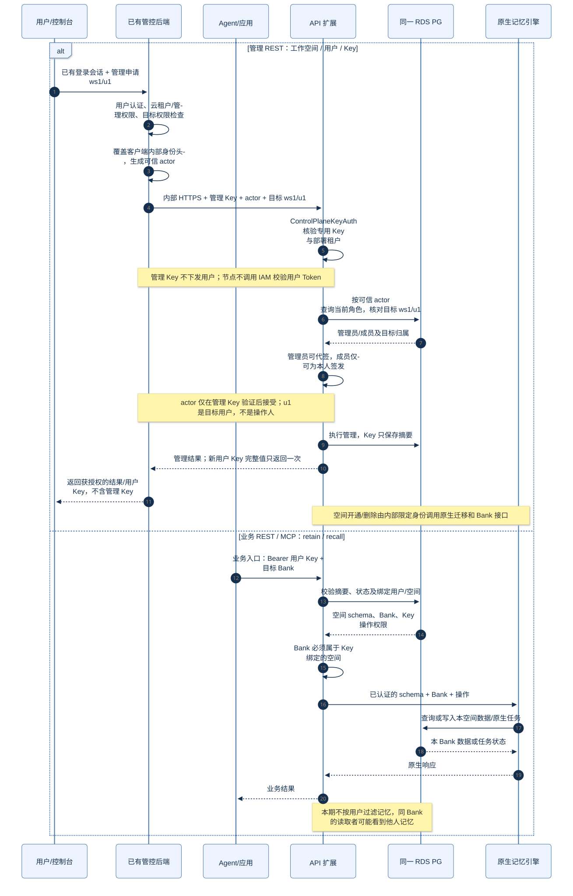

# ContextDB 独享版本工作空间、用户与 API Key 服务化设计

更新日期：2026-10-13。本特性新增实例登记、工作空间、成员和 API Key 管理能力，管理接口仅通过内部 REST 提供给已有云管控后端，不向用户面直接开放，也不新增管理 MCP 工具。

原生 Hindsight 的 REST/MCP 接口、路径和请求/响应协议保持不变。本特性只接入动态 Key 认证、空间路由与操作权限；是否关闭或裁剪原生接口另行评估，不属于本次设计与验收。

首期源码已实现，前序代理已完成本地自测；用户尚未检视代码或完成验收，云管控联调和生产验证未完成。本轮仅局部校准文档，未修改源码、架构、运行配置或历史测试结果。证据见[实现与本地自测记录](implementation/contextdb-service-verification-2026-10-13.md)，开发问题见[开发记录](implementation/contextdb-service-night-task-2026-10-13.md)。

## 目录

- [首期交付范围](#首期交付范围)
- [总体架构与资源模型](#总体架构与资源模型)
- [功能模块设计](#功能模块设计)：实例/空间、成员、用户 API Key
- [认证与授权](#认证与授权)：管控服务认证、原生业务认证接入
- [PG 表设计](#pg-表设计)：同库布局、9 张表、索引与事务、[管理操作审计范围](#管理操作审计audit_events)
- [管理 REST 接口设计](#管理-rest-接口设计)：16 个新增操作
- [与原生业务接口及 Worker 的集成](#与原生业务接口及-worker-的集成)
- [扩展实现](#扩展实现)
- [部署与验收](#部署与验收)

## 首期交付范围

| 本期实现 | 本期不实现 |
|---|---|
| 动态创建、查询、修改、冻结和删除工作空间；初始化对应 schema 和唯一 Bank | 同 Bank 内个人记忆按用户隔离 |
| 动态创建、查询、改角色、停用和删除工作空间用户 | 私有记忆与共享知识的 tag 授权、记忆晋升和知识发布工作流 |
| 用户多 API Key 的签发、查询、过期、撤销和轮换 | 成员级记忆/文档/派生内容 ACL、成员任务私有状态适配 |
| 管控专用 Key 认证、admin/member 授权、用户 Key 认证与空间/schema/Bank 范围校验 | 节点直接校验用户 IAM Token、父子 Key 委派、跨空间 Key、组织层、用户组与独立计费服务 |
| 新增管控管理 REST，仅由可信管控后端调用 | 新增管理 MCP 工具、用户面直连新增管理接口、原生业务协议裁剪 |
| 管理面调用新增管理接口的成功变更记录（管理操作审计） | 独立审计模块、审计查询接口、完整安全审计及 retain/recall 业务调用审计 |

**本期使用默认记忆语义：同工作空间、同 Bank 的用户只要具有相应读取权限，就可能读到其他用户写入的记忆。Key 绑定用户用于凭据归属、管理授权和管理操作审计，不等于记忆所有权。**不能宣传“个人记忆私有”，也不能把控制台的用户筛选当成后端隔离。

共享不只限于读取：持有 memory.write 的成员可修改同 Bank 记忆，编辑/删除他人的共享文档及派生内容；admin/member 是管理角色，不构成个人内容保护。

用户隔离的论据与候选思路见[后续记忆隔离备忘](member-memory-isolation-future-notes.md)。这部分不是本期验收门槛或已经实现的功能。

## 总体架构与资源模型



Hindsight 计算引擎包含并列的 API 与 Worker 节点，共用租户独享 PG。管理扩展与原生记忆能力位于节点内，不额外部署生命周期、审计或独立 MetaPG 服务。云管控是已有系统，不新增登录平台。

调用链路只有两条：**Console → 管理面 → Hindsight 计算节点**，以及 **Agent → Hindsight 计算节点**。管理面指已有云管控后端；两类请求均由计算节点的 API 处理，不新增独立入口、网关或转发服务。

```text
云租户（独享 API / Worker / 一个 RDS PG 数据库）
  └─ 工作空间 × N（每空间独立 schema 内唯一 Bank）
       ├─ 用户 A：管理员 admin → API Key × N
       ├─ 用户 B：成员 member → API Key × N
       └─ Bank 内记忆/知识：沿用上游共享语义，用户记忆隔离未实现
```

用户也叫成员，两者是同一实体，沿用 `member_id` 作为工作空间用户 ID。只有 admin/member 两种角色，不设 Owner、全局用户目录或单独服务账号类型。同一个云登录身份在多个空间分别建立用户记录，角色和 Key 独立。保留 `iam_subject` 作为与已有管控登录身份的绑定字段，不代表 Hindsight 节点需要调用 IAM。

一个 Key 必须且只归属一个用户，从该用户解析云租户和工作空间；不能自选其他 Bank。每空间唯一 `bank_id = workspace_id`，名称修改不改变 Bank ID 或 schema。工作空间显示名以管控元信息为准；本期不保证原生 Bank 的初始名称随改名同步。应用用一个用户的 Key 服务多个终端用户时，Hindsight 不会自动识别这些终端用户。



```text
一个租户独享 PG 数据库
  ├─ ctxdb_meta：工作空间、用户、API Key、管理任务与管理操作审计
  ├─ ctxdb_ws_a：Bank A、记忆/索引、原生任务表
  └─ ctxdb_ws_b：Bank B、记忆/索引、原生任务表
```

schema_name 由服务端生成并登记，例如 `ctxdb_ws_<workspace_id_hex>`，在本 DB 内唯一且不可修改；不能用显示名/邮箱或客户参数拼接。Hindsight 技术 Tenant 对应空间 schema，不新增产品层级。公共扩展/例程及元信息仍共享。

跨空间访问由 Key→schema/Bank 路由及操作校验限制；独立 schema 不等于独立 PG 账号权限边界，客户端不持有数据库凭据。

分 schema 复用社区路由、迁移与 Worker 机制，目标是不为工作空间分表修改内核；动态映射和用户/Key 管理由 ContextDB 扩展实现。各空间表和索引独立增长，但 CPU、内存、I/O、连接容量、WAL 及故障/恢复边界共享，性能收益与混合负载影响须压测。[PG Schema](https://www.postgresql.org/docs/current/ddl-schemas.html)、[PG 资源](https://www.postgresql.org/docs/current/runtime-config-resource.html)

## 功能模块设计

以下三个模块定义新增管理能力；后续章节分别说明共用的认证、PG 存储、内部 REST 及原生业务/Worker 集成。

### 实例与工作空间管理

实例接口只登记部署配置中的已有独享实例，不自动创建云计算/RDS 资源。一个云租户可以创建多个工作空间，每空间独立 schema，内有唯一 Bank；工作空间是产品资源，不增加项目或组织层。

工作空间支持创建、查询、改名、冻结和删除。创建空间时登记初始管理员并初始化 schema/Bank；删除先排空请求与原生任务，再清理 Bank。开通/删除为可查询的管理任务，不把“受理成功”当成空间已可用或已删除。改名仅更新管控显示名，不保证原生 Bank 标签同步。

### 用户（成员）管理

用户与成员是同一实体，属于工作空间；仅 admin/member 两种角色。同一云登录身份在多个空间分别建立成员记录，角色和 Key 独立。管理员管理本空间成员及其 Key，普通成员只能通过管控管理本人 Key；至少保留一个 active、绑定登录身份的管理员。

成员支持创建、查询、修改名称/角色、停用和软删除。停用或删除后，其所有 Key 的新请求鉴权失败；不承诺取消已通过认证的请求和已受理任务。

成员的 `iam_subject` 绑定管控已认证的稳定登录身份，用于本人管理、角色解析和管理操作审计，不是 IAM Token。管理员必须绑定；未绑定的普通成员可用于应用/Agent，但其 Key 由管理员代管。管控核验身份属于本云租户，节点不另调用 IAM，也不接受客户自报 member_id 获得本人权限。身份绑定不通过成员 PATCH 改写，软删除后重新加入需后续显式流程。

### 用户 API Key 管理

一个成员可以有多个 Key，每个 Key 固定归属一个成员和一个工作空间。Key 是随机凭据，不是 tenant/user 信息的加密；归属、权限和到期状态由后端映射解析，不能修改 URL 或自报 schema 越权。

用户 Key 为 `ctx_live_<key_id>_<secret>`，secret 至少 32 字节密码学随机数；PG 仅保存带服务端 pepper 的 HMAC-SHA256 摘要。完整 Key 只在签发成功时返回一次；列表不返回 secret 或摘要。当前单部署 pepper 修改会使已有用户 Key 失效，版本化轮换另行设计。

签发按“管控认证申请人 → 节点验证管理服务凭据并复核本人/管理员及目标归属 → 生成随机 Key、保存摘要和管理操作审计记录”的顺序执行。仅传用户身份、role、租户或目标 ID 不能代替认证授权；管理员身份也不允许业务 Key 调用新增管理接口。没有绑定身份的成员只能由管理员代签。

支持多 Key 的签发、查询和撤销；到期按 expires_at 自动判定。轮换复用“签发新 Key → 客户端切换 → 撤销旧 Key”，不新增到期或轮换接口。同幂等请求不重放 secret，首响应丢失时撤销后重建。Key scopes 仅表示业务能力，不包含 users.manage、keys.create 等管理能力；Key 归属用户不等于个人记忆所有权。

管控服务的管理 Key 是另一类部署凭据，不属于成员，不进入 `api_keys` 表，也不通过用户 Key API 签发/撤销。其配置与认证见下一章。

## 认证与授权

| 调用链路 | 凭据与验证 | 权限边界 |
|---|---|---|
| 用户 → 已有云管控 | 已有登录会话/云凭据，由管控认证授权 | 云租户、云管理动作、目标空间/成员；用户不持有管理 Key |
| 管控 → 新增管理 REST | 管理 Key + 管控生成的操作人，由节点验证 | 只允许可信管控来源；节点再复核空间角色、本人关系与目标归属 |
| Agent/应用 → 原生 REST/MCP | 用户 API Key，由 Tenant/Validator 扩展验证 | Key/成员/空间状态、绑定 schema/Bank、操作 scope |
| 内部生命周期与 Worker | 服务端限定上下文，不接受客户自报 internal | 登记 schema/Bank、后台任务及管理动作；内部身份不等于任意 Bank 管理权限 |

### 管理面认证



1. **管理面认证用户并授权。** 接收 Console 发出的工作空间、成员或 Key 管理申请，从真实登录上下文取得操作人身份。
2. **Hindsight 校验管理 Key 并复核权限。** 管控通过内网 HTTPS 携带管理 Key 和操作人身份调用；节点检查目标归属及当前空间角色。
3. **执行管理操作。** 元信息保存到同一 RDS PG；空间开通/清理复用原生 Bank 接口。

管理 Key 仅由管控持有，不下发用户。操作人必须由管控生成，不能透传用户自报身份；管理 Key 认证的是管控服务，不是用户。云创建权限仍由管控负责，节点不直接校验用户 IAM Token。

本文以“Hindsight 计算引擎”统称 API 与 Worker；本图管理请求由 API 节点内的管理扩展处理，管理扩展不单独部署。业务 retain/recall 使用用户 API Key，走原生 REST/MCP，不经过管控管理链路。

#### 管控服务凭据配置

| 项目 | 首期约定 |
|---|---|
| 生成与绑定 | 实例开通阶段生成，secret 至少 32 字节密码学随机数；每个租户的独享部署使用独立 Key，不是所有客户共用的固定值 |
| 保存 | 管控后端持有 secret；API 端保存可校验的摘要及 key_id/租户/有效状态。通过受保护配置注入，不硬编码到源码、镜像、文档或浏览器配置 |
| 凭据种类 | 管理 Key 可采用 `ctx_ctrl_<key_id>_<secret>`；用户 Key 为 `ctx_live_<key_id>_<secret>`。前缀只是识别提示，认证必须核验实际凭据及其用途 |
| 权限范围 | 管理 Key 只用于内部管理路由；不进入用户 `api_keys` 表、用户列表或签发接口，不获得 retain/recall 权限；用户 Key 无论角色是否 admin，都不能访问管理路由 |
| 调用来源 | 管理面直接调用计算节点的管理 REST；节点校验连接来源、管理 Key 与操作人。网络访问限制须部署联调验收，不新增独立管理监听或网关；Agent 的用户 Key 不能调用管理接口 |
| 轮换与撤销 | 管理 Key 为启动时配置，本期无热加载；配置更新后须使全部相关副本重新加载（当前通常滚动重启）。可限定新旧 Key 短期并存，切换后移除旧摘要；不承诺取消已认证的在途请求 |
| 泄露处理 | Key 不入日志、错误或响应；持有泄露 Key 的攻击者可能冒充管控及操作人，应立即限制入口、撤销/轮换并审计，不能承诺“内置即绝不泄露” |

首期不强制额外引入 mTLS、服务签名或新的 IAM 适配器；采用已有用户认证/授权、内部网络限制、HTTPS 和专用 Key 的组合。仅“用户不知道 Key”、隐藏 URL、Referer 或 User-Agent 都不能作为安全边界。

节点须禁用 `--proxy-headers`，避免 Uvicorn 在扩展检查前重写连接来源。管理路由拒绝 `Forwarded`/`X-Forwarded-For`，按实际连接来源检查网络；若部署环境已有代理，须剥离这些头，不透传客户端自报来源。这是部署约束，不表示本方案新增代理组件。

### 原生数据接口的认证接入（retain / recall）


1. **校验用户 Key。** Agent/应用通过 HTTPS 携带用户 API Key；Hindsight 查询 PG 中的 Key 映射，核验摘要、到期/撤销状态，以及所属用户、工作空间是否有效。
2. **检查访问范围与操作权限。** 从服务端映射确定工作空间 schema 和唯一 Bank，拒绝访问其他空间；recall 要求 `memory.read`，retain 要求 `memory.write`（签发时同时要求 `memory.read`）。
3. **执行记忆操作。** 校验通过后，原生记忆引擎在目标 schema/Bank 查询或写入；异步 retain 的后台任务沿用该空间上下文。

原生业务 REST/MCP 使用用户 API Key；不经过云管控、不使用管理 Key，也不接受客户自报用户/租户身份作为授权依据。鉴权失败或越权即拒绝，不执行记忆操作。同 Bank 内的成员记忆仍共享，Key 归属用户不等于个人记忆隔离。

## PG 表设计

### 存储布局与表结构

元信息与记忆使用同一个租户独享 RDS PG，不新增 MetaPG。`ctxdb_meta` 存管理元信息；每空间的 `ctxdb_ws_<32位随机hex>` 存原生 Bank、记忆、索引与任务。元信息不放入 `memory_units`，本期不修改原生记忆表增加用户字段。

下表列出全部 9 张元信息表的主要字段与约束。ID、名称和状态主要使用 `text`，时间使用 `timestamptz`，版本使用 `bigint`；完整可执行 DDL 在源码 `hindsight-extensions/contextdb-service/hindsight_ext_contextdb/schema.sql`，本文是设计说明，不复制一份易失配的 SQL。

表中包含数据库约束及服务规则：最后管理员保护、schema 不可修改由 Repository 的事务与校验保障，运维直接写 SQL 不得绕过这些规则。启动版本标记校验不自动核验/修复实际列与索引，旧原型不能仅凭 version=1 认定可升级。

| 表 | 主要字段 | 约束与用途 |
|---|---|---|
| schema_versions | version（integer 主键）、installed_at | 本期版本 1；运行副本校验版本，缺失或未知版本拒绝启动 |
| instances | instance_id（主键）、cloud_tenant_id、name、created_by、created_at | 固定部署登记；instance/tenant 联合唯一，租户来自服务端配置，不是新产品层级 |
| workspaces | workspace_id（主键）、instance_id、cloud_tenant_id、schema_name、name、description、state、version、created_at | schema 全局唯一、服务端生成且不可修改；instance/tenant 复合外键；Bank ID = workspace ID |
| workspace_members | member_id（主键）、workspace_id、member_name、iam_subject、role、status、version、created_at | role 仅 admin/member；admin 必须绑定身份；同空间非空身份唯一，软删除保留历史绑定 |
| api_keys | key_id（32位 hex 主键）、workspace_id、member_id、name、digest（bytea，32字节）、scopes（text[]）、expires_at、revoked_at、created_by、created_at、last_used_at | 只存 HMAC-SHA256 摘要；workspace/member 复合外键；scope 白名单、到期时间约束 |
| management_operations | operation_id（主键）、instance_id、workspace_id、workspace_version、actor_subject、action、target_id、idempotency_key、request_hash、state、attempts、lease_token、lease_until、error_code、created_at、updated_at | 开通/删除任务；actor/动作/目标/幂等值联合唯一；版本代次防旧失败创建复活；租约 token 不返回客户端 |
| request_admissions | admission_id（主键）、instance_id、workspace_id、owner_id、origin、state、created_at | origin 为 http/queue；执行前提交，正常结束仅移除自身记录；active/interrupted 均阻止清理，无 TTL |
| key_requests | workspace_id、member_id、actor_subject、idempotency_key、request_hash、key_id | 前四项组成主键；复合外键保证 Key、成员、空间一致；签发重试只保存 ID/hash，不保存 secret |
| audit_events | event_id（自增 bigint 主键）、request_id、instance_id、cloud_tenant_id、workspace_id、member_id、key_id、control_key_id、actor_subject、action、result、created_at | 管理操作审计：记录管理面调用新增接口的成功变更，由计算节点写入；不记录 retain/recall 业务调用，不保存凭据、请求或记忆正文 |

工作空间状态为 creating/active/frozen/deleting/deleted/failed；成员状态为 active/disabled/deleted；管理任务状态为 pending/running/succeeded/failed。Key 的 active/expired/revoked 状态由到期及撤销字段计算，不单独持久化，也不代表所属成员/空间必然有效。

### 主要索引与事务规则

| 索引 | 用途 |
|---|---|
| workspaces_instance_page | 按实例分页查询空间 |
| members_login_unique | 空间内登录绑定唯一，含软删除历史 |
| members_workspace_page | 空间成员分页 |
| keys_member_page | 用户 Key 分页 |
| operations_pending | 管理任务领取、过期租约发现 |
| admissions_workspace | 删除前查询未完成的请求记录 |
| audit_workspace_time | 按实例、空间与时间检索管理操作审计记录 |

1. **初始化与升级。** 部署阶段单个 bootstrap 安装 `ctxdb_meta`，API/Worker 只校验版本；空间表使用原生 `run_migration`。本期 DDL 是未发布的初始版本，不是旧原型的原地升级工具。
2. **成员与 Key 修改。** 先锁空间行，再检查操作人和目标；同空间角色变更串行，保证至少一个 active、绑定身份的管理员。身份唯一绑定不会因软删除自动回收，重新加入需要后续显式流程。
3. **开通与租约。** 空间、初始管理员和管理任务在一个元信息事务登记；迁移 DDL 与 Bank 创建不宣称原子。任务使用行锁领取，不新增 advisory lock；租约时间在行锁等待结束后用新语句检查，不能跨原生 DDL 持长事务，也不提供 DDL 强 fencing。
4. **删除与恢复。** 请求/入队前提交持久记录，清理前先检查原生任务、再检查请求记录；残留记录不按超时回收。准入与管控使用独立连接池但连接同一 PG，避免占满记忆连接池；容量仍需压测。清理保留 schema/表和 deleted 历史，不复用空间 ID。
5. **备份与授权。** 备份恢复包含 `ctxdb_meta` 与全部空间 schema；仅备份 Bank 不够。新请求查 PG 主库，不缓存授权；元信息恢复带回的请求记录不能未经旧执行者隔离就清零。集合分页限制进入 SQL，不先读取全量再切片。

### 管理操作审计（audit_events）

本文的“管理面审计”特指**管理面调用新增管理 REST 所产生的成功变更记录**，用于追踪谁在何时对哪个空间、成员或 Key 执行了管理操作。管理面提供可信操作人身份，Hindsight 计算节点将记录写入同一 PG 的 `ctxdb_meta.audit_events`；不是由管理面维护这张表，也不覆盖管理面的所有动作。

| 对象 | 当前记录的动作（action） |
|---|---|
| 工作空间 | 创建（create_workspace）、修改名称/描述或冻结/恢复（update_workspace）、发起删除（delete_workspace） |
| 用户／成员 | 创建（create_member）、修改名称/角色或启停（update_member）、删除（delete_member） |
| 用户 API Key | 签发（create_key）、撤销（revoke_key） |

记录包含操作人、管理 Key ID、请求 ID、目标 ID、动作和时间，不保存 Key secret、请求/记忆正文或字段修改前后值。记录与管理变更在同一元信息事务提交；写入失败会使该事务回滚。

当前 `result=success` 表示对应元信息事务成功；创建/删除空间只表示已受理，不表示后台执行完成，最终结果查询 `management_operations`。实例登记、查询/列表、失败认证和越权请求、生命周期最终结果，以及 retain/recall 等业务调用均不写入本表。

首期不新增审计查询 API、审计页面或日志保留/清理策略，不把这张表作为独立审计模块或完整安全审计。它与 Hindsight 原生业务审计、LLM trace 是不同能力，原生行为保持不变。

## 管理 REST 接口设计

### 通用约定

新增 16 个操作仅由可信管理面调用，实际挂载在计算节点的 `/ext/contextdb/v1` 下，不依赖额外路径映射。用户通过 Console 向管理面提出申请，不直接调用这些节点管理接口。

本章列出新增接口的请求、响应和权限；[管理 OpenAPI](api/contextdb-control-plane.openapi.yaml) `0.4.0-development` 是对应的机器合同。原生业务接口不是新增管理 API，也不套管理响应信封。

| 管理请求头/参数 | 约定 |
|---|---|
| X-ContextDB-Control-Key | 所有管理接口必需；用户业务 Key、IAM Token 不可替代 |
| X-ContextDB-Actor-Subject | 所有管理接口必需；由管控登录上下文重建，1–256 个可见 ASCII 字符，不是目标 member_id |
| Idempotency-Key | 创建/删除空间必需，Key 签发可选但建议提供；1–128 字符，同值不同正文 409 |
| If-Match | PATCH 空间/成员必需；提交查询所得 ETag，如 `"3"`，版本不符 412 |
| limit / offset | 管理集合查询；limit 默认 20、上限 100，offset 默认 0；返回 items/total/limit/offset |
| JSON 正文 | 新增管理 DTO 拒绝未知字段；PATCH 至少一个非 null 修改；name/member_name 长度 1–64，description 最长 512 |

管理响应均带 `X-Request-ID`、`Cache-Control: no-store`；有正文时包含 request_id，204 无正文。空间/成员查询与更新提供 ETag。错误正文为 `code/message/request_id`，状态包括 400 输入非法、401 凭据无效、403 权限不足、404 不存在/不可见、409 状态或幂等冲突、412 版本冲突、503 元信息不可用。本期不新增限流或配额模块；429 仅在部署环境已有相应能力时产生，不假定已有独立入口。业务输入校验可返回原生 422，错误结构沿用原生 API，不承诺上述统一信封。

### 实例、空间与任务（8 个操作）

以下路径均相对管理前缀，权限指管控认证后的实际操作人，不表示用户持有管理 Key。

| 方法与路径 | 主要输入/规则 | 成功结果与权限 |
|---|---|---|
| POST /instances | instance_id、name；ID 必须匹配固定部署配置 | 201，实例登记；管控核验云登记权限，不自动创建 RDS/API/Worker |
| GET /instances/{instance_id} | 目标 instance_id | 200，实例信息；只允许本部署登记 |
| POST /workspaces | name、可选 description；Idempotency-Key | 202，管理任务及 workspace_id；管控核验云创建权限，操作人成为初始管理员 |
| GET /workspaces | limit、offset | 200，操作人可见空间分页 |
| GET /workspaces/{workspace_id} | workspace_id | 200，空间信息/状态/版本与 ETag；空间成员可见 |
| PATCH /workspaces/{workspace_id} | name/description/state；If-Match；state 仅 active/frozen | 200，更新后空间；本空间管理员 |
| DELETE /workspaces/{workspace_id} | Idempotency-Key | 202，删除任务；本空间管理员，排空后清理唯一 Bank |
| GET /operations/{operation_id} | 管理 operation_id | 200，可见空间的管理任务状态；不泄露其他空间任务 |

空间返回 workspace_id、instance_id、cloud_tenant_id、schema_name、name、description、state、version、created_at；schema 只读，创建和修改不能自报。管理任务返回 operation_id、workspace_id、action、state、attempts、error_code，不返回租约 token。

管理任务 state 为 pending/running/succeeded/failed。202 只表示受理，须轮询任务并查询空间状态；创建成功后 active 才可使用业务 API。`waiting_for_admissions` / `waiting_for_tasks` 是删除等待码，不是删除成功或 failed。

冻结 PATCH 和 DELETE 在首响应前可能先等待已准入请求退出；DELETE 取得独占锁、关闭准入并登记任务后才返回 202，随后异步排空后台任务。管控超时不证明请求未受理，删除重试沿用原 Idempotency-Key。

### 成员（5 个操作）

下表路径相对 `/workspaces/{workspace_id}`。

| 方法与路径 | 主要输入/规则 | 成功结果与权限 |
|---|---|---|
| POST /members | member_name、可选 iam_subject、role；role 默认 member | 201，新成员；本空间管理员 |
| GET /members | limit、offset | 200，成员分页；本空间管理员 |
| GET /members/{member_id} | 目标 member_id | 200，成员及 ETag；管理员或本人 |
| PATCH /members/{member_id} | member_name/role/status；If-Match；status 仅 active/disabled | 200，更新后成员；本空间管理员 |
| DELETE /members/{member_id} | 目标 member_id，无正文 | 204，软删除并使其 Key 后续鉴权失败；本空间管理员 |

成员返回 member_id、workspace_id、member_name、iam_subject、role、status、version、created_at。iam_subject 为管控核验的登录身份绑定：普通成员可不绑定，管理员必须绑定；创建后不通过 PATCH 改绑身份。最后一个 active、绑定身份的管理员不可降级/停用/删除。普通成员不能创建其他成员或改角色。

### 用户 API Key（3 个操作）

下表路径相对 `/workspaces/{workspace_id}/members/{member_id}`；管理员管理本空间用户的 Key，普通成员只管理绑定到本人登录身份的 Key。未绑定身份的成员只能由管理员代管。

| 方法与路径 | 主要输入/规则 | 成功结果 |
|---|---|---|
| POST /api-keys | name、scopes、expires_at；可选 Idempotency-Key | 201，Key 元信息及完整 secret，仅返回一次 |
| GET /api-keys | limit、offset | 200，Key 元信息分页，无 secret/摘要 |
| POST /api-keys/{key_id}/revoke | 目标 key_id，无正文 | 204，幂等撤销；不删除历史归属与管理操作审计记录 |

scopes 为 1–4 个不重复值：memory.read、memory.write、knowledge.read、reflect。memory.write 和 reflect 都要求同时有 memory.read；不包含任何成员/Key/Bank 管理权限。expires_at 必须携带时区、晚于当前时间，当前实现最长 365 天。Key 元信息返回 key_id、归属、name、scopes、status、到期/撤销及创建/使用时间；status 仅反映 Key 自身，不替代用户和空间状态检查。

memory.read 不只覆盖 recall，也覆盖同 Bank 原生文档/model/profile，以及复用该授权的原生审计、LLM trace 和原始导出（取决于原生开关）；不包含新增管理 REST 或 ctxdb_meta.audit_events 管理操作审计记录的访问权。专用知识读取另需 knowledge.read，不随 memory.read/write 自动授予。

Key 轮换使用“签发新 Key → 客户端切换 → 撤销旧 Key”，不新增修改 secret 的接口。同幂等值签发重放返回 409 并告知原 key_id，不重放 secret；首响应丢失时撤销后重建。幂等记录按部署、操作人、动作与目标隔离，不以可轮换的管理 Key ID 作为用户身份。

管控调用示例，仅示意，无真实凭据：

```bash
curl -X POST 'https://contextdb-internal.example.com/ext/contextdb/v1/workspaces' \
  -H 'X-ContextDB-Control-Key: <CONTROL_API_KEY>' \
  -H 'X-ContextDB-Actor-Subject: <VERIFIED_ACTOR_SUBJECT>' \
  -H 'Content-Type: application/json' \
  -H 'Idempotency-Key: workspace-demo-1' -d '{"name":"研发空间"}'
```

签发用户 Key 的正文示例，目标空间/成员在 URL 中确定，不接受正文自报租户、schema 或 allowed_bank_ids：

```json
{
  "name": "app-key",
  "scopes": ["memory.read", "memory.write"],
  "expires_at": "2027-01-01T00:00:00Z"
}
```

## 与原生业务接口及 Worker 的集成

### 原生业务接口的接入范围

retain、recall、reflect 和知识管理是 Hindsight 已有能力，不属于本次新开发的功能模块。本特性不改变其原生 REST/MCP 协议，只在执行前解析 Key、定位工作空间并校验权限；原生接口的裁剪/关闭不在本特性中讨论。

REST 仍使用 `Authorization: Bearer <USER_API_KEY>`，路径前缀为 `/v1/default/banks/{bank_id}`；bank_id = workspace_id，default 不是客户可自选的租户。原生 MCP 端点与协议保持，上下文同样接入动态 Key/Bank 认证，不新增成员或 Key 管理工具。

| 原生能力/REST 路径 | 与本特性有关的校验 | 原生请求/响应重点 |
|---|---|---|
| POST /memories（retain） | memory.write + memory.read；限定目标 Bank | items[].content，async 默认 false；返回 success/items_count，异步含 operation_id 或 operation_ids |
| POST /memories/recall | memory.read；限定目标 Bank | query；返回 results |
| POST /reflect | reflect + memory.read；限定目标 Bank | query；返回 text 及可选 based_on/usage |
| GET /operations/{operation_id} | memory.read；限定任务所属 Bank | 返回原生任务 status/进度；不是管理面的 operation |
| 原生知识树/页面/搜索/导出 | knowledge.read；限定目标 Bank | 沿用原生 knowledge-base 路径与字段；不授予 recall、原始 model、审计或 LLM trace 权限 |
| 原生知识目录/页面编辑 | memory.write + memory.read；限定目标 Bank | 沿用原生创建、更新、删除节点接口，不另开发知识处理引擎 |

表中 REST 路径相对 Bank 前缀，是权限接入说明，不是重新定义原生接口。完整字段沿用原生 OpenAPI；不在本文复制全部记忆/知识 API。加载扩展后仍须执行授权策略，不能把“保留接口”理解为任意 Key 可以访问所有 Bank。

MCP 工具已成功时，SDK 后续请求仍可能因撤权返回 401；应核对实际工具结果，不能直接重试非幂等写入。

### Worker 与任务上下文

异步 retain 受理后，原生任务保存目标空间上下文，Worker 在对应 schema/Bank 执行；撤销 Key 不自动取消已受理任务。冻结/删除空间仍可被发现以排空已有任务，但禁止周期维护重新提交新任务。Worker 只消费原生 PG 队列，不新增面向客户的成员/Key 管理或数据写入 RPC；健康/指标仅供私有监控。

空间开通/删除的管理任务由 API 进程内的 Lifecycle 执行；Worker 消费的是原生数据任务，不新增独立生命周期服务。

管理任务与数据任务是两套状态，不混用：

| 任务 | 查询接口 | 状态 |
|---|---|---|
| 空间开通/删除 | 管理 /operations/{operation_id} | pending/running/succeeded/failed |
| 原生异步记忆处理 | Bank 下 /operations/{operation_id} | pending/processing/completed/failed/cancelled/not_found |

异步 retain 返回的 200 仅表示入队，status=completed 才表示完成；管理创建的 202 仅表示受理，须管理任务成功且空间 active 才能使用。

## 扩展实现

```text
hindsight_ext_contextdb/
  http.py         HttpExtension：工作空间/用户/Key 管理 REST
  security.py     随机 Key、摘要核验和 ControlPlaneKeyAuth
  tenant.py       Key 验证与工作空间 schema 路由
  validator.py    Bank/操作权限、禁止业务 Key 建删 Bank
  repository.py   ctxdb_meta 查询及状态版本
  lifecycle.py    原生 schema 迁移/Bank 调用及幂等恢复
  admission.py    跨副本在途请求排空、服务端目的上下文
  models.py       请求/响应、Principal 和状态模型
  config.py       部署配置与连接适配；管理操作审计写入在 repository.py
```

实际源码包为 `hindsight-extensions/contextdb-service/hindsight_ext_contextdb/`，HTTP 路由/Repository 分层，租户与操作策略分别在 `tenant.py`/`validator.py`，不新增独立管控服务。运行/打包说明见源码包 README。

部署不能只复制扩展包，还须包含前序实现的[原生边界补丁清单](implementation/contextdb-service-verification-2026-10-13.md#代码组织与侵入点)。可选 ASGI/入队 hook 默认空或 no-op；MCP 身份恢复等补充另有兼容验证，不能一概称为 no-op。

HttpExtension 不会自动为新增管理 API 完成管理 Key 认证。原型使用 `ManagementRoute`（APIRoute 子类）在所有管理接口解析正文前检查来源和 `ControlPlaneKeyAuth`，再由 Repository 按可信 actor 核对空间、角色与本人关系；列表、详情和 operation 状态也受保护。不能认为原生 ApiKeyTenantExtension 会保护这些新路由。OpenAPI security 只是合同声明，不能代替实际代码；凭据配置不可用、认证失败或权限无法确定时拒绝，不 fail-open。

管理认证先校验 Key，再解析 actor；Key 核验使用恒定时间摘要比较。输入校验统一适配本合同的 400，不直接沿用 FastAPI 默认的 422；在允许的内部来源上，无效管理凭据优先于正文校验返回 401。actor 格式/长度检查及角色复核不是再次向 IAM 认证这个用户。

```text
ManagementRoute：来源约束 → 管理 Key → 可信 actor → 请求正文校验
  → handler：解析目标与版本/幂等信息
  → Repository：当前空间/成员权限 → 事务写入及管理操作审计记录
```

新增的纯 ASGI 准入扩展 hook 用于业务 REST/MCP 在途排空，不代替上述管理认证，也不新增 IAM Token 校验。

| 原生接口 | 本期扩展职责 |
|---|---|
| TenantExtension.authenticate / authenticate_mcp | 验证随机 Key 摘要、Key/用户/空间状态；选择登记 schema，设置 api_key_id 和技术 tenant_id=workspace_id |
| TenantExtension.list_tenants | 返回本部署初始化完成且仍需后台任务处理的空间 schema；Tenant(schema=schema_name, tenant_id=workspace_id) |
| OperationValidator.validate_bank_read/write / validate_create_bank | 检查目标 Bank、操作权限；仅限定内部管理身份可创建/配置/删除 Bank，拒绝未知 Bank 懒创建 |
| bank_list_scope / filter_bank_list / filter_mcp_tools | Key 只看本空间唯一 Bank；列表/工具过滤不能替代引擎对目标 Bank 的权限校验 |
| ExtensionContext.run_migration(schema) | 初始化/升级空间 schema，复用上游迁移 |
| TenantExtension.async_submission_scope | 在获取数据连接前保护原生队列提交；默认 no-op，ContextDB 实现工作空间锁及持久清理屏障 |
| resolve_tag_scope / resolve_write_tag_scope | 本期不实现用户 tag 私有/共享策略，不据此宣称个人记忆隔离 |

业务协议保持上游 REST/MCP；本特性只接入认证、授权与空间路由。认证得到 schema 后仍须校验目标 Bank 和操作权限，不能把身份校验等同于授权通过。内部 Bank 管理还须校验当前 PG 管理任务 ID、租约 token、动作和目标，不能仅凭 purpose 标签放行。

用户归属/Key ID 可供后续业务审计关联，本期不据此新增业务调用审计，也不注入 owner/shared ACL 标签，不做成员级文档、任务或派生页面权限。旧“成员任务状态适配”“knowledge/publications”接口不进入本期合同。

## 部署与验收

### 首次初始化流程

部署单 owner 安装元信息表 → 配置管控管理 Key、业务 Key pepper 与 PG 账号 → 启动 API/Worker → 登记固定实例 → 创建空间并等待 active → 管理员通过管控创建成员/签发用户 Key → Agent 调用原生接口。

管理 Key 在部署阶段配置，独立于用户 Key，因此没有“必须先有用户 Key 才能签发第一把 Key”的依赖。API/Worker 使用服务端 PG 账号，客户端不持有 PG 密码；管理 Key 不自动提升 PG 权限。迁移、索引、清理权限与备份恢复需要单独验收。

本特性不新增关闭原生 REST/MCP 的部署要求。原生接口裁剪另行评估，不将关闭 MCP 作为本期验收项。加载 ContextDB 扩展时不得配置 `HINDSIGHT_API_MCP_AUTH_TOKEN`，当前实现会拒绝该旧共享 Token 配置；原生 MCP 继续使用动态用户 Key，这是认证配置约束，不是关闭接口。

### 生命周期、故障边界与验收

创建：登记空间/schema 和管理任务 → run_migration → 限定内部身份创建唯一 Bank → 校验 → active。失败保持 creating/failed，由 API 进程内持久管理任务重试；同库不代表跨原生迁移和 Bank 操作天然原子。

删除：先等待已准入 HTTP 操作结束（包含同步调用和尚未提交任务的调用），取得空间独占锁并关闭新准入 → 排空原生 pending/processing 任务 → 在目标 schema 清理 Bank → 标记 deleted。保留该空间 schema/表结构与 deleted 元信息作为 tombstone，不复用空间 ID，不 DROP 整个 schema/数据库，不清理其他空间。

故障保护：会话锁断开不等于旧数据事务已结束。因此业务执行前先提交 `request_admissions` 记录，正常结束才移除；任何残留记录都阻止物理清理。中断/崩溃后 DELETE 可以已返回 202，但任务保持等待，不能报告删除成功。状态接口的 `error_code=waiting_for_admissions` 表示等待屏障，`waiting_for_tasks` 表示等待原生任务，不等于 failed。

业务执行中的后端故障、请求中断或未知执行状态须保留屏障，包含 REST 500 及原生 MCP 包装为错误正文的后端异常；预期的认证/权限拒绝不误报为未知执行故障。删除时先检查原生任务、再检查持久记录，避免父任务刚结束、子任务尚未入队时误判为空。

本期不自动回收未知执行者的记录，也不提供用户清除接口。需在可信维护窗口确认旧 API/Worker 及 PG 工作会话停止，再恢复清理；不能只凭“超过若干分钟”或某个 PID 不见了移除记录。自动恢复与云管控联动是后续讨论项。

首期上线前须明确可信运维负责人与人工恢复演练。owner_id 是随机执行者标识，不是 PID；无法证明旧执行者及工作会话已停止时继续保留屏障，维护窗口的影响范围由部署侧确认，不承诺无中断恢复。

准入锁和管控查询使用独立连接池，但都连接同一个租户独享 RDS PG，不新增 MetaPG 组件。这是为了避免持锁请求/等待删除占满原生连接池，导致已准入操作无法完成。部署须合计各 API/Worker 副本的原生、元信息/准入及迁移连接预算；连接池分开不提供资源物理隔离，容量须压测。

当前每 API 进程另有准入池和管控/队列池，各最多 10 条连接；独立 Worker 按实际加载路径另计管控/队列池。上线预算还须加原生池、迁移和维护连接，不能把池限额当成已验证容量。

租约 token 用于管理任务元信息和短事务模板入队检查，不是 native DDL 的强 fencing。原生迁移线程不能随协程取消停止，仍依赖上游迁移串行化；本期须关闭 `HINDSIGHT_API_MIGRATION_ISOLATION`，不支持可能在父进程退出后继续运行的迁移子进程。异常取消/进程崩溃、升级与恢复仍须专项验收，不能据主链路通过宣称任意故障下安全。

| 本期验收 | 内容 |
|---|---|
| 动态管理 | 空间/成员/用户 Key 动态管理无需重启；管理 Key、来源网络、pepper 是启动配置，变更须全副本重新加载，本期无热加载 |
| 管理与业务认证 | 管理面调用的来源限制、无/伪造/失效管理 Key 401、仅 actor 头拒绝、业务 Key/IAM Token 调管理拒绝、管理 Key 调业务拒绝；网络访问限制另做部署联调验收 |
| 可信管控与凭据运维 | 管控覆盖客户端伪造 actor/role 头；未登录/越权申请不转发；合法管控请求仍复核角色、目标与租户；缺少 actor 400；跨实例 Key 拒绝；全副本轮换/撤销及日志脱敏 |
| 用户/Key 管理 | 用户目录管理员限定、本人 Key 管理、最后管理员保护、摘要存储/展示一次、撤销/停用生效 |
| 工作空间隔离 | 修改 Bank/alias/空间/schema 参数不能跨空间；原生 REST/MCP 与 Worker 指向正确 schema，Bank 创建绕过被拒绝 |
| 原生接口兼容 | 原生 REST/MCP 路径和请求/响应协议不变；接入动态 Key、空间路由及 scope 后，原客户端与 Worker 回归通过 |
| 运维与负载 | 多 schema 升级/失败恢复、删除排空、不影响其他空间；大空间导入与小空间查询混合压测 |
| 非本期验收 | 用户记忆私有+共享知识的 tag ACL、成员私有任务状态、记忆晋升/知识发布 |

真实云管控登录/权限/内部 HTTPS/安全组联调仍为 NOT_RUN。本地原型已在独立临时 PG、真实 API/Worker 进程上用合成 Key 和 stub 模型验证基础链路，不能替代生产验收；完整用例及命令在开发记录。已有 public/共享 schema 的数据不会自动迁移，需要另行停写、拆分校验和切换映射。

## 附录：Hindsight Cloud 参考

本节保留前期竞品观察，仅解释设计取舍，不定义 ContextDB 新接口或原生协议裁剪策略。

不能把 Cloud 的 Organization 直接等同于我们的工作空间，也不能从 UI 推断其 PG schema 拓扑。

| 能力 | Cloud 已有证据 | ContextDB 首期采用 |
|---|---|---|
| Bank 管理 | 原生 REST `/v1/default/banks/...` 以及部分 Bank MCP 工具；没有证明存在同名 Workspace 管理 API | 资源包装为工作空间，由管理 REST 开通 schema 和唯一 Bank；业务 Key 禁止原生建/删 Bank |
| 组织及用户管理 | 登录控制台创建/切换组织、团队管理；历史前端证据有 `/api/organizations` 和 `/team` | 复用云租户及已有管控登录认证，用户在空间下，仅 admin/member；不复制 Organization、邀请邮件或密码系统 |
| 常规 API Key 管理 | 登录控制台 `/api-keys`、`/api/api-keys`；名称、到期、Bank scope、完整 secret 展示一次 | 用户多 Key、固定一个空间、摘要存储、展示一次和撤销 |
| 程序化子 Key | `/v1/api-keys/scoped` 的创建/列表、按 ID 撤销；有特定能力的父 Key 可管理自己的子 Key | 仅作为后续自动化参考；本期普通业务 Key 不可签发其他 Key |

组织角色与管理动作由登录后的成员权限决定，API Key 调用并不自动获得完整账户管理权限。[Cloud Team Management](https://docs.hindsight.vectorize.io/team-management/)

Cloud 的一个重要例外是：具有 `create_scoped_keys` 能力的父 Key 可以用 Bearer 调用子 Key 管理 API，子 Key 的 Bank 范围和到期时间受父 Key 限制，子 Key 不能继续签发。这是**明确的委派能力**，不是“所有 API Key 都能管理用户/Key”。本期不引入这种能力。[Cloud API Keys](https://docs.hindsight.vectorize.io/api-keys/)

历史[协议对比](Hindsight-API协议对比-Rest-MCP-商用与开源.md)主要证明数据面 REST/MCP 与 scoped Key 路径，不是全部控制台管理 API 的合同；[Cloud 对比 §3.3](hindsight-cloud-open-source-comparison.md#33-cloud-控制面比开源-control-plane-多什么)补充前端路由证据。没有捕获并核验全部控制台管理请求的 Cookie/JWT/Token 交换，不能断言其完整认证协议。当前官网还存在部分角色细节描述差异，因此不照搬其权限矩阵。

借鉴其“治理与记忆访问分开”的边界，不照搬全部协议或工具。ContextDB 新增管理接口只提供内部 REST；原生 REST/MCP 保持不变，业务 Key 的管理权限由既定授权策略约束。

## 源码与证据

固定源码基线：`a77c1f3412a7b82f36588dffce1a8d7480e99cc7`。以下源码链接证明上游 hook；ContextDB 实现位于本地新增扩展包，尚未提交/推送，不能将基线链接当作本次扩展代码。

- [HttpExtension](https://github.com/vectorize-io/hindsight/blob/a77c1f3412a7b82f36588dffce1a8d7480e99cc7/hindsight-api-slim/hindsight_api/extensions/http.py)
- [TenantExtension](https://github.com/vectorize-io/hindsight/blob/a77c1f3412a7b82f36588dffce1a8d7480e99cc7/hindsight-api-slim/hindsight_api/extensions/tenant.py)
- [OperationValidatorExtension](https://github.com/vectorize-io/hindsight/blob/a77c1f3412a7b82f36588dffce1a8d7480e99cc7/hindsight-api-slim/hindsight_api/extensions/operation_validator.py)
- [原生迁移入口](https://github.com/vectorize-io/hindsight/blob/a77c1f3412a7b82f36588dffce1a8d7480e99cc7/hindsight-api-slim/hindsight_api/extensions/context.py)
- [Worker schema 发现](https://github.com/vectorize-io/hindsight/blob/a77c1f3412a7b82f36588dffce1a8d7480e99cc7/hindsight-api-slim/hindsight_api/worker/poller.py)
- [SMIC 跨 Key 实测](evidence/hindsight-cloud-cross-key-smic-2026-10-10.md)
- [成员/Key 竞品调研](member-and-apikey-management-design.md)
- [文档验证记录](evidence/member-service-design-doc-validation-2026-10-12.md)
- [管理 Key 认证修订验证记录](evidence/member-service-design-control-key-validation-2026-10-13.md)
- [开发进度、问题与设计差异](implementation/contextdb-service-night-task-2026-10-13.md)
- [PG 表设计章节](#pg-表设计)
- [实现验收、专家结论及保留风险](implementation/contextdb-service-verification-2026-10-13.md)
