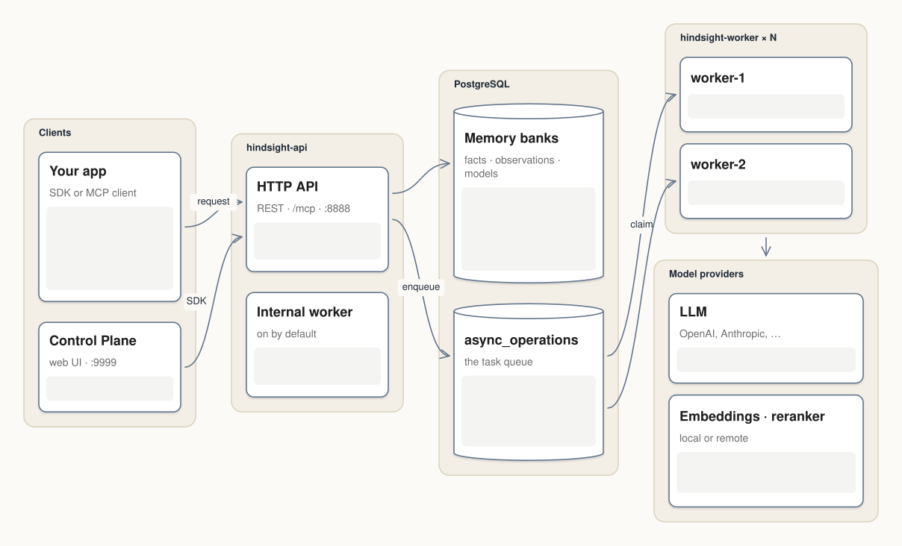
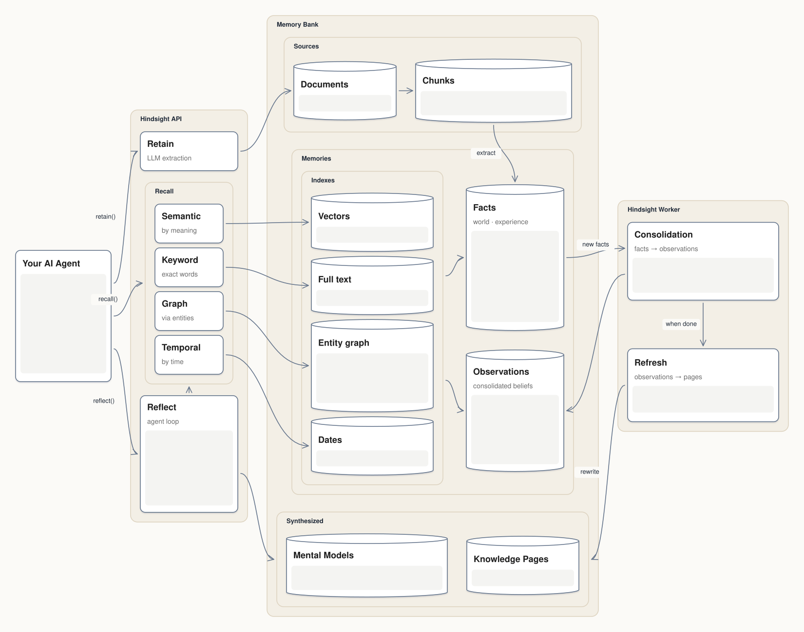
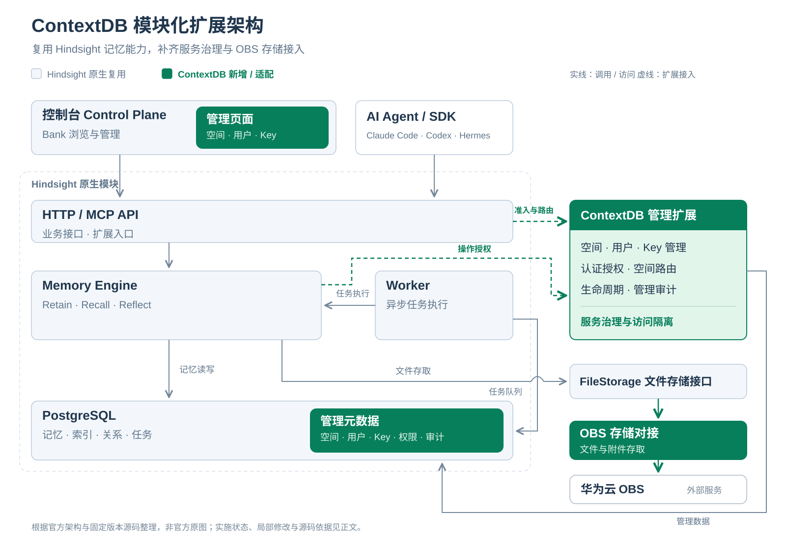
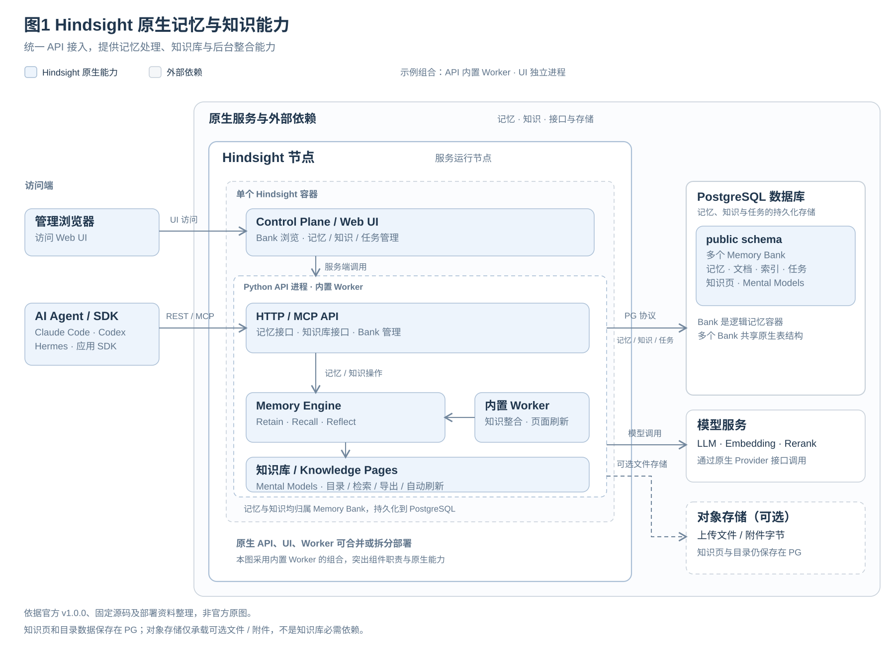
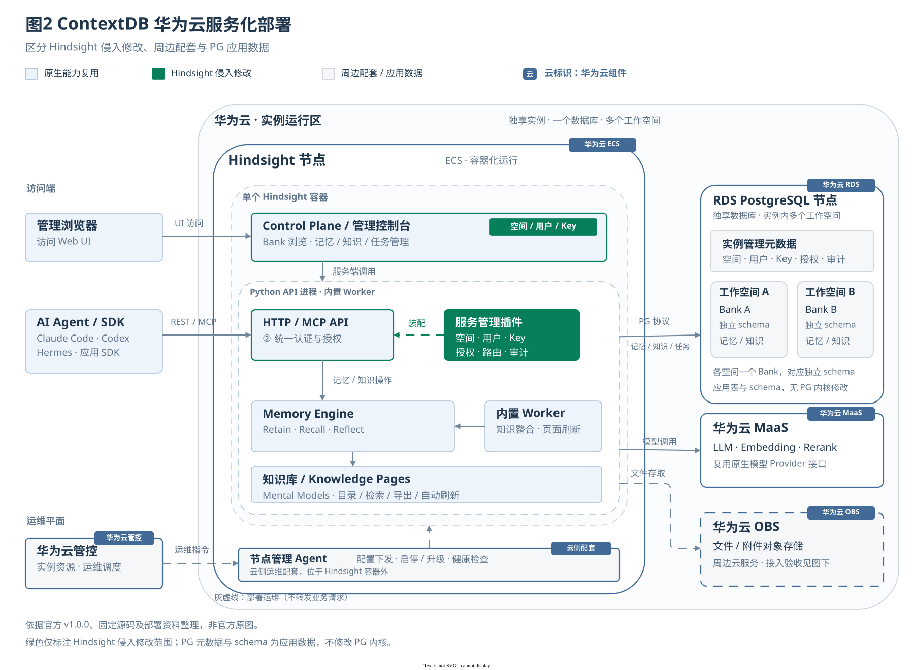

# ContextDB 开源选型与 Hindsight 侵入式修改评审

版本：第一版修订，已复核官方能力、定制实现与后续事项的归属，供开源引入和定制修改评审。日期：2026年10月21日。产品：华为云 ContextDB。审批状态：待产品、开源 COE、安全、法务及相关责任人评审。

Hindsight官方提供Retain、Recall、Reflect和Memory Bank等记忆服务能力；ContextDB固定代码在其上增加独享实例内的工作空间、用户和API Key管理，并修改品牌配置、公开错误及部分观测输出，另提供部署脚本。官方能力依据为[官方概览][O1]、[Memory Banks][O5]和[Services][O2]；实际新增/修改依据为[团队设计][C1]、[管理实现][C12]及[模块差异记录（归档摘要）](evidence/README.md)。原始取证文件已本地归档，当前仓内入口见[依据摘要](evidence/README.md)。**建议继续以 Hindsight v1.0.0 为引入基线，按定制分支申报整体差异；管理功能优先使用上游扩展接口，同时如实申报已存在的源码侵入。** 此建议不代表开源引入批准或生产发布批准。

本次静态核验确认：相对官方发布提交，整体存在 2,346 个变更文件，原生 Python 运行目录有 34 个变更文件；不能用最近一次管理功能 PR 的“原生目录无新增修改”代表整个产品零侵入。Hindsight 根许可证和 Python 包声明是 MIT；API 内的 Apache 2.0 元数据存在不一致；该标注在官方基线已存在、团队版本沿用，需收敛，并非本次定制造成的许可证切换（[官方API源码][U6]、[目标API源码][C10]）。`toktok` 的正式 Python 分发名是 `toktok-rs`，锁定版本为 0.1.3；OpenTelemetry 则是多个独立 Python 包，须逐包登记。依据见第1、5、6、7章及[基线证据（归档摘要）](evidence/README.md)。

## 1 评审范围和证据基线

### 1.1 固定版本

| 对象 | 本次采用值 | 使用方式 |
| --- | --- | --- |
| 代码仓 | `/Users/zhuqingping/Work/Database/Context/hindsight/integration/rsixdb-contextdb` | 所有本地代码结论绑定下列提交，不采用主工作区未提交修改 |
| ContextDB 提交 | `2606e883168800429c221b9be5a10e8f552b6e07` | [团队代码快照][C0]，提交日期2026-10-21 |
| 官方引入基线 | Hindsight v1.0.0，`39c65ffe2f140d0c84cee58566cad8900c5b9908` | [官方发布提交][U0]，提交日期2026-10-13；已验证是目标提交祖先 |
| 资料仓 | `/Users/zhuqingping/Work/Database/Context/ContextDB-Research` | 固定版本引用与当前工作树分开 |
| 资料提交 | `5f9993c2c1d9eb68a83decdb99590f4dfe7d76dd` | [设计][D1]、[部署指南][D2]、[验证摘要][D3] |
| Supabase 参考 | `hindsight/Supabase 开源组件侵入式修改评审.md` | 用户指定的工作树文件，未包含于上述资料提交；SHA256在证据附件留存 |
| 在线核验 | 2026-10-21 | 官方网站、项目仓库、PyPI、监管部门原文；当前网页不能替代版本内能力证据 |

本报告中，“已实现”指固定代码可定位到实现；“历史验证”指同版仓库文档记载的既有测试；“建议”是本次分析；“待补证”是正式送审或发布还需取得的证据。本次执行的是静态取证、差异统计和资料核验，没有重新运行产品全量测试、漏洞扫描或目标云环境验收。

### 1.2 与 Supabase 模板的对应关系

| Supabase 材料栏目 | 本报告位置 | 处理原则 |
| --- | --- | --- |
| 基本信息、产品定制需求、业务 gap、定制可否消减 | 第2、3、5章 | 分模块说明哪些可扩展、哪些已经侵入，避免一句“不可消减” |
| CMC/PC及研发开源COE前期结论 | 第11章 | 责任角色和需提供附件明确，结论保持待评审 |
| 服务介绍及产品位置 | 第3、4章 | 提供原生架构、ContextDB集成及信任边界 |
| 侵入式修改原因、点位、工作量、回馈 | 第5章 | 用实际差异和文件定位说明；不把行数虚构成人天 |
| 开源软件安全检查 | 第8章 | 原样映射可识别检查项，增加Agent/模型特有风险 |
| 中心仓分支现状及归一 | 第10章 | 公司内部查询结果待补，公开fork不等于中心仓已建档 |
| 演进、维护投入、社区同步 | 第10章 | 明确维护角色、补丁策略、退出和升级条件 |
| 决策点 | 第12章 | 提供可直接改写为议题结论的建议文本 |

参考文件存在 Prometheus / KubeRay 模板残留，部分附件正文和架构图片未保留，不能作为这些栏目已获批准、无漏洞或仅需1人维护的证据。其“安全检查项14条”标题下实际只有1.1～1.10共10个编号；第8章另外补充4项建议检查，不冒充华为官方缺失条款。完整内部流程版本和必填字段仍应由开源COE提供。

### 1.3 能力归属与证据使用规则

| 标识 | 含义 | 可使用的依据与边界 |
| --- | --- | --- |
| **官方原有** | 本次引入的官方v1.0.0已说明或实现的能力 | 优先引用官方发布提交中的概念页和API参考；当前官网仅作入口，不把官网新能力回填旧版本 |
| **实际新增/修改** | 目标ContextDB提交相对官方提交新增或修改的内容 | 同时给出目标源码和Git差异；“源码已实现”不等于目标云环境已验收 |
| **本期规格/限制** | ContextDB当前设计选择、交付范围和操作前置条件 | 引用固定团队设计/部署合同；不将上游可选部署组合视为ContextDB承诺 |
| **已有待办** | 固定设计或验证记录明确列出的未完成事项 | 引用原有TODO/未验收范围；没有完成证据则保持待办 |
| **本报告建议** | 为评审补充的改进、验证或治理建议 | 标明提出原因和依据；没有团队批准或排期，不写成已承诺的产品路线图 |

全文的“复用”只表示继承相应模块或接口；对权限、配置、外部响应或部署方式作出的限制仍需单独说明。概念介绍不等同于每个发布组合都已验证。第3.5节集中对照官方能力和ContextDB状态，第5.2节登记实际修改，第5.5节列出已有待办与本报告建议。

## 2 ContextDB 开源选型对比分析

### 2.1 需求与评价方法

目标是可独立交付的记忆数据服务：应用通过 REST/MCP 调用，底层可使用华为云 PostgreSQL，模型可接合规 MaaS，具有可维护的隔离、权限、部署和可观测性。首发以独享实例为边界，实例内多工作空间；并非把一个开源 Agent 框架整体托管。需求以[固定资料设计][D1]及[团队完整设计][C1]为依据。

优先级建议：P0为可修改和交付的许可、独立API、数据持久化和恢复、隔离权限及模型可控；P1为事实提取、多路径召回、时间关系处理、可追溯、中文效果及总成本；P2为控制台、SDK生态和社区维护。P0不通过不能依靠Stars或论文得分抵消。

### 2.2 候选方案比较

下表是架构适配判断，比较范围为公开开源部分；没有把各家商业云的功能直接计入开源能力。候选版本尚未统一冻结，正式选型归档时需保存各候选tag/commit及许可证快照。

| 方案 | 定位与主要能力 | 与ContextDB的适配及代价 | 许可与结论 |
| --- | --- | --- | --- |
| **Hindsight v1.0.0** | **官方原有**：Retain/Recall/Reflect、Bank、实体/时间关联、PG、REST/MCP；[概览][O1]、[Services][O2]、[MCP][O16] | **适配分析**：服务边界与“独立记忆服务+PG”目标相近；官方已有认证/多租户扩展机制，我们增加具体管理与授权实现。[官方扩展][O14]、[团队设计][C1] | 官方基线MIT。[LICENSE][U1]。**本报告推荐**继续采用；当前实际集成与尚待验证范围见[团队记录][C19] |
| **Mem0** | 面向Agent应用的记忆层，提供记忆管理与多种存储集成 | 适合个性化记忆场景，是主要替代候选；其后端组合、图能力和华为云运营管理需按选定配置重新集成与验证 | Apache-2.0；保留为迁移和专项对测候选。[官方仓库](https://github.com/mem0ai/mem0) |
| **Graphiti** | 时间知识图谱，追踪事实变化与来源，支持增量更新 | 适合关系和时态密集业务；需要评估图后端及其许可、运维和恢复成本。不能把Graphiti直接等同于完整Zep商业服务 | Apache-2.0；建议作为图检索专项备选。[官方仓库](https://github.com/getzep/graphiti)、[许可证](https://github.com/getzep/graphiti/blob/main/LICENSE) |
| **Letta** | 有状态Agent平台，围绕Agent运行及记忆管理组织能力 | 适合整体托管Agent；若只交付记忆服务，需评估剥离Agent生命周期及工具执行后的边界和维护成本 | Apache-2.0；作为平台化路线备选。[官方仓库](https://github.com/letta-ai/letta)、[许可证](https://github.com/letta-ai/letta/blob/main/LICENSE) |
| **LangGraph** | Agent工作流、持久状态及记忆基础设施 | 适合应用编排。按本项目需求，需要继续建设事实加工、统一记忆API、治理和控制台；与独立记忆服务可组合使用 | MIT；更适合作为客户端框架或自研基础组件。[官方仓库](https://github.com/langchain-ai/langgraph)、[许可证](https://github.com/langchain-ai/langgraph/blob/main/LICENSE) |
| **PostgreSQL+pgvector自研** | 自建向量和全文检索，数据结构与调用链完全可控 | 可复用PG运维；事实提取、关系/时间召回、反思、异步任务、SDK和测试均由团队负责 | 需逐件核验PG及扩展许可；作为可控性最高、建设量最大的退出路线 |

不以公开榜单直接判定Hindsight“全面领先”。官方不同模型、数据集、提示词、费用和裁判设置下的结果不能直接横比，也不证明本版本中文和华为MaaS效果。已有投入是交付成本依据，但不是质量优势证明。

### 2.3 推荐理由与反例条件

**官方事实**：Hindsight提供记忆API、PG存储和可自定义的认证/租户/操作扩展。[Services][O2]、[Storage][O17]、[Extensions][O14]。**当前实现事实**：团队已编写管理扩展、UI接线和部署/测试材料。[扩展装配][C3]、[部署镜像][C4]、[验证记录][C19]。**本报告判断**：这些能力与首发需求相符，可减少另建记忆引擎、独立图数据库及管理接入层的建设量；该判断不等于已证明成本最低或质量最优。

若出现以下任一情况，应重新选型或缩减范围：关键依赖许可无法引入；P0越权或数据恢复问题不能关闭；目标中文数据集效果/成本达不到产品门槛；上游维护政策无法支撑安全回补；团队品牌及协议变更造成长期大面积冲突。此时先对Mem0和自研PG方案进行同条件复测，而不是为保留既有投入无限扩大fork。

### 2.4 统一POC验收建议

**本报告建议，尚非已执行测试或已批准门槛。** 测项由官方记忆/检索/语言机制与当前验证缺口推导，依据为[Recall][O7]、[Multilingual][O15]及[团队验证边界][C19]；P01～P03项列出对应待验证范围。

| 维度 | 必测场景与记录 | 建议判定方式 |
| --- | --- | --- |
| 记忆效果 | 中文/英文，多轮偏好更新、事实冲突、时间范围、多跳关系、无答案、删除后再召回 | 固定数据/版本/模型与裁判；记录正确率、拒答质量、可追溯性；阈值由产品在测试前确认 |
| 性能和成本 | 同步/异步写入、不同bank规模、混合读写、长文、并发、后台积压 | 分开记录端到端与数据库延迟、p50/p95/p99、token、模型费用、CPU/RAM/存储 |
| 隔离和安全 | 不同实例/空间、只读Key、撤权、MCP重用连接、隐藏诊断、并发管理 | 未授权数据暴露为0；失败请求不得产生越权副作用 |
| 运维 | ECS/RDS原样镜像、x86/鲲鹏ARM、插件版本、故障、备份/PITR和版本升级 | 保存镜像digest、环境、步骤、日志；实际恢复满足确认后的RPO/RTO |
| 可迁移性 | 导出文档、记忆、标签、时间及关系，导入备选实现 | 先定义通用数据契约；允许派生索引重建，保留来源及删除状态 |

本版没有同条件候选POC结果，因此选型结论是有代码和架构依据的推荐，不是已完成全候选性能优胜证明。

## 3 Hindsight 服务介绍和开源基本信息

### 3.1 软件身份

| 字段 | 可用于申报的内容 |
| --- | --- |
| 软件名称/社区主体 | Hindsight / Vectorize；根LICENSE版权主体为Vectorize AI, Inc.。[官方LICENSE][U1] |
| 官网/源码 | [官网](https://hindsight.vectorize.io/)；[官方仓库](https://github.com/vectorize-io/hindsight) |
| 引入版本 | v1.0.0；正式以第1章完整提交和源码制品SHA256绑定，不只填“latest” |
| 主要技术栈 | Python API、Next.js控制台、Rust CLI及多语言SDK；分别对应不同包和交付范围。[官方README][U4]、[Services][O2] |
| 核心许可证 | MIT；不能从一个包推断整个镜像依赖都为MIT。[官方根许可证][U1]、[官方包声明][U3]（目标对应文件为[C5]和[C6]） |
| 源码规模 | 官方提交共5,095个Git跟踪文件，其中.py 1,985、.ts 590、.tsx 139、.go 245。包含测试/生成文件，不等同于手写核心代码行数。[树统计证据（归档摘要）](evidence/README.md) |
| 定制分支规模 | 5,427个Git跟踪文件；统计方法与原生相同，见证据JSON |
| 安全支持 | 版本内SECURITY.md仅声明支持latest，并提供GitHub私密安全上报；不是v1.0.0长期支持承诺。[官方安全策略][U2]（目标版本沿用[C7]） |
| 交付定位 | **ContextDB方案定位**：作为服务后端基础组件；华为云管控/节点Agent为对接边界，不是Hindsight官方能力。[团队设计][C1] |

2026-10-21官方GitHub API快照显示Stars 52,223、forks 6,196、open_issues_count 153，仓库未归档（[原始API快照（归档摘要）](evidence/README.md)）；该计数包括GitHub定义的开放issue/PR集合，不能当作153个缺陷。社区指标只说明活跃情况，不证明安全或质量合格；送审时应更新并保存原始JSON。

### 3.2 官方服务定位与核心能力

根据官方v1.0.0概览，Hindsight面向AI Agent跨会话记忆：从输入中提取事实，关联实体与时间，通过后台整合形成更高层次的知识，并在回答时检索证据。它的对外核心操作是**Retain、Recall、Reflect**。[官方概览原文][O1]

| 官方核心操作 | 官方说明的中文概述 | 对ContextDB的意义 |
| --- | --- | --- |
| **Retain** | 将输入转换为可检索记忆；常见模式由LLM抽取事实及元数据，`chunks`模式不调用LLM。关联来源、实体和索引。[官方Retain][O6]、[Bank提取模式][O5] | **复用原有能力**；实际模式以配置为准，不能把所有写入都算成LLM事实提取 |
| **Recall** | 并行使用语义、关键词、图和时间路径，按排名融合、交叉编码器重排，再裁剪至token预算。[官方Recall][O7] | **复用原有能力**；具体后端、语言、预算和开关影响实际行为，见第4.3节 |
| **Reflect** | 执行围绕Memory Bank的Agent循环，调用检索工具搜集证据，形成带来源引用的回答；mission、directives及disposition影响推理行为。[官方Reflect][O8] | **复用原有能力**；不把指令描述为绝对安全保证，真实模型效果与内容合规待验证 |

以上为官方说明的中文概述，不是逐字翻译；以[固定版本概览][O1]和[官方核心流程图源][O3]为主要依据，具体调用与返回合同仍按目标代码确认。Recall的多路检索不等同于Reflect的生成推理；embedding/reranker是否本地运行需另看配置。

官方还区分不同层次的记忆：**World fact**为被告知的客观陈述，**Experience fact**为Bank自身的行为或经历，**Observation**为从多个事实整合出的认识；**Mental model**由用户选择问题、由Hindsight生成并保存答案，可配置刷新；**Knowledge page**使用Mental Model机制及面向知识库的默认设置，不是另一个独立模型引擎。事实与实体及其他事实建立关联，帮助跨片段检索。[官方概览][O1]、[Observations][O9]、[Mental Models][O10]、[Knowledge Pages][O12]

**本报告分析/建议**：官方“World fact”的分类不等于内容经过独立核验；来源引用机制有助于追溯，不能保证模型结论必然正确。应结合事实来源、文档删除和派生知识机制验证纠错/删除闭环，属于第9.3节治理要求及P07建议。[官方事实与来源说明][O6]、[Observations生命周期][O9]、[Documents][O22]。

### 3.3 Memory Bank 与 PG 数据库的关系

**Memory Bank不是PostgreSQL数据库。** 官方将其定义为面向特定上下文或用途的隔离记忆容器，内容包括记忆、文档、实体、关系和directives；Bank是Hindsight的逻辑对象，PG数据库和schema是存储对象。[官方Memory Banks定义][O5]

| 对象 | 官方含义或机制 | 当前ContextDB映射与依据 |
| --- | --- | --- |
| Memory Bank / `bank_id` | 记忆容器及其API寻址标识。[官方定义][O5] | 一个工作空间对应一个Bank；不等于用户、API Key或PG数据库。[团队设计][C1] |
| PostgreSQL数据库 | 官方主要持久化后端；同一数据库可以存放记忆及任务等。[官方Services][O2]、[Storage][O17] | 一个独享实例使用一个PG数据库；保存管理schema及多个空间schema。[团队设计][C1] |
| PostgreSQL schema | 官方TenantExtension可选择请求使用的schema；内置ApiKey实现对所有已认证请求使用`public`。[官方Extensions][O14] | ContextDB按工作空间路由到`ctxdb_ws_<bank_id>`，这是我们具体的隔离映射，不是官方规定“Bank必须独占schema”。[Tenant实现][C21] |
| `ctxdb_meta` | 官方没有这套ContextDB管理表 | 我们新增管理schema，含六张表；与业务空间数据分开。[管理DDL][C9] |

当前关系是：**一个独享实例 → 一个PG数据库 → 多个工作空间；每个工作空间 → 一个Memory Bank及一个空间schema**。schema提供命名和权限边界，不是物理隔离。官方图中的“Memory banks”圆柱描述存储的逻辑内容，不表示每个Bank都是独立PG数据库。[官方图源][O4]、[团队设计][C1]

### 3.4 协议和引入范围

**官方原有**：API提供HTTP接口和默认挂载的MCP入口，支持按Bank寻址；原生MCP默认可不启用认证，认证需要配置扩展。[官方Services][O2]、[MCP Server][O16]。**当前实际改造**：ContextDB使用自有认证、授权及ASGI入口，不能把原生无认证默认值当作当前托管服务配置。[装配][C3]、[Tenant][C21]、[Validator][C22]。FastAPI/FastMCP等依赖以[包声明][C6]和[锁文件][C14]为准。申报“实现MCP接口”不代表获得协议认证。MCP/JSON-RPC、HTTP/SSE、SDK兼容性和超时/取消应按实际发布组合测试，不能只测试REST。

首发镜像路径主要包含API-slim、ContextDB扩展、UI及TypeScript客户端运行所需内容；源码仓中的CLI、全部框架集成、文档站和可选Oracle/local-ML等不应自动列为默认运行组件。但不启用某provider，不保证其SDK未被API-slim依赖安装；需以最终镜像SBOM确定可裁剪范围。[Dockerfile][C4]、[包声明][C6]为依据。

### 3.5 官方能力与 ContextDB 当前状态逐项对照

本表只回答“能力来自哪里、我们改了什么、当前能承诺什么”。**官方原有不等于当前部署已启用；源码继承不等于生产验收通过。** 后续验证和治理事项集中在第5.5节。

| 编号/能力 | 官方原有能力及依据 | 当前ContextDB状态、实际变化及依据 |
| --- | --- | --- |
| H01 Bank | 隔离的逻辑记忆容器；写入可自动创建Bank，读取不存在对象返回404。[Memory Banks][O5] | **新增管理映射并限制生命周期**：工作空间与Bank一对一；通过管理API同步创建/删除，禁止业务绕过管理入口创建Bank。[设计][C1]、[Validator][C22]、[Lifecycle][C26] |
| H02 Retain | 有不同提取模式，`chunks`不调用LLM，`verbatim`仍可由LLM提取元数据。[Retain][O6]、[提取模式][O5] | **复用处理能力**；本次改造不能表述为自研提取算法。当前差异含错误及配置/身份适配，详见M02/M03。[引擎][C8]、[差异（归档摘要）](evidence/README.md) |
| H03 Recall | 语义、关键词、图、时间检索；融合、重排、token预算及扩展上下文。[Recall][O7] | **复用检索能力**，本次未据此声称新增一种召回算法。首发全文采用native+english，中文关键词能力另验。[部署指南][D2]、[目标检索实现][C2] |
| H04 Reflect | Agent循环、分层检索、disposition、directives及来源引用校验。[Reflect][O8] | **复用推理能力并改公开错误**；不把“directives为硬规则”的产品用语视为对恶意输入的绝对安全保证。[Reflect实现差异M02（归档摘要）](evidence/README.md)、[权限Validator][C22] |
| H05 Observations | 事实整合、证据引用、去重/演进和新鲜度；支持关闭自动整合。[Observations][O9] | **继承已有整合机制**，不计作ContextDB新增算法；错误诊断适配单列M02，是否启用以bank/部署配置为准。[目标配置][C15]、[M02差异（归档摘要）](evidence/README.md) |
| H06 Mental Models | 用户定义问题、系统生成持久答案；支持手动和配置自动刷新。普通Mental Model的`refresh_after_consolidation`默认false、cron默认null，失败还可能暂停自动刷新。[概念][O10]、[API触发设置][O11] | **继承已有能力**；不能概括为“所有总结默认自动持续更新”。ContextDB按Key权限限制操作，当前模型效果和真实MaaS未完整验收。[Validator][C22]、[验证范围][C19] |
| H07 Knowledge Pages | 使用Mental Model机制，面向知识库设置observations来源、delta编辑及自动刷新默认值；还提供树和CLI文件投射。[概念][O12]、[API默认值][O13] | **继承已有知识页能力**；刷新受任务、范围、新鲜度及失败状态约束。CLI不因上游存在就自动进入ContextDB默认镜像。[镜像][C4]、[本期设计][C1] |
| H08 文档/任务 | 文档与记忆来源管理、异步操作查询和相关操作接口。[Documents][O22]、[Operations][O21] | **复用并增加授权/诊断边界**，含chunk访问与任务敏感字段处理；不是新增一套记忆任务调度器。[Transport][C25]、[Validator][C22]、[团队设计][C1] |
| H09 MCP | 默认可用的MCP入口，按Bank及多Bank模式提供工具；原生默认认证可为空。[MCP Server][O16] | **新增统一准入/授权**，管理生命周期不开放为普通原生工具。最终可见工具由权限决定，不直接沿用官方工具总数作为产品规格。[ASGI][C3]、[Validator][C22] |
| H10 多租户/认证扩展 | TenantExtension可认证和选schema；官方已有静态Key、Supabase等扩展方案；Validator/HTTP/MCP提供扩展接口。[Extensions][O14] | **新增具体动态管理实现**：用户、Key、逐空间读写权限及六张管理表。多租户扩展机制来自上游，“独享实例内的工作空间治理”来自ContextDB。[Tenant][C21]、[Repository][C24]、[DDL][C9] |
| H11 PG存储 | 官方主要使用PG，vector/全文/关系等可在同一数据库承载；文档还列有Oracle选项。[Storage][O17] | **首发选外部PG**，不据此承诺Oracle、全部全文后端或所有托管PG均通过。目标华为RDS/插件组合待验。[部署][D2]、[验证记录][C19] |
| H12 多语言 | 官方描述依赖LLM语言能力，并要求结合embedding、reranker和全文后端配置；native默认英文词典不提供有效CJK分词。[Multilingual][O15] | **复用多语言机制**；不宣称中文全链路/中文BM25已验收，也不把自研UI中英文本地化当作记忆模型的多语言质量证明。[首发配置][D2]、[验证范围][C19] |
| H13 观测与诊断 | Prometheus和OTLP追踪为官方原有，PG中的LLM请求记录也已存在。[Monitoring][O19]、[原生LLM追踪源码][U8] | **修改命名和部分错误输出**，不是从零新增OTel体系。OTLP默认关闭、PG LLM追踪默认开启是继承的默认值；运行值、采集字段和保留仍需验收。[原生配置][U5]、[目标配置][C15]、[M04差异（归档摘要）](evidence/README.md) |
| H14 tokenizer | 官方基线已使用toktok计数/截断；词表封装集中在token_encoding.py。[官方封装][U7] | **继承三方件**；该文件在两固定提交间无差异，不是本次新增自研组件。[目标封装][C13]、[差异清单（归档摘要）](evidence/README.md) |
| H15 管控与运维 | 上游提供通用API、Worker及控制台部署方式。[Services][O2] | **实际新增部署脚本，云侧对接仍是设计**；Console/节点Agent、高可用调度和目标RDS不因本仓有Dockerfile而视为已经完成。[Dockerfile][C4]、[团队设计][C1]、[验证边界][C19] |

## 4 原生架构与 ContextDB 集成架构

### 4.1 Hindsight 官方架构图

本节优先使用**Hindsight官方v1.0.0文档内的图源**。官网采用交互动画呈现；下图由官方原始JSON通过文档指定的Giotto绘图器导出为静态SVG，保留英文标识与图结构，未由本报告重新设计。固定官方发布提交为`39c65ffe2f140d0c84cee58566cad8900c5b9908`，不使用团队品牌替换后的图源。

#### 官方服务组件图 Services



**来源：** [官方Services页面](https://hindsight.vectorize.io/developer/services)；[v1.0.0官方文档原文][O2]；[v1.0.0官方图源services.json][O4]。[本地原始图源](https://github.com/vectorize-io/hindsight/blob/39c65ffe2f140d0c84cee58566cad8900c5b9908/hindsight-docs/figures/services.json)和[SVG版本](diagrams/official/services.svg)可用于材料归档。静态图中的浅灰区域为原图动画用于展示运行数据的占位区，不是本报告删掉的组件。

官方将服务分为三个角色：**API Service**执行记忆操作，默认也运行内置后台Worker；**Worker Service**可以独立运行，从PostgreSQL轮询待处理任务；**Control Plane**通过API浏览和管理Memory Banks、实体关系及操作记录。API和独立Worker复用相同服务包与镜像，运行入口不同。[官方Services说明][O2]

该图呈现上游支持的部署组合。ContextDB首发采用哪种进程/容器组合，以及是否支持高可用，应以第4.3节的产品规格和目标环境验收为准。

#### 官方核心流程图 What Hindsight Does



**来源：** [官方概览Architecture Deep Dive](https://hindsight.vectorize.io/#architecture-deep-dive)；[v1.0.0官方概览原文][O1]；[v1.0.0官方图源what-hindsight-does.json][O3]。[本地原始图源](https://github.com/vectorize-io/hindsight/blob/39c65ffe2f140d0c84cee58566cad8900c5b9908/hindsight-docs/figures/what-hindsight-does.json)、[SVG版本](diagrams/official/what-hindsight-does.svg)及[动画SVG](diagrams/official/what-hindsight-does-animated.svg)一并保留。

沿官方图阅读：Agent调用Retain，将输入关联到Documents/Chunks并提取Facts；Recall通过Vectors、Full text、Entity graph和Dates等索引访问记忆；Worker将事实整合为Observations，并按刷新设置及新鲜度条件刷新Knowledge Pages；Reflect通过检索循环利用原始与派生知识形成回答。Mental Models与Knowledge Pages位于图中的Synthesized层。[官方流程图源][O3]。图表达概念及数据流，不表示每个圆柱都是独立数据库实例或直接对应一张SQL表。

**版本与来源选择：** 官方论文也有端到端架构图（[2025年论文Figure 2](https://arxiv.org/html/2512.12818v1#S3.F2)），但论文的历史概念和当前发布实现不完全等同。本材料以本次引入版本的官方文档图为主，论文作为研究背景；不把历史Opinion/Agent Profile设计直接套入当前产品合同。

**原自绘图的处理：** [源码整理补充图](diagrams/hindsight-native.svg)保留在附件，图内已标注“根据源码整理，非官方原图”，不再作为本节主图。其依据为固定版本API、引擎、检索、Worker和观测源码；详见[图来源说明](diagrams/README.md)。官方原始文件hash、静态导出方法与绘图器版本见[来源证据（归档摘要）](evidence/README.md)。

### 4.2 ContextDB 模块化扩展架构

主图以淡蓝呈现Hindsight原生复用模块，以深绿突出ContextDB新增或适配范围：管理页面、管理扩展、管理元数据和OBS存储对接。华为云OBS单独标为外部服务；颜色表示改造归属，实施状态在图下说明。源码文件和局部修改不放入主图。



**图来源：根据官方v1.0.0架构及ContextDB固定源码整理，非Hindsight官方原图。** [SVG](diagrams/contextdb-customization.svg) · [可编辑Mermaid](diagrams/contextdb-customization.mmd)。实线概括调用/数据访问，虚线表示扩展接入；跨线拱桥表示线路交叉而不相连，分组不表示物理容器边界。蓝色表示复用，不表示模块内零修改。文件支路按原生关系绘制为**Memory Engine → FileStorage → OBS存储对接 → 华为云OBS**；绿色“OBS存储对接”表示接入工作，不表示OBS云服务为自研组件。[引擎装配FileStorage][U13]、[文件存储接口][U10]。

**实施状态**：管理能力已存在于固定目标提交；OBS为本次补充对接工作，具体适配及目标环境验收尚未完成，不计入M01～M09及34个原生运行文件的既有差异。ASGI及管理扩展在服务进程内装配，图中旁接不代表另建独立网关。[装配][C3]、[差异证据（归档摘要）](evidence/README.md)、[OBS对接范围（归档摘要）](evidence/README.md)。

**Agent接入示例**：图中以Claude Code、Codex、Hermes说明面向Agent的使用场景，SDK表示应用集成入口。官方固定版本已有相应集成资料；名称示例不代表ContextDB目标环境已逐项完成兼容验收。[Coding Agents][U15]、[Hermes集成][U16]。

**图下说明与源码依据**

| 图中模块 | 新增 / 修改原因与实现说明 | 文件与固定版本依据 |
| --- | --- | --- |
| Control Plane与新增管理页面 | 提供实例管理员的空间、用户和Key管理入口；原有控制台继续复用，存在页面接线、代理及会话等局部适配 | `components/contextdb/`、`src/app/api/contextdb/`；[管理页面][C27]、[服务端代理][C28]、[团队设计][C1]；对应第5.2节M07 |
| HTTP/MCP与管理扩展 | 原有业务接口继续使用，通过既有扩展机制接入动态管理和逐空间授权；新增ASGI准入与四类扩展在同一服务进程中装配 | `asgi.py`、`transport.py`、`tenant.py`、`validator.py`、`http.py`、`mcp.py`；[官方扩展机制][O14]、[装配][C3]、[Tenant][C21]、[Validator][C22]、[HTTP][C23]、[Transport][C25]、[扩展目录][C12]；对应M01/M05/M06 |
| Memory Engine与Worker | 复用记忆处理、检索和后台任务；仍有公开异常、Provider与任务诊断输出的局部修改，简图不单独展开 | `engine/memory_engine.py`、`worker/poller.py`等；[官方Services][O2]、[目标引擎][C8]、[Worker][C11]及[实际差异（归档摘要）](evidence/README.md)；对应M02 |
| PostgreSQL与新增管理元数据 | 原有业务数据与任务表继续使用；新增应用管理表，持久保存空间、用户、Key、授权和审计；Bank为逻辑容器，不等于PG数据库 | `schema.sql`、`repository.py`、`tenant.py`；[DDL][C9]、[Repository][C24]、[Tenant][C21]、[官方Bank定义][O5]；对应M05 |
| 原生FileStorage与OBS对接 | **官方已有**`FileStorage`文件存取接口，`S3FileStorage`支持配置bucket、region、endpoint和访问凭据，`create_file_storage()`支持装配内置后端或加载自定义扩展。**本次拟做**OBS文件/附件存储对接：先验证原生S3后端；存在兼容缺口时，再采用FileStorage扩展或局部适配 | `engine/storage/base.py`、`engine/storage/s3.py`、`engine/storage/__init__.py`；[原生接口][U10]、[S3后端][U11]、[后端装配与扩展加载][U12]；计划P09，固定目标提交尚无OBS验收证据 |
| 图中省略的辅助改造 | 品牌/配置兼容、指标身份与部署适配仍有实际代码变化；模型调用、观测后端及部署细节不在主图展开 | `config.py`、`metrics.py`、`tracing.py`、`deployment/`等；[配置][C15]、[指标][C17]、[追踪][C16]、[镜像][C4]及[逐模块差异（归档摘要）](evidence/README.md)；对应M03/M04/M08/M09 |

**OBS对接工作范围（计划P09）**：接入文件/附件对象存储，配置endpoint、bucket及受控凭据，验证上传、读取、流式处理、删除和按空间前缀清理，以及空间隔离、TLS、异常重试和恢复一致性。PG继续承载记忆、索引、关系、任务和管理数据。原生接口已定义`store/retrieve/delete`等操作，原生装配提供租户/Bank对象键前缀和自定义后端加载机制；这些是对接基础，不构成OBS兼容性已通过的结论。具体补丁范围以目标OBS实测确定。依据：[接口合同][U10]、[S3后端配置][U11]、[装配与键前缀][U12]；OBS需求来自本次用户补充。

**文件保留边界**：图中“文件与附件存取”不承诺原始文档默认长期保留。官方`file_delete_after_retain`默认值为`True`，原始文件转换流程按配置尝试删除文件字节；部署时须明确原文件及附件各自的保留、清理与恢复策略。[原生默认配置][U5]、[文件转换后清理逻辑][U14]。

原生Python运行目录的实际差异为34个文件、增加461行/删除265行；完整模块范围、修改原因和文件列表见第5章及[基线证据（归档摘要）](evidence/README.md)。[图来源说明](diagrams/README.md)保留更细的关系与定位依据；[信任边界补充图](diagrams/contextdb-trust-boundaries.svg)用于安全专项讨论。

**本期规格及当前管理实现**是独享实例、一个PG数据库、实例内多空间：`ctxdb_meta`存管理元数据，每个工作空间对应原生Bank及`ctxdb_ws_<bank_id>` schema。用户和空间均归属实例，授权配置在Key上；不把多个客户共享API/DB的多租户方案算作已交付。schema隔离依赖服务授权与数据库权限，不是物理隔离，也无法约束真正PG超级用户。[完整设计][C1]、[管理DDL][C9]。

浏览器仅持有UI会话；Next.js服务端持有Admin Key，并向API发管理请求；业务Agent直接携业务Key调用REST/MCP。Admin Key可访问全部active空间，属于高权限凭据。ContextDB ASGI外层覆盖REST/MCP入口，必须使用专用启动入口；单装扩展配置不能替代准入层。[ASGI装配][C3]、[设计凭据说明][C1]。

**实际新增**的`ctxdb_meta`六张管理表是`deployment_info`、`workspaces`、`users`、`api_keys`、`key_workspace_permissions`、`audit_events`；它们是新增业务治理对象，不是另一个记忆数据库内核。[DDL][C9]。

### 4.3 部署约束和已知边界

**本期规格/代码资产**：单容器、API内置Worker、独立UI进程和外部PG，默认API/UI端口8888/9999。[团队设计][C1]、[Dockerfile][C4]。**历史验证**：记录覆盖两种Worker模式，不能据此推出ContextDB高可用已交付。[验证记录][C19]。**待验证/建议**：生产TLS入口、证书、负载均衡和安全组需在目标部署验证，见P01/P04。

创建/删除空间同步返回。删除前管理员必须停止新访问并等待既有请求和后台任务结束；本版没有全局执行排空、代次或持久故障屏障。不得宣称支持任意业务并发下删除/重建空间的完整隔离。**本期配置**为native+english；官方明确native默认英文词典对中文等CJK内容缺少有效分词，不能由多语言LLM或向量结果推导中文关键词已支持或已验收。[官方多语言说明][O15]、[首发部署资料][D2]。中文全链路验证列入P02。

### 4.4 原生能力与华为云服务化部署对照

两图按“**原生能力 → 华为云服务化实现**”组织，主要节点位置对齐，便于评委对照。图1介绍Hindsight原生记忆、知识、API、UI及后台能力，使用通用PG、模型服务和可选对象存储；图2参考[首版总体架构](../diagrams/contextdb-first-release-architecture.svg)，展示ECS、RDS、MaaS、OBS以及空间治理和云侧运维；图2中绿色区分Hindsight侵入修改，蓝色云角标标注华为云资源与云侧配套，PG应用数据保持中性色。计算节点内进一步区分容器、UI进程和API内部模块。

#### 图1 Hindsight原生记忆与知识能力



**依据官方v1.0.0资料及固定源码整理，非官方原图。** API、Worker与UI职责来自[官方Services][O2]；本图用API内置Worker、UI独立进程的示例组合展示原生职责，不限定只有一种部署拓扑。不展开原生扩展接入机制，图1也不画华为云管控或节点管理Agent。主图新增**知识库 / Knowledge Pages**，体现目录、检索、导出及自动刷新；UI和PostgreSQL同步体现知识管理与存储。Knowledge Pages基于原生Mental Models，页面内容及目录分别保存在PG的`mental_models`与`knowledge_pages`，不依赖OBS存储。[官方Knowledge Pages][O12]、[Mental Models][O10]、[知识页DDL](https://github.com/vectorize-io/hindsight/blob/39c65ffe2f140d0c84cee58566cad8900c5b9908/hindsight-api-slim/hindsight_api/alembic/versions/a9b8c7d6e5f4_add_knowledge_pages.py)。

**S3无需在部署主图单列**，FileStorage与S3后端均移到图下说明：原生FileStorage和S3后端支持可配置endpoint；图1只画通用可选对象存储；图2保留华为云OBS周边存储节点与文件存取连线，取消④编号及独立文件对接模块；接入范围与验收状态仍见第5.5节P09。[FileStorage][U10]、[S3后端][U11]、[后端装配][U12]。

#### 图2 ContextDB华为云服务化部署实现



**绿色表示本次Hindsight侵入修改评审范围**：当前主图突出控制台空间/用户/Key管理页面、服务管理插件及统一认证授权。公共适配（品牌与配置、指标/Trace、初始化与启动）已按用户微调从主图省略，仍保留在第5.2节差异说明；本轮没有恢复已删除的条带或编号。图中“侵入修改”按本次产品定制评审口径使用：服务插件通过原生扩展机制新增，不等同于直接改写原生记忆引擎；源码直接修改、新增插件与部署材料仍按第5.2节M01～M09分别记录。Engine/Worker错误及诊断等细小修改仍不在主图单独标识。实际修改基线保持`2606e883…`，详见[分类与源码依据](diagrams/README.md#图2服务化实现改造原因与源码依据)。

**PG元数据属于应用数据，不是PG侵入修改**：`ctxdb_meta`管理表与工作空间schema使用中性色，不再标为绿色，也不作为侵入修改编号。其DDL和读写代码属于管理插件交付内容，但建表、schema路由或读写元数据不意味着修改PostgreSQL源码/内核。华为云ECS、RDS、MaaS、OBS及管控使用统一蓝色角标与深蓝边框；节点管理Agent标为“云侧配套”。这是一种资源归属标记，与绿色侵入修改分类独立；不表示修改这些云服务本身的源码。

**RDS中的多空间实现**：图中分别画出工作空间A和B；每个空间包含一个原生Bank及独立schema，保存该空间的记忆、知识、文档、索引和任务。所有空间位于同一个实例的PG数据库中，`ctxdb_meta`统一保存本实例的空间、用户、Key、授权和审计元数据。A/B只是举例，不限制空间数量；独立schema不等于独立PG数据库。实际命名为`ctxdb_ws_<bank_id>`，依据[管理DDL][C9]、[Tenant路由][C21]、[生命周期][C26]和[团队设计][C1]。

RDS与MaaS连线连接API进程边界，概括该进程内模块共同使用的外部依赖。节点管理Agent位于Hindsight容器外，表示云侧部署运维职责；MaaS通过原生Provider配置接入，见[服务化部署资料](../deployment/contextdb-deployment-contract.md)。**OBS对应华为云对象存储服务**，图中使用中性底色、蓝色云角标和灰色文件存取连线，不设置④侵入编号或新增适配模块。文件存取实际由原生Memory Engine/FileStorage执行；知识页与目录数据仍在PG。OBS接入兼容性及目标环境验收按P09单列，不计入固定提交已完成差异。

**可编辑图源保护**：本轮以用户微调后的双页签draw.io为权威源，保留节点尺寸、位置、文字和连线路径，仅增加云组件标识；图2 SVG/PNG直接由draw.io导出，未运行旧布局生成器。保存了[标注前备份](diagrams/source/backups/hindsight-contextdb-huawei-cloud.before-cloud-markers.306f3dd3bf.drawio)，具体修改及保留校验见[标注记录（归档摘要）](evidence/README.md)。

**可编辑源文件**：[两页签合并版draw.io](diagrams/source/hindsight-contextdb-huawei-cloud.drawio) · [图1 draw.io](diagrams/source/hindsight-huawei-cloud-native.drawio) · [图2 draw.io](diagrams/source/contextdb-huawei-cloud-changes.drawio)。[图1 SVG](diagrams/hindsight-huawei-cloud-native.svg) · [图2 SVG](diagrams/contextdb-huawei-cloud-changes.svg) · 两图资料包（原件本地归档：`diagrams/hindsight-contextdb-huawei-cloud-diagrams.zip`）。详细来源、状态及文件说明见[图源说明](diagrams/README.md)及[证据快照（归档摘要）](evidence/README.md)。

## 5 侵入式修改方案与可消减性

### 5.1 差异口径

统一比较官方提交`39c65ffe…`到目标提交`2606e883…`。`v1.0.0`是带注释tag时，tag对象SHA不等于commit SHA，申报应填解引用后的发布提交。历史集成报告中的`f51b165a…`不是本次官方引入基线。

| 范围 | 变更文件数 | 新增行 | 删除行 | 解读 |
| --- | ---: | ---: | ---: | --- |
| 全仓 | 2,346 | 98,983 | 29,691 | 包含品牌替换、测试、生成SDK、文档等，非全部为手写运行改造 |
| 原生Python运行目录`hindsight-api-slim/hindsight_api` | 34 | 461 | 265 | 直接侵入范围；需逐文件复核 |
| 上行中的`engine`子目录 | 14 | 122 | 98 | 是34文件的子集，不能相加 |
| Control Plane | 123 | 9,833 | 2,920 | 包含UI、服务端代理、测试和资源 |
| ContextDB扩展 | 129 | 20,114 | 0 | 新增目录，包含实现、部署、测试、说明材料 |
| Clients | 458 | 2,768 | 1,047 | 多数与SDK/生成物和命名有关，须按发布范围筛选 |
| Integrations | 1,042 | 15,082 | 14,065 | 包含大量兼容身份和品牌适配，并非默认全部进入镜像 |
| Brand | 13 | 1,815 | 0 | 新增品牌合同与生成规则 |

统计是Git文本差异，不是开发工作量、人天或有效代码量。完整路径、前后Git blob见[file-diff.csv（归档摘要）](evidence/README.md)。该CSV共2,574个路径记录，使用`--no-renames`保留路径增删；上表使用Git默认短统计，两种口径对重命名的文件计数可能不同，不应混用。正式申报应同时提供功能补丁说明、人工变更和生成物分类。

### 5.2 实际新增与修改模块明细

本表M01～M09均指固定目标提交中已存在的差异；最后一列是**风险分析或本报告建议**，不是已经执行的消减/回馈计划。[逐模块Git差异（归档摘要）](evidence/README.md)记录每组涉及的实际路径、增删行和目标源码。

| 编号/类别 | 业务gap及实际修改点 | 可定位源码与差异依据 | 可消减性、兼容风险与建议回馈 |
| --- | --- | --- | --- |
| M01 直接修改API与公开错误 | 产品需要中性、稳定的外部错误；新增产品配置接口、改API标题和说明、公开异常投影 | `api/http.py`、`public_errors.py`、`api/mcp.py`、`mcp_tools.py`；[实际差异M01（归档摘要）](evidence/README.md) | 安全错误机制可尝试上游通用化；产品展示配置保留定制。错误文本、OpenAPI变化可能影响客户端，需契约回归 |
| M02 直接修改引擎/provider/Worker错误与输出 | 防止业务接口和异步任务暴露内部异常，同时保留诊断 | `engine/memory_engine.py`、`engine/reflect/agent.py`、`engine/consolidation/consolidator.py`、多个`engine/providers/*`、`worker/poller.py`、`worker/main.py`、`webhooks/models.py`；[实际差异M02（归档摘要）](evidence/README.md) | 单靠UI代理不能覆盖直连REST/MCP和异步路径。建议评估统一上游错误接口减少散点，不能声称已完成上游合入 |
| M03 直接修改品牌与配置 | ContextBase公开身份、服务显示、配置兼容、资源命名 | `brand.py`、`brand_defaults.py`、`product_config.py`、`config.py`、`banner.py`、`main.py`、`daemon.py`、`liveness.py`、`pg0.py`；[实际差异M03（归档摘要）](evidence/README.md) | 展示名和协议身份应分离；保留HINDSIGHT兼容前缀。配置优先级/显式空值需测试，避免改品牌后静默换默认值 |
| M04 直接修改观测与LLM追踪 | 指标/trace服务标识适配及错误诊断 | `metrics.py`、`tracing.py`、`engine/llm_trace.py`、`webhooks/manager.py`；[实际差异M04（归档摘要）](evidence/README.md) | 指标名前缀变化影响既有面板告警；可通过可配置命名减小侵入。追踪脱敏、采样及字段策略需专项审查 |
| M05 新增管理扩展 | 工作空间、用户、Key、权限、管理审计、同步生命周期 | `hindsight-extensions/contextdb-service/hindsight_ext_contextdb/`；Tenant/Validator/HTTP/MCP四类扩展、`authorization.py`、`repository.py`、`lifecycle.py`、`schema.sql`；[实际差异M05（归档摘要）](evidence/README.md) | 使用既有扩展接口，无需把管理表和管理逻辑灌入原生记忆表；降低侵入已实现，但新增包仍进入产品维护和安全责任范围 |
| M06 新增ASGI准入及响应投影 | REST与MCP需要统一身份/授权，chunk读取及配置/诊断响应须遵守业务Key权限 | `asgi.py`、`transport.py`、`mcp.py`、`validator.py`；[实际差异M06（归档摘要）](evidence/README.md) | 是同进程外层扩展，不是独立外置网关；路由、编码和响应格式与上游耦合，必须随上游更新回归 |
| M07 修改UI与代理 | 增加空间/用户/Key管理，品牌、多语言、管理员会话与服务端调用 | `hindsight-control-plane/src/components/contextdb/`、`src/lib/contextdb-api.ts`、`src/app/api/contextdb/[...path]/`、`src/lib/auth/`等；[实际差异M07（归档摘要）](evidence/README.md) | 管理UI可新增模块，宿主页接线与服务端会话仍有修改；维护同源、固定目标、secret一次展示和响应未知处理合同 |
| M08 修改SDK/CLI/生态集成及生成体系 | 产品身份与原生包/API兼容，接入体验一致 | `brand/`、`hindsight-clients/`、`hindsight-cli/`、`hindsight-integrations/`、生成脚本；[实际差异M08（归档摘要）](evidence/README.md) | 默认镜像之外的组件可分批引入，减少首发扫描和维护面；生成文件从规则产生，避免人工多点替换 |
| M09 新增部署与构建 | 华为云节点Agent需离线初始化、外部PG、可信制品和服务启停 | 扩展的`deployment/`、`scripts/`及Dockerfile；[实际差异M09（归档摘要）](evidence/README.md) | 可独立于原生核心；当前仍需冻结base digest、离线来源和目标环境验证。华为专有部署一般保留内部 |

以上路径均相对固定代码仓；[34个原生运行差异路径（归档摘要）](evidence/README.md)给出穷举列表。M01～M04按职责分组，不能替代逐文件补丁审查；同一文件可能同时承担品牌和安全修改。[API实现][C10]、[Worker实现][C11]、[扩展目录][C12]可直接定位。

### 5.3 为什么不能只增加外置业务适配

**适配分析**：SDK或UI代理只控制经过自身的请求，不能自动覆盖直连MCP及后台Worker，因此当前方案通过上游扩展槽与ASGI准入统一接入。[官方扩展/延迟任务说明][O14]、[当前ASGI][C3]、[Validator][C22]。管理逻辑在新增扩展中实现，但团队已有的安全、品牌和观测源码差异依旧存在。[M01～M06差异（归档摘要）](evidence/README.md)。

建议采用两层定制账本：第一层登记整体产品相对官方版本的全部差异；第二层按各功能PR登记增量。目标提交相对管理前团队提交`57bbfd2d…`的原生Python运行目录无差异，能证明管理功能未新增该目录改造，不能证明整个ContextDB没有侵入。两层口径应同时出现在评审中。

### 5.4 工作量与回馈计划

现有代码已落地，新增行数无法可靠折算历史人天。正式表格建议逐模块补齐：实际开发投入、后续维护投入、主备责任人、上游冲突次数、下一版本验证投入。由研发负责人根据工时和发布计划签认，不套用Supabase的“1人/天”或“1人维护”。

建议回馈候选为通用安全错误策略、扩展接口缺口和不含华为专有信息的兼容性修复；产品品牌、云配置和内部发布流程保留定制。提交社区前需完成公司对外贡献审批和脱敏；本报告不授权向社区推送。每项登记“拟回馈/保留/评估中、原因、issue/PR、合入版本”，不能将“已开PR”视为“已合入”。

### 5.5 已有待办与后续建议

以下条目不属于当前已交付能力。**“已有待办”以固定设计/验证记录为依据；“本报告建议”没有已批准排期。** 扫描或合规治理事项也不等同于新增软件功能。

| 编号 | 类型与后续事项 | 当前边界及建议完成证据 | 依据 |
| --- | --- | --- | --- |
| P01 | **已有待验收范围**：Linux/Node24、原样Docker、ECS/RDS/插件和目标ARM环境 | 固定制品及目标环境运行记录；本机或stub结果不能替代 | [团队验证未执行范围][C19]、[资料验证摘要][D3] |
| P02 | **已有待验证范围**：真实MaaS、中文及混合语言、端到端效果与成本 | 确认LLM/embedding/reranker/全文后端组合后按同条件数据集验收；未承诺新增哪个中文插件 | [官方多语言要求][O15]、[首发配置][D2]、[验证边界][C19] |
| P03 | **已有待验收范围**：性能、积压、故障、备份/PITR及恢复 | 提供实际压测和恢复证据，RPO/RTO及容量门槛先由产品确认；不能列为已具备生产SLA | [验证记录][C19]、[验证摘要][D3] |
| P04 | **本期对接设计**：华为云管控/节点Agent；**本报告建议验收项**：生产TLS与高可用组合 | 对接设计不等于云侧已实现；拓扑、故障转移与责任边界另行评审，没有本报告给出的交付日期 | [设计第1～2章][C1]、[部署合同][D2]、[目标环境未验][C19] |
| P05 | **本报告建议**：减少散点错误/品牌补丁并评估通用回馈 | 先评估扩展或配置能否覆盖，保留实际补丁及对外贡献审批；没有已合入社区的结论 | [官方扩展机制][O14]、[M01～M04差异（归档摘要）](evidence/README.md) |
| P06 | **本报告建议**：统一许可证元数据，完成SBOM、NOTICE与扫描 | 官方与目标API均残留Apache元数据而根许可证为MIT；提出纠正建议，不代表已改源码或已批准引入 | [官方LICENSE][U1]、[官方API][U6]、[目标API][C10]、第8/10章 |
| P07 | **本报告建议**：明确日志/LLM记录/OTLP数据最小化、留存及备份删除策略 | 分开审查三个通道，验证实际字段和落盘；继承默认值不是定制合规策略已落地 | [官方观测][O19]、[原生默认值][U5]、[目标追踪][C18]、第7/9章 |
| P08 | **待组织确认**：中心仓归一、维护主备、投入和对外备案适用性 | 取得有权责任人及主管程序要求的结论；本报告只提供待填信息和建议，不填虚构批准 | [用户提供的Supabase模板](../Supabase%20开源组件侵入式修改评审.md)、第9/10/11章及其法规/源码依据 |
| P09 | **本次新增规划**：OBS文件/附件对象存储对接 | 优先复用现有FileStorage/S3兼容后端；补充endpoint/bucket/凭据配置及必要适配，完成上传/读取/流式/删除、空间隔离及恢复验收；实现、补丁范围与排期均待确认，不计入固定提交差异 | 本次用户需求；[FileStorage接口][U10]、[S3后端][U11]、[工厂/扩展与键前缀][U12]；第4.2节 |

并发删除排空、共享实例多租户、个人成员UI账号及在线双Key轮换，当前仅应按[团队设计的首发边界][C1]说明。它们不在本报告中自动升级为已承诺后续功能；如产品需要，应另行立项和设计评审。

## 6 配套三方件 toktok

### 6.1 组件是什么及实际用途

**三方件官方能力**：`toktok`是Rust实现并提供Python绑定的BPE tokenizer；本项目安装名为**toktok-rs 0.1.3**、Python导入名为`toktok`，不是NLTK中同名的ToktokTokenizer。它为文本计数、截断和批量预算处理服务，不是大模型、向量数据库或远程推理服务。[PyPI指定版本](https://pypi.org/project/toktok-rs/0.1.3/)。

**上游原有、当前复用**：官方发布提交已在`engine/token_encoding.py`集中使用toktok；该文件在两个固定提交之间无差异（[官方封装][U7]、[目标封装][C13]）。固定代码只在该运行封装中直接导入它，再由记忆引擎、embedding输入裁剪、reranker及reflect等调用。当前支持`o200k_base`、`cl100k_base`、`o200k_harmony`；词表编入扩展二进制，计数不必先创建完整Python token ID列表。[封装源码][C13]。该编码对不使用对应词表的模型只能作为预算近似，不能据此宣称精确等同于华为MaaS计费token。

### 6.2 许可和来源链

| 项目 | 本次可确认信息 | 送审动作 |
| --- | --- | --- |
| 主项目 | [vectorize-io/toktok](https://github.com/vectorize-io/toktok)；MIT；PyPI 0.1.3来源记录指向`e7bc140817ff1747042fed2b192dee6a30ea16a8` | 绑定源包、wheel和发布commit，不以“toktok”简称建唯一身份 |
| 移植来源 | 上游[NOTICE](https://github.com/vectorize-io/toktok/blob/e7bc140817ff1747042fed2b192dee6a30ea16a8/NOTICE)说明算法和部分实现来自quicktok | 保留`LICENSE-quicktok-upstream`及来源说明，核对最终wheel是否完整携带 |
| 词表和字符表 | NOTICE说明相关词表/Unicode表来自OpenAI tiktoken链路，声明MIT | 将嵌入数据视为制品组成部分，核验源数据许可和必要归属，不能只扫描Python源码 |
| Rust构建依赖 | 核心crate声明无普通依赖；Python绑定通过PyO3生成原生扩展 | [Cargo清单](https://github.com/vectorize-io/toktok/blob/e7bc140817ff1747042fed2b192dee6a30ea16a8/crates/toktok-py/Cargo.toml)含PyO3 0.29.2约束；真实解析版本及传递项以Cargo.lock为准，纳入构建SBOM |

“无运行时下载”只适用于该tokenizer词表路径，不能推广为整个Hindsight无公网访问。PyPI提供发布来源证明也不能代替内部供应链审查、签名校验和漏洞扫描。

### 6.3 二进制和维护风险

锁文件列出Linux x86_64/aarch64及不同Python ABI制品；Python3.11 ABI3 Linux wheel与free-threaded Python3.14制品的glibc下限不同，必须按目标系统选包。目标鲲鹏、glibc、CPU指令集、Python ABI都需要实际导入和计数测试，不能用Apple Silicon本机通过替代。

建议验收中文、emoji、特殊token字面量、超长文本、空输入、截断边界和并发计数，并以选定编码的参照实现对比。当前封装使用`toktok._encoding`私有接口，这增加升级耦合；应固定版本并保留替换方案。小项目维护集中是风险之一，建议评估可切回tiktoken或维护最小封装；替换会影响预算及截断，必须回归，不直接删除依赖。[封装源码][C13]。

## 7 配套三方件 OpenTelemetry Python

### 7.1 组件是什么

OpenTelemetry提供观测数据的API、SDK、插桩和导出机制。Python实现可以支持trace、metrics等信号。[OpenTelemetry官方Python说明](https://opentelemetry.io/docs/languages/python/)。**Hindsight官方原有**Prometheus及OTLP链路，[官方Monitoring][O19]；**当前实际修改**是M04命名和错误输出适配，不应把引入观测框架本身记作新增。它是观测库，不等同于商业遥测SaaS，也不意味着默认向OpenTelemetry社区发送客户数据。[官方Python说明](https://opentelemetry.io/docs/languages/python/)。

API/SDK等主体来自`open-telemetry/opentelemetry-python`，FastAPI/ASGI插桩等来自`opentelemetry-python-contrib`；不能以单个“OpenTelemetry Python”条目替代所有分发包。主项目[LICENSE](https://github.com/open-telemetry/opentelemetry-python/blob/main/LICENSE)为Apache-2.0，实际申报还须逐版核验contrib、传递依赖和制品中的NOTICE。

### 7.2 当前锁定包族

| 版本 | 包名 |
| --- | --- |
| **1.44.0** | `opentelemetry-api`、`opentelemetry-sdk`、`opentelemetry-proto`、`opentelemetry-exporter-otlp-proto-common`、`opentelemetry-exporter-otlp-proto-http` |
| **0.65b0** | `opentelemetry-exporter-prometheus`、`opentelemetry-instrumentation`、`opentelemetry-instrumentation-asgi`、`opentelemetry-instrumentation-fastapi`、`opentelemetry-semantic-conventions`、`opentelemetry-util-http` |

依据为目标提交`uv.lock`，共11个分发包。0.65b0是带beta标识的版本，不应写成“全包均为稳定1.x”。与`protobuf 7.35.1`、`prometheus-client 0.23.1`等存在依赖关系，应按整套兼容组合冻结。[锁文件][C14]及[依赖附件（归档摘要）](evidence/README.md)。

### 7.3 上游继承的三条观测链路与后续治理建议

三种机制在官方版本已经存在。目标版本保留的OTLP默认关闭、PG LLM记录默认开启及留存/字符上限，均可从[官方配置][U5]与[目标配置][C15]逐项比较。M04修改了部分服务/指标名称及错误展示；P07是后续治理建议。

| 链路 | 固定源码事实与归属 | 风险和后续建议（未作为完成能力） |
| --- | --- | --- |
| Prometheus metrics | **官方原有，当前修改部分命名**：MeterProvider与PrometheusMetricReader指标路径。[官方Monitoring][O19]、[目标metrics][C17]、[M04差异（归档摘要）](evidence/README.md) | 运维采集地址与访问权限由部署确定。审查bank标签、基数和跨空间可见性，不能向公网裸露指标 |
| OTLP traces | **官方原有/当前继承**：`DEFAULT_OTEL_TRACES_ENABLED=False`；开启且有endpoint后初始化HTTP exporter。[官方配置][U5]、[原生tracing][U9]、[目标tracing][C16] | 配置端点必须批准；trace中可能包含模型输入输出、bank_id和异常。仅限受控内网收集器并按字段处理敏感内容 |
| PG中的LLM请求记录 | **官方原有/当前继承**：`DEFAULT_LLM_TRACE_ENABLED=True`，默认保留1天，文本上限50,000字符；每bank记录。[原生配置][U5]、[原生LLM记录][U8]、[目标实现][C18] | 即使OTLP关闭，也可能在PG记录提示词、模型输出及用量。应单独确定是否启用、访问角色、保留/清理和备份影响 |

以上区分了官方机制、目标源码与建议；当前事实来自[配置][C15]、[tracing.py][C16]、[metrics.py][C17]和[LLM追踪][C18]；实际部署可覆盖默认值，应验收渲染配置和运行行为。截断不是匿名化；1天默认值不是已验证的删除保证。

**本报告建议P07**：生产采集默认仅保留必要的计数/延迟/错误码，正文采集单独受控；秘密、Authorization、Cookie、数据库连接串和客户原文不得凭“诊断需要”无条件入trace。Collector端过滤可作为补充，优先在源端减少敏感数据。[OpenTelemetry敏感数据指导](https://opentelemetry.io/docs/security/handling-sensitive-data/)。

## 8 开源安全分析和产品风险

### 8.1 Supabase可识别检查项逐项映射

| 原编号 | 检查内容 | 本次事实/结论 | 正式证据或后续动作 |
| --- | --- | --- | --- |
| 1.1 | 公开高危漏洞 | **待扫描，不能填“无”**。代码含依赖安全下限和历史修复注释，但不能代替最终版本漏洞匹配 | 对源码、实际Python/Node/OS/Rust二进制和镜像扫描；记录CVE/GHSA、可达性、修复/豁免及复扫日期 |
| 1.2 | 安全求助渠道 | **官方原有**：SECURITY.md给出私密上报和响应说明。[官方安全策略][U2] | 保存策略快照并指定产品PSIRT联系人；社区响应目标不等于合同SLA |
| 1.3 | 官网漏洞披露地址 | [GitHub advisories](https://github.com/vectorize-io/hindsight/security/advisories) | 公开记录为空也不能证明无漏洞，建立持续订阅 |
| 1.4 | 官网软件名 | Hindsight | 配套登记PyPI分发名、npm路径和版本别名 |
| 1.5 | NVD对应名称 | **未确认唯一CPE映射** | 查询NVD/CVE与OSV/GHSA；不得自造CPE或仅按hindsight关键词否定依赖漏洞 |
| 1.6 | 其他来源 | [OSV](https://osv.dev/)、[GitHub Advisory Database](https://github.com/advisories)、各上游安全通告 | 需形成带日期的工具输出，链接本身不是扫描报告 |
| 1.7 | 账号口令清单 | **当前实现涉及**：UI密码、Admin Key、业务Key、pepper、PG凭据、模型凭据等。[团队设计][C1]、[部署合同][D2] | 见8.2；核验无硬编码默认可用口令、无测试secret混入正式制品 |
| 1.8 | 嗅探/调试/开发编译工具 | **待最终制品检查**。当前Docker构建阶段含编译工具，不代表运行层全部有或全部无。[Dockerfile][C4] | 按内部工具检查runtime层、可执行文件和依赖；保留必要性审批和裁剪结果 |
| 1.9 | 未公开公网地址 | **官方/当前代码具备外联配置，实际运行待核验**：模型端点、OTLP、webhook、构建下载。[官方模型][O18]、[观测][O19]、[当前镜像][C4] | 区分文档字符串/构建下载/运行可达；提取地址并做阻断公网测试和运行流量验证 |
| 1.10 | 恶意连接等行为 | 本次未作动态恶意行为检测，不能凭业务用途判定已通过 | 由安全团队选择适用于服务端/容器的检测工具；模板移动端工具不直接等价适用 |

参考依据为用户提供Supabase文件和[版本内安全策略][C7]。以下A11～A14是为本产品补充的建议检查项，**不是声称恢复了华为模板缺失条款**。

| 补充编号 | 检查 | 可执行验收要求 |
| --- | --- | --- |
| A11 | 权限和入口一致性 | 原生REST、MCP目录/工具执行、SSE会话、任务查询、chunk、配置、导出、诊断全部覆盖；只读/撤权/跨空间读取负例 |
| A12 | AI特有风险 | 记忆投毒、提示词注入、虚假事实、恶意文档、越权引用；限制可调用工具、内容来源和模型请求目标 |
| A13 | 外联和解析风险 | webhook SSRF/重定向/DNS变化、文件路径/内容类型、压缩炸弹、超长请求、模型重试费用放大、任意base URL |
| A14 | 供应链和运行隔离 | 固定制品哈希、构建来源、签名、非root、文件权限、资源限额、扫描、依赖更新和应急回补 |

### 8.2 凭据与数据资产清单

| 资产 | 当前用途/保存边界及依据 | 待检查或本报告建议 |
| --- | --- | --- |
| UI实例级登录密码 | 仅UI管理员登录；服务端配置/秘密文件。[团队凭据设计][C1] | 不等同于业务用户账号；密码轮换、会话撤销、失败限制需验收 |
| Admin Key | 离线初始化；UI服务端调用管理及数据API。[凭据设计][C1]、[管理实现][C24] | 属于全空间高权限凭据；不下发浏览器、不入镜像/日志；轮换需同步PG摘要和UI配置 |
| 业务API Key | 应用按空间/权限调用。[Key管理][C23]、[Repository][C24] | 创建时一次返回明文，数据库存HMAC摘要；列表脱敏；未知结果不能自动重签 |
| Key pepper | HMAC服务端秘密。[凭据设计][C1]、[Repository][C24] | 不入元数据表；丢失/泄漏处理和备份独立设计；保留Key时重启必须复用 |
| PG数据库账号/连接串 | API/Worker访问数据库。[当前部署合同][D2]、[Dockerfile][C4] | 服务账号非超级用户、最小权限、TLS证书校验；连接串含密码，需全链路脱敏 |
| LLM/embedding/reranker凭据 | 访问模型服务。[官方模型配置][O18]、[部署资料][D2] | 分端点与地域审查；模型不得用客户数据训练的条款须可核验 |
| UI会话、OTLP/webhook认证信息 | 服务端磁盘/受控配置，视启用功能而定。[团队设计][C1]、[官方观测配置][O19] | 持久目录权限、过期撤销、导出头脱敏、备份访问权限 |

[完整设计][C1]与[管理实现][C12]说明当前边界。业务用户记录不是PG角色，当前UI也是实例管理员入口，不提供每业务成员个人UI账号。不能在表中填“未涉及账号口令”。

### 8.3 已知关键风险与处置优先级

| 风险 | 优先级建议 | 当前状态和关闭条件 |
| --- | --- | --- |
| 误报“整个内核零侵入”导致评审漏项 | 送审前 | 本报告已给全量差异；需要研发确认每个补丁归属和维护责任 |
| MIT与API Apache元数据不一致 | 送审前 | **上游遗留不一致**，目标版本沿用；根许可证MIT、API Apache标注同时存在。纠正为P06建议，尚未改代码。[官方LICENSE][U1]、[原生API][U6]、[目标API][C10] |
| 记忆正文进入OTLP或PG诊断 | 发布前 | 冻结实际开关、字段、保留、权限和删除策略，做含敏感样本的流量/落盘验证 |
| 持久管理授权与MCP/异步路径不一致 | 发布前 | 已有相关实现/历史回归，但需在发布组合复测撤权、直连、消息复用和异步任务 |
| 并发删除/重建空间 | 发布前说明 | 首发只支持管理员先停业务并等待完成；将操作前置条件纳入产品和运维手册 |
| 目标RDS插件、中文全文和ARM制品 | 发布前 | 不用本机PG/native+english替代；真实目标版本、插件许可和效果验证 |
| 上游只支持latest | 持续 | 对v1.0.0定制分支建立内部安全回补机制和升级窗口 |
| 文档生成门禁Issue #14 | 合入/发布门禁 | 固定代码文档记录缺少`what-contextbase-does.json`；不能用独立lint通过替代完整门禁通过。[验证记录][C19] |

## 9 备案与合规适用分析

### 9.1 分开处理内部开源引入与对外服务合规

内部开源软件登记/中心仓入库、侵入修改评审，与算法备案、生成式AI服务备案或应用登记、ICP/电信许可、等级保护等，是不同事项；MIT许可不能替代这些流程。以下是按产品形态提出的适用性分析，最终结论由公司法务、合规和主管机关确认，当前没有任何已获备案编号或内部批准的证据。

| 事项 | ContextDB涉及条件 | 首版应提交材料/判断 |
| --- | --- | --- |
| 内部开源引入/定制分支登记 | 引入并修改Hindsight及配套组件 | 软件身份、许可、来源、源码/二进制、SBOM、差异、维护策略、安全报告、归一结论及审批单。具体系统和关卡以COE当前流程为准 |
| 生成式AI服务及算法备案 | 向境内公众提供生成能力，并结合舆论属性/社会动员能力判断 | Reflect直接生成回答；Retain也可能做内容提炼，不能只依据“数据库”名称排除。需按合同、受众、接口和真实用途评估。[暂行办法第二、十七、二十二条](https://www.cac.gov.cn/2023-07/13/c_1690898327029107.htm) |
| 调用已备案模型的应用登记 | 应用/功能通过API调用已备案模型能力 | 已备案模型不自动覆盖上层应用全部义务；应核对地方登记及公示要求，不能只提交MaaS备案号。[网信办2026-01-09公告](https://www.cac.gov.cn/2026-01/09/c_1769688009588554.htm) |
| 生成合成内容标识 | 服务符合相关规定情形并向用户提供生成内容 | 评估Reflect、知识总结和导出是否需显式/隐式标识；API、UI、导出职责应约定，不能把原文与生成内容混为一类。[标识办法](https://www.cac.gov.cn/2025-03/14/c_1743654684782215.htm) |
| 个人信息保护和委托处理 | 会话、记忆、事实、实体或画像中含可识别个人信息 | 明确客户与云服务方角色、合法性基础、处理目的、敏感信息、访问/更正/删除、委托处理协议和影响评估；区分向量化与匿名化。[个人信息保护法](https://www.cac.gov.cn/2021-08/20/c_1631050028355286.htm) |
| 数据安全和跨境 | 模型、trace、webhook、备份或支持访问将数据提供境外 | 画清地域、接收方、字段和远程访问；按数据类别、数量和主体适用评估/合同/认证或豁免，不能用“默认关OTLP”概括全部出境链路。[跨境流动规定](https://www.cac.gov.cn/2024-03/22/c_1712776611775634.htm)、[网络数据安全管理条例](https://app.www.gov.cn/govdata/gov/202409/30/520076/article.html) |
| 等级保护与密码应用 | 按实际云服务系统边界定级，涉及相应密码要求 | 确认ContextDB纳入现有云系统范围还是新增系统；保存定级、备案/测评及密码适用性判断，不能只凭schema隔离宣称合规。[等级保护管理办法](https://www.miit.gov.cn/jgsj/xxjsfzs/xxgk/art/2020/art_a981907528694176a61b5b52c2d19895.html) |
| 互联网信息服务/电信资质 | 公网域名、网站/控制台、实际经营服务模式 | 由运营主体核对已有许可覆盖范围；“上华为云”不自动免除产品运营主体的相关要求。[非经营性备案办法](https://www.miit.gov.cn/zcfg/xxtxl/art/2024/art_7e48434c08c24131b4b7eecfca5b2b6c.html)、[互联网信息服务管理办法](https://qhca.miit.gov.cn/zwgk/zcwj/flfg/art/2022/art_21d4b34dc211467db385c3b4a690d8b7.html) |

### 9.2 建议形成三种业务形态的书面判断

1. **企业内部专用**：仅特定企业内部使用，不向境内公众提供服务，按《暂行办法》第二条相关范围分析；同时落实数据安全、个人信息和合同义务，不写成“所有合规均不涉及”。
2. **云上B2B托管API**：华为云提供记忆和生成API，客户再向公众开放应用；分别说明基础服务商与客户应用的生成、内容治理和登记责任。B2B或API形态本身不能作为一概豁免依据。
3. **直接面向公众的生成服务**：Reflect或其他功能直接对公众输出生成内容；由运营主体确认安全评估、算法备案/服务备案或应用登记、内容治理、投诉和标识义务。

建议出具一页签认表，包含：上线地区、法律主体、客户类型、能否公开注册、开放功能、模型名称/版本/端点/地域、是否已备案、是否微调、生成内容传播范围、是否调用境外服务、适用条款、所需程序、负责人和结论日期。功能或模型变化时重新评估。[暂行办法](https://www.cac.gov.cn/2023-07/13/c_1690898327029107.htm)、[登记公告](https://www.cac.gov.cn/2026-01/09/c_1769688009588554.htm)支持该区分，但并不构成对ContextDB的主管机关个案认定。

### 9.3 数据生命周期和客户权利

合规对象应覆盖原始文档、chunks、抽取事实、实体关系、向量、mental models、任务中间态、日志、LLM请求记录、审计与备份。删除一段原文不一定删除全部派生数据；须测试关系、派生总结、索引和备份恢复后的处理。

需书面定义：客户数据是否用于训练；模型供应商的留存和日志政策；用户更正/遗忘请求如何传播到派生事实；合法保存的审计如何最小化；备份保留及恢复后的删除重放。保护要求依据[个人信息保护法](https://www.cac.gov.cn/2021-08/20/c_1631050028355286.htm)和[网络数据安全管理条例](https://app.www.gov.cn/govdata/gov/202409/30/520076/article.html)落实，不能只用“数据都在PG”证明闭环。

## 10 依赖、中心仓分支与长期演进

### 10.1 引入边界与初步依赖清单

| 组件族 | 当前已定位版本/依据 | 引入注意 |
| --- | --- | --- |
| Hindsight核心与UI | v1.0.0派生，目标commit固定 | 许可证、产品命名与版本元数据分开管理 |
| ContextDB扩展 | 包声明`hindsight-ext-contextdb-service 0.1.0` | 自研身份、源代码版权和维护责任须明确，不能因位于开源仓目录自动当作社区原有组件 |
| tokenizer | toktok-rs 0.1.3 | 包括Rust/PyO3及嵌入词表来源 |
| OTel包族 | 1.44.0/0.65b0，详见第7章 | 核心与contrib逐包核验 |
| API/MCP | FastAPI 0.136.3、FastMCP 3.2.0、MCP 1.28.1 | 多入口协议和传递安全依赖 |
| 模型SDK/路由 | OpenAI 2.24.0、LiteLLM 1.104.0等 | 依赖被安装与功能是否启用分别审查；模型和SDK不是同一许可对象 |
| 文件/存储处理 | markitdown 0.1.5b1、obstore 0.8.2等 | beta制品、解析攻击面、原生扩展和传递项应专项检查 |
| 数据库访问 | asyncpg 0.30.0、Python pgvector 0.4.1 | Python pgvector版本不是PG服务器vector扩展版本 |
| PG服务端扩展 | vector、pg_trgm、btree_gin；首发native+english | 具体RDS/插件版本、许可及支持范围待目标环境固定；不自动引入PGroonga |
| UI/基础镜像 | npm锁：Next.js 16.3.8、React 19.2.3、TypeScript 5.9.3；Docker默认`node:24-bookworm-slim` | base tag浮动，正式构建固定批准digest；OS包、Node和Python运行时纳入SBOM |

依据为[锁文件][C14]、[包声明][C6]、[扩展包][C20]、[Dockerfile][C4]。本次导出根`uv.lock`的233个包记录和`package-lock.json`的2,337个包路径记录。它们包含workspace、本地链接、开发/可选依赖等，**不是最终镜像的安装SBOM，也不是2,337个独立运行组件**。[Python锁清单（归档摘要）](evidence/README.md)、[npm锁清单（归档摘要）](evidence/README.md)。

正式SBOM建议使用SPDX或CycloneDX，至少包括组件名、版本、purl、来源、许可证、依赖边、制品hash、安装路径、直接/间接及构建/运行身份。必须补充OS、Rust、静态链接/嵌入数据、模型权重及前端最终bundle；从锁文件自动导出只是起点。

### 10.2 中心仓定制分支现状与归一表

| 字段 | 当前可以填写的内容 | 待内部确认 |
| --- | --- | --- |
| 社区仓 | vectorize-io/hindsight | 无 |
| 团队开发仓 | RSIXDB/hindsight，目标commit见第1章 | 与公司中心仓的关系、权限和镜像同步方式 |
| 中心仓组件ID/版本ID | 待开源COE查询 | 是否已有Hindsight、toktok及OTel包族，不重复建档 |
| 定制分支 | 当前是基于官方v1.0.0的团队定制代码 | 公司受控分支名、托管位置、审批人、制品流转与追溯策略 |
| 其他产品使用版本 | 未取得内部清单 | 逐产品、版本、许可证、补丁、维护到期日期归一 |
| 归一建议 | 通用错误/兼容修复优先共享，云专有部署保留分层 | 有无冲突产品需求；不能在无查询结果时填“不可归一” |

Supabase参考文件给出的中心仓内部入口可作为COE查询线索；本文未访问内部系统，也不把GitHub fork视作完成中心仓入库。

### 10.3 维护和投入建议

建议指定开源组件owner及备份人，安全owner、发布/构建owner、数据库兼容owner；可以由人员兼岗，但不能省去责任。投入由研发负责人按发布节奏签认，至少覆盖上游评估、冲突处理、模型效果、全入口权限回归、镜像扫描及故障恢复。

| 事项 | 建议节奏/触发 | 输出 |
| --- | --- | --- |
| 上游和依赖安全监控 | 持续订阅，按产品安全SLA分级响应 | 影响分析、修复版本、验证与发布/豁免记录 |
| 上游版本评估 | 每个稳定版本评估；紧急安全事件单独触发 | 可升级/回补/暂缓及理由；不等待社区替旧fork兜底 |
| 补丁维护 | 按M01～M09台账，区分人工与生成差异 | patch ID、来源、功能owner、冲突点、回归范围、可回馈性 |
| 发布 | 固定官方commit+定制commit+锁文件+base digest+模型合同 | 不可变制品、签名、SBOM、扫描报告、测试记录 |
| 数据升级和回滚 | 先验证迁移可恢复再上线 | schema变更前备份、兼容窗口、回退条件；代码回滚不能代替数据恢复 |
| 替代/退出 | 上游停止维护、许可变化、维护成本失控或P0不达标 | 固定接口与数据导出契约、派生索引可重建、备选POC |

这些是**本报告建议**，没有已批准排期，也不是华为既定SLA或已创建的自动任务。建议原因是官方只声明支持latest，长期固定v1.0.0需要团队评估和承担回补责任。[官方安全策略][U2]。

## 11 验证现状与正式送审附件

### 11.1 已有验证记录如何使用

固定代码的[团队验证记录][C19]包含多个日期、快照和局部验收。第13章记载插件448通过、UI645通过、系统故事73通过、相关原生132通过且1个既有收集期skip；其中生产UI两项是系统故事子集，不相加。其后第14～16章补充浏览器及UI局部修改验收，不能把这些历史数字全部累计成目标commit的新一轮全量测试结果。

第16章记录UI665通过、75文件、零skip及双Worker生产UI两项通过，并明确未重跑Python448/系统73/原生132。上述是仓库内既有验收证据，不是本报告重新运行或独立复核完整日志后的证明。本次只验证固定源码和文档能够定位到这些记录。

生产发布仍需补齐：Node24/Linux和原样Docker、目标ECS/RDS及插件、鲲鹏/目标CPU、真实MaaS和中文质量、压力/积压、HA/故障/备份恢复、镜像安全与许可证、远端流水线。历史本机stub测试可证明接口行为，但不能替代模型质量、真实云环境和生产容量结论。[团队记录][C19]、[固定资料验证摘要][D3]。

### 11.2 附件清单和建议责任角色

“送审前”与“发布前”是本报告建议的证据阶段，实际流程要求以开源COE为准。内部决策栏当前均不填“同意”。

| 编号 | 材料 | 当前状态 | 建议责任角色/阶段 |
| --- | --- | --- | --- |
| A01 | 本报告、选型结论、替代方案和POC计划 | 本版已形成；全候选同条件POC待执行 | 产品/架构，送审前 |
| A02 | 官方源码、来源证明、tag/commit和hash | commit及关键文件hash已核验；正式源码归档hash待生成 | 开源owner，送审前 |
| A03 | 全量差异、34个原生路径、模块方案 | 本版已生成；逐补丁签认待补 | 研发owner，送审前 |
| A04 | 原生/定制架构和信任边界 | 原生采用两张官方图源导出图；定制及源码补充图注明自绘来源 | 架构/安全，送审前 |
| A05 | Hindsight/toktok/OTel及全依赖许可审查 | 主体许可与锁清单已定位；制品逐件结论待补 | COE/法务，送审前 |
| A06 | 最终SBOM、第三方声明和NOTICE包 | 锁清单不是SBOM；正式制品扫描和归属文件待补 | 构建/COE，送审或发布前按流程 |
| A07 | CVE、恶意代码、二进制/镜像、secret、外联扫描 | 未执行正式扫描 | 安全/PSIRT，送审或发布前按流程 |
| A08 | CMC/PC及研发开源COE审批 | **待取得**，不得借用Supabase结论 | 产品与研发管理，按内部流程 |
| A09 | 中心仓组件、版本、定制分支和归一查询 | **待取得** | 开源COE，送审前 |
| A10 | 上游维护/内部投入/回馈策略 | 本版有建议；主备责任人与投入待签认 | 研发负责人，送审前 |
| A11 | 生成式AI、算法、登记/标识及数据合规适用性 | 本版有分场景分析；正式适用性结论和编号待补 | 法务/合规/产品，发布前 |
| A12 | 模型和数据流/地域/委托处理合同 | 端点和角色清单框架已列；实际合同与配置待补 | 模型服务owner/隐私owner，发布前 |
| A13 | 真实目标环境/模型/性能/恢复验收 | 历史记录明确未覆盖的范围尚待执行 | 测试/SRE/数据库owner，发布前 |
| A14 | 发布版本包、签名、回滚方案、操作手册 | 代码和资料已有部分；正式制品及批准待补 | 发布owner，发布前 |

### 11.3 建议评审会议直接确认的问题

1. 批准对象是哪些组件和版本，是否同意包括toktok嵌入数据、OTel包族和全部运行依赖？默认镜像之外的SDK/CLI/集成是否本次一并申报？
2. 是否接受“扩展优先、保留已登记直接修改”的路线，以及M01～M09的责任分工？哪些差异要求本次消减？
3. 独享实例、同步空间管理及删除前停业务的首发边界是否可接受？中文全文与高可用哪些承诺明确不进入首发规格？
4. 模型调用、PG中的LLM记录和OTLP采集分别采用何种数据处理和留存策略？
5. 谁完成中心仓归一、许可/安全扫描、备案适用性判断，哪些证据是送审条件，哪些是发布条件？

## 12 决策建议文本

建议议题名称：**Hindsight 及配套组件引入与 ContextDB 定制修改评审**。

建议决策表述如下，供有权评审组织审议，不代表已生效审批：

> 同意以Hindsight v1.0.0官方提交`39c65ffe2f140d0c84cee58566cad8900c5b9908`为开源引入基线，以ContextDB提交`2606e883168800429c221b9be5a10e8f552b6e07`所列定制差异为评审范围，按公司开源流程申请中心仓组件及定制分支。管理能力优先通过扩展实现，原生API、引擎/Worker错误、品牌配置及可观测性等直接修改纳入补丁台账和维护责任。配套toktok-rs 0.1.3、OpenTelemetry Python各分发包及最终实际依赖逐件履行许可和安全审查。正式入库与发布条件以评审决议为准；需取得许可证一致性、SBOM/NOTICE、漏洞与制品扫描、中心仓归一、责任投入和对外合规适用性结论，并完成目标云环境、模型效果和恢复验收。

不建议使用“内核无侵入”“所有三方件均可商用且无漏洞”“已满足备案”“社区提供长期维护”作为当前结论。每个结论应绑定组件、版本、环境和证据。

## 13 评审依据与复核方法

资料仓持续维护评审正文、架构SVG、可编辑图源与[依据摘要](evidence/README.md)。原始Git差异、依赖清单、官方全文快照、导出验收JSON及正式资料包已转为本地归档，不随仓库推送。正文静态数字仍绑定当时固定提交，不因为附件移出就变成新的现场验收。

- [依据摘要](evidence/README.md)列明官方基线、团队目标和资料版本，说明原件获取边界。
- [图源与版权](diagrams/README.md)保留官方出处、导出SVG、源码整理图及编辑入口。
- 原始附件在本地`.local-archive/2026-11-09-before-push/hindsight/opensource-review/`保存，未取得归档的读者应通过下列固定源码自行复核，而非假定JSON附件仍在远端。

在含相关提交的Hindsight代码仓中执行：

```bash
git diff --shortstat 39c65ffe2f140d0c84cee58566cad8900c5b9908 2606e883168800429c221b9be5a10e8f552b6e07
git diff --stat 39c65ffe2f140d0c84cee58566cad8900c5b9908 2606e883168800429c221b9be5a10e8f552b6e07 -- hindsight-api-slim/hindsight_api
git show 2606e883168800429c221b9be5a10e8f552b6e07:LICENSE
```

### 固定源码与资料引用

[C0]: https://github.com/RSIXDB/hindsight/tree/2606e883168800429c221b9be5a10e8f552b6e07
[U0]: https://github.com/vectorize-io/hindsight/commit/39c65ffe2f140d0c84cee58566cad8900c5b9908
[C1]: https://github.com/RSIXDB/hindsight/blob/2606e883168800429c221b9be5a10e8f552b6e07/docs/contextdb-management/DESIGN.md
[C2]: https://github.com/RSIXDB/hindsight/blob/2606e883168800429c221b9be5a10e8f552b6e07/hindsight-api-slim/hindsight_api/engine/search/retrieval.py
[C3]: https://github.com/RSIXDB/hindsight/blob/2606e883168800429c221b9be5a10e8f552b6e07/hindsight-extensions/contextdb-service/hindsight_ext_contextdb/asgi.py
[C4]: https://github.com/RSIXDB/hindsight/blob/2606e883168800429c221b9be5a10e8f552b6e07/hindsight-extensions/contextdb-service/deployment/Dockerfile
[C5]: https://github.com/RSIXDB/hindsight/blob/2606e883168800429c221b9be5a10e8f552b6e07/LICENSE
[C6]: https://github.com/RSIXDB/hindsight/blob/2606e883168800429c221b9be5a10e8f552b6e07/hindsight-api-slim/pyproject.toml
[C7]: https://github.com/RSIXDB/hindsight/blob/2606e883168800429c221b9be5a10e8f552b6e07/SECURITY.md
[C8]: https://github.com/RSIXDB/hindsight/blob/2606e883168800429c221b9be5a10e8f552b6e07/hindsight-api-slim/hindsight_api/engine/memory_engine.py
[C9]: https://github.com/RSIXDB/hindsight/blob/2606e883168800429c221b9be5a10e8f552b6e07/hindsight-extensions/contextdb-service/hindsight_ext_contextdb/schema.sql
[C10]: https://github.com/RSIXDB/hindsight/blob/2606e883168800429c221b9be5a10e8f552b6e07/hindsight-api-slim/hindsight_api/api/http.py
[C11]: https://github.com/RSIXDB/hindsight/blob/2606e883168800429c221b9be5a10e8f552b6e07/hindsight-api-slim/hindsight_api/worker/poller.py
[C12]: https://github.com/RSIXDB/hindsight/tree/2606e883168800429c221b9be5a10e8f552b6e07/hindsight-extensions/contextdb-service/hindsight_ext_contextdb
[C13]: https://github.com/RSIXDB/hindsight/blob/2606e883168800429c221b9be5a10e8f552b6e07/hindsight-api-slim/hindsight_api/engine/token_encoding.py
[C14]: https://github.com/RSIXDB/hindsight/blob/2606e883168800429c221b9be5a10e8f552b6e07/uv.lock
[C15]: https://github.com/RSIXDB/hindsight/blob/2606e883168800429c221b9be5a10e8f552b6e07/hindsight-api-slim/hindsight_api/config.py
[C16]: https://github.com/RSIXDB/hindsight/blob/2606e883168800429c221b9be5a10e8f552b6e07/hindsight-api-slim/hindsight_api/tracing.py
[C17]: https://github.com/RSIXDB/hindsight/blob/2606e883168800429c221b9be5a10e8f552b6e07/hindsight-api-slim/hindsight_api/metrics.py
[C18]: https://github.com/RSIXDB/hindsight/blob/2606e883168800429c221b9be5a10e8f552b6e07/hindsight-api-slim/hindsight_api/engine/llm_trace.py
[C19]: https://github.com/RSIXDB/hindsight/blob/2606e883168800429c221b9be5a10e8f552b6e07/docs/contextdb-management/VALIDATION.md
[C20]: https://github.com/RSIXDB/hindsight/blob/2606e883168800429c221b9be5a10e8f552b6e07/hindsight-extensions/contextdb-service/pyproject.toml
[D1]: https://github.com/ZhuQingping/ContextDB-Research/blob/5f9993c2c1d9eb68a83decdb99590f4dfe7d76dd/hindsight/design/contextdb-release-design.md
[D2]: https://github.com/ZhuQingping/ContextDB-Research/blob/5f9993c2c1d9eb68a83decdb99590f4dfe7d76dd/hindsight/deployment/contextdb-service-integration-guide.md
[D3]: https://github.com/ZhuQingping/ContextDB-Research/blob/5f9993c2c1d9eb68a83decdb99590f4dfe7d76dd/hindsight/testing/contextdb-validation-summary.md

[O1]: https://github.com/vectorize-io/hindsight/blob/39c65ffe2f140d0c84cee58566cad8900c5b9908/hindsight-docs/docs/developer/index.mdx
[O2]: https://github.com/vectorize-io/hindsight/blob/39c65ffe2f140d0c84cee58566cad8900c5b9908/hindsight-docs/docs/developer/services.md
[O3]: https://github.com/vectorize-io/hindsight/blob/39c65ffe2f140d0c84cee58566cad8900c5b9908/hindsight-docs/figures/what-hindsight-does.json
[O4]: https://github.com/vectorize-io/hindsight/blob/39c65ffe2f140d0c84cee58566cad8900c5b9908/hindsight-docs/figures/services.json

[O5]: https://github.com/vectorize-io/hindsight/blob/39c65ffe2f140d0c84cee58566cad8900c5b9908/hindsight-docs/docs/developer/api/memory-banks.mdx
[O6]: https://github.com/vectorize-io/hindsight/blob/39c65ffe2f140d0c84cee58566cad8900c5b9908/hindsight-docs/docs/developer/retain.md
[O7]: https://github.com/vectorize-io/hindsight/blob/39c65ffe2f140d0c84cee58566cad8900c5b9908/hindsight-docs/docs/developer/retrieval.md
[O8]: https://github.com/vectorize-io/hindsight/blob/39c65ffe2f140d0c84cee58566cad8900c5b9908/hindsight-docs/docs/developer/reflect.mdx
[O9]: https://github.com/vectorize-io/hindsight/blob/39c65ffe2f140d0c84cee58566cad8900c5b9908/hindsight-docs/docs/developer/observations.mdx
[O10]: https://github.com/vectorize-io/hindsight/blob/39c65ffe2f140d0c84cee58566cad8900c5b9908/hindsight-docs/docs/developer/mental-models.mdx
[O11]: https://github.com/vectorize-io/hindsight/blob/39c65ffe2f140d0c84cee58566cad8900c5b9908/hindsight-docs/docs/developer/api/mental-models.mdx
[O12]: https://github.com/vectorize-io/hindsight/blob/39c65ffe2f140d0c84cee58566cad8900c5b9908/hindsight-docs/docs/developer/knowledge-pages.mdx
[O13]: https://github.com/vectorize-io/hindsight/blob/39c65ffe2f140d0c84cee58566cad8900c5b9908/hindsight-docs/docs/developer/api/knowledge-pages.mdx
[O14]: https://github.com/vectorize-io/hindsight/blob/39c65ffe2f140d0c84cee58566cad8900c5b9908/hindsight-docs/docs/developer/extensions.md
[O15]: https://github.com/vectorize-io/hindsight/blob/39c65ffe2f140d0c84cee58566cad8900c5b9908/hindsight-docs/docs/developer/multilingual.mdx
[O16]: https://github.com/vectorize-io/hindsight/blob/39c65ffe2f140d0c84cee58566cad8900c5b9908/hindsight-docs/docs/developer/mcp-server.md
[O17]: https://github.com/vectorize-io/hindsight/blob/39c65ffe2f140d0c84cee58566cad8900c5b9908/hindsight-docs/docs/developer/storage.md
[O18]: https://github.com/vectorize-io/hindsight/blob/39c65ffe2f140d0c84cee58566cad8900c5b9908/hindsight-docs/docs/developer/models.mdx
[O19]: https://github.com/vectorize-io/hindsight/blob/39c65ffe2f140d0c84cee58566cad8900c5b9908/hindsight-docs/docs/developer/monitoring.md
[O20]: https://github.com/vectorize-io/hindsight/blob/39c65ffe2f140d0c84cee58566cad8900c5b9908/hindsight-docs/docs/developer/configuration.mdx
[O21]: https://github.com/vectorize-io/hindsight/blob/39c65ffe2f140d0c84cee58566cad8900c5b9908/hindsight-docs/docs/developer/api/operations.mdx
[O22]: https://github.com/vectorize-io/hindsight/blob/39c65ffe2f140d0c84cee58566cad8900c5b9908/hindsight-docs/docs/developer/api/documents.mdx
[O23]: https://github.com/vectorize-io/hindsight/blob/39c65ffe2f140d0c84cee58566cad8900c5b9908/hindsight-docs/docs/developer/memory-defense/index.md
[U1]: https://github.com/vectorize-io/hindsight/blob/39c65ffe2f140d0c84cee58566cad8900c5b9908/LICENSE
[U2]: https://github.com/vectorize-io/hindsight/blob/39c65ffe2f140d0c84cee58566cad8900c5b9908/SECURITY.md
[U3]: https://github.com/vectorize-io/hindsight/blob/39c65ffe2f140d0c84cee58566cad8900c5b9908/hindsight-api-slim/pyproject.toml
[U4]: https://github.com/vectorize-io/hindsight/blob/39c65ffe2f140d0c84cee58566cad8900c5b9908/README.md
[U5]: https://github.com/vectorize-io/hindsight/blob/39c65ffe2f140d0c84cee58566cad8900c5b9908/hindsight-api-slim/hindsight_api/config.py
[U6]: https://github.com/vectorize-io/hindsight/blob/39c65ffe2f140d0c84cee58566cad8900c5b9908/hindsight-api-slim/hindsight_api/api/http.py
[U7]: https://github.com/vectorize-io/hindsight/blob/39c65ffe2f140d0c84cee58566cad8900c5b9908/hindsight-api-slim/hindsight_api/engine/token_encoding.py
[U8]: https://github.com/vectorize-io/hindsight/blob/39c65ffe2f140d0c84cee58566cad8900c5b9908/hindsight-api-slim/hindsight_api/engine/llm_trace.py
[U9]: https://github.com/vectorize-io/hindsight/blob/39c65ffe2f140d0c84cee58566cad8900c5b9908/hindsight-api-slim/hindsight_api/tracing.py
[C21]: https://github.com/RSIXDB/hindsight/blob/2606e883168800429c221b9be5a10e8f552b6e07/hindsight-extensions/contextdb-service/hindsight_ext_contextdb/tenant.py
[C22]: https://github.com/RSIXDB/hindsight/blob/2606e883168800429c221b9be5a10e8f552b6e07/hindsight-extensions/contextdb-service/hindsight_ext_contextdb/validator.py
[C23]: https://github.com/RSIXDB/hindsight/blob/2606e883168800429c221b9be5a10e8f552b6e07/hindsight-extensions/contextdb-service/hindsight_ext_contextdb/http.py
[C24]: https://github.com/RSIXDB/hindsight/blob/2606e883168800429c221b9be5a10e8f552b6e07/hindsight-extensions/contextdb-service/hindsight_ext_contextdb/repository.py
[C25]: https://github.com/RSIXDB/hindsight/blob/2606e883168800429c221b9be5a10e8f552b6e07/hindsight-extensions/contextdb-service/hindsight_ext_contextdb/transport.py
[C26]: https://github.com/RSIXDB/hindsight/blob/2606e883168800429c221b9be5a10e8f552b6e07/hindsight-extensions/contextdb-service/hindsight_ext_contextdb/lifecycle.py
[C27]: https://github.com/RSIXDB/hindsight/blob/2606e883168800429c221b9be5a10e8f552b6e07/hindsight-control-plane/src/components/contextdb/users-view.tsx
[C28]: https://github.com/RSIXDB/hindsight/blob/2606e883168800429c221b9be5a10e8f552b6e07/hindsight-control-plane/src/app/api/contextdb/[...path]/route.ts

[U10]: https://github.com/vectorize-io/hindsight/blob/39c65ffe2f140d0c84cee58566cad8900c5b9908/hindsight-api-slim/hindsight_api/engine/storage/base.py
[U11]: https://github.com/vectorize-io/hindsight/blob/39c65ffe2f140d0c84cee58566cad8900c5b9908/hindsight-api-slim/hindsight_api/engine/storage/s3.py
[U12]: https://github.com/vectorize-io/hindsight/blob/39c65ffe2f140d0c84cee58566cad8900c5b9908/hindsight-api-slim/hindsight_api/engine/storage/__init__.py

[U13]: https://github.com/vectorize-io/hindsight/blob/39c65ffe2f140d0c84cee58566cad8900c5b9908/hindsight-api-slim/hindsight_api/engine/memory_engine.py#L6030
[U14]: https://github.com/vectorize-io/hindsight/blob/39c65ffe2f140d0c84cee58566cad8900c5b9908/hindsight-api-slim/hindsight_api/engine/memory_engine.py#L4267

[U15]: https://github.com/vectorize-io/hindsight/blob/39c65ffe2f140d0c84cee58566cad8900c5b9908/hindsight-integrations/coding-agents/README.md
[U16]: https://github.com/vectorize-io/hindsight/blob/39c65ffe2f140d0c84cee58566cad8900c5b9908/hindsight-integrations/hermes/README.md
