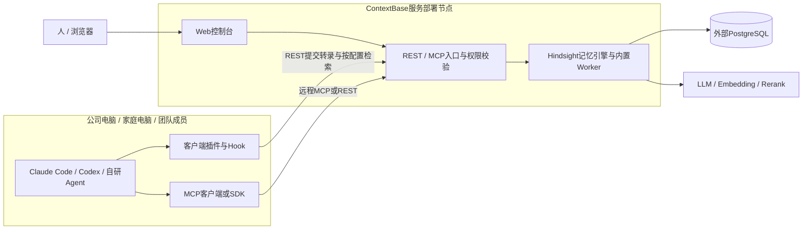

# 产品部署架构

**客户端负责接入工作，ContextBase服务负责记忆处理和授权，PG负责持久存储，模型服务参与提取和检索处理。**

## 可用的单实例形态

图中是逻辑组件，不表示每个框都需要一台机器。当前插件Compose提供API、内置Worker和Node UI合并运行的单容器形态，外接PG；本机演示采用现有本地进程部署。模型能力按配置使用本地或远程服务。

MCP有两种常见落点：Agent直连服务端远程MCP；或启动客户端本地适配进程，由该进程连接后台。**不要求每位客户额外部署独立的远程MCP Server。** 当前文档讲接入职责，具体工具路由以固定客户端配置为准。

## 一次工作的完整链路

1. 人正常布置开发/排障任务，Agent产生工作记录。
2. 已注册的Hook读取宿主转录，通过REST提交给服务；服务验证Key和空间权限。
3. 引擎/Worker异步处理，持久保存相关文档、提取事实和经验。处理成功不等于客户端提交了完整对话，仍需核验原文。
4. 下一任务通过启动注入或MCP/SDK检索，获取有关历史和来源；Agent再结合源码、测试和实时状态判断。
5. 人通过UI检查记忆、知识页和操作状态，管理空间与成员权限。

## 现有可访问环境

| 项目 | 地址/状态 | 核对范围 |
| --- | --- | --- |
| API | http://127.0.0.1:8891 | 2026-11-07检查 `/health` 返回200 |
| 控制台 | http://127.0.0.1:9991/login | 同日检查登录页返回200 |
| 历史演示版本 | PR90 `9b4817aa1e582915db82bf4a395bcd8563883d2c` | 2026-11-05完整场景记录 |
| PG | 沿用原本机部署及历史数据 | 此次文档整理未修改数据库，未重新核对版本/连接目标 |

**HTTP 200只证明相应入口响应，不是端到端读写、模型、权限或数据完整性验收。** 今天工作树HEAD为`9fb57bc04`，不据此推定后台正在运行同版服务。版本对应需要后续核实。

127.0.0.1只能在服务所在电脑使用。跨电脑需要可达的服务器地址、监听/防火墙配置及适当的网络访问方式；公网使用应配置HTTPS和受控访问。不能把127.0.0.1直接复制给家里电脑。

## 从“可部署”到“可用”

代码仓已有可执行材料：

- 插件说明（本机现场路径：`/Users/zhuqingping/Work/Database/Context/hindsight/hindsight-extensions/contextdb-service/README.md`）：服务入口与测试入口。
- Compose（本机现场路径：`/Users/zhuqingping/Work/Database/Context/hindsight/hindsight-extensions/contextdb-service/deployment/compose.yaml`）：单容器运行形态。
- 部署意图模板（本机现场路径：`/Users/zhuqingping/Work/Database/Context/hindsight/hindsight-extensions/contextdb-service/deployment/intent.example.json`）：部署输入。
- [部署操作指南](../deployment/contextdb-service-integration-guide.md)、[部署合同](../deployment/contextdb-deployment-contract.md)：详细初始化和升级要求。

新部署应固定同一次构建的API、插件和UI，准备专用PG库/角色及所需扩展，注入数据库和模型凭据，初始化，再创建空间、用户和业务Key，最后安装客户端并验证实际采集/查询。不要使用上游通用镜像冒充包含ContextBase扩展的镜像。

既有实例按升级路径处理，先确认版本、备份数据和持久化秘密，不重新跑新库创建脚本，不清除原数据。本文不重复维护另一套部署命令，操作前以目标版本的部署合同和模板核对；现有详细指南部分内容是历史版本，不能忽略其版本提示。

## 空间、身份和数据边界

项目/团队可以选择独立bank。跨电脑连接同一服务、同一bank，并持有授权Key，才会读到相同范围的经验。不同人使用自己的业务Key，不共享后台管理员Key。只读成员不能回写；客户端关闭采集不等于服务端权限控制。

PG和模型凭据只留在服务端受保护配置中。原文/抽取内容可能包含业务信息，远程模型处理范围应按部署配置和团队数据策略确认。数据库高权限管理员不受普通API空间权限的保护。
