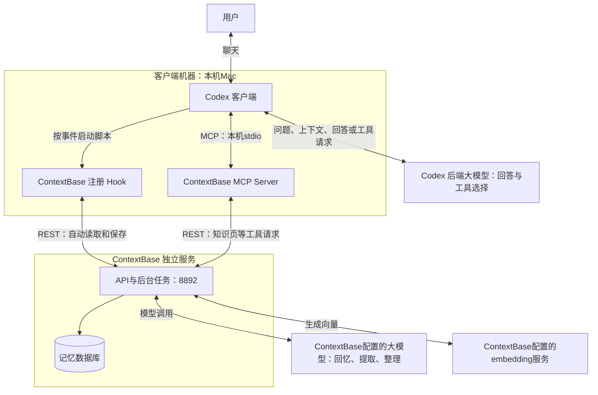
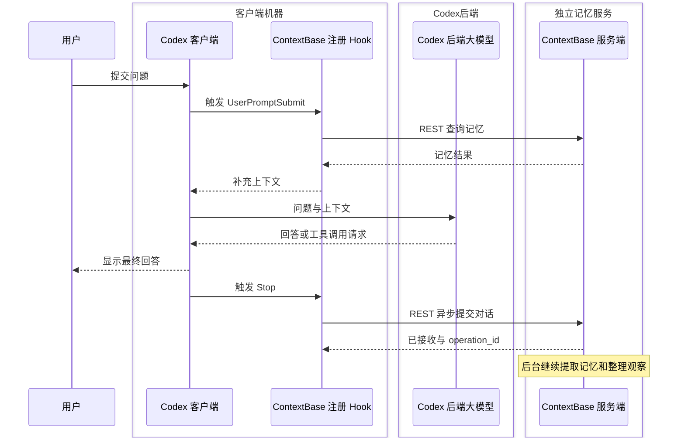
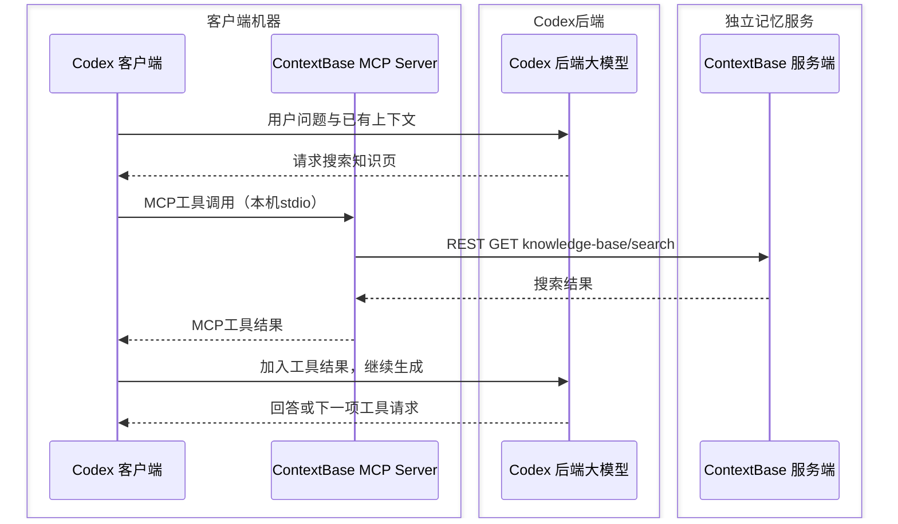

# Codex 与 ContextBase 如何交互：outer_space 三轮真实会话

记录日期：2026-11-07。本文按一次真实聊天的顺序解释：谁发起请求、发送了什么、收到什么，以及服务端随后做了什么。它是现场观察文档，不是需要用户执行的测试用例。

## 1. 先分清谁是谁，再看两条调用路径

### 1.1 按部署边界看组件

客户端这一侧的三个组件放在同一组：**Codex客户端、ContextBase注册Hook、ContextBase MCP Server**，本机均运行在用户的Mac上。Hook是Codex触发的脚本，MCP Server是Codex启动的工具适配程序。

**Codex后端大模型**负责为Codex生成回答和工具调用请求。**ContextBase服务端**是独立运行的记忆服务，它为Reflect、事实提取和观察整理另行调用自己配置的大模型，并调用embedding服务生成向量。这两种大模型调用用途不同，即使选择相同厂商或模型名称，也不应混作同一条交互。



这是部署角色与调用关系图，不是逐包抓取结果。服务端分组表示独立服务边界，**不等于一定部署在另一台机器**：当前ContextBase API、后台和PG也运行在这台Mac上；以后可将服务端迁到另一台机器，客户端这组三个组件仍留在客户端机器上。

图中两个“大模型”按调用用途区分：Codex向其后端请求回答，ContextBase向自己配置的模型请求记忆处理。不能把ContextBase的约31秒Reflect时间解释成Codex后端生成最终回答的耗时。

### 1.2 第一条路径：按事件自动执行Hook



图为流程说明，省略可能发生的多次模型和工具交互，不是模型网络抓包。Hook通过REST直接访问ContextBase，不经过MCP Server。它返回additionalContext，由Codex客户端加入模型输入。

本次历史测试首轮实际经历“Reflect超时 → 搜索知识页为空 → Recall返回15条观察”，后两轮不重复首次召回，但仍读目录和保存。

### 1.3 第二条路径：根据大模型的工具请求访问MCP



Codex后端大模型生成工具请求，Codex客户端负责实际执行。ContextBase MCP Server再把MCP请求转成REST，返回结果沿原路交回。工具名与REST路径是两个层次，例如contextbase_search_knowledge_pages对应knowledge-base/search。

本地stdio连接方式可查[官方MCP说明](https://learn.chatgpt.com/docs/extend/mcp?surface=cli)。本次具体读取结果以下面的HTTP及会话记录为准。

### 1.4 两条路径的区别

| 比较项 | ContextBase注册Hook | ContextBase MCP工具 |
| --- | --- | --- |
| 触发方式 | Codex按配置事件自动执行脚本 | Codex根据大模型产生的工具请求执行 |
| 到服务端的路径 | Hook直接调用REST | 经ContextBase MCP Server转为REST |
| 是否每轮都查记忆 | 按事件、配置和缓存逻辑决定 | 按当前任务需要决定 |
| 本次历史测试读取 | 首轮降级Recall返回15条观察 | 首轮搜索、列目录为空 |
| 本次历史测试保存 | 每轮Stop自动提交 | 没有通过MCP保存 |

旧记忆进入回答的路线是：ContextBase服务端 → 注册Hook → Codex客户端上下文 → LLM。自动Hook没有执行时，Codex仍可能通过MCP取得记忆，所以两条路径应分别核对。

### 1.5 对照本机文件就能找到这两套接入

- Hook 注册：outer_space/.codex/hooks.json（本机现场路径：`/Users/zhuqingping/Life/outer_space/.codex/hooks.json`）。三个事件分别执行 `codex-sessionstart-hook.js`、`codex-hook.js`、`codex-stop-hook.js`。
- MCP 注册：outer_space/.codex/config.toml（本机现场路径：`/Users/zhuqingping/Life/outer_space/.codex/config.toml`）。`[mcp_servers.contextbase]` 的 `command = "node"`，参数指向 `/Users/zhuqingping/.contextbase/coding-agents/dist/mcp-server.js`。
- 两套入口都选用 outer_space 专用配置（本机现场路径：`/Users/zhuqingping/.contextbase/projects/outer_space/coding-agent.json`），通过相同 `CONTEXTBASE_CONFIG` 找到 API、凭据和 Bank。

文件位置说明谁配置了什么；后文 HTTP 记录说明它们在那次聊天里实际做了什么。

## 2. 本次观察的对象与边界

| 项目 | 本次值 |
| --- | --- |
| 客户端 | Codex，ContextBase coding-agents 接入 |
| 项目 | `/Users/zhuqingping/Life/outer_space` |
| Bank | `outer_space` |
| 会话 ID | `01a1b52a-42e7-73a1-9b84-cd0488820e4c` |
| 服务端文档 ID | `conversation:01a1b52a-42e7-73a1-9b84-cd0488820e4c` |
| API / UI | `http://127.0.0.1:8892` / `http://127.0.0.1:9992` |
| 部署代码 | `dd5521cb948beff39a24d604f625bc4108d1aac2` |
| 记忆服务模型 | GPT `gpt-6.1-sol / medium`；火山 embedding 1024 维；RRF |

抓取期间项目请求经过本机代理 `127.0.0.1:8893` 转发至 API 8892，记录 HTTP 请求与响应，再结合客户端事件、Codex 会话记录、服务端日志和数据库快照核对。记录结束后代理已停止，项目地址已恢复 8892。

以下时间均为 **2026-11-07 北京时间（UTC+8）**；请求体中的 `Z` 时间为 UTC，比北京时间少 8 小时。正文中的 JSON 是真实数据摘录，省略处明确标注；未展示认证头或密钥。

本次记录的是 **Codex 的这套接入**，不能直接推广到 Claude Code 等其他客户端的生命周期。本次也未抓取 Codex 与 OpenAI 之间的模型网络请求，无法从这些日志还原模型内部推理。

## 3. 第一轮：先找回旧讨论，再回答

用户提问：“继续前面讨论的火星移民的问题，是否有必要考虑火星移民，价值是什么？大致什么时间能实现？”

### 3.1 自动 Hook 做了哪些请求

下表接口均以 `/v1/default/banks/outer_space` 为前缀。

| 北京时间 | 发起者与请求 | 实际返回 / 客户端结果 | 对回答的作用 |
| --- | --- | --- | --- |
| 16:40:42 | SessionStart：`GET /knowledge-base/tree` | HTTP 200，`{"roots":[]}` | 没有知识页目录可提供 |
| 16:40:42 | ContextBase 注册 Hook：`POST /reflect` | 客户端约 20 秒后终止等待，记录 `reflect_failed` | 本次没有成功注入深度回忆答案 |
| 16:41:02 | 降级：`GET /knowledge-base/search?q=原问题&limit=10` | HTTP 200，`{"results":[],"total":0}`，约 253ms | 没有匹配知识页，继续降级 |
| 16:41:02—03 | 降级：`POST /memories/recall` | HTTP 200，15 条观察，约 250ms | 提供真正注入 Codex 客户端 的旧记忆 |
| 16:41:03 | ContextBase 注册 Hook：`GET /knowledge-base/tree` | HTTP 200，`{"roots":[]}` | 本轮知识目录刷新，仍为空 |

`POST /reflect` 的 `query` 不仅包含用户原话，还包裹了插件生成的检索指引：按历史记录报告相关事实，注明归属，避免将历史记忆改写成当前任务指令；`budget` 为 `low`。其目标是生成一份针对当前提问的历史综合回答，而非只返回相似文本列表。

这次客户端没有拿到 Reflect 正常完成的响应。服务端继续执行，日志显示单次模型调用 30 秒超时与重试；约 16:43:41，代理记录向已关闭连接写回时的错误。**这个传输错误不能解释为客户端收到了一个成功的 Reflect 答案。**

普通 Recall 的实际请求体为：

```json
{
  "types": [
    "observation"
  ],
  "budget": "low",
  "max_tokens": 2000,
  "include": {
    "entities": null
  },
  "query": "继续前面讨论的火星移民的问题\n是否有必要考虑火星移民，价值是什么？大致什么时间能实现？"
}
```

返回对象的 `results` 包含 15 条观察，每条带有 `id`、`text`、`type`、时间和检索分数等字段。与本题直接相关的一条文本是：

> 2026年11月7日，助手判断火星移民具有科学与工程基础，也有宣传价值，但当时尚不具备普通家庭在火星长期生活的条件；少量人员驻留基地与不依赖地球的自给自足城市属于不同层级的目标。

结果中也混入天文馆行程等相关性较弱内容，所以“召回成功”并不代表每条结果都适合当前问题。客户端将这些召回结果转成 Hook 上下文交给 Codex 客户端；Codex 客户端 不必再次主动调用 MCP recall 才能读到它们。

### 3.2 Codex 客户端 又主动调用了什么

16:41:13，Codex 客户端 主动调用两个 MCP 工具：

| MCP 工具 | 最终对应的 REST 请求 | 服务返回 |
| --- | --- | --- |
| `contextbase_search_knowledge_pages` | `GET /knowledge-base/search`，查询“火星移民 价值 必要性 时间 SpaceX 基地 自给自足”，`limit=10` | HTTP 200，0 条结果 |
| `contextbase_list_knowledge_pages` | `GET /knowledge-base/tree` | HTTP 200，空目录 |

这里 MCP 是 Codex 客户端 到本机工具进程的工具调用，工具进程再访问 ContextBase REST API；不能把 Hook 自动请求都称作 Codex 客户端 主动使用 MCP。

16:41:38，Codex 客户端 完成回答，其中明确提到之前区分过“少量人员驻留基地”和“自给自足城市”。结合 Hook 注入和回答内容，可以确认旧记忆进入并被引用；这次旧记忆来自普通 Recall，知识页工具没有返回内容。

## 4. 每轮回答后：先确认接收，再异步处理

### 4.1 谁触发保存，发送什么

本次 Codex 的 `Stop` 在**每一轮回答结束**时触发。第一轮 16:41:38，Stop Hook 先 `GET /config`，返回 `{"bank_id":"outer_space","config":{},"overrides":{}}`，随后提交：

`POST /v1/default/banks/outer_space/memories`

第一轮实际请求的结构如下，长消息内容和归属说明已省略，其余字段保留：

```json
{
  "items": [
    {
      "content": "【省略：按行编码的消息 JSON，包含 role、content、timestamp】",
      "context": "【省略：区分用户陈述与助手声明，助手声称完成不应直接记为已证实事实】",
      "document_id": "conversation:01a1b52a-42e7-73a1-9b84-cd0488820e4c",
      "tags": [
        "source:chat",
        "harness:codex"
      ],
      "strategy": "conversation",
      "observation_scopes": "shared",
      "timestamp": "2026-11-07T08:41:03.276Z",
      "metadata": {
        "source": "chat",
        "session_id": "01a1b52a-42e7-73a1-9b84-cd0488820e4c",
        "ref_id": "conversation:01a1b52a-42e7-73a1-9b84-cd0488820e4c",
        "harness": "codex"
      }
    }
  ],
  "async": true,
  "operation_id": "dc0abf71-2614-59a9-a6da-08a69f539332"
}
```

各字段可以这样理解：

| 字段 | 为什么发送 |
| --- | --- |
| `content` | 按行编码的消息 JSON，每行有角色、正文、时间；本次含用户消息、助手说明、工具动作摘要及最终回答，并非只保存用户问题 |
| `context` | 告诉提取模型区分用户的话和助手的声明，避免把助手声称“已修好”直接当成已证实事实 |
| `document_id` | 把同一聊天各轮归到同一服务端原文文档 |
| `strategy: conversation` | 使用对话提取策略 |
| `tags`、`metadata` | 记录来源为聊天、客户端为 Codex，以及会话关联标识 |
| `observation_scopes: shared` | 在该 Bank 的共享观察范围内整理，不是跨 Bank 共享 |
| `timestamp` | 本次三次提交都使用会话起始时间；消息行内另有各自时间。不能将这个字段视为每个事实的精确提及时间 |
| `async: true`、`operation_id` | 提交异步处理任务，并用任务 ID 跟踪处理结果 |

### 4.2 服务端立即返回了什么

第一轮 HTTP 200，约 7ms 确认接收，响应为：

```json
{
  "success": true,
  "bank_id": "outer_space",
  "items_count": 1,
  "async": true,
  "operation_id": "dc0abf71-2614-59a9-a6da-08a69f539332",
  "operation_ids": null,
  "usage": null
}
```

这里的 `success: true` 表示提交请求已被接受，`items_count: 1` 表示一项输入文档内容，**不表示提取出一条事实，也不表示观察已经刷新**。客户端日志中的 `retain_ok` 同样不能单独证明后台全部完成。

### 4.3 服务端随后做了什么

结合请求、日志与最终数据库快照，本次后台处理可以按以下顺序理解：

1. 对同一 `document_id` 保存或追加对话原文，并处理变化后的文本分块。
2. 调用 GPT 从相关内容中提取来源记忆，区分 `world` 与 `experience`，保存时间与来源关联；生成 embedding 向量用于后续检索。
3. 完成该次 retain 任务，更新 operation 状态与提取数量。
4. 后台继续将来源记忆与已有认识整合，创建或更新 `observation`，保留来源记忆 ID。

这里描述的是流程层次，不是对每一个 SQL 或模型网络包的逐条追踪。RRF 用于融合检索排序，不是一个独立的 rerank 模型调用。观察整理完成也不意味着自动生成了知识页；本次知识页目录始终为空。

第一轮直到 16:41:54 才完成提取，产出 3 条来源记忆，比 HTTP 确认晚约 16 秒。事实提取与观察整理是不同完成阶段。

## 5. 第二、三轮：不重复首次召回，但继续保存

第二轮问地火距离、飞行时间和速度提升；第三轮问适合给女儿讲的太空趣闻。

| 阶段 | 第二轮 | 第三轮 |
| --- | --- | --- |
| 提问时 | 16:42:39，`GET /knowledge-base/tree`，返回空目录 | 16:43:45，同一接口，返回空目录 |
| 自动长期记忆检索 | 无新的 `/reflect`、`/memories/recall` | 无新的 `/reflect`、`/memories/recall` |
| Codex 客户端 主动调用 ContextBase MCP | 无；这一轮查了公开网页 | 无 |
| 回答结束 | 16:43:07 | 16:44:06 |
| Stop 先查上次任务 | `GET /operations/dc0abf71-2614-59a9-a6da-08a69f539332`，HTTP 200，`completed` | `GET /operations/ebf0bc5b-27e2-5364-86fd-56784962b222`，HTTP 200，`completed` |
| 本轮写入 | `POST /memories`，HTTP 200，约 6ms 确认接收 | 同一接口，HTTP 200，约 15ms 确认接收 |
| 后台提取完成 | 16:43:16，0 条来源记忆，错误数 0 | 16:44:26，6 条来源记忆，错误数 0 |

后两次写入沿用相同 `document_id`，`content` 是本轮新增消息，并增加 `update_mode: "append"`。服务端因此更新同一份原文，而非为每轮创建一个互不关联的会话文档。

例如第二轮查询上次任务时，响应中的关键字段为：

```json
{
  "operation_id": "dc0abf71-2614-59a9-a6da-08a69f539332",
  "status": "completed",
  "operation_type": "batch_retain",
  "error_message": null,
  "result_metadata": {
    "document_id": "conversation:01a1b52a-42e7-73a1-9b84-cd0488820e4c",
    "unit_ids_count": 3,
    "extraction_errors_count": 0
  }
}
```

上面是响应字段摘录。它说明前一次提取任务已完成；不能从中推出所有观察或知识页都已刷新。

后续轮次没有再次自动 Reflect，符合当前集成“首次注入后缓存”的行为，首次降级取得的结果也会被缓存。每轮读知识目录与每轮读记忆正文是两回事；目录为空并不表示 Bank 没有事实和观察。Codex 客户端 仍可主动调用 MCP，只是这两轮没有这样做。

第二轮抽取为 0，但原文已经保存，且任务没有抽取错误。仅凭这一结果，不能确定是去重、模型筛选还是其他原因。第三轮因文本变化重新分块、重新提取，覆盖前几轮主题，并替换先前相关来源记忆；不能把 3 + 0 + 6 相加当成最终 9 条。

## 6. 聊完后，数据库最终留下什么

本次只读快照记录：原文文档已更新，3 个 retain operation 均为 `completed`，最终有效来源记忆为 **5 条 world、1 条 experience**。

| 类型 | 保存内容的例子 | 如何理解 |
| --- | --- | --- |
| world | 用户的女儿喜欢外太空，希望获得趣味知识 | 用户兴趣与需求 |
| world | 用户持续关注火星移民的价值、时间、距离与速度 | 对多轮提问的归纳 |
| world | 地火距离、常见航程与发射窗口等 | 来自本次对话的知识陈述，仍需核对原始权威来源 |
| experience | 助手建议持续探索基地，同时区分依赖地球补给与独立城市 | 记录助手当时的判断，不能改称用户已确认的决策 |

到 16:44:57，这 6 条来源记忆均已标记完成观察整理，7 条观察引用了它们；其中既有新观察，也有与旧来源合并后更新的观察，因此不能称为“新建了 7 条”。快照中 `pending_source_facts=0`，没有待处理或运行中的 operation。

本机当时只注册 `SessionStart`、`UserPromptSubmit`、`Stop`，没有 `SessionEnd`。已观测到的是三次回答结束、三次自动提交；**没有证据表明关窗口时还会额外发送一次“会话结束保存”请求**。

## 7. 怎样判断某个环节成功

| 想确认的事情 | 应看什么 | 哪些信号还不够 |
| --- | --- | --- |
| 知识目录读取成功 | `/knowledge-base/tree` 返回 200 和 `roots` | 不代表有知识页正文被读取 |
| 深度回忆成功 | `reflect_ok` 与实际返回答案 / 注入内容 | 最终回答提到旧知识不一定来自 Reflect，可能是降级 Recall |
| 普通召回成功 | `/memories/recall` 响应及 `reflect_fallback_observations` | 不保证返回内容都相关 |
| 自动提交成功 | `/memories` 响应及 `operation_id` | HTTP 200、`retain_ok` 不等于后台完成 |
| 来源记忆提取完成 | operation 的 `completed`、数量、错误信息，加原文与事实核对 | 原文增长不保证事实条数增加 |
| 观察整理完成 | 来源事实的整理状态与观察来源关联 | retain completed 不能代替这一检查 |
| Codex 客户端 主动用了 MCP | 会话里的工具调用与结果 | Hook 访问 REST 不等于 Codex 客户端 调用了 MCP |

抓取窗口中还有另一个 Claude 会话访问同一 Bank。本文按目标会话、请求内容及 operation ID 对齐证据，没有把其他会话的写入计入上述三轮。客户端 usage 日志存在重复输出的轮次记录，也没有按日志行数计算实际工具调用次数。

## 8. 本次问题与后续配置的关系

本次抓取发生时，客户端 Reflect 等待 20 秒，服务端单次模型 30 秒、整次 Reflect 300 秒。因此时间线保留“20 秒超时”这一历史事实。

随后本机已调整为单次模型 60 秒、整次 Reflect 120 秒、客户端 150 秒、Hook 180 秒，并直接调用 Hook 成功一次。这是后续处理，不能倒写成本文三轮会话当时已采用新配置。配置路径、复验边界和默认值评估见 [深度回忆超时处理记录](../operations/contextbase-reflect-timeout-20261107.md)；后续工作见 [推进清单](05-backlog.md#客户端接入与回忆超时后续评估)。

## 9. 需要核对原始证据时看哪里

原始抓取目录为：

`/Users/zhuqingping/.local/share/contextbase/captures/outer-space-20261107/`

| 文件 | 用来核对什么 |
| --- | --- |
| `target-http.jsonl` | 目标请求与响应正文、HTTP 状态、耗时；请求与响应按 `id` 配对 |
| `first-turn-hook-events.json` | 首次 Reflect 超时、知识页降级为空、Recall 取得 15 条观察 |
| `session-events.jsonl` | 三轮用户消息、Codex 客户端 工具调用、回答与完成事件 |
| `client-events.jsonl` | 自动提交结果与工具使用记录；注意重复的 usage 输出 |
| `server-events.jsonl` | 提取与整理过程；该文件覆盖整个 Bank 窗口，需按目标任务筛选 |
| `target-backend-evidence.json` | 最终文档、三次任务、6 条来源记忆及 7 条观察的关联快照 |
| `manifest.json` | 抓取起止和项目配置恢复情况 |

资料仓保留[验证摘要](evidence/README.md)，便于了解接口往返与本轮结果。原始请求、响应及JSON仅保存在本机归档；需要核对具体字段、返回数量和任务状态时，应使用对应抓取目录中的原件，摘要不能代替完整抓取。
