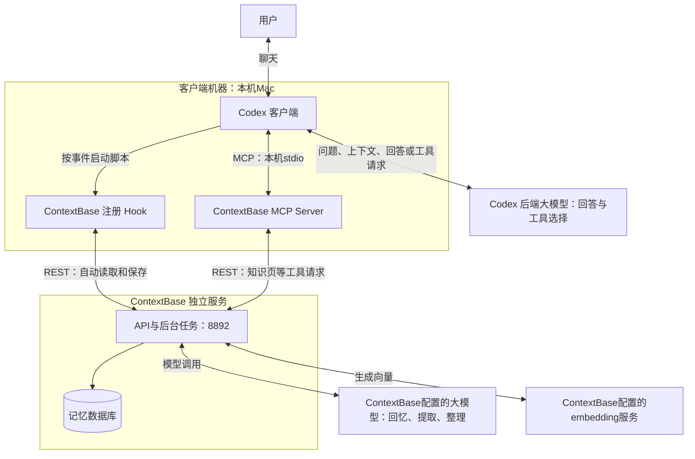
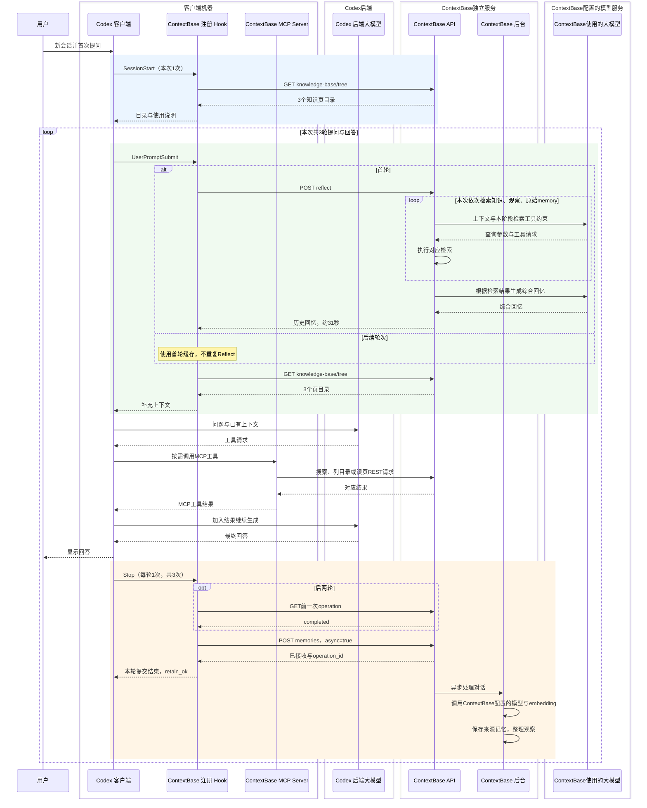
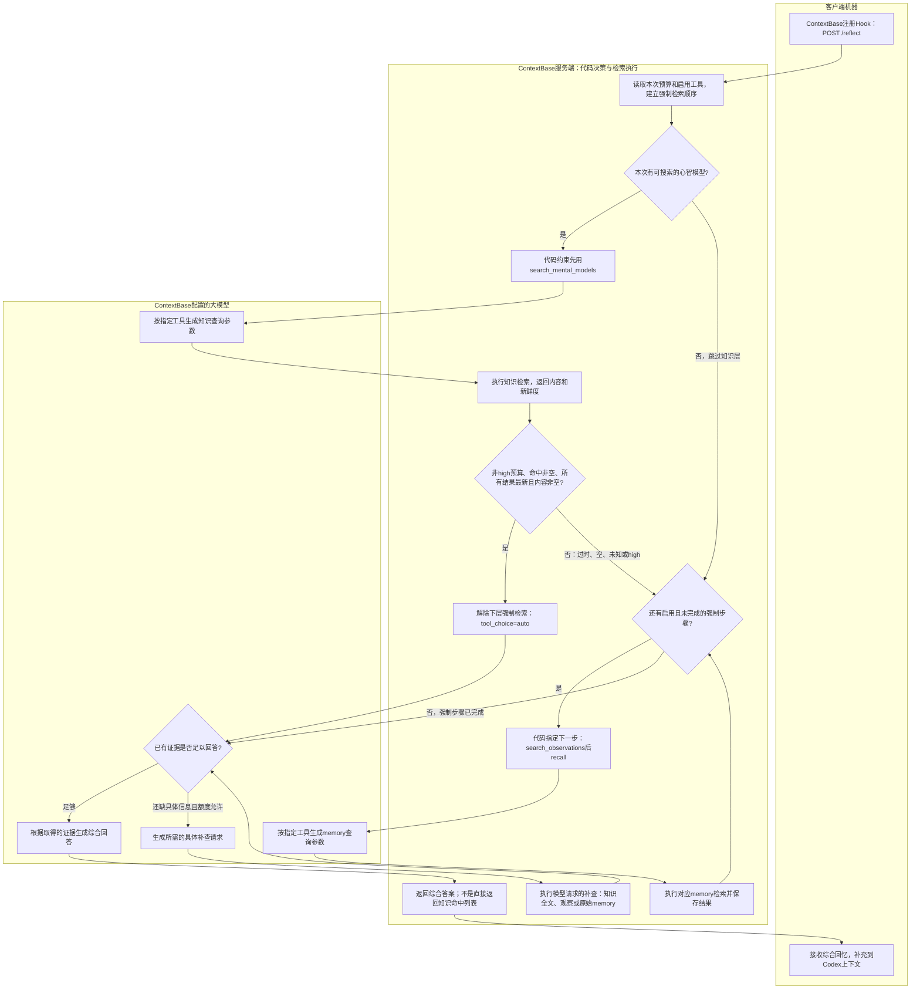
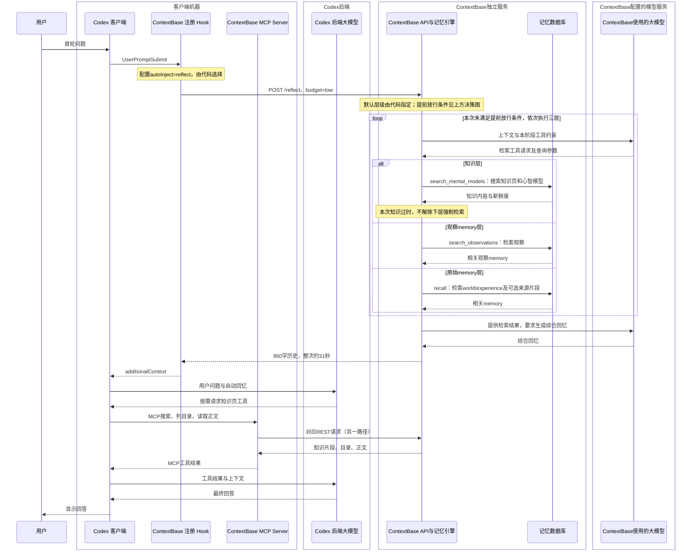

# Codex 与 ContextBase 交互：Hook 失效定位与恢复验证

更新日期：2026-11-08；以下时间均为北京时间（UTC+8）。**本文整合原第07、08篇，以最新恢复验证为主线，保留此前失效的证据和原因。** 两轮各三次提问，是不同会话，任务与记忆数量分别统计。

阅读顺序：先看当前结论，再看最新一轮的读取、MCP和保存过程；第7节回溯失效现场及信任问题，第8节解释知识页过时，第9节列出两轮证据。状态：两轮记录均已结束，项目入口已恢复。

<a id="latest-verification"></a>

## 名称与部署边界

不再单独设置“AI助手/Agent”组件；统一用Codex客户端。大模型明确区分Codex后端与ContextBase自身配置的两种用途。

### 按部署边界看组件

客户端这一侧的三个组件放在同一组：**Codex客户端、ContextBase注册Hook、ContextBase MCP Server**，本机均运行在用户的Mac上。Hook是Codex触发的脚本，MCP Server是Codex启动的工具适配程序。

**Codex后端大模型**负责为Codex生成回答和工具调用请求。**ContextBase服务端**是独立运行的记忆服务，它为Reflect、事实提取和观察整理另行调用自己配置的大模型，并调用embedding服务生成向量。这两种大模型调用用途不同，即使选择相同厂商或模型名称，也不应混作同一条交互。



这是部署角色与调用关系图，不是逐包抓取结果。服务端分组表示独立服务边界，**不等于一定部署在另一台机器**：当前ContextBase API、后台和PG也运行在这台Mac上；以后可将服务端迁到另一台机器，客户端这组三个组件仍留在客户端机器上。

图中两个“大模型”按调用用途区分：Codex向其后端请求回答，ContextBase向自己配置的模型请求记忆处理。不能把ContextBase的约31秒Reflect时间解释成Codex后端生成最终回答的耗时。

## 1. 当前结论：三个 Hook 在最新一轮均实际生效

上一轮的 UserPromptSubmit 为 modified，自动回忆没有执行。本轮开始前、切换记录入口后和结束后，三个 Hook 均 enabled=true、trustStatus=trusted。随后从真实会话观察到：

| 环节 | 实际证据 | 结论 |
| --- | --- | --- |
| SessionStart | 读取知识树，返回 3 页；记录 session_start | 生效，符合目录与说明注入设计 |
| 首轮 UserPromptSubmit | POST /reflect 返回 950 字，reflect_ok=30991ms；随后读目录 | 自动回忆成功，未降级 |
| 后续 UserPromptSubmit | 第二、三轮均 pages_ok，目录均为 3 页；没有重复 Reflect | 符合首轮缓存、每轮目录更新的设计 |
| Codex 客户端 主动 MCP | 3 次搜索、1 次列目录、2 次读全文，共 6 次 | 工具调用与 REST 请求可对应 |
| 每轮 Stop | 3 次异步提交，后两次 append，3 个 operation 全部 completed | 自动保存成功，三份最终回答逐字匹配数据库 |
| 后台处理 | 10 条有效来源记忆全部完成观察整理，10 条观察与其关联 | 完成，无 pending/processing 任务 |

除控制探针外共有 **17 次 outer_space HTTP 请求，全部 200**，没有连接错误和服务端 ERROR/CRITICAL。本轮仍有 conversation 命名策略未识别的配置警告，见第 6 节，不能把“无错误”写成“无任何配置问题”。

**本机功能恢复已得到真实会话证据；“Hook 静默失效时用户不知道”的产品优化仍未实现。** 两者分别跟踪，详见 [P1 可观测性优化项](05-backlog.md#优先优化hook-静默失效与客户端接入可观测性)。

## 2. 这次验证的是哪套环境

| 项目 | 值 |
| --- | --- |
| 项目 / Bank | `/Users/zhuqingping/Life/outer_space` / `outer_space` |
| 会话 ID | `01a1baa3-8e36-7982-9538-1eb1ee682bca` |
| 原文 ID | `conversation:01a1baa3-8e36-7982-9538-1eb1ee682bca` |
| Hook 上限 | SessionStart 30 秒；UserPromptSubmit 180 秒；Stop 60 秒 |
| 客户端回忆等待 | reflectTimeoutMs=150000，即 150 秒 |
| 服务端 Reflect | 单次模型 60 秒；整次 120 秒 |
| 服务 | API 8892 / UI 9992；记录时经本机代理 8893 转发 |
| 知识页初始状态 | 3 页均存在、均显示过时；本轮保留初始状态，没有先刷新 |

### 两轮会话与初始状态

| 项目 | 失效定位轮（原07） | 恢复验证轮（原08，以下第3—6节主线） |
| --- | --- | --- |
| 会话ID | `01a1ba83-0106-7171-973a-30c95d539726` | `01a1baa3-8e36-7982-9538-1eb1ee682bca` |
| 用户交互窗口 | 17:37—17:41，观察整理至17:42:46 | 18:12—18:18，观察整理至18:20:56 |
| UserPromptSubmit信任 | modified | trusted |
| 知识页状态 | 开始最新，结束过时 | 开始与结束均过时 |
| 客户端版本依据 | 会话元数据为0.167.0-alpha.3.2 | Codex 客户端信任检查使用同一安装版本，三个Hook运行产物哈希与前轮一致 |
| 部署代码 / 记忆模型 | `dd5521cb948beff39a24d604f625bc4108d1aac2`；gpt-6.1-sol / medium、火山embedding1024维、RRF | 同一服务；embedding每批上限10 |

后文“本轮”“本次”如未明确标为失效定位轮，均指最新的恢复验证轮。两个Bank快照发生在不同时点，不能将来源数或关联观察数相加作为Bank总数。

Codex客户端管理上下文、模型调用和工具执行。ContextBase注册Hook按事件自动运行；ContextBase MCP Server处理Codex根据模型工具请求发起的调用，并转为REST请求。角色原理见 [第 06 篇](06-agent-contextbase-interaction.md#1-先分清谁是谁再看两条调用路径)。

三个 Hook 命令、超时与可信哈希均未在本轮修改。临时只改项目 apiUrl、logLevel。四个实际执行 bundle（三个 Hook 和 MCP Server）的开始、结束哈希一致，并与上一轮已核对的产物一致。

### 完整生命周期：三个Hook都实际触发了

下面补齐SessionStart、UserPromptSubmit和Stop的完整顺序。此前第3节的图只展开提问与读取阶段，不能作为全部生命周期图。**最新测试记录到1次SessionStart、3次UserPromptSubmit产生的请求、3次Stop保存。**

| 事件 | 实际时间 | 请求与结果 |
| --- | --- | --- |
| SessionStart，1次 | 18:12:41.135开始；18:12:41.153记录session_start | GET knowledge-base/tree返回200、3页目录 |
| UserPromptSubmit，3次 | 首轮18:12:41.196开始；后两轮18:16:12.942、18:18:10.896读目录 | 首轮Reflect约31秒成功；三轮各读目录，均pages_ok |
| Stop，第1次 | 18:14:24.932提交 | POST memories，200；18:14:43.563提取完成，18:15:17.696观察整理完成 |
| Stop，第2次 | 18:17:05.318追加 | 先确认上次任务completed，再POST memories，200；18:17:23.466提取完成，18:17:39.345整理完成 |
| Stop，第3次 | 18:18:51.879追加 | 先确认上次任务completed，再POST memories，200；18:19:23.878提取完成，18:20:56.727整理完成 |



这是按已观测行为整理的全流程图，合并了每轮不同的工具次数与模型往返；后台处理可与后续聊天重叠，不能把图中的纵向位置理解为下一轮必须等待整理完成。蓝色为开始、绿色为提问前、橙色为回答结束后的保存。

图中Hook是一组注册脚本的统称：SessionStart执行codex-sessionstart-hook.js，UserPromptSubmit执行codex-hook.js，Stop执行codex-stop-hook.js，不是同一个常驻Hook进程。模型箭头用于解释调用职责，本次没有抓取Codex后端模型网络。

**SessionStart是会话开始事件，不等于每次启动Codex应用就立即执行；Stop是每轮回答结束，不等于关闭窗口。** 本次没有SessionEnd注册，也没有额外“关闭窗口后提交”的证据。

## 3. 首轮：Hook 先自动回忆，Codex 客户端 再按需读知识页

用户问火星移民的技术难点、Musk 宣传动机，以及职业宇航员与普通人最快何时能到达火星。

| 时间 | 发起者与接口 | 实际返回及作用 |
| --- | --- | --- |
| 18:12:41.135 | SessionStart：GET /knowledge-base/tree | 200，约 14ms，3 个页目录；用于提供页面清单与使用说明 |
| 18:12:41.196—18:13:12.164 | ContextBase 注册 Hook：POST /reflect，budget=low | 200，HTTP 约 30.968 秒，返回 text 950 字 |
| 18:13:12.184 | ContextBase 注册 Hook：GET /knowledge-base/tree | 200，3 页；pages_ok，约 19ms 客户端计时 |
| 18:13:27.764 | Codex 客户端 经 MCP：GET /knowledge-base/search，limit=10 | 200，约 285ms，3 条匹配结果与片段 |
| 18:13:28.070 | Codex 客户端 经 MCP：GET /knowledge-base/tree | 200，约 11ms，3 页；这一次是主动工具调用，不是自动 Hook 重复执行 |
| 18:13:36.182 | Codex 客户端 经 MCP：GET /knowledge-base/pages/kp-9019fd11e6f24037aac3edd60b81c69f | 200，约 10ms，火星页正文 1766 字 |
| 18:14:24.667 | Codex 客户端 最终回答 | 引用火星知识页的阶段区分，并结合外部网页资料回答 |

上述路径统一以 `/v1/default/banks/outer_space` 开头。用户消息在会话文件中的时间为18:13:12.206，晚于 Hook 开始，这是 Hook 先完成、随后输入进入 Codex 客户端 上下文的记录顺序，不表示服务端在用户提问前猜中了问题。

### 自动回忆返回了什么

Reflect 并非全文读取某一个知识页。Hook 用原问题加历史归纳指引构建 query，要求报告带归属的历史事实与决定；服务端检索并生成综合回答，返回 text。客户端 diag 记录 reflect_ok、950 字内容，其文本与 API 响应一致。

本次返回主要包括：此前对登陆、驻留、自给自足城市的区分；长期生存的技术门槛；首次登陆估计与普通家庭定居没有可信时间表的边界；历史不足以确立 Musk 动机的结论。此外还带回知识页命名和资料取舍的维护讨论，这些对本题的相关性较弱，可作为以后精简回忆内容的样本，不能据一次成功就认定全部结果质量最优。

Hook把回忆转为additionalContext交给Codex客户端，客户端在首次调用大模型时即可带上这批历史。本次没有 reflect_failed，也没有降级知识页搜索或 Recall。

### UserPromptSubmit选择Recall还是Reflect：由配置决定

这里的事件名是UserPromptSubmit。Codex按事件执行ContextBase注册Hook；Hook脚本读取autoInject，按固定分支选择接口，**不是Codex后端大模型先判断用Recall还是Reflect**。

### autoInject在哪里配置，默认值在哪里

这是**客户端插件配置**，不是服务端api.env里的配置。outer_space的三个Hook命令通过CONTEXTBASE_CONFIG选择同一文件：

coding-agent.json（本机现场路径：`/Users/zhuqingping/.contextbase/projects/outer_space/coding-agent.json`）

在已有JSON对象的顶层设置，例如下方只展示该字段，不能用它覆盖原文件的API地址、Bank与凭据：

```json
{
  "autoInject": "reflect"
}
```

当前文件没有显式设置autoInject，也没有autoReflect:false，因此使用默认reflect。默认位置不是hooks.json；hooks.json负责注册事件、脚本与执行上限。

可读源码位置：

| 目的 | 本机源码 |
| --- | --- |
| 配置文件路径：CONTEXTBASE_CONFIG优先，否则用户默认文件 | [core/config.ts:39](https://github.com/RSIXDB/hindsight/blob/dd5521cb948beff39a24d604f625bc4108d1aac2/hindsight-integrations/coding-agents/src/core/config.ts#L39) |
| 默认值与旧配置兼容：resolveAutoInject | [core/config.ts:562](https://github.com/RSIXDB/hindsight/blob/dd5521cb948beff39a24d604f625bc4108d1aac2/hindsight-integrations/coding-agents/src/core/config.ts#L562) |
| 将解析值赋给运行配置 | [core/config.ts:615](https://github.com/RSIXDB/hindsight/blob/dd5521cb948beff39a24d604f625bc4108d1aac2/hindsight-integrations/coding-agents/src/core/config.ts#L615) |
| 根据autoInject选择pages/recall/reflect | [core/hook.ts:267](https://github.com/RSIXDB/hindsight/blob/dd5521cb948beff39a24d604f625bc4108d1aac2/hindsight-integrations/coding-agents/src/core/hook.ts#L267) |
| Reflect失败后的降级次序 | [core/hook.ts:198](https://github.com/RSIXDB/hindsight/blob/dd5521cb948beff39a24d604f625bc4108d1aac2/hindsight-integrations/coding-agents/src/core/hook.ts#L198) |
| 允许降级的错误条件：fallbackEligible | [core/contextbase.ts:238](https://github.com/RSIXDB/hindsight/blob/dd5521cb948beff39a24d604f625bc4108d1aac2/hindsight-integrations/coding-agents/src/core/contextbase.ts#L238) |

resolveAutoInject的关键代码为：

```typescript
if (AUTO_INJECT_MODES.includes(raw.autoInject as AutoInject)) return raw.autoInject as AutoInject;
return raw.autoReflect === false ? "none" : "reflect";
```

因此有效的显式autoInject优先；未设置时通常为reflect，但旧配置autoReflect:false会使它变成none。也支持CONTEXTBASE_AUTO_INJECT环境变量作为后备值；文件中显式设置的值优先。本文列的是本机可读源码，运行的仍是已记录哈希的安装bundle；本次仅补文档，没有改配置。

### 客户端决策图：选接口和降级由Hook代码执行

```mermaid
flowchart TB
    subgraph CLIENT[客户端机器：Codex与ContextBase注册Hook]
        A[Codex触发UserPromptSubmit]
        T{Hook已启用、获信任且项目配置有效?}
        CACHE{本会话自动注入已解决并缓存?}
        MODE{读取autoInject}
        F[Hook选择Reflect]
        R[Hook选择Recall]
        P[Hook选择知识页搜索]
        N[不自动注入正文]
        OK{Reflect成功?}
        ELIGIBLE{超时或服务端5xx等可降级错误?}
        FALL[Hook先降级搜索知识页]
        HIT{得到可用知识片段?}
        RR[没有可用结果：Hook再降级Recall]
        BODY[将取得的内容作为additionalContext返回Codex]
        ERR[记录失败与重试状态]
        SKIP[不运行本次Hook]
        DIR[按配置更新目录与使用说明]
        DONE[Codex把问题与上下文交给Codex后端大模型]
        A --> T
        T -->|否| SKIP
        SKIP --> DONE
        T -->|是| CACHE
        CACHE -->|是，不重复首轮检索和正文注入| DIR
        CACHE -->|否且本轮允许尝试| MODE
        MODE -->|reflect，当前默认| F
        MODE -->|recall| R
        MODE -->|pages| P
        MODE -->|none| N
        F --> OK
        OK -->|是| BODY
        OK -->|否| ELIGIBLE
        ELIGIBLE -->|是| FALL
        ELIGIBLE -->|否，如鉴权失败| ERR
        FALL --> HIT
        HIT -->|是| BODY
        HIT -->|空或搜索失败| RR
        R --> BODY
        P --> BODY
        RR --> BODY
        N --> DIR
        BODY --> DIR
        ERR --> DIR
        DIR --> DONE
    end
    subgraph SERVER[ContextBase独立服务]
        SF[POST /reflect：服务端综合回忆]
        SR[POST /memories/recall：返回记忆条目]
        SP[GET /knowledge-base/search：返回知识片段]
    end
    F <-->|REST请求与响应| SF
    R <-->|REST请求与响应| SR
    P <-->|REST请求与响应| SP
    FALL <-->|REST请求与响应| SP
    RR <-->|REST请求与响应| SR
```



图中客户端与服务端分开；没有由Codex后端大模型选择Hook接口的箭头。BODY表示有内容才注入；检索为空或失败时记录相应状态，不虚构内容。新Bank延后、失败重试次数等边界由源码处理，图中“本轮允许尝试”包含这些限制。

**默认reflect，超时后不是直接跳到recall。** 实际次序为Reflect →（超时/可降级错误）搜索知识页 →（没有可用片段）Recall。知识页搜索已返回可用内容时，不再执行降级Recall。两种降级检索共享injectTimeoutMs预算；普通4xx不能一概视为降级条件，具体以fallbackEligible为准。Reflect成功但历史为空，也不等同于超时后降级。

| autoInject | Hook首轮自动动作 |
| --- | --- |
| reflect，当前默认 | POST /reflect，取得综合历史回答 |
| recall | POST /memories/recall，取得记忆条目；插件默认types为observation，可用recallOptions调整 |
| pages | 搜索知识页，使用检索结果片段 |
| none | 不自动注入以上正文；目录与工具使用说明按配置另行处理 |

outer_space没有显式设置autoInject，实际使用默认reflect。成功结果缓存后，后续不再重复首次自动回忆，仍按目录更新配置执行。新Bank延后、失败有限重试等边界按脚本处理。Reflect超时或遇到可降级错误时，脚本先搜索知识页，未得到可用结果再Recall；这也是代码分支，不是Codex后端模型的临时选择。

| 比较 | Recall接口 | Reflect接口 |
| --- | --- | --- |
| 返回什么 | 相关记忆条目、分数和可选原文片段 | 服务端结合检索结果生成的综合回答 |
| 是否搜索知识页/心智模型 | 不直接搜索；检索对象是memory | 可以，使用search_mental_models等工具 |
| 是否搜索memory | 可以按types检索world、experience、observation；还可附带来源片段 | 可以，内部调用search_observations及recall等工具 |
| 是否生成综合答案 | 不进行这一层综合生成；检索仍可能调用embedding服务 | 调用ContextBase配置的大模型综合生成，通常更慢 |

注意同名边界：独立Recall API可以检索三类memory；Reflect内部的recall工具在本版本只查world/experience，observation由search_observations处理。知识页底层是mental_model，不属于独立Recall接口的三类类型。

Reflect具备同时检索知识与memory的能力，不代表每次一定全部查询。服务端代码约束检索步骤；对于低/中预算且知识内容新鲜可用的情况，可以解除继续向底层检索的强制要求，之后由ContextBase侧大模型决定是否补查和如何回答。本轮知识页过时，实际执行了知识、观察、原始记忆三个层次。**决定Hook接口的是配置；Reflect内部的工具流程和综合回答是另一层服务端逻辑。**

### Reflect内部谁决定先查什么、何时停止

**默认层级顺序由服务端代码规定；满足提前放行条件后，才交给ContextBase大模型选择直接回答还是继续补查。** 这不是Codex后端大模型的决定，也不是任何时候都固定查完全部层次。

| 决策 | 负责方 | 当前运行版本行为 |
| --- | --- | --- |
| 默认先查哪一层 | 服务端代码 | 存在可搜索的心智模型时先search_mental_models，再search_observations，再recall；仅加入本次启用的工具 |
| 每一步搜什么词 | ContextBase大模型，在代码指定的工具约束下 | 生成查询参数，服务端执行检索，结果放回模型上下文 |
| 是否解除继续查memory的强制要求 | 服务端代码 | 非high预算，知识命中非空，而且所有命中均明确最新且内容可用时解除 |
| 解除后是否只用知识回答 | ContextBase大模型 | 判断知识能否回答；能则生成答案，缺细节则继续读知识全文或查观察、原始memory |
| 未提前解除时是否继续查memory | 服务端代码 | 按启用的下层工具顺序约束模型，不能仅因模型自认为知识够用就跳过尚未完成的强制步骤；仍受迭代、上下文、超时与错误边界限制 |

提前解除强制检索需要**同时满足**：

1. budget是low或mid，即代码判断不是high；当前Hook请求的是low。
2. search_mental_models确实返回至少一个结果，空结果不放行。
3. 返回的**每一个**结果都是is_stale=false。只要有一项过时、状态缺失或未知，就不放行。
4. 每个结果都有可用的非空snippet或content。搜索片段也可满足这个可用性检查，不要求已逐页读取全文。

这些条件只说明“允许不查memory”，**不会直接把知识结果当最终答案返回**。代码将tool_choice从指定工具切换为auto，并提示模型：知识若足够就回答，只为缺少的具体细节继续搜索。“够不够回答”仍由ContextBase大模型判断，必要时可以先读知识全文再决定。



图中将客户端、服务端代码、ContextBase大模型分组。强制阶段是代码指定工具类型，大模型生成调用参数；自由阶段才由大模型决定补查哪个工具。图示为正常检索路径：工具抛错或整次硬超时可能返回错误；迭代与上下文额度也会使流程提前收束，不能保证无限检索。

可直接核对**当前部署版本**的源码：

- [建立强制顺序、指定tool_choice：reflect/agent.py:1204](https://github.com/RSIXDB/hindsight/blob/dd5521cb948beff39a24d604f625bc4108d1aac2/hindsight-api-slim/hindsight_api/engine/reflect/agent.py#L1204)。
- [检查每条知识是否最新且可用：reflect/agent.py:471](https://github.com/RSIXDB/hindsight/blob/dd5521cb948beff39a24d604f625bc4108d1aac2/hindsight-api-slim/hindsight_api/engine/reflect/agent.py#L471)。
- [提前解除下层强制检索：reflect/agent.py:1632](https://github.com/RSIXDB/hindsight/blob/dd5521cb948beff39a24d604f625bc4108d1aac2/hindsight-api-slim/hindsight_api/engine/reflect/agent.py#L1632)。
- [解除后给模型的“足够就回答”提示：reflect/agent.py:465](https://github.com/RSIXDB/hindsight/blob/dd5521cb948beff39a24d604f625bc4108d1aac2/hindsight-api-slim/hindsight_api/engine/reflect/agent.py#L465)。

**对应本次测试：** budget=low，但知识页过时，未满足提前放行条件，因此仍按强制顺序执行search_observations和recall，最后生成950字回忆。日志中的三次工具调用与该路径一致，不能据此推断“模型自由决定所有顺序”，也不能推广成“Reflect永远必查三层”。

### Reflect内部也检索了memory，并不只有知识页

**最新测试确实检索了memory。** 客户端只发出一次POST /reflect，随后由ContextBase在这次请求内部调用检索工具；这些内部函数调用不是从客户端发来的新HTTP请求，所以客户端抓取中没有单独的POST /memories/recall。

18:13:12.153的服务端完成日志明确记录了三个内部工具：

| 服务端内部工具 | 作用 | 本次耗时与参数 |
| --- | --- | --- |
| search_mental_models | 搜索心智模型，知识页底层也是这类对象 | 约245ms，max_results=3 |
| search_observations | 检索已经整理的观察记忆 | 约303ms，max_tokens=4500 |
| recall | 进一步检索memory，补充相关历史 | 约184ms，max_tokens=4500、max_chunk_tokens=1500 |

内部检索工具总耗时约732ms，Reflect进行了4轮模型调用，模型累计约30.182秒，总计约30.935秒，最后生成950字历史综合回答。因此约31秒主要花在服务端模型处理，而不是全部花在memory检索上。

**要区分三个动作：** Codex客户端通过MCP读取知识页；注册Hook请求Reflect；ContextBase在Reflect内部检索知识与memory。本次三者都发生了。内部memory检索属于同步Reflect请求的一部分，不是回答结束后Stop触发的异步保存。

证据边界：本次Reflect响应中的based_on和trace均为null；服务端日志证明调用了这三类检索工具，但没有保留逐条命中的完整memory ID清单。不能从日志中的返回字符数推导命中条数，也不能据此重建每一句综合回答的具体来源。



此图展开最新测试的服务端内部三层检索及4轮模型调用。MCP通过同一ContextBase API访问知识页检索和读取接口，不是再次发Reflect。数据库检索可能需要embedding等辅助调用，未在这里展开。**ContextBase配置的大模型与Codex后端大模型是两种用途的调用，不能混为同一阶段。**

服务端先约束可用工具与检索阶段，再由ContextBase大模型生成工具参数、继续查询和综合回答；不是让Codex后端大模型在Hook里挑接口。知识新鲜且可用时，低/中预算可解除继续查底层memory的强制要求，再决定是否补查；图中三层全部执行是本次实际路径，不是每次必走全部层次。


图中MCP的三次调用及模型往返作了合并；Codex后端大模型箭头用于解释流程，本次没有抓取该模型网络流量；ContextBase内部调用自己的模型见前面的部署图。Codex 客户端 还查询网页，网页调用不属于 ContextBase 交互。首轮耗时分解要区分约31秒自动回忆与后续网页检索、推理及生成，不能把整轮等待都归给 ContextBase。

这次真实回忆耗时超过原来的20秒客户端上限，当前150秒等待预算允许它成功完成；这支持本次配置对慢调用有效，但不是耗时分布或通用默认值已验收的结论。

## 4. 第二、三轮：自动目录更新与主动 MCP 同时存在

| 项目 | 第二轮 | 第三轮 |
| --- | --- | --- |
| 用户问题 | SpaceX 可回收飞船飞行能力，与飞向火星的差距 | 与女儿去天文馆，火星展区及参观建议 |
| 自动ContextBase 注册 Hook | 18:16:12.942 GET /knowledge-base/tree，200；pages_ok count=3 | 18:18:10.896 同一接口，200；pages_ok count=3 |
| 是否再次自动 Reflect | 没有 | 没有 |
| Codex 客户端 MCP 搜索 | 18:16:17.021，3 个结果，约272ms | 18:18:15.104，3 个结果，约218ms |
| Codex 客户端 MCP 读全文 | 没有，已有火星页上下文仍可继续使用 | 18:18:22.196，读取天文馆页，正文1613字，约6ms |
| 最终回答 | 18:17:05.172 | 18:18:51.506 |

本次实际注册并调用的完整工具名为：

```text
mcp__contextbase__contextbase_search_knowledge_pages
mcp__contextbase__contextbase_list_knowledge_pages
mcp__contextbase__contextbase_read_knowledge_page
```

三轮分别调用3、1、2次，总计6次。搜索返回id、name、snippet等，并非完整正文；全文读取则返回body。第二轮不重新读全文符合按需使用方式，不构成MCP故障。

第三轮回答标注了“家庭太空探索偏好”，但本轮直接读取全文的是天文馆页；搜索同时返回了其他页面片段。因此不能仅凭回答中的页面名称断言 Codex 客户端 全文读取过家庭偏好页。证据应以实际工具参数、接口路径和返回内容为准。

## 5. 每轮如何保存，后台何时完成

Stop Hook在每轮回答结束时读取转录，第一次保存整段内容，后两次向同一document_id追加新增消息；追加前查询前次operation确认完成。发出的请求为POST /memories，async=true，后两次还含update_mode=append。

| 轮次 | HTTP接收时间 / 耗时 | 后台提取完成 | 当次来源数量 / 错误数 | 观察整理完成 |
| --- | --- | --- | --- | --- |
| 1 | 18:14:24.932 / 约19ms | 18:14:43.563 | 5 / 0 | 18:15:17.696 |
| 2 | 18:17:05.318 / 约15ms | 18:17:23.466 | 2 / 0 | 18:17:39.345 |
| 3 | 18:18:51.879 / 约14ms | 18:19:23.878 | 8 / 0 | 18:20:56.727，含被重置的其他来源 |

### 保存接口发送什么、接收什么

每次请求包含`items[].content`（逐行JSON消息，含role、content、timestamp）、`document_id`、`context`、`tags`、`metadata`、`strategy:"conversation"`、`observation_scopes:"shared"`，以及顶层`async:true`、`operation_id`。`context`提醒提取模型区分用户陈述与助手声明，不能把助手声称完成直接当成已核验事实。后三个层次分别是消息原文、来源记忆、观察，不是一份同步更新的文档。

这里的shared指Bank内观察范围，不是跨Bank共享。同一会话三次提交使用起始timestamp；每条消息另有时间，不能把会话起始时间解释为每个事实的精确提及时间。

第一轮响应为：

```json
{
  "success": true,
  "bank_id": "outer_space",
  "items_count": 1,
  "async": true,
  "operation_id": "9189b128-273c-54b1-8c14-27180362d60b",
  "operation_ids": null,
  "usage": null
}
```

items_count=1是一项输入内容，不是一条事实；success表示接受异步任务，不表示知识页或观察已经刷新。

三个 operation_id：

```text
9189b128-273c-54b1-8c14-27180362d60b
f62396b2-16a0-5a2a-8064-8c867a9562fa
e1f039be-e6ae-5d99-9b8e-3c7f83076f43
```

三者最终均completed，extraction_errors_count均为0。HTTP先返回success和operation_id，模型提取、embedding与观察整理在后台继续；retain_ok不能独立证明后台完成。

最终原文8802字符。三次最终回答与数据库assistant消息逐条比较，均为精确匹配，已验证末尾回答确实存入。

第三轮分块为1个未变、2个变化、1个新块，保留了原有部分来源，又对变化部分重新提取8条，最终为 **10条有效来源记忆（3条world、7条experience）**，不是5+2+8=15条。新的来源包含用户关注点，以及助手对技术、动机和参观建议的判断；助手判断不能改称用户已确认事实。

最终 **10条观察与这些来源关联**，可能新建也可能更新，不应全部称为本会话新建。第三轮整理日志处理15条来源，其中还包含重分块时被重置的其他历史来源，不能把后台批量数当成本会话最终数量。来源整理待处理数为0，Bank没有pending/processing任务。

## 6. 与源码预期逐项核对

| 代码路径 | 实际行为与判定 |
| --- | --- |
| codex-sessionstart-hook.ts → runHarnessSessionStart → core/session-start.ts | 读取目录并生成说明；本轮3页，符合。autoSeed/codebaseSurvey/manageBankConfig关闭，未自动播种和调查也符合配置 |
| codex-hook.ts → runHarnessPrompt → core/hook.ts | 默认autoInject=reflect，首轮执行并缓存；本轮reflect_ok且后续不重复，符合 |
| core/hook.ts 的目录cadence分支 | 默认pageRefreshEveryTurns=1；每轮均pages_ok，符合。5次tree由SessionStart 1次、ContextBase 注册 Hook 3次、Codex 客户端 MCP主动列目录1次组成 |
| core/knowledge-tools.ts 与本机mcp-server.js | Codex 客户端按需搜索、列目录、读取正文；本轮6次，调用结果和REST对应，符合 |
| codex-stop-hook.ts → runHarnessRetain → core/retain-hook.ts / core/chat.ts | 每轮写回、后两轮append、查询前次任务，最终回答完整，符合 |
| API与后台 | 任务接收后异步提取、向量化、整理观察，全部完成，符合当前流程 |

上述首轮缓存指已经成功取得结果的路径。若首轮请求失败且没有成功降级结果，实际代码允许有限重试；永久错误、已缓存结果和新Bank延后等分支另有条件，不能断言所有会话永远只尝试一次。

Stop是每轮回答结束，不是只有关闭窗口才保存。本机未注册SessionEnd，两轮均没有关闭窗口后另行提交的证据。

源码目录位于代码仓integration/rsixdb-contextdb/hindsight-integrations/coding-agents/src/。旧入口注释“每轮recall”不代表实际逻辑；应以core/hook.ts与运行产物为准。

服务端仍有三次 `Unknown retain strategy 'conversation', using resolved config as-is` 警告。源码config_resolver.py对未知命名策略会记录警告并使用现有通用配置，本次写入均完成；因此不能说conversation专用覆盖项已生效。这一配置提示保留为独立待评估项，本轮没有为消除警告而开启Bank自动管理。

<a id="hook-trust-incident"></a>

## 7. 失效现场、原因与恢复前后对照

### 7.1 为什么上一轮回答正常，却没有自动回忆

失效定位轮中，SessionStart读取了3个知识页目录，Codex 客户端可以自行使用MCP，Stop也能保存。用户仍可正常聊天，服务端没有自动Reflect的失败请求，因为该请求根本未发出。

| 轮次 / 用户问题 | Codex 客户端实际读取 | 自动保存与后台结果 |
| --- | --- | --- |
| 1：最快何时实现火星移民 | 17:37:20搜索返回3个结果（约199ms）；17:37:33读取火星页全文（约10ms） | 17:37:48提交（约25ms）；17:38:00完成提取2条；17:38:16完成整理 |
| 2：难点在运输还是长期生存 | 17:39:25搜索返回3个结果（约233ms），没有重复读全文 | 17:39:48追加（约10ms）；17:39:58提取1条；17:40:12完成整理 |
| 3：天文馆火星展区在哪 | 17:41:04搜索返回3个结果（约293ms），没有读取天文馆页全文 | 17:41:36追加（约14ms）；17:42:02重提取6条；17:42:46完成整理 |

上一轮工具完整名与第4节相同，但实际只有3次搜索和1次全文读取，共4次MCP调用。第三轮还查了网页，不能把其所有展区结论归为知识页内容。窗口内两次目录请求分别在17:37:12、17:37:53，均有session_start日志；第二次无会话ID可精确归属，不能当作第二轮每轮目录刷新。

对应原文ID为`conversation:01a1ba83-0106-7171-973a-30c95d539726`，三个operation分别为：

```text
74b190c2-31f5-5fba-a71b-2116c9e285fe
fc2934d4-e670-5729-89d3-50f07893c7c9
4abf1dba-c0f2-5365-8902-bc30270e1a1c
```

三者均completed、抽取错误0；原文4584字符，三份最终回答与数据库逐字匹配。第三轮重新分块替换了来源，最终为6条来源（2条world、4条experience）、7条关联观察，不是2+1+6=9条；无待处理来源或运行中任务。

上一轮12次HTTP均200、无连接错误、无服务端ERROR/CRITICAL。**这不能证明ContextBase 注册 Hook正常：没有Reflect、Recall、每轮pages_ok或ContextBase 注册 Hook缓存才是关键缺口。** 同期仍有conversation策略提示；另一个“忽略level参数”提示来自记录工具的基线读取，不是用户聊天失败。

### 7.2 Codex 客户端信任状态解释了缺失环节

使用同一版本Codex app-server只读查询hooks/list：

| Hook | enabled | timeoutSec | 失效定位轮 | 恢复验证轮 |
| --- | --- | --- | --- | --- |
| SessionStart | true | 30 | trusted | trusted |
| UserPromptSubmit | true | 180 | **modified** | **trusted** |
| Stop | true | 60 | trusted | trusted |

UserPromptSubmit当时当前哈希与可信哈希不一致，其余两项匹配。[验证摘要](evidence/README.md)记录失效结论，具体哈希与命令保存在本机原始抓取中，正文不要求读者手工比较长哈希。

这一状态与此前调整ContextBase 注册 Hook执行上限后没有重新确认信任相符；结合三轮没有自动调用与诊断事件，原因指向Codex 客户端信任检查，而非ContextBase API超时或知识页缺失。没有完整的Codex 客户端逐次dispatch日志，因此不虚构“每一轮都被明确拒绝”的日志。失效轮hooks/list是结束后同版本进程对项目当时配置的只读核验；恢复轮则在开始、切换代理后和结束时都确认trusted。

调整Hook配置后，“重启即可验证”的说明不完整，还应核对信任。本次没有自动改写trusted_hash或替用户确认信任；重新信任后同一脚本的真实执行已恢复，也没有为恢复触发而更换记忆模型或知识页。

### 7.3 恢复后哪些证据发生变化

| 项目 | 失效定位轮 | 恢复验证轮 |
| --- | --- | --- |
| 首轮自动回忆 | 没有执行证据 | reflect_ok，约31秒、950字，未降级 |
| ContextBase 注册 Hook每轮目录 | 未观察到 | 三轮均pages_ok |
| Codex 客户端 MCP | 4次 | 6次 |
| 三轮最终回答完整保存 | 通过 | 通过 |
| HTTP状态 | 12次均200 | 17次均200 |
| 最终来源 / 关联观察 | 6 / 7 | 10 / 10 |

这里最有意义的变化是UserPromptSubmit从modified到trusted后，首轮回忆和每轮目录出现了实际执行证据；两轮HTTP均成功和MCP均可用，不能替代这个判定。

### 7.4 功能恢复不关闭后续优化

“Hook静默失效时用户不知道”仍是[P1优化项](05-backlog.md#优先优化hook-静默失效与客户端接入可观测性)：安装、升级和改配置后独立检查Codex 客户端状态；区分自动读取、MCP、自动保存；按会话展示是否执行、跳过原因和恢复步骤。尤其被跳过的Hook不能承担自己的唯一诊断入口。该产品能力尚未实现，不因为本机重新信任成功就标为已修复。

其他待评估项包括conversation策略是否需要注册、回忆结果中弱相关维护讨论如何精简，以及默认超时的多场景验证；均不因一次测试成功而关闭。


### 统计口径提醒：Reflect检索不增加当前Recall计数

当前已启用的recall_count/last_recalled_at来自提交9a5ba2c6定义的“外部直接Recall或知识搜索最终命中”口径，明确排除Reflect内部检索、页面全文读取和后台刷新。本次首轮Reflect虽然检索知识与memory，其内部命中不更新现计数；本轮MCP知识搜索可计入知识命中，全文读取不计。不能根据当前计数判断全部业务使用量，更不能把没有增加解释成Hook未执行。原功能符合既定设计，但对默认Reflect客户端存在覆盖缺口，后续优化见[统计设计补充](../design/contextdb-recall-usage-design.md#2026-11-08-复核默认reflect场景的统计覆盖缺口)。

## 8. 知识页为什么仍过时

失效定位轮开始时三个知识页均为最新，新增记忆后变为过时；恢复验证轮开始和结束时均is_stale=true，刷新时间未变，没有生成新版正文。页面配置为手动刷新，搜索、全文读取和自动Reflect都不等于刷新知识页。本次读到的是已有版本，同时用自动回忆和网页资料补充。

“过时”不妨碍接口成功返回，但提醒页面没有覆盖最新记忆。不能用本次所有请求200推断知识页已自动更新，也不能把初始就过时写成这轮才首次变过时。

## 9. 记录已结束，如何查证

outer_space服务地址已从代理8893恢复为8892，logLevel恢复原值，代理已停止。本次目标聊天的MCP进程可能仍缓存8893；继续使用它前应重开MCP或重启客户端。本次没有修改Hook信任或产品源码。

两轮证据各自保存，不能把其中的任务ID或数量混用：

| 轮次 | 可核对摘要 | 本机完整抓取目录 |
| --- | --- | --- |
| 失效定位轮 | [接口、信任状态与最终快照（归档摘要）](evidence/README.md) | `/Users/zhuqingping/.local/share/contextbase/captures/outer-space-knowledge-20261108-173116` |
| 恢复验证轮 | [接口、诊断与后台快照（归档摘要）](evidence/README.md) | `/Users/zhuqingping/.local/share/contextbase/captures/outer-space-hooks-trusted-20261108-180953` |

远端保留人可读的验证摘要。以下JSON、日志与源码快照均为原测试机器上的本地材料，不随资料仓推送。失效轮可在对应目录查看host-hooks-list.json；恢复轮文件说明如下，其完整目录为：

`/Users/zhuqingping/.local/share/contextbase/captures/outer-space-hooks-trusted-20261108-180953`

| 文件 | 核对用途 |
| --- | --- |
| host-hooks-before.json / host-hooks-after-routing.json / host-hooks-after.json | 三阶段均trusted，避免仅凭配置文件判断 |
| http.jsonl | 17次业务请求与响应，按id配对；control=true是准备探针 |
| session-events.jsonl | 三轮真实消息、嵌套MCP工具调用、返回与最终回答 |
| window-diag.jsonl | reflect_ok全文、三个pages_ok、三个retain_ok |
| target-backend-evidence.json | 10条来源、10条关联观察、最终回答精确匹配 |
| server-events-complete.json | 补齐停止代理后继续执行的观察整理日志 |
| knowledge-tree-before.json / knowledge-tree-after.json | 页面初末均过时，刷新时间不变 |
| hook-source-evidence/ | 实际执行的JS快照与哈希 |

usage.jsonl会重复打印旧轮次，本次按真实工具调用去重。只记录ContextBase交互及本机会话，不抓取Codex到模型服务的网络包，不据此声称还原模型内部推理。此处是当前版本和这三轮的验证结论，不保证所有未来输入、模型和网络条件都成功。

整合前两份原文已本地归档，不随仓库推送；远端保留本文及[验证摘要](evidence/README.md)。原08文件仅保留转向本页的说明。
