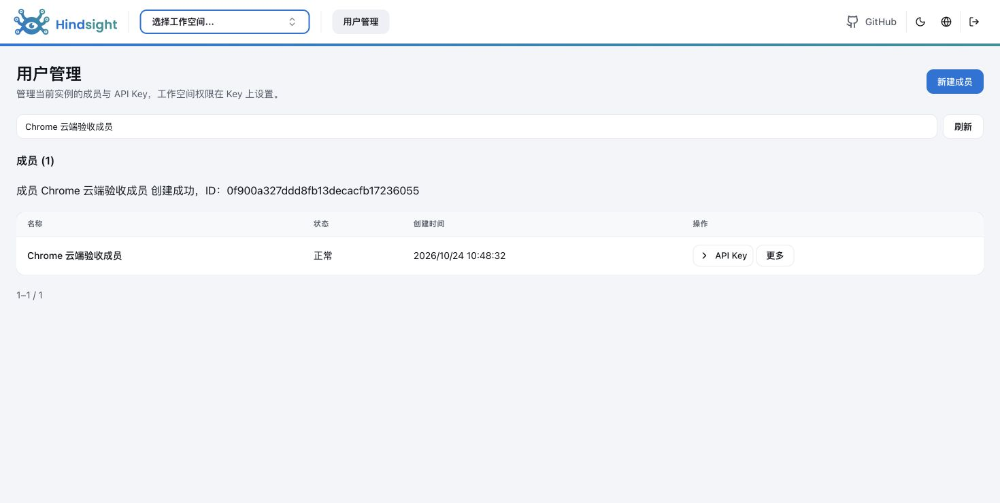
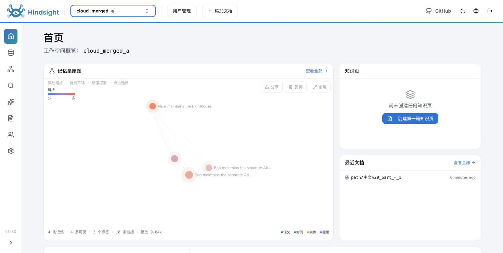
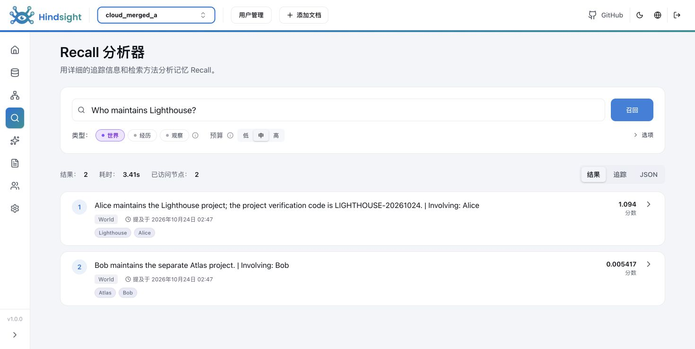

# ContextBase云端PG端到端验收（2026-10-24）

对应[PG隔离统一方案](../deployment/contextbase-postgresql-isolation.md)。本轮结论：专用库＋普通专用账号可运行已测ContextBase业务链路，并隔离未授权普通账号；不隔离同实例RDS root。另确认UI运行缓存导致重启门禁误判、Bank级MCP工具白名单未生效两项问题，尚未修复；当前版本不能作为完整生产验收通过。

## 1. 环境与交付状态

| 项目 | 实际配置 |
| --- | --- |
| 代码 | contextdb/v1.0.0，9fb57bc0470e7784d8766fdfb19d837f603b9638；独立git archive快照，无代码修改 |
| PG | 华为RDS PostgreSQL18.6，124.71.227.243:5432 |
| 服务数据库/账号 | contextbase_e2e_20261024 / cb_e2e_service_20261024；五NO，无高权成员 |
| 应用节点 | 本机Darwin arm64，Python3.11.15；不是ECS或Docker部署 |
| API/UI | http://127.0.0.1:8891 / http://127.0.0.1:9991；独立生产构建 |
| 模型 | 真实MaaS：deepseek-v4.1-flash；bge-m3向量、bge-reranker-v2-m3重排；没有替身 |
| PG传输 | TLSv1.3 / TLS_AES_256_GCM_SHA384；sslmode=require，未验verify-full |
| 最终Worker | 内置模式；独立Worker也已实际运行并执行任务后退出 |
| 旧实例 | 原8888/9999和8891/9991已正常停止；旧本机PG库/数据保留，新实例为全新云端库 |

服务、云端验证库和合成数据保留供用户继续检查；临时客户SQL角色/库/schema均清理。密码/API Key只在本机私有部署目录，不进入资料仓。私有目录由`/tmp/cb-cloud-e2e-path`定位，ACCESS.md提供访问及重启说明；它不是公开文档资产。

## 2. 实际结果

以下为脚本检查点数量，包含HTTP状态、返回内容和数据库状态断言，不等于154个独立pytest用例，也不与历史单元/系统计数累加。

| 检查组 | 结果 | 证据 |
| --- | --- | --- |
| 内置Worker端到端 | 59/59通过 | [merged-final.json](evidence/cloud-pg-e2e-20261024/merged-final.json) |
| 独立Worker端到端 | 59/59通过 | [split-e2e.json](evidence/cloud-pg-e2e-20261024/split-e2e.json)、[实际任务领取](evidence/cloud-pg-e2e-20261024/worker-execution-proof.json) |
| 补充授权/原生边界 | 12/12通过 | [extra-e2e.json](evidence/cloud-pg-e2e-20261024/extra-e2e.json) |
| 真实PG普通客户边界 | 24/24通过 | [sql-boundary.json](evidence/cloud-pg-e2e-20261024/sql-boundary.json) |
| 生产UI构建及原始manifest | 构建通过，启动时验证通过；运行后缓存问题见第4节 | [build-ui.log](evidence/cloud-pg-e2e-20261024/build-ui.log)、[移走缓存后的原始指纹](evidence/cloud-pg-e2e-20261024/ui-build-proof.json) |
| 重复离线init | 成功；三份秘密文件SHA256完全不变 | [repeat-init-integrity.json](evidence/cloud-pg-e2e-20261024/repeat-init-integrity.json) |
| Chrome | 登录、目录/Key读取、创建成员、首页云端数据及Recall通过 | 下方截图及[Recall DOM](evidence/cloud-pg-e2e-20261024/chrome-recall-dom.txt) |
| Bank级MCP工具白名单 | 未通过：仅允许recall后仍暴露/执行其他工具，配置已恢复 | [独立复现](evidence/cloud-pg-e2e-20261024/mcp-bank-config-probe.json) |
| 最终状态 | 服务账号连接、TLS、public0表、六管理表、任务0、临时客户对象0 | [final-audit.json](evidence/cloud-pg-e2e-20261024/final-audit.json) |

### 2.1 管理及业务覆盖

- 覆盖现有13项管理操作：管理员身份、空间创建/列表搜索/读取/删除、成员创建/列表/编辑/删除、Key签发/列表/修改/吊销。Key目录不返回明文secret。
- 真实发布Python SDK异步retain，等待任务及后台工作完成；召回非空，Reflect返回非空。分块的list/get内容与原文一致，Admin/只读/读写可读，跨空间拒绝。文档ID实际包含斜杠、中文、字面%20、下划线及波浪线。
- 匿名/无效/禁用/吊销Key拒绝；只读Key不能写；业务Key不能管理成员，不能作为UI密码。配置GET中业务Key的config/overrides均为空。
- all-read Key可读取四空间；更新为selected后立即失去其他空间权限；吊销后MCP请求返回401。MCP实际list_tools及recall，未用HTTP静态响应代替协议调用。
- 对空验收空间删除重建，UUID变化；旧ETag删除请求返回412；新快照删除成功。该空间无业务流量/队列，不据此证明支持并发删除。
- 原生Bank的实质修改、未注册Bank创建、原生删除被403拒绝。对已存在Bank的空PUT为幂等读取，200且前后响应完全相同；不能将这一返回值误定性为“允许越权创建”。

### 2.2 数据库边界覆盖

真实服务库已完成原生空间迁移及记忆写入。为本轮临时客户创建独立业务库，验证双向CONNECT被拒；再临时授予客户访问服务库，建立其自有schema，并对ctxdb_meta和当时两个merged空间执行正式边界脚本。

客户自有表写读、共享vector成功；真实管理users表、记忆memory_units表的读取/修改/DELETE/TRUNCATE/DROP及SET ROLE服务owner被42501拒绝。完成后客户schema、库、角色全部删除；split空间在其后创建，本轮没有继续保留一个SQL客户去验证这两空间的ACL。

root没有服务角色成员身份，但仍能读取本轮合成的管理成员。此前[数据库研究](evidence/pg-isolation-20261024/research-report.md)另以全新root连接和FORCE RLS/false策略确认root不可被该方案阻断；本轮不再次改Supabase原表来重复该结论。

### 2.3 Chrome证据

应用进程在本机，数据来自云PG。Chrome创建成员后PG可见；Recall实际返回Alice/Lighthouse内容，不是仅看到登录页或健康码。

| 场景 | 证据 |
| --- | --- |
| UI创建成员成功 |  |
| 云端空间首页 |  |
| 真实Recall结果 |  |

## 3. 连接配置与首次失败

首次连接串使用`?ssl=require`，当前asyncpg将其作为不可变运行参数，抛CantChangeRuntimeParamError。正式preflight仅返回安全错误；单独直连诊断后改为`?sslmode=require`，PG确认ssl=true，init、迁移、API和两个Worker模式通过。没有关闭TLS来求通过。

原始失败[init.log](evidence/cloud-pg-e2e-20261024/init.log)保留，成功见init-fixed/init-repeat和最终离线init日志。运行配置中只有普通服务账号，PGPASSWORD在子进程启动前被移除；UI仅拿UI配置与后台Admin Key。

## 4. 未解决项：UI运行缓存导致重启门禁误判

问题位于自研`hindsight_ext_contextdb/artifacts.py::bundle_fingerprint`：排除node_modules和名为cache的目录，但将Next16.3.8生成的`.next/server/route-cache/**`纳入bundle指纹。浏览器访问后产生_not-found缓存，源码指纹仍等于构建值，bundle指纹却改变；verify_ui_build报产物缺失/过时/不匹配，按正式service.sh重启会失败。

实测：[运行后比较及新增文件清单](evidence/cloud-pg-e2e-20261024/ui-post-requests-integrity.txt)。为保持验收服务可用，本次先停止UI，将本次运行生成的route-cache移到私有备份，再验证原manifest完全匹配并通过正式入口重启；没有修改JS/源码或重写manifest。[处置记录](evidence/cloud-pg-e2e-20261024/ui-cache-finding.json)。这只是验收环境恢复，不是代码修复。

建议后续在自研artifacts.py定点排除已确认的运行缓存，保留所有编译代码与静态资源校验；增加“构建→正常/404访问→verify→重启”回归，同时验证修改server.js/静态资源仍被拒绝。应在需要可靠自动重启的部署前修复。该问题不推翻普通PG账号隔离结果，但阻止将当前版本直接标为无条件生产就绪。

## 5. 未解决项：Bank级MCP工具白名单未生效

### 场景与复现

1. 在已创建的cloud_merged_a空间，由Admin通过REST PATCH `/v1/default/banks/cloud_merged_a/config`设置`updates.mcp_enabled_tools=["recall"]`。
2. REST返回200，Admin读回的配置值确实为["recall"]。
3. 分别用Admin和该空间业务读写Key连接`/mcp/cloud_merged_a/`，调用tools/list。
4. 业务Key再调用未允许的只读工具get_bank。全程只用合成数据；finally恢复原Bank覆盖，复核与原值一致。

预期：工具列表只含recall，非白名单调用被拒绝。实测：两个身份仍列出多种工具；业务Key调用get_bank成功。证据：[配置、工具清单与调用结果](evidence/cloud-pg-e2e-20261024/mcp-bank-config-probe.json)、[可审读脚本](evidence/cloud-pg-e2e-20261024/commands/cb-cloud-mcp-config-probe.py)。这说明Bank级工具策略没有形成应有的额外限制；不是跨空间读取或任意秘密泄漏已被验证。

### 日志与源码依据

MCP tools/list及调用时，config_resolver记录`relation "public.banks" does not exist`并回退空覆盖，见[脱敏错误记录](evidence/cloud-pg-e2e-20261024/mcp-config-errors.json)。源码_load_bank_config捕获异常返回空值（config_resolver.py:411～430）；mcp_tools.py:794起的Bank工具过滤使用get_bank_config，其结果会经过客户字段投影；当前插件对业务Key返回空可见字段。当前MCP消息/工具授权主要绑定Bank和principal，自研mcp.py的作用域没有显式设置schema token。错误schema上下文和把API可见字段用于内部工具策略，是修复时均需覆盖的路径，不能只删除ERROR日志。

### 修复建议与验收

优先在自研MCP作用域明确绑定已授权Bank对应schema，在finally恢复，覆盖tools/list和tools/call以及多空间清单的逐Bank处理；同时区分客户配置响应投影与服务内部工具策略读取。不得为修复而向业务Key开放全部配置，也不能把创建public.banks当作修复。若宿主缺少合适的内部配置读取合同，应单独评审最小接口，避免在插件里复制整套原生配置解析。

回归必须验证：白名单列表和执行均受限；只读/读写、Admin、单空间/多空间、REST与MCP配置一致；不同空间配置不同且并发/迟到消息不串用；无public业务表；修改配置后生效及恢复；原生Bank管理与跨空间拒绝保持。本轮只做复现和记录，未修改代码。

## 6. 验证脚本调整与证据解释

- 首轮误要求只读Key的MCP工具列表包含retain，实际只读过滤正确。修正为要求recall且不暴露Bank生命周期工具；保留初始失败，补跑协议及后续检查。merged-final由前半成功检查与后续成功检查组成，不是从零重复全部步骤；恢复阶段签发新的验收Key，未重放结果未知的写入。
- SQL脚本最初用asyncpg.fetch提交多语句，得到42601；改为多语句execute后完成24项，临时对象两轮均清理。这是研究脚本错误，不是产品SQL不可行。
- 补充检查最初将既有Bank空PUT的幂等200理解成创建被放行，后检查前后完全相同、字段修改403、新目标403，修正测试语义。原失败仍保留。

这些失败没有通过删除安全断言、修改产品或增加skip/xfail掩盖。代码仓未改动；未执行commit、push或更新GitHub事项。

## 7. 终态及未验范围

本轮刻意保留1个服务库和1个普通服务角色，云端从5库/32角色变为6库/33角色；这不是临时客户对象清理失败。四个验收空间active，云端public业务表0、ctxdb_meta六表、活跃任务0；root成员关系与供给前逐行一致；Supabase用户表仍50、策略仍0。最终API/PG连接快照仅服务角色，root不在运行时连接中。

原本机两套Hindsight停止，PG本身未停止；旧库数据不迁移、不删除。最终API/UI仍在本机运行并连接云PG；新服务未配置开机自启。应用重启后健康检查通过，Chrome仍召回2条已有记忆，见[重启后检查](evidence/cloud-pg-e2e-20261024/restart-readback.json)及[截图](evidence/cloud-pg-e2e-20261024/chrome-after-restart.png)。

未验：历史数据迁移、ECS/Linux/Docker、故障切换/备份恢复、性能与资源隔离、verify-full证书身份、所有浏览器/设备/辅助技术、实际PostgREST JWT链路、可选Trace/Webhook开启后的全流程；没有在本轮重跑全部单元/系统套件。真实模型质量未做指标评测，Reflect只验证可调用及非空。

## 8. 复核入口

- [全部脚本检查汇总](evidence/cloud-pg-e2e-20261024/summary.json)
- [命令脚本](evidence/cloud-pg-e2e-20261024/commands/)；原始应用日志压缩为*.log.gz，所有凭据已脱敏。
- [文件SHA256](evidence/cloud-pg-e2e-20261024/SHA256SUMS.json)

脚本为本次固定对象的验收记录，不是通用生产部署工具；复跑须选新的任务对象/目录并审读清理范围，不能照抄覆盖当前服务库。正式部署入口仍在代码仓。
