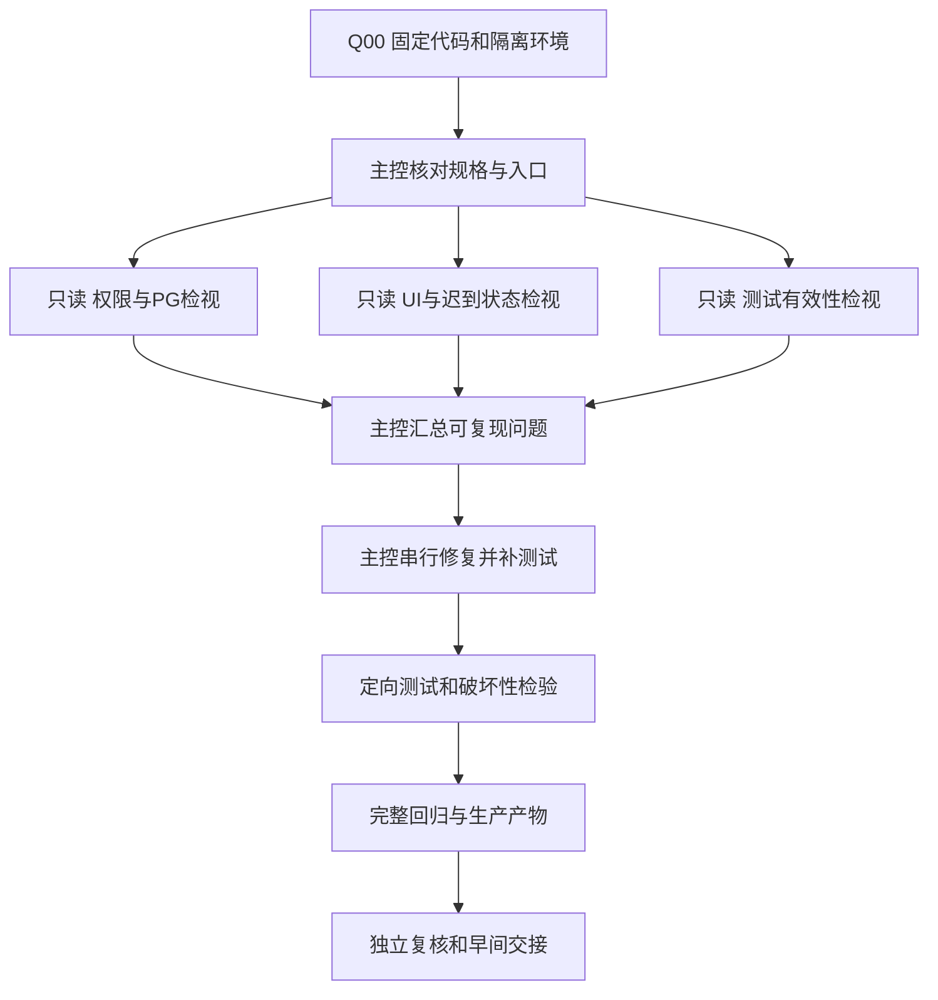

# ContextDB 夜间质量任务与验收记录

> **版本说明（2026-10-22）：** 本文保留问题复现、评审和过程记录；旧的“独立worktree／未提交”描述不代表当前状态。当前代码为本地提交`9fb57bc04`（父提交003bbe032，未推送），已修复项和剩余边界以[当前设计](../design/contextdb-release-design.md)及[最新验证](contextdb-validation-summary.md)为准。Audit继续关闭，O02及外部环境等未验项不记为通过。


历史任务记录（2026-10-21，当时状态）：**本轮代码修复、自动化回归及独立检视完成；O01真实浏览器已执行但有失败项，默认ARM容器启动仍有验收缺口**。原始代码基线`c56c7ac17ff438228d257be42072a12c7f72e7c5`；本轮不自动提交/推送，不修改原8888/9999或用户数据库。

本文件记录任务调度、测试覆盖和问题闭环；功能规格仍以[设计](../design/contextdb-release-design.md)为准，变更决策写入[实施清单](../design/contextdb-simplification-plan.md#current-optimization-backlog)，[验证摘要](contextdb-validation-summary.md)保留历史结果。本轮结果不能用历史通过数代替。

## 1. 当前任务位置

- 分支：`contextdb/quality-20261021-004226`
- 工作区：`/Users/zhuqingping/Work/Database/Context/.local/worktrees/contextdb-quality-20261021-004226`
- 证据目录：`/Users/zhuqingping/Work/Database/Context/test/contextdb-quality-20261021-004226`
- 本机运行指针：`/tmp/contextdb-current-quality-run.json`
- 执行者：主控负责修改、整合和记录；三个独立检视者只读，分别检查权限/PG、UI/TS、测试有效性。最多主控加三个检视并发；不多人写同一文件。
- 范围：插件实现、相关管理UI、插件测试及资料。原生Python运行代码、RSIXDB集成工作区、verification/及其他开发者改动不修改。
- 模型：先使用现有确定性替身；不读取真实秘密，不擅自调用付费MaaS。

## 2. 执行列表

| ID | 顺序 | 要做什么 | 完成标准 | 当前状态 |
| --- | --- | --- | --- | --- |
| Q00 | 准备 | 固定基线、独立worktree、证据和隔离资源 | 初始status/基线/权限边界记录齐全 | 已完成 |
| Q01 | 第一优先级 | 列出管理/REST/MCP/UI/特殊路径的认证授权矩阵 | 各入口明确身份、对象、权限、schema、对应测试；缺口可定位 | 已完成，三名独立检视通过 |
| Q02 | 第一优先级 | 验证跨空间、逐空间读写、撤权/吊销及敏感响应 | 合法成功与非法拒绝均通过真实API/SDK验证 | 已完成，73项系统故事含权限矩阵/拒绝后数据不变 |
| Q03 | 第二优先级 | 连续操作：创建→授权→retain/recall→改权→吊销→删除重建 | 每步状态和后续访问符合规格，旧selected UUID不继承 | 已完成，双Worker及真实原生提交故障 |
| Q04 | 第二优先级 | 失败与迟到：PG错误、客户端未收到结果、UI迟到/关闭/切换 | 不错报成功、不自动重放、不泄露Secret、不串授权；部分失败可核对 | 已完成，真实PG故障/MCP协议/UI竞态 |
| Q05 | 第三优先级 | 隔离副本有意破坏四个关键保护，验证测试检出 | 每项记录改动、目标测试、退出码；误改语法不算检出 | 已完成4项，目标断言均检出 |
| Q06 | 跟随问题 | 修复可复现缺陷，补先失败后通过的回归 | 有根因、最小改动、验证、未覆盖边界；无需新增架构 | 已完成，4项产品缺陷和2项测试缺口关闭 |
| Q07 | 跟随问题 | 消除有证据的重复策略/无用状态/多余查询 | 解释原复杂度与替代职责，行为和安全回归不变 | 已完成，状态只存ID、删除无用函数/转发壳 |
| Q08 | 回归 | 插件、UI、完整系统、生产UI双Worker、合同、相关原生及静态检查 | 当前修改快照完整记录，不能静默skip或用历史结果冒充 | 已完成，最终回归及静态检查见N-T16 |
| Q09 | 补缺口 | 真实浏览器多宽度、浅深色、键盘和Secret交互 | 真实界面证据；工具不可用则记录阻塞，不冒充通过 | 已于2026-10-21真实Chrome执行，未全通过：3项UI问题及复制内容待归因，见O01/N-T22/第11章 |
| Q10 | 补缺口 | 原样Docker镜像及Linux/Node24关键流程 | 记录实际平台、隔离端口/PG、构建与业务结果；缺环境明确未测 | 此前本机构建成功/默认init失败；用户决定本机后续跳过，移交外部验证，不作通过结论 |
| Q11 | 补测量 | 完整请求SQL/连接回收检查，原生与自研开销分开 | 记录实际请求、规模和查询次数；不提前改变目录语义或加缓存 | 完成18次调用SQL测量及取消/上下文复核，未作全局泄漏审计 |
| Q12 | 收口 | 独立复核、更新文档和补丁、未解决清单 | 必修项关闭或明确阻塞，证据可追溯，无生产操作 | 完成，补丁/报告和未完成项已保存，无提交/推送 |

固定规格：删除前停流量/排空，超时不等于回滚；不保证中止已受理请求，不新增复杂删除屏障。all授权本来就覆盖未来空间，只有旧selected授权不得继承新UUID。首版native+english不承诺中文全文；测试不能以未承诺功能为缺陷。

## 3. 调度方式



只读检视先依据规格列自己的失败场景，再看实现者结论。写入只由主控在独立worktree执行；测试数据库、端口、产物目录归本任务所有。资源不足时串行跑重测试，不启动多套相同全量测试争抢资源。某项缺环境不阻塞其他独立工作；不得把未运行写成通过。实现和范围外问题分开，先处理第一/二优先级，不为删行改公共框架。

## 4. 已完成测试：进入本轮前的基线记录

这些证据对应c56c7ac17所包含的上轮修复内容；amend只更新提交组织、说明和README标题。**不是本轮新测试结果**。详见验证摘要和上轮本机`/tmp/contextdb-current-a05-fixes-path`。

| 编号 | 已执行内容 | 结果 | 限制 |
| --- | --- | --- | --- |
| B-T01 | 插件Python，含真实非超级用户重复init/public无表 | 360通过，零跳过 | 隔离真实PG；非生产RDS |
| B-T02 | 全UI套件 | 505通过，54文件 | JSDOM，TZ=UTC；不是实机视觉 |
| B-T03 | ContextDB完整系统 | 67通过，零跳过 | SDK/REST/MCP、真实PG/API、模型替身、双Worker |
| B-T04 | 生产UI双Worker独立门禁 | 2通过 | 已包含在B-T03覆盖内，不重复累加 |
| B-T05 | chunk专项 | 4通过 | 同属B-T03；特殊ID与三类Key/拒绝路径 |
| B-T06 | 原生相关8文件 | 121通过 | 不是上游全部测试 |
| B-T07 | 跨语言Key合同 | 1通过 | 既有合同提取器 |
| B-T08 | 正式build-ui、指纹、类型、lint、knip@5 | 通过 | 本机Node23；未执行原样Docker/远程CI |

## 5. 已修复问题：基线已有，不重复开发

| 编号 | 问题或调整 | 当前状态 | 证据范围 |
| --- | --- | --- | --- |
| B-P01 / S20 | chunk特殊路由未建立空间认证上下文 | 已修复 | SDK/权限及编码回归 |
| B-P02 / SEC-01 | Bank config overrides与config可见字段不一致 | 已修复并保留 | GET/PATCH/DELETE、诊断、分块/gzip及双Worker |
| B-P03 / S21 | GET失败混淆空实例/无匹配/旧数据 | 已修复 | 目录、Key和picker组件 |
| B-P04 / S22 | 用户管理混入空间内容动作；users空间被误判 | 已修复 | 完整路径匹配及反例 |
| B-P05 / S23 | 授权空间无法搜索后续分页 | 已修复 | 第59项、UUID/只读保留、搜索迟到/清空复位 |
| B-P06 / S19 | Secret定时/标签隐藏清理及复制反馈问题 | 已调整并回归 | 明确关闭/pagehide/用户切换、签发与复制迟到 |
| B-P07 / S24 | 日期未使用UI语言 | 已修复 | 用户及展开后的Key列表 |
| B-P08 / S16 | public初始化了无必要的原生业务表 | 新实例路径已修复 | init和完整系统结束后public无表；不清理用户旧库 |
| B-P09 / S17/S18/S25 | 注释英文、权限文案、表格与控件一致性 | 已实施 | 静态/组件/构建；视觉仍待验收 |

## 6. 本轮新增测试执行记录

每次执行追加一行，不覆盖失败历史；RUN/NOT RUN明确区分。重复执行注明是否包含前次场景，避免重复累加。测试对象固定为基线加当时diff指纹；证据保存完整命令、退出码、总数、skip/xfail原因及日志路径。

| 编号 | 对应任务/问题 | 场景及命令/证据 | 状态 | 通过/失败/跳过 | 代码快照 | 未完成原因 |
| --- | --- | --- | --- | --- | --- | --- |
| N-T00 | Q00 | 工作区与scope.json | RUN | 准备成功 | c56c7ac17 | — |
| N-T01 | Q01 | python-baseline.log/xml | RUN | 359通过/1跳过 | c56c7ac17 | 真实init为opt-in；已纳入N-P005修复 |
| N-T02 | Q01 | ui-baseline.log | RUN | 505通过 | c56c7ac17 | JSDOM |
| N-T03 | N-P001/002 | ui-red.log、ui-user-red.log、ui-target-green-2.log | RUN | 定向先失败后41通过 | 本轮工作区 | 首轮标签选择器错误另记，不当作缺陷复现 |
| N-T04 | N-P003 | prompt-preview-red-2.log→prompt-preview-green.log | RUN | 两Worker真实SDK先失败后2通过 | 本轮工作区 | 首轮SDK模型误用日志保留，不算有效红例 |
| N-T05 | N-P004 | mcp-errors-red.log→mcp-errors-complete-3.log | RUN | 6个协议红例；补全后31通过 | 本轮工作区 | 合成错误，不使用真实秘密 |
| N-T06 | N-P005 | init-always-run.log | RUN | 真实fixture自有PG，1通过/零跳过 | 本轮工作区 | 无外部管理员URL |
| N-T07 | Q03/Q04 | lifecycle-faults.log | RUN | 两类真实原生/元数据提交故障×两Worker，4通过 | 本轮工作区 | 最终完整回归继续验证清理改进 |
| N-T08 | Q05 | mutation-results.json及M1～M4日志 | RUN | 每项控制组通过、语义破坏后目标断言失败，4/4检出 | c56c7ac17隔离副本 | 仅四项样本，不代表全部变体 |
| N-T09 | Q02 | mcp-revocation-strict.log | RUN | 6通过；MCP停用/吊销必须HTTP401 | 本轮工作区 | 不接受任意异常 |
| N-T10 | Q02 | denials-preserve-data.log | RUN | 两Worker 2通过；拒绝后记忆与队列不变 | 本轮工作区 | SDK断言，无业务表SQL读取 |
| N-T11 | Q08 | python-iteration.log/xml、ui-iteration.log | RUN | Python391通过/零跳过；UI520通过 | 本轮工作区 | 尚待最终复核后的快照记录 |
| N-T12 | Q08 | production-ui-build.log、lint-iteration.log | RUN | 正式构建/指纹与lint通过 | 本轮工作区 | Node23本机 |
| N-T13 | Q10 | docker-build.log、docker-build-final.log | RUN | 两次构建成功；最终Linux aarch64/Node24.22.0/Python3.11.2 | 本轮工作区 | 构建成功不代表默认启动成功，见N-T18 |
| N-T14 | Q09 | cua.getState | RUN | apps/browsers为空、native pipe启动失败 | 本机 | 真实浏览器验收阻塞 |
| N-T15 | Q08 | system-iteration.log/xml | RUN | 73通过/零跳过 | Unicode修正前 | 包括4项真实生命周期失败回归 |
| N-T16 | Q08 | final-checks.json与*-final日志/JUnit | RUN | Python391、UI523/54文件、系统73、原生相关121、Key合同1；均通过，零跳过 | 最终本轮工作区 | UI独立2项/门禁亦通过，已计入73，不累加 |
| N-T17 | Q08 | production-ui-build-final.log、lint-final.log、types-final.log、knip-final.log | RUN | 正式构建、指纹、类型、lint、knip@5及diff-check通过 | 最终本轮工作区 | 首轮no-control-regex检查失败已加局部语义说明；历史日志保留 |
| N-T18 | Q10/N-P007 | docker-smoke-default.log、docker-illegal-instruction-probe.log | RUN | 默认init失败：cryptography50原生绑定SIGILL/132 | 最终镜像6bd4b4cb9c76 | 非通过；与宿主ARM虚拟机能力探测相符，目标Linux尚未测 |
| N-T19 | Q10/N-P007 | docker-smoke.log/results、docker-cryptography-rsa-probe.log | RUN | 同一镜像仅测试注入OPENSSL_armcap=0后完整冒烟通过；RSA签验通过 | 最终镜像6bd4b4cb9c76 | 未修改生产默认；不替代N-T18失败，非全系统Linux回归 |
| N-T20 | Q11 | whole-request-sql.log/json | RUN | 18次完整客户端调用，1/10授权空间×REST recall/MCP recall/tools-list×3 | 本轮工作区 | 空数据、预热、单客户端、嵌入Worker；不作吞吐结论 |
| N-T21 | Q12 | auth-pg/ui-ts/test-effectiveness-final-review.md | RUN | 三方ACCEPT，无未关闭必修项 | 本轮修复差异 | 不替代视觉、云环境或默认Docker启动验收 |
| N-T22 | Q09/O01 | o01-browser-20261021/report.md、59张截图、screenshots.json、cleanup.json | RUN | 真实Chrome：主流程/弹窗视觉/部分键盘通过；3项UI失败；复制内容核对未通过、归因未定 | 指针独立worktree当前未提交快照，source-before/after逐文件相同 | 未注入真实浏览器迟到/复制Promise竞态；未修代码；自有PG/API/UI/替身及标签已清理 |
| N-T23 | O02/N-P007 | o02-recheck-20261021/results.json及两份探针日志 | RUN | 同一镜像/Colima：默认RSA探针SIGILL/132；仅测试覆盖OPENSSL_armcap=0后签名验证0 | 镜像6bd4b4cb9c76，代码未变 | network=none、只读、cap-drop=ALL、自清理容器；未重跑完整系统或云上部署 |


## 7. 本轮发现、修复与未修复问题

首轮六项已由对应独立检视者复核关闭；平台问题保留未解决。O01后续真实浏览器新增N-P008～010及待归因复制问题，均未修复，不能沿用首轮ACCEPT结论关闭。

| 编号 | 级别/类别 | 复现与影响 | 根因/修改位置 | 状态 | 回归证据 | 未修复原因/后续决策 |
| --- | --- | --- | --- | --- | --- | --- |
| N-P001 | Important/UI | 空间弹窗卸载/外部关闭后迟到成功仍回调导航 | create-workspace-dialog；检查abort、关闭取消及旧finally不清新controller | 已关闭，独立复核接受 | 定向红绿，UI全量通过 | — |
| N-P002 | Important/UI | 用户创建损坏201 JSON被报成功 | 请求边界增加成员创建身份验证，异常进入未知结果核对 | 已关闭，独立复核接受 | 组件红绿、响应矩阵、Unicode规范化反例、UI全量通过 | — |
| N-P003 | Important/权限 | prompts/preview绕过业务配置字段过滤 | 扩展transport将预览限Admin，GET config空投影保留 | 已关闭，独立复核接受 | 真实SDK双Worker红绿；selected/all与read/read_write | — |
| N-P004 | Important/诊断安全 | MCP新增元数据阶段回传内部异常原文 | 小型metadata_errors边界复用；不包原生工具执行 | 已关闭，独立复核接受 | 协议红绿、六hook×四类故障、原生错误透传 | — |
| N-P005 | 测试缺口 | 非超级用户部署测试可因外部URL缺失静默skip | 直接复用已有任务自有PG fixture | 已关闭，独立复核接受 | baseline skip→真实init及全Python零skip | — |
| N-P006 | 测试缺口 | 只断言MCP撤权任意异常，未证明鉴权拒绝 | 收紧为HTTPStatusError+401；补拒绝后数据/队列不变 | 已关闭，独立复核接受 | 定向6+2通过，含重叠不累加 | — |
| N-P007 | 部署平台/未解决 | 默认ARM镜像init在cryptography原生绑定SIGILL/132 | 独立import同样失败；测试容器覆盖OPENSSL_armcap=0后import、RSA及业务通过 | 本机暂不处理；外部环境待验证 | 默认失败/覆盖成功日志均保留 | 用户决定本机后续跳过；不改依赖/宿主/生产默认；不能将移交标为修复通过 |
| N-P008 | P2/UI，已确认 | 390px全局页头溢出，导航/主题等屏外，页面整体横向滚动 | 页头响应式布局待定位，后续优先局部收敛 | 待修复 | O01报告及截图19/21/22/38/43 | 本次浏览器验收只读，未修改代码 |
| N-P009 | P2/键盘可达性，已确认 | 成员/空间/Secret弹窗关闭后焦点落在BODY，未恢复触发位置 | 弹窗触发元素与关闭焦点恢复待定位 | 待修复 | O01真实键盘、截图及focus-after-workspace-close.json | 本次只读验收，修复后须真实键盘复测 |
| N-P010 | P3/输入校验，已确认 | 76字符成员名可提交，仅显示英文Invalid management request | UI成员名称上限与字段错误提示不完整 | 待修复 | O01截图09；服务端上限64，合法缩短后成功 | 后续补前端提示及后端既有约束回归，不放宽上限 |
| O01-C01 | 剪贴板核对失败，归因未定 | 浏览器路径显示已复制，但虚拟剪贴板为空；原生路径无反馈且粘贴未匹配 | 产品剪贴板、工具隔离及前台行为尚未区分 | 待归因 | O01截图14/30/49/50及browser-observations.json | 不把反馈成功写成内容通过，也不直接认定产品代码缺陷 |

问题状态：待复现、已确认、修复中、待复核、已关闭、未修复。环境阻塞和明确规格限制单独记录，不混成已确认代码缺陷。必须修复的问题不能仅凭源码调整关闭，须有针对回归和复核。

已知未完成项：

| 编号 | 类型 | 事项 | 当前处置 |
| --- | --- | --- | --- |
| O01 | 已执行，未全通过 | 真实浏览器多宽度、主题、键盘/剪贴板 | 本次Chrome可用，59张截图；主流程及主题/多宽度弹窗通过，390页头溢出、关闭焦点、超长名提示失败；复制反馈通过但内容核对未通过、归因未定；见第11章 |
| O02 | 本机后续验证跳过，移交其他开发环境 | Linux/Node24原样Docker与目标部署 | 用户于2026-10-21明确决定：本机Colima ARM不再继续验证；保留此前默认SIGILL/132及诊断成功证据，不标通过；由其他开发环境验证默认镜像，步骤及标准见12.1 |
| O03 | 方案已确认，待实施；非已证实缺陷 | 固定镜像构建/CI检查一致性，运行时沿用原生直接启动 | 源码部署保留检查；不新增跳过开关或镜像信任平台；本次仅改文档，代码仍扫描；详见简化清单第11章 |
| O04 | 已测量，最小方案明确、待实施 | MCP消息内身份、同目标认证及空间目录复用；遥测UPDATE去重 | tools/list原15次/6次认证；保留不同Bank与不同消息授权边界，不改原生MCP；修改范围和验收见简化清单第12章，本次未改代码 |
| O05 | 分项跟踪，待完成 | 中文全文；Trace/Audit正文开启支持；Webhook | 中文全文由用户联合PG同事定方案；Trace/Audit须补开启后的功能和隔离验收，当前仍被代码禁止，不能宣称已支持；Webhook恢复原生全局/Bank能力、撤销继续禁止，代码仍阻断待实施；见设计O05及简化清单第16章 |
| O06 | 待外部环境分阶段验收 | 真实MaaS、ECS/RDS、性能/稳定性、HA、备份恢复 | 先部署/模型，再负载，再明确拓扑下恢复；目标环境、执行责任与证据待安排，不作为已确认代码缺陷 |
| O07 | 范围外原生问题 | 原生DSN敏感日志 | 已另提Issue跟踪，不在管理特性中顺带修 |
| O08 | 最小方案明确，暂不实施 | 自研扩展错误安全诊断 | 只补服务端现有logging诊断，客户端仍脱敏；不改原生、不新增框架，范围与待执行验收见简化清单第15章及设计O08 |

简化记录：成员展开状态由完整User对象改为user_id，移除无用对象同步；删除未调用的select_workspace及仅转发权限检查的async _admin。未新增元数据表、生产变量、删除屏障或原生内核修改。

### 7.1 问题、实现与测试对应表

N-P001～N-P006均已修复或补强，并通过对应独立复核；修复尚未提交或应用到原工作区。查看第1章独立worktree，而不是直接在`/Users/zhuqingping/Work/Database/Context/hindsight`查找这些新改动。以下路径相对于该worktree；`插件`指`hindsight-extensions/contextdb-service`，`UI`指`hindsight-control-plane/src`。

| 问题 | 实现修改 | 新增/补强的回归 |
| --- | --- | --- |
| N-P001 关闭后迟到导航 | UI/components/contextdb/create-workspace-dialog.tsx：关闭取消、成功前检查abort、finally只清自己的controller | 插件/tests/ui/contextdb-native-entrypoints.test.tsx新增2项：`does not navigate when a workspace creation succeeds after the selector unmounts`；`invalidates a closed create attempt without losing a newer request's cancellation` |
| N-P002 创建用户错报成功 | UI/lib/contextdb-api.ts新增createContextDBUser；UI/components/contextdb/users-view.tsx使用该边界 | 插件/tests/ui/contextdb-responses.test.ts新增member creation response identity组15项：坏响应8项、错误成功码3项、Unicode规范化3项、合法规范化与请求快照1项；contextdb-users-view.test.tsx新增坏201组件故事1项 |
| N-P003 预览权限 | 插件/hindsight_ext_contextdb/transport.py：敏感后缀增加/prompts/preview，普通配置GET空投影不变 | 插件/tests/system/test_114_contextdb_diagnostic_credentials.py新增`test_business_keys_cannot_read_hidden_settings_through_prompt_preview`，两Worker共2项；管理员成功，selected/all×read/read_write均拒绝，合法recall保持 |
| N-P004 元数据内部异常 | 插件/hindsight_ext_contextdb/database_checks.py新增metadata_errors；mcp.py、tenant.py、validator.py在元数据阶段复用，原生工具执行在外 | 新文件插件/tests/python/test_mcp_metadata_errors.py共31项：6个真实内存MCP协议故障、六hook×四异常24项、1项原生工具错误不被误改写 |
| N-P005 init静默skip | 只改测试，不改生产初始化 | 插件/tests/python/test_deployment_contract.py已有`test_real_source_init_preserves_secrets_without_public_business_tables`改用database_url fixture，无需外部URL、不再skip；真实非超级用户重复init/public无表 |
| N-P006 撤权断言不足 | 只改测试，不新增认证策略 | 插件/tests/system/test_110_contextdb_tenant_admin.py已有`test_multi_space_live_keys_admin_and_lifecycle`；test_111_contextdb_business_keys.py已有`test_revoke_one_key_preserves_sibling_and_old_mcp_session_cannot_reuse_it`。要求明确HTTP401；110另核对拒绝操作前后记忆及队列不变 |

除上述六项，本轮还新增`插件/tests/system/test_117_contextdb_management_failures.py`：原生初始化后元数据激活失败、原生删除后最终审计提交失败，两Worker共4项。它是第二优先级“操作组合/失败恢复”的补充验证，不属于新增产品API或运行框架。

新增/补强用例计数：Python新增31项；UI新增18项；系统新增6项（预览2+生命周期故障4）；N-P005/006是在原测试上加强，不额外增加测试函数。最终391/523/73是各完整套件的通过数，不能再把这些子集累加。

检视命令：

```bash
cd /Users/zhuqingping/Work/Database/Context/.local/worktrees/contextdb-quality-20261021-004226
# 实现：相对修复前基线逐行比较。
git diff c56c7ac17 -- hindsight-control-plane/src hindsight-extensions/contextdb-service/hindsight_ext_contextdb
# 已有测试的修改。
git diff c56c7ac17 -- hindsight-extensions/contextdb-service/tests
# 新文件尚未跟踪，普通git diff不会显示，必须一起检查。
git ls-files --others --exclude-standard
```

完整`contextdb-quality.patch`已包含两个新增测试文件。用补丁检视比只看git diff --stat完整。实际命令/退出码见`quality-report.json`；红例日志、最终JUnit和三份独立复核见证据目录。N-P001/002/003/004保留修复前目标断言失败→修复后通过的证据；N-P005为原skip改成真实执行，N-P006为原测试补强，不把历史任意异常通过当作正确拒绝的证明。

## 8. 具体测试入口

以下是可重跑入口，实际执行以第6章和工件final-checks.json为准。准备各自依赖后从本任务worktree运行，PYTHONPATH必须明确指向该worktree，避免editable落到源仓。

```bash
export QUALITY_ROOT="/Users/zhuqingping/Work/Database/Context/.local/worktrees/contextdb-quality-20261021-004226"
export PYTHON_DOTENV_DISABLED=1
export PYTHONPATH="$QUALITY_ROOT/hindsight-extensions/contextdb-service:$QUALITY_ROOT/hindsight-api-slim:$QUALITY_ROOT/hindsight-clients/python:$QUALITY_ROOT/hindsight-system-tests"
cd "$QUALITY_ROOT"
.venv/bin/python -m pytest hindsight-extensions/contextdb-service/tests/python -q
TZ=UTC npm test -w @vectorize-io/hindsight-control-plane -- --reporter=dot
.venv/bin/python -m hindsight_ext_contextdb build-ui --source-root "$QUALITY_ROOT"
export CONTEXTDB_UI_SERVER="$QUALITY_ROOT/hindsight-control-plane/standalone/server.js"
.venv/bin/python -m pytest -c hindsight-extensions/contextdb-service/pytest-system.ini hindsight-extensions/contextdb-service/tests/system -q
.venv/bin/python -m pytest -c hindsight-extensions/contextdb-service/pytest-system.ini hindsight-extensions/contextdb-service/tests/system/test_112_contextdb_ui_management.py -q --junitxml="$QUALITY_ROOT/../production-ui-quality.xml"
.venv/bin/python hindsight-extensions/contextdb-service/scripts/check_production_ui.py "$QUALITY_ROOT/../production-ui-quality.xml"
.venv/bin/python -m pytest hindsight-extensions/contextdb-service/tests/contracts -q
./scripts/hooks/lint.sh
(cd hindsight-control-plane && npx --yes knip@5 --include files,dependencies --no-progress)
git diff --check
```

真实init用例本轮已改为始终复用database_url会话fixture，不再依赖外部CONTEXTDB_DEPLOYMENT_TEST_ADMIN_URL，也不跳过；该fixture仅操作本任务自有PG。原生回归按实际改动补选并记录文件；不要直接对默认共用hindsight-test跑数据库测试。故意破坏保护只在独立临时副本执行，需确认是目标断言失败，不能把语法/依赖错误当有效检出。Docker外部端口使用空闲端口；不接管主机8888/9999/5432。

## 9. 早间验收与后续调度

- [x] 新发现问题有复现、根因、最小改动和回归，未修复原因明确。
- [x] 三条优先主线分别有实际执行记录，包括未完成/环境阻塞。
- [x] 关键保护破坏试验每项能说明测试是否检出；未检出已补强或保留问题。
- [x] 简化解释职责由谁承担，无新增通用框架、生产变量、元数据表或删除屏障。
- [x] 原生Python运行差异未扩大，现有源仓和RSIXDB改动不受影响。
- [x] 补丁含新增文件，日志、秘密、构建产物不进代码；基线和diff指纹齐全。
- [x] 独立检视Must fix关闭；视觉/目标环境等未验收项清楚列出。
- [x] 本轮不提交/推送；用户检视后再决定应用到主分支和移植RSIXDB。

本轮已由用户明确要求启动，不需再次发启动口令。后续在任何会话中请求“查看ContextDB夜间质量任务进度，读取本清单及/tmp/contextdb-current-quality-run.json”即可接续；不要启动第二个写入同一worktree的主控。若需暂停，明确说“暂停夜间质量任务”。


## 10. 最终交接：做完什么、还差什么

**代码增量：** 9个实现文件修改，7个测试文件修改，新增2个测试文件；没有新增实现文件、依赖、CI框架或生产参数。相对c56基线共18文件，新增752行、删除200行，包含错误边界引起的缩进和291行新测试。补丁`contextdb-quality.patch`包含全部新增文件；SHA和完整命令见同目录`quality-report.json`。原工作区仍在c56，`verification/`保留，RSIXDB工作区未修改。本轮没有commit/amend/push，现有8888/9999及用户PG不变。

**测试有效性：** M1只读越权、M2旧UUID授权、M3迟到Secret、M4敏感配置投影，均为控制组通过、语义破坏后目标断言失败。31项MCP故障测试、4项真实生命周期故障、2项预览权限回归均纳入最终全量，不重复相加。

**容器结果必须分开读：** 最终镜像`sha256:6bd4b4cb9c76d93193412280a312db3e918a83a0f2b402349b5c2f23e7be3ca8`按仓库Dockerfile构建。默认UID10001、只读runtime、随机主机端口和独立PG17非超级用户；默认init因cryptography50 SIGILL失败。仅在测试容器覆盖OPENSSL_armcap=0后，真实init、ready、UI登录/CSRF、两个空间、用户/Key签发、异步Retain→Recall、跨空间拒绝、真实MCP tools/list及public无业务表通过；模型为HTTP替身。测试的容器、网络和卷已清理。覆盖只用于定位虚拟机问题，未写入部署默认或降级uv.lock，不能宣称“原样默认部署通过”。其现象与[cryptography上游已知Docker ARM问题](https://github.com/pyca/cryptography/issues/14764)及[Hindsight相关记录](https://github.com/vectorize-io/hindsight/issues/1322)一致；当前精确非法指令未反汇编确认。

**完整请求SQL实测：** 同一新部署中授权1和10个空间，每项预热后连续3次。REST recall为2次元数据语句/1次认证SELECT；MCP recall为6次/2次；MCP tools/list客户端调用累计15次/6次。元数据数包含使用遥测UPDATE、归属检查和目录查询；完整原生/连接设置/背景poll另外计入原始JSON，不混成扩展开销。tools/list重复鉴权仍有优化空间，本轮先记录，不能为减少查询引入跨消息权限缓存。无生产吞吐、大数据或全局连接泄漏保证。

**待补验：** O01已执行但有3项UI问题及复制内容待归因（见第11章）；默认ARM容器启动；x86、目标ECS/RDS、真实MaaS、负载/HA/备份恢复。**未修复/待优化：** N-P007平台启动问题、MCP完整调用重复检查、可信镜像启动免扫描、安全诊断关联日志。中文全文待联合PG同事定案；Trace/Audit正文及Webhook当前代码仍禁用，但最新目标已定为按O05恢复，不再作为永久不支持规格；原生DSN日志由原Issue单独跟踪。O01～O08当前分类以简化清单第16章为准。

**首轮执行中出现的非产品失败：** 自编Docker冒烟脚本曾遇到PG临时启动窗口、重复render未指定replace、把SDK同步close误写await，均修正外部脚本后从头重跑；生产UI门禁最初误传73项报告，被正确拒绝，随后单独重跑2项并通过门禁。这些日志保留，不算产品缺陷或有效红例。lint首次拒绝有意模拟Python strip的信息分隔符正则，添加一条局部规则说明后最终lint通过。

交付指纹：`contextdb-quality.patch` SHA256为`e2c14176b562a174346e8d9bc5aadc1ff2dc8287e40c68f60b5216f50191cd7a`。四项故意破坏副本已恢复并移除，仅保留脚本和结果；本轮修复worktree与镜像保留供检视。


## 11. O01 补验：2026-10-21 真实 Chrome

报告原始位置：`/Users/zhuqingping/Documents/Codex/2026-10-21/pets-plugin-work-pets-openai-curated/outputs/o01-browser/report.md`；已与证据目录副本逐字节核对一致，SHA256为`65491d4d035ae92d862349dbeb73a56c77a9685975d25d059fbb1e37620986f3`。

本节是 N-T22 的实际新结果，不覆盖 N-T14 旧会话工具失败历史。当前浏览器连接可用；O01 **已执行但未全通过**，不能再称“无浏览器所以未执行”。未修代码，未提交或推送。

- 环境：运行指针中的独立 worktree、全部已有未提交修复；正式 UI 与当前源码指纹校验通过。临时 PG 58395、模型替身 58394、API 58400、UI 58466。只操作本任务数据，未使用原8888/9999或用户数据库。
- 实际通过：空间列表/搜索/22条分页、创建与长描述；成员创建和Key展开；selected空间搜索/键盘选中/只读保留、all空间模式；一次性Secret展示及按钮/X/Escape关闭、刷新和用户切换后的可见清理；创建草稿关闭重开清空；浅深色390/1024/1440弹窗、长文本换行及可滚动底部；Tab/Shift+Tab/Enter/Space真实操作。列表移动布局有下列失败，不据弹窗通过宣称整页通过。
- N-P008 / P2：390全局页头横向溢出，主题/语言/退出屏外，访问主题按钮使主体移出视口。截图19/21/22/38/43；documentWidth约684–686 > viewport390。表格自身横向滚动已实测可达，不消除此页头问题。
- N-P009 / P2：成员/空间弹窗关闭后焦点落在BODY，不恢复触发按钮；Secret关闭后也见根节点焦点。影响键盘用户定位。真实键盘/截图及focus-after-workspace-close.json；未修复。
- N-P010 / P3：76字符成员名可输入并启用保存，提交只显示英文Invalid management request，无64字符上限说明。缩短后创建成功。截图09；未修复。
- O01-C01 / 待归因：浏览器点击/Enter复制出现“已复制”，但虚拟剪贴板长度0、粘贴报“Browser Use encountered an error interacting with this webpage's clipboard: Browser Use virtual clipboard has no data to paste”。原生点击路径无反馈、Cmd+V未得到测试Key；默认viewport/Raise后复测亦无反馈。核对未通过，不能归因到产品代码，也不能写复制端到端通过。证据14/30/49/50、browser-observations.json。
- 未执行：真实浏览器网络迟到注入/复制Promise竞态、屏幕阅读器/物理移动设备/WCAG数值审计、真实MaaS或业务权限重跑。历史组件/HTTP回归不能替代这些检查。
- 清理：本任务标签已关闭，viewport已恢复；PG/API/UI及替身全部停止，四端口均已关闭；自有PG数据与临时凭据文件已删除。22空间、2成员、5测试Key随自有PG删除。worktree所有跟踪/未跟踪源码运行前后逐文件SHA相同，未改代码。

完整复现步骤、影响、通过/失败/未执行和59张截图索引：[O01浏览器报告](../../../test/contextdb-quality-20261021-004226/o01-browser-20261021/report.md)。证据目录：`/Users/zhuqingping/Work/Database/Context/test/contextdb-quality-20261021-004226/o01-browser-20261021`。O01待处理上述失败项及复制路径归因，不能勾为全部验收通过。

## 12. O02：默认容器初始化失败的范围与处置

O02不是“所有Docker部署都失败”，也不是构建失败。当前事实是：仓库Dockerfile构建成功，同一镜像在本机默认环境执行service.sh init时，Python预检导入cryptography原生绑定触发SIGILL（退出132），因此未进入正常API/UI启动。不是已证实的PG连接、空间迁移或自研认证失败。

- 实际环境：macOS宿主，Docker context为`colima`，服务端为Ubuntu24.04.1 LTS/aarch64、Docker27.4.0、内核6.8.0-50-generic；不能把本机故障直接称作Docker Desktop问题。
- 镜像：`sha256:6bd4b4cb9c76d93193412280a312db3e918a83a0f2b402349b5c2f23e7be3ca8`；Python3.11.2、Node24.22.0、cryptography50.0.0。
- 本次最小复核：不连接PG、不加载ContextDB服务，独立导入密码库并RSA签验，默认132退出；仅在自有诊断容器传入`OPENSSL_armcap=0`后签验通过。命令与日志在`o02-recheck-20261021/`；没有改镜像、锁文件、生产环境变量或宿主VM。
- 此前同一临时覆盖下完整冒烟已通过：非超级用户PG初始化、API/UI ready、UI登录/CSRF、空间/用户/Key、Retain/Recall、跨空间拒绝、MCP。该结果只证明覆盖后的本机冒烟，不替代默认环境通过。
- 归属：官方v1.0.0锁文件也包含cryptography50；当前证据将故障缩小到依赖原生指令/VM能力路径。精确CPU指令及Colima具体虚拟化缺陷尚未确认，不能直接归因自研业务逻辑。

**用户决定（2026-10-21）：停止本机O02后续验证，移交其他开发环境。** 原因是本机Colima ARM已在独立cryptography探针复现SIGILL，临时CPU能力覆盖后可运行；继续调整宿主或全局依赖不能直接证明目标ECS可交付。此前失败保留，不改记为跳过或通过；本次决定仅跳过后续本机验证。当前不升级/重建用户VM、不全局降级cryptography、不把OPENSSL_armcap=0写入生产默认。O02不再阻塞本机任务推进，但其他环境的默认初始化及业务验收仍待完成，不能据此宣称容器发行已通过。


### 12.1 移交其他开发环境的验证建议

**环境和版本先对齐。** 优先选择与首发ECS相同CPU架构的原生Linux或Linux虚拟机；先验证计划交付的架构，另一架构作为独立矩阵，不把一种结果推广到另一种。当前镜像是linux/arm64，不能直接在x86机器上当作原生镜像使用。同架构可分发同一构建镜像；跨架构从同一源码、同一uv.lock/package-lock.json和Dockerfile重建，记录各自镜像ID/摘要，避免混入模拟执行因素。

**必须包含本轮未提交修复。** 当前被验证源码是c56c7ac17加独立worktree的未提交质量补丁；只拉远程a05b808不能复现本轮代码。移交同一源码快照或“c56基线源码+contextdb-quality.patch”，后者SHA256为`e2c14176b562a174346e8d9bc5aadc1ff2dc8287e40c68f60b5216f50191cd7a`。不要仅以git HEAD标签证明工作树相同。补丁和版本信息在质量证据目录，源仓及资料仓本轮未自动提交/推送。

**第一步：不接PG，验证默认密码库。** 在外部环境设置实际交付镜像名，执行以下命令；不要添加OPENSSL_armcap=0或更换依赖来获取默认路径的通过结果。探针不连接网络、不使用实际凭据，不执行ContextDB代码。

```bash
export CONTEXTDB_IMAGE='contextdb:external-o02'
docker image inspect "$CONTEXTDB_IMAGE" --format '{{.Id}} {{.Os}}/{{.Architecture}}'
docker version
docker run --rm -i --network none --read-only --cap-drop ALL \
  --entrypoint /app/.venv/bin/python "$CONTEXTDB_IMAGE" - <<'PYCODE'
import platform
import cryptography
print(platform.platform(), flush=True)
print('cryptography', cryptography.__version__, flush=True)
from cryptography.hazmat.primitives.asymmetric import rsa, padding
from cryptography.hazmat.primitives import hashes
key = rsa.generate_private_key(public_exponent=65537, key_size=2048)
payload = b'ContextDB O02 synthetic verification'
signature = key.sign(payload, padding.PKCS1v15(), hashes.SHA256())
key.public_key().verify(signature, payload, padding.PKCS1v15(), hashes.SHA256())
print('RSA sign/verify passed', flush=True)
PYCODE
```

`-i`保留脚本的标准输入。通过标准是打印RSA sign/verify passed且退出0；仅输出cryptography版本或仅import成功不算签验通过。

**第二步：使用同版部署指南完成真正部署。** 依次执行[部署指南第2～3章](../deployment/contextdb-service-integration-guide.md)：创建独立UTF8数据库及非超级用户服务账号，在目标数据库启用vector/pg_trgm/btree_gin；填写私有部署意图并render，service.sh init，随后以合并形态启动API/内置Worker和UI。先核对源码快照，指南中的旧远程提交号不代表本轮质量修复。使用全新专用数据库和独立端口，不接管现有客户库；容器内127.0.0.1指自身，外置PG使用容器可达地址。若使用真实MaaS，在该环境提供测试Key并记录实际模型，不将本机HTTP替身结果当成真实模型成功。

**第三步：验收矩阵。**

| 顺序 | 必验项目 | 通过标准 |
| --- | --- | --- |
| 1 | 默认密码库探针 | 未覆盖CPU能力、未降级依赖，import和RSA签验均退出0 |
| 2 | 首次初始化及重复初始化 | init退出0；重复执行保留原Admin Key/pepper/UI密码，管理元数据归属一致 |
| 3 | 运行容器 | API /health/ready与UI /api/health正常；UI可用输入密码登录，使用正式同版UI |
| 4 | 管理与隔离 | 建mysql/pg两个空间及两个成员，签发selected/all测试Key；合法管理成功，跨空间/只读写入/吊销后请求按契约拒绝 |
| 5 | 原生业务 | 经真实SDK或REST进行异步Retain→等待任务完成→Recall，Reflect及MCP至少一个实际调用成功；标清模型是替身还是真实MaaS |
| 6 | 重启 | 保留私有持久化runtime目录和PG，正常重启服务后原凭据、空间和记忆仍可用 |
| 7 | 证据与清理 | 记录源码/补丁/镜像摘要、OS/架构/CPU、Docker版本、插件版本、命令/退出码/日志及未测项；分享前脱敏，仅清理自有测试资源 |

如果第一步仍SIGILL，先保存原始错误、CPU/虚拟化环境和依赖版本，停止后续服务启动，回到依赖/构建兼容性分析；不要修改工作空间权限或PG元数据来修复原生库导入崩溃。若探针通过但init失败，应按实际错误重新定位PG连通性、插件/权限、私有文件权限和部署配置，不能继续沿用“都是本机CPU问题”的归因。

结果回填O02/N-P007并附证据：只完成RSA探针仍不算容器部署通过；完成部署冒烟不代表性能、HA、备份恢复或全部MaaS质量验收，这些仍归O06。
